# PPAP 智能审核产品 · 产品需求文档（PRD）


## 文档信息

| 项      | 内容                                                                                                                                                                                                                                                                                                                                                                                                                                                                                                                                                                                                                                                                                                                                                                                                                                                                                                                                                                                                               |
| ------ | ---------------------------------------------------------------------------------------------------------------------------------------------------------------------------------------------------------------------------------------------------------------------------------------------------------------------------------------------------------------------------------------------------------------------------------------------------------------------------------------------------------------------------------------------------------------------------------------------------------------------------------------------------------------------------------------------------------------------------------------------------------------------------------------------------------------------------------------------------------------------------------------------------------------------------------------------------------------------------------------------------------------- |
| 文档名称   | PPAP 智能审核产品需求文档（PRD）                                                                                                                                                                                                                                                                                                                                                                                                                                                                                                                                                                                                                                                                                                                                                                                                                                                                                                                                                                                             |
| 版本     | **V3.7**                                                                                                                                                                                                                                                                                                                                                                                                                                                                                                                                                                                                                                                                                                                                                                                                                                                                                                                                                                                                         |
| 文档状态   | 已定稿 · 完整版（覆盖全部主路径、异常路径，以及文件级档案库与用量全链路；本期不做项见附录 A）                                                                                                                                                                                                                                                                                                                                                                                                                                                                                                                                                                                                                                                                                                                                                                                                                                                                                                                                                                |
| 编制日期   | 2026-10-13（初版）· 2026-11-03（V3.7 最近更新）                                                                                                                                                                                                                                                                                                                                                                                                                                                                                                                                                                                                                                                                                                                                                                                                                                                                                                                                                                                                       |
| 上一版    | V3.6（2026-11-03，全文一致性二次审计校正）                                                                                                                                                                                                                                                                                                                                                                                                                                                                                                                                                                                                                                                                                                                                                                                                                                                                                                                                                                                       |
| 本次改版要点 | **V3.7（相对 V3.6，2026-11-03）**：以审核角度全文一致性二次审计校正——① 约束编号修正（原 #37 撞号，幂等重编 #38、禁止静默失败重编 #39）；② 原因码硬阻断子集澄清（硬阻断 = B01/B02/B04/B05/B06，B03 归识别失败非硬阻断），并将 B02 纳入硬阻断；③ P12 规则库导航缺口补全（IL-00.14 + JP-34，JP 计数 33→34 条）；④ §8 #1/#2 补 P12；⑤「无送审文件」定为独立第④推进节点（四个通知节点，0 送审仅发④不发②③）；⑥ 状态机补 0 送审分支；⑦ P1 线框补「规则库」；⑧ 附录同步（D 覆盖度 N/17、F FR 范围至 FR-21、C 术语补三概念、E 补 notify_sent）                                                                                                                                                                                                                                                                                                                                                                                                                                                                                                                                                                                                                                                                                                                                        |
| 需求口径基线 | 《PPAP Agent MVP需求规格说明》V1.10（图 4 未匹配提示行两项入口定稿、移除原因映射定稿）                                                                                                                                                                                                                                                                                                                                                                                                                                                                                                                                                                                                                                                                                                                                                                                                                                                                                                                                                              |
| 适用对象   | 前端 / 后端 / 算法（审核模型与规则）/ 测试                                                                                                                                                                                                                                                                                                                                                                                                                                                                                                                                                                                                                                                                                                                                                                                                                                                                                                                                                                                        |
| 产品形态   | 飞书内应用（现有部署形态、免登与鉴权链路不变）`[沿用现有]`                                                                                                                                                                                                                                                                                                                                                                                                                                                                                                                                                                                                                                                                                                                                                                                                                                                                                                                                                                                  |
| 文档性质   | **本文档为唯一现行需求文档**，与此前任何版本冲突时以本文档为准                                                                                                                                                                                                                                                                                                                                                                                                                                                                                                                                                                                                                                                                                                                                                                                                                                                                                                                                                                                |
| 设计稿出处  | Figma 文件「**PPAP Audit Agent 飞书集成**」（设计文件原名，含 Agent 字样，与产品概念无关）：<br />· **主流程 / 审核过程**：起始节点 `851-284` —— <https://www.figma.com/design/UnAZOqc0qtKlRiPfnVend2/PPAP-Audit-Agent-%E9%A3%9E%E4%B9%A6%E9%9B%86%E6%88%90?node-id=851-284\\\\\\\\\\\\\\\\\\\\\\\\\\\\\\\\\\\\\\\\\\\\\\\\\\\\\\\\\\\\\\\\\\\\\\\\\\\\\\\\\\\\\\\\\\\\\\\\\\\\\\\\\\\\\\\\\\\\\\\\\\\\\\\\\\\\\\\\\\\\\\\\\\\\\\\\\\\\\\\\\\\\\\\\\\\\\\\\\\\\\\\\\\\\\\\\\\\\\\\\\\\\\\\\\\\\\\\\\\\\\\\\\\\\\\\\\\\\\\\\\\\\\\\\\\\\\\\&t=yebatL3T7oOL64Zp-4><br />· **模板库**：节点 `851-1988` —— <https://www.figma.com/design/UnAZOqc0qtKlRiPfnVend2/PPAP-Audit-Agent-%E9%A3%9E%E4%B9%A6%E9%9B%86%E6%88%90?node-id=851-1988\\\\\\\\\\\\\\\\\\\\\\\\\\\\\\\\\\\\\\\\\\\\\\\\\\\\\\\\\\\\\\\\\\\\\\\\\\\\\\\\\\\\\\\\\\\\\\\\\\\\\\\\\\\\\\\\\\\\\\\\\\\\\\\\\\\\\\\\\\\\\\\\\\\\\\\\\\\\\\\\\\\\\\\\\\\\\\\\\\\\\\\\\\\\\\\\\\\\\\\\\\\\\\\\\\\\\\\\\\\\\\\\\\\\\\\\\\\\\\\\\\\\\\\\\\\\\\\&t=553WNVox8UiKSaRF-4><br />历史节点：`746-196`（审核过程）、`804-94`（模板库） |


## 修订记录

| 版本       | 日期             | 修订说明                                                                                                                                                                                                                                                                                                                                                                                             |
| -------- | -------------- | ------------------------------------------------------------------------------------------------------------------------------------------------------------------------------------------------------------------------------------------------------------------------------------------------------------------------------------------------------------------------------------------------ |
| V1.0     | 2026-10-12     | 按标准 PRD 体例首次重编：补齐编号与优先级、非功能需求、数据字典、接口清单、埋点、验收标准与工程约束；口径沿用 MVP 规格 V1.10                                                                                                                                                                                                                                                                                                                           |
| **V2.0** | **2026-10-13** | **面向研发重编**：① 功能模块改为四段式（功能描述 / 效果图 / 页面逻辑 / 交互逻辑），核心为后三段；② 删除所有已被取代的中间版本描述（撤销项、作废枚举、历史分歧），正文只保留最新确认口径；③ 界面细节拆到元素级与操作级，交互逻辑逐条给出「操作 → 系统行为 → 界面反馈 → 边界与异常」；④ 效果图统一编号占位 `IMG-xx-nn`，清单见附录 D；⑤ 补入设计稿出处（Figma 文件「PPAP Audit Agent 飞书集成」：主流程 `851-284`、模板库 `851-1988`）；⑥ 移除内部「Agent」集成概念，统一表述为**客户 → 客户模板库 / 客户规则库**，规则定义为「按客户、文件类型区分」；⑦ 任务状态机补充「上传文件 → 预校验」前置步骤                                        |
| **V3.0** | **2026-10-13** | **0→1 完整版**：① 新增 2.8 页面跳转矩阵、2.9 通用交互规范（9.1–9.15）、2.10 通用异常与兜底规范（EA-01–EA-10 + 异常信息三要素）；② 新增 FR-12 / FR-13 / FR-14 / FR-15 / FR-16 / FR-17 六个模块（沿用模块展开结构，未知口径标 `[待补充]`）；③ 交互逻辑按「每个可点击元素的正常路径 + 异常路径」补全；④ 删除「接口需求」章节，后续章节顺延编号；⑤ 新增附录 F 待补充资料与待补充项清单；⑥ 页面清单补充 P8 用量记录页与「联系我们」                                                                                                                       |
| **V3.1** | **2026-10-13** | **计费闸门重构 + 文件级档案与用量全链路补全**：① 计费校验重构为「进入 PPAP Audit 页面校验飞书 AI 包开关 → 点击创建审核任务实时校验 免费额度+飞书AI点数>0 放行、≤0 拦截」双步闸门，统一术语「免费额度」（默认 1000 点/企业），计费异常提示文案按 Figma 节点 886-3068 逐字落地；② 新增「审核文件」列表页（P9，文件档案库，一行=一云文档）、「文件审核详情」页（P10，跨任务历史版本）、「报告预览」页（P11，PDF 预览 + 组织内分享）；③ 用量记录页（P8 / FR-16）按图4 落地：4 张统计卡 + 单文件单次审核流水（每记录独立飞书订单号）+ 用量详情页；④ 全局分页默认 10 条/页；⑤ 数据模型增补飞书文档 ID 聚合、历史版本、报告-per-记录、分享组织内约束，新增 DM-05 用量流水 |
| **V3.2** | **2026-11-02** | **预检规则体系正式并入（架构级引用）**：① 将 PPAP 数据标准化预检规则体系（总纲 v0.14 + 覆盖矩阵·路由表 v1.7 + 27 份分则）作为预检环节权威参考源正式纳入，规则文档统一存放于 `PRD工作区/预检规则/`；② 附录 G 由「简化框架」重写为「架构级引用」——新增 G.7 识别与路由（总纲 4.5 五项要素两级置信度 / 4.6 字典 T01–T17+E01–E12 / 4.7 三级判定源 L1/L2/L3 / 4.8 未匹配两态）、G.8 客户受控模板三分界（有/有(待补登记)/无 → B05/S05/S02）、G.9 口径校准（四类不构成阻断 / 四类不得放宽）；G.5 状态词由 S01–S03 扩展为 S01–S05；③ §1.5 字典对齐总纲 4.6（核心 17 类 T01–T17 + 扩展类 E01–E12，两套编号不得混用）；④ 修正 FR-02 中指向已归档调整文档 §0.1/§0.1.4 的失效引用，改指总纲 4.8 / 《PPAP-00-A》§1·§5；⑤ 历史交付物（PRD V3.1 md + 两份 docx + 预检规则调整提案 + 旧 PPAP模版&规则）统一归档至 `PRD工作区/归档/` |
| **V3.3** | **2026-11-02** | **审查报告驱动的一致性修订（逻辑冲突 / 闭环缺失 / 口径漂移）**：根据《PPAP Audit PRD_V3.2 审查报告》逐项修订，全部保持在产品/需求层级、**未引入技术实现逻辑**——① 高严重度：§1.4 与 DM-02 `precheck_status` 状态词同步扩为 S01–S05（对齐附录 G G.5，S01 释义改为「与交没交无关」）；移除原因映射由「1 对 1」统一为「多对一」；文件信息可编辑范围收敛为「仅客户名称/车型/零件号/零件名称四项、保存不重匹配」，删除 P5 文件类型/客户手动指定入口（收敛至 P3·IL-02.17）；计费基数统一为「勾选且已匹配的文件数 × 500」，并明确取消勾选文件在确认后作为本任务跳过（不进审核/不计费/不移除/不计入 P5）闭合无主状态；② 中严重度：双步计费闸门补注「两步校验 + 确认时扣费」（硬闸不校验足额、不扣费）；2.4 任务状态枚举删除混杂的文件/报告级状态；异常总表「开始识别置灰」更正为「P3【开始审核】置灰」；跳转矩阵新增 JP-08 登记消息①【查看预检报告】、约束 32 计数改为 33 条（编号连续）；取消排队补 `queued_cancel` 移除原因；③ 低严重度：P1 时长预估改为不反映 P3 深度模式勾选；单份耗时 20–30 分钟明确为深度模式区间（非深度更短、[开放] 回填）；P0 覆盖度仅计核心 17 类；页面入口计数 10→11；附录 B 补 B8；`review_status` 的 `failed` 内部枚举值明确用户侧一律展示「NG」 |
| **V3.4** | **2026-11-02** | **新增「规则库」菜单（P12）**：① §1.3 业务范围新增「四、规则库（菜单）」，与模板库（P0）对称，按客户归集审核规则、以「客户 → 文件类型」层级呈现每个客户的规则库（覆盖度 `N/17 类已支持`），明确其为主检索范围（FR-02 / §2.5）的用户侧视图、规则内容维护仍由内部后台负责（用户侧为按客户存储与查看的视图）；② 左侧导航菜单清单同步加入「规则库」，页面入口计数 11→12（独立页 9→10，新增 P12）；③ 术语表「客户规则库」补用户侧查看入口（P12），边界说明改写为「用户侧提供 P0 模板库页与 P12 规则库页作为查看入口」；④ 新增 §3.4 规则库（菜单 · P12）与 FR-21（五段式，含 `IMG-P12-01` 占位、客户 → 文件类型 两级页面逻辑、IL-21.01~03、只读验收要点）；⑤ 附录 A19 由「不提供规则管理 UI」改写为「用户侧 P12 规则库页为按客户归集的只读查看视图，规则增删改仍仅内部后台」（与 A11 一致）；⑥ 章节顺延：原 §3.4 用量记录 → §3.5、§3.5 联系我们 → §3.6。本次所有新增内容保持在产品 / 需求层级，未引入技术实现逻辑 |
| **V3.5** | **2026-11-03** | **客户识别与规则匹配口径重构（缓解文件无法提取客户信息导致的匹配错误）+ 全文一致性校正**：① §2.5 规则匹配机制重写「文件归属客户确定链」——每文件独立确定归属客户，优先级为「文件自身识别 → 模板库匹配（首选辅助信号：唯一高置信自动采用并标注『模板推断』、多候选收窄候选集）→ P1 本批默认客户兜底 → 多项选择 / 手动指定」，并正式定义「多项选择」状态（新增 IL-02.18）；② P1 客户下拉语义改写为「本批默认客户 / 批量归属偏好（兜底，非过滤），支持同批多客户文件各自归属」，同步精化 §1.3 业务概述表述；③ P3 匹配提示行 B 增补「多项选择」分支与模板匹配指示，**识别失败标注由误标的 B03/S02 修正为 `B03`、无规则覆盖补 `S02`**，未匹配文件可列候选规则点选并可切手动指定，**异常总表·识别失败行同步增补确定链与双入口**；④ **DM-02 新增**每文件 `effective_customer_id` 与 `customer_determination_source`（file_extracted / template_matched / task_default / multi_choice / manual），并厘清其与 `customer_id`（命中客户）的同源关系；**DM-01 的 `selected_customer_id` 重新定义为本批默认客户（兜底，非过滤）**；⑤ 术语表补「本批默认客户」「文件归属客户」「模板匹配推断客户」三概念；⑥ 附录 G 总纲原则（**G.7 加载纪律 / G.11 核心原则**）补充「分则按文件实际归属客户（`effective_customer_id`）加载，P1 默认客户仅作未识别兜底、不强迫改写已识别文件归属」；**⑦ P0 模板库页边界补「模板库同时作为客户识别辅助信号源」（本次新增、原稿漏记）**。同步校正：断链引用「见 A8」更正为提示行 B / IL-02.17 / IL-02.18（附录 A 的 A8 为「P2 联系信息表单」，非识别失败分支）；§8 约束 #30 收敛为「未匹配·无规则覆盖提示行仅两项入口」，并为识别失败入口单独立约束；FR-02 / 术语表「与是否选客户解耦」衔接 `effective_customer_id`。本次全部保持在产品 / 需求 / 交互 / 状态层，未引入技术实现逻辑 |
| **V3.6** | **2026-11-03** | **产品决议落版（闭合下游 Issue 第 8 章 Q-01~Q-06 待决项）**：全部保持在产品 / 需求 / 交互 / 状态层，未引入技术实现逻辑——① **Q-02**（IL-02.17 指定后无规则 → S02）：IL-02.17 / IL-02.18 明确「指定后若（客户 × 类型）有生效规则→已匹配；已确定客户/类型但无生效规则→转「无规则覆盖 `S02`」（提示行仅两入口）；仍无法确定归属→保留 `B03`/候选视图」，修正旧「指定后仍为识别失败」措辞；② **Q-03**（零送审收敛 + JP-10 修正）：JP-10 与「开始审核」可用性收敛为「存在未解决硬阻断（B01/B04/B05/B06）才禁用；全 S02 / 全取消 / 混合允许 0 点完成」，明确「自动移除 > 跳过」优先级（已勾选已匹配取消勾选=跳过不移除；未匹配确认时自动移除），零送审任务完成发送「无送审文件」飞书通知、不产生审核报告；③ **Q-05**（模板推断可覆盖）：匹配提示行（已匹配）「模板推断」标识旁增「更改」入口，复用 IL-02.17/18 指定器，IL-02.17/18 适用范围由「识别失败/低置信」扩大为「识别失败 / 模板推断 / 用户质疑归属的文件（含 `file_extracted` 覆盖，覆盖时与文件自身识别冲突给二次确认）」，覆盖后按新归属重匹配+重预检、来源改 `manual`；④ **Q-01**（B03 自动移除）：提示行 B 与异常总表明示「确认时仍未解决的 `B03` 文件与 S02 同处理——自动移出审核队列、不计费」，整批门禁仅针对不可解决的硬阻断 B01/B04/B05/B06；⑤ **Q-04**（预检报告版本）：预检报告区 / IL-02.08 补「纠正归属/类型（IL-02.17/18 触发重匹配+重预检）后重新生成最新版 PDF，旧版按 doc ID 历史版本可追溯、不静默覆盖」；⑥ **Q-06**（后台补登留痕）：新增约束 #37「受控模板补登导致的判定更正由内部规则运营后台发起，仅留痕不通知用户，原 PDF 保留、新版本可追溯，不新增整改闭环」。配套决议记录见《PPAP V3.5 产品决议记录_Q-01~Q-06.md》 |
| **V3.7** | **2026-11-03** | **全文一致性二次审计校正（闭合 V3.6 审核发现的冲突 / 错误 / 缺失）**：全部保持在产品 / 需求 / 交互 / 状态层，未引入技术实现逻辑——① **HD-2 约束编号修正**：原 V3.6 将「受控模板补登留痕」与「幂等防重」两约束同编 #37，本次把幂等重编为 #38、禁止静默失败重编为 #39，消除编号撞号与后续错位；② **HD-3 + MD-6 原因码硬阻断子集澄清**：§1.4 原因码 与 附录 G.4 明确「硬阻断（置灰、须移除）仅限 `B01`/`B02`/`B04`/`B05`/`B06`；`B03` 身份不可归属虽列于 B 系列但归为识别失败 / 未匹配（非硬阻断，不置灰、确认时自动移除、不计费）」，并将 `B02` 提交范围不可判 纳入硬阻断子集（原 V3.6 仅列 B01/B04/B05/B06，漏 `B02`），同步修订 P3「开始审核」可用性、IL-02.13 边界、JP-10 前置条件中的硬阻断枚举；③ **MD-4 P12 规则库导航缺口补全**：FR-00 ④ 新增 IL-00.14（左导航规则库 → P12）、2.8 跳转矩阵新增 JP-34（左导航规则库 → P12）并将 §8 #32 计数由 33 条更新为 34 条，闭合 V3.4 新增菜单但交叉引用未补全的遗留；④ **MD-5 §8 约束补 P12**：§8 #1 页面数量清单与 §8 #2 全局框架左导航列表均补入 P12 规则库页，与 §2.1（12 个页面入口含 P12）、FR-00（6 项含规则库）对齐；⑤ **HD-1 无送审文件通知定位**：将「本次任务无送审文件」明确定位为**独立第 ④ 推进节点**（原 V3.6 仅在 P3 / 异常总表零散提及，与 §2.6「仅 3 个节点」、FR-11「三个关键节点」、§8 #21「三个通知节点」矛盾），同步更新 §2.6 / FR-11（功能描述、页面逻辑表、按钮行为、发送规则、验收要点）/ NF-09 / §8 #21 为四个推进节点，并明确「0 送审时仅发 ④、不发送 ②/③」；⑥ **LD-7 状态机补 0 送审分支**：§2.3 审核任务状态机规则表新增「零送审完成」行（送审集合为空 → 不进 P5、直接已完成 + 发 ④ 通知）；⑦ **LD-8 P1 线框示意补 规则库**：P1 线框左导航示意补「规则库」项，与 FR-00 实际 6 项对齐 |

---

## 0. 阅读约定

### 0.1 状态标记

| 标记       | 含义                      | 工程处理方式                            |
| -------- | ----------------------- | --------------------------------- |
| `[确认]`   | 已由产品方明确拍板               | 严格按描述实现，不得自行发挥                    |
| `[沿用现有]` | 基于已有产品迭代，现有实现/交互/数据源不改动 | 复用现有实现，只做增量开发                     |
| `[开放]`   | 产品尚未确认                  | 先留空或按建议降级实现，代码中留配置项，**不得臆造参数**    |
| `[待补充]`  | 0→1 编制时识别出的缺口，资料或口径尚未到位 | **确认前不下实现**；条目集中登记在附录 F，资料到位后回填正文 |
| `[本期不做]` | 明确排除在本期范围外              | 不得出现在实现与界面中                       |

> 本文档已清理所有历史中间版本描述（如已撤销的档位标识、已作废的枚举值等），**正文出现的每一条规则均为当前最新确认口径**。若研发在实现中发现与旧版文档不一致，一律以本文档为准。

### 0.2 编号规则与优先级

- **编号规则**：
  - `FR-xx` —— 功能模块（第 3 章，按页面/能力划分）
  - `IL-xx.yy` —— 交互逻辑条目（`xx` 对应模块号，`yy` 为序号），是研发实现与测试用例的直接依据
  - `JP-xx` —— 页面跳转条目（2.8 页面跳转矩阵）；`EA-xx` —— 通用技术异常条目（2.10）
  - `DM-xx` —— 数据实体；`NF-xx` —— 非功能需求；`IMG-xx-nn` —— 效果图占位；`M-xx` —— 待补充资料（附录 F）
  - 本文档**不含接口需求章节**，接口设计由研发自行产出
- **优先级定义**：
  - **P0 必须**：本期上线的底线能力，缺失则链路不通；
  - **P1 应该**：影响完整体验，建议本期完成；
  - **P2 可以**：可延后到下个迭代。

### 0.3 功能模块的编写结构（四段式）

第 3 章每个模块统一按以下四段编写，其中 **功能描述 / 页面逻辑 / 交互逻辑** 是核心：

| 段落            | 内容                                                 | 研发用途         |
| ------------- | -------------------------------------------------- | ------------ |
| **① 功能描述**    | 模块定位、解决的问题、边界（做什么 / 不做什么）、优先级                      | 理解需求边界       |
| **② 效果图（占位）** | 设计图编号与占位，附「界面结构线框」示意分区                             | 对版设计稿        |
| **③ 页面逻辑**    | 元素级说明：构成与布局、数据来源、字段与文案口径、状态与显隐规则、进入/离开条件           | 前端搭建页面 + 取数  |
| **④ 交互逻辑**    | 操作级说明：逐条给出「触发 → 系统行为 → 界面反馈 → 边界与异常」，编号 `IL-xx.yy` | 前后端联调 + 测试用例 |
| ⑤ 验收要点        | 该模块可验收的判定点                                         | 测试验收         |

> **全局口径优先**：第 2 章的 **2.8 页面跳转矩阵**（所有跳转）、**2.9 通用交互规范**（按钮 / 空态 / 加载 / 错误 / Toast / 确认 / 浮层 / 列表 / 搜索 / 勾选 / 表单 / 截断 / 轮询 / 权限 / 返回）、**2.10 通用异常与兜底规范**（技术类异常）为**全产品统一基线**。模块章节未特别声明的一律按第 2 章执行；模块内有明确相反约定的以模块为准。
>
> **交互逻辑的覆盖要求**：每个可点击元素须同时给出**正常路径**与**异常路径**（见各模块 ④ 交互逻辑的「边界与异常」列），不得只写主路径。

---

## 1. 产品概述

### 1.1 背景

**PPAP 与产品定位**

PPAP（Production Part Approval Process，生产件批准程序）是汽车行业供应链中确保产品质量的核心流程，覆盖从设计验证到量产批准的一系列关键文件（如 FMEA、控制计划、特殊特性、尺寸报告、PSW 等，业界通常归为 17 类）。PPAP Audit 是入驻飞书工作台的数字员工，能够像一位经验丰富的 SQE（供应商质量工程师）一样，自动、智能地审核 PPAP 全套文件，将质量工程师从海量、重复的文档核对工作中解放出来。产品采用「零额外 AI 采购成本、按结果付费」的模式，直接使用企业已有的飞书 AI 包额度，无 SaaS 年费。

**目标用户**

整车厂（OEM）及其供应链中，需要审核或编制 PPAP 文档的质量工程师、SQE 及相关管理人员。

**行业痛点（整车厂 × 供应商双视角）**

- 整车厂（OEM）痛点
  - 审核耗时耗力：人工核对 17 类文件的标准符合性，单份文件平均审核耗时 2–3 小时；PPAP 文件环环相扣、相互引证，跨文件一致性核对与追溯极易遗漏和矛盾，是质量风险的主要来源。
  - 标准传递断层：供应商对 OEM 定制化要求（如特殊特性标识、检测频次）理解偏差，导致反复修改。
  - 风险追溯困难：历史审核记录分散在邮件 / Excel 中，无法快速定位高频错误项，难以针对性优化标准。
- 供应商痛点
  - 标准获取成本高：OEM 内部标准仅经邮件 / 会议传递，缺乏结构化知识库，新人培训周期长。
  - 文档编制易出错：17 类文件间存在强关联（如控制计划需引用 FMEA 严重度），人工维护易导致数据矛盾。
  - 整改反馈低效：收到 OEM 退回意见后需手动比对差异、调整文件，重复劳动占比高。

**行业现状**

- 标准化程度低：全球主流标准（AIAG、VDA、IATF 16949）存在差异，OEM 常叠加定制化要求，供应商需同时适配多套规则。
- 数字化工具碎片化：现有工具多只负责单一文件的生成或存储，跨文件核对与追溯困难，缺乏全流程协同与智能决策支持。
- 人工依赖度高：PPAP 审核高度依赖工程师经验判断，主观误差率高；跨文件语义理解与关联校验能力不足。
- 竞品局限：传统 PLM/ERP 侧重文档存储与流程审批，缺乏深度语义理解与跨文件关联校验；轻量级 SaaS 聚焦单环节，未覆盖 PPAP 全链路；通用 AI 工具缺乏汽车行业 Know-how，无法识别 PPAP 特有业务逻辑（如「临时批准」的条件判定）。

### 1.2 业务目标

| 目标        | 达成口径                                                       |
| --------- | ---------------------------------------------------------- |
| 长耗时可脱离    | 单份文件审核（非深度模式 [开放] 基线；深度模式约 20–30 分钟/份），任务在服务端持续运行，关闭 / 刷新 / 断网后重进从服务端恢复进度，不清零、不重跑 |
| 审核依据可信    | 每条结论旁可见判定依据；展示范围 = 规则组来源（客户 + 规则名称）+ AI 实际使用的规则明细 + 文件定位   |
| 无效文件不浪费点数 | 计费基数 = **勾选且已匹配的待审文件数 × 500**；未匹配、预检阻断级、取消勾选文件计 0                  |
| 模板缺口可收敛   | 未匹配文件可通过「反馈对应模板」进入运营闭环，落到飞书多维表格                            |

> 指标基线值（单份耗时区间、并发数、超时阈值等）见附录 B。

### 1.3 业务范围

PPAP Audit 围绕「客户提交 PPAP 文件 → AI 审核 → 产出可流通报告」主链路展开。按产品左侧导航的「菜单 → 页面 → 子页面」层级，业务覆盖如下：

**一、PPAP Audit（默认落地页）**

- **上传待审文件（P1）**：支持本地上传与从飞书云文档选择，可**选指定本批默认客户（文件无法识别归属时按该客户兜底匹配其专属规则，不限制同批多客户文件）**；点击【开始识别】创建审核任务（任务状态 = 规则匹配中）后进入预检与匹配页。
- **预检与匹配页（P3）**：P1 点击【开始识别】创建任务后进入，系统在同一页面内完成 ① **格式级门禁 + 文件类型内容规则级预检**（正确性 / 完整性 / 一致性三维度，阻断 / 警告分级）② **识别文件要素**（五字段：文件类型 / 客户名称 / 车型 / 零件号 / 零件名称）③ **匹配客户规则**（按客户 × 文件类型命中「生效中」规则，已匹配展示规则名称、未匹配展示提示行）；输出**预检报告**（页内总览合规 + 警告 + 阻断 + 已匹配 / 未匹配，支持 PDF 导出）。预检、识别与匹配**全程免费**，不消耗点数；仅【开始审核】按已匹配文件数 × 500 扣费（详见附录 G · 预检规则体系）。
- **审核详情（P5）**：以「审核详情表 + 总结区 + 文件预览」呈现逐条结论与判定依据。
- **报告中心（P6）**：任务内全部文件完成后生成逐文件报告（单份 PDF / 多份 ZIP 异步打包）。
- **补充模板（P2）**：未匹配文件可经补充模板弹窗提交，落入飞书多维表格运营闭环。
- **分享（P7）**：将报告链接或报告文件分享给飞书用户 / 群组；关键节点通过飞书消息卡片通知创建人，ZIP 打包完成另发通知。
- **审核任务**：点击「开始识别」创建审核任务（四态流转：规则匹配中 / 规则待确认 / 审核中 / 已完成），任务列表内嵌于 PPAP Audit 页左侧栏，支持搜索 / 筛选 / 切换 / 新建；深度模式为任务级模型能力开关。
- **飞书消息通知**：审核任务关键节点（规则待确认 / 审核中 / 报告已生成）各发一条飞书消息卡片召回用户，ZIP 打包完成另发操作类通知。

**二、审核文件（菜单）**

- **审核文件列表（P9）**：审核完成的文件沉淀于此，按车型 / 零部件左树归档，支持筛选与批量下载。
- **文件审核详情（P10，子页面）**：查看该文档跨任务历史审核版本与明细。
- **报告预览（P11，子页面）**：在文件审核详情内进一步查看 / 预览报告。

**三、模板库（菜单）**

- **模板库（P0）**：按客户归集 PPAP 模板（覆盖度 `N/17 类已支持`），支持预览、下载 ZIP、分享与补充模板。

**四、规则库（菜单）**

- **规则库（P12）**：按客户归集审核规则（覆盖度 `N/17 类已支持`），以「客户 → 文件类型」层级呈现每个客户的规则库（即按客户 × 文件类型组织的审核要求文档集合），可查看规则名称、生效状态与覆盖的文件类型；是审核规则匹配（FR-02 / §2.5）检索范围的用户侧视图。规则内容的增删改与生效配置由内部后台维护，用户侧规则库为**按客户存储与查看**的视图（编辑能力见附录 A11 / A19）。

**五、用量记录（菜单）**

- **订阅与用量（P8）**：以组织级视角展示「免费额度 + 飞书 AI 点数」双池的消费统计与按文件用量流水；进入产品与创建任务时分别校验双池余额。

**六、联系我们（底部菜单）**

- 提供产品支持与反馈入口。

> **边界**：聚焦单文件审核报告，不提供整套 PPAP 汇总报告；审核规则与客户模板的内容维护由内部后台负责，用户侧提供 **P0 模板库页** 与 **P12 规则库页** 作为按客户归集的查看入口（用户侧范围之外的能力清单见附录 A）。

### 1.4 术语与概念

> 说明：本文档**只描述用户侧交互**。客户与其模板库 / 规则库的对应关系由内部后台维护（现有能力 `[沿用现有]`），用户侧通过 **P0 模板库页** 与 **P12 规则库页** 查看；其内部集成方式不在本文档描述范围；下文出现的「客户」「模板库」「规则库 / 规则」均为**用户可见概念**。

| 概念               | 定义                                                                                                           | 数据来源                          |
| ---------------- | ------------------------------------------------------------------------------------------------------------ | ----------------------------- |
| **客户（整车厂 / T1）** | PPAP 提交对象，每个客户对应**一套模板库与一套规则库**                                                                              | 客户下拉选项 = 模板库中「已生效」客户清单 `[确认]` |
| **本批默认客户**       | P1 客户下拉设定的、作用于整个审核任务的**兜底客户**；当任务内某文件无法识别归属客户时，回落本批默认客户直接匹配其规则；非过滤条件、不强制单客户，不影响已识别文件的归属 `[确认]` | P1 下拉选项 = 模板库中「已生效」客户清单 `[确认]` |
| **文件归属客户**       | 每个待审文件**实际用于规则匹配的客户**（`effective_customer_id`）；由文件自身识别 / 模板匹配推断 / 本批默认兜底 / 多项选择 / 手动指定 五级来源之一确定，同一任务内不同文件可归属不同客户 `[确认]` | 每文件独立确定（见 §2.5 确定链） |
| **模板匹配推断客户**   | 当文件自身无法识别客户时，将文件结构 / 版式与模板库各客户模板比对、唯一高置信匹配所得之客户；作为客户识别的**首选辅助信号**，采用时标注「模板推断」、用户可经 P3 匹配提示行「更改」入口覆盖其归属（含 `file_extracted` 覆盖，覆盖时若与文件自身识别冲突给「来源冲突」二次确认） `[确认]` | 模板库（P0）各客户已生效模板 |
| **客户模板库**        | 按客户归集的 PPAP 模板集合，用户侧对应 **P0 模板库页**（查看 / 预览 / 下载 ZIP / 分享 / 补充模板）；模板实体存放于飞书云盘文件夹                              | 内部后台「已生效」聚合 + 飞书云盘            |
| **客户规则库**        | 按**客户 × 文件类型**组织的审核要求文档集合，是规则匹配的检索范围；用户侧对应 **P12 规则库页**（按客户归集、客户 → 文件类型 层级查看） | 内部后台（现有）+ P12 规则库页（用户侧查看入口）`[沿用现有]` |
| **审核规则**         | 按**客户、文件类型**区分的审核要求文档；导入后拆条为**审核项**                                                                          | 内部后台（现有）`[沿用现有]`              |
| **文件类型字典**       | PPAP 文件类型的全局清单（**核心 17 类 + 扩展类**，见 §1.5），可维护增删                                                                                    | 内部后台（建议字典化）                   |
| **审核任务**         | 从**用户在 P1 点击【开始识别】时创建**，到「任务内全部进入审核的文件到达终态**且**每份已完成文件的报告生成结束」转为**已完成**的流程单元。四态：`规则匹配中` / `规则待确认` / `审核中` / `已完成` | 新建实体                          |
| **深度模式**         | 任务级开关。勾选 = 调用**能力更强的审核模型**（耗时更长）；不勾 = 常规模型。**两档的审核规则范围完全相同（均为全量审核项）**，界面呈现无差异，不提供"由浅入深"的升级                   | 任务字段                          |
| **已移除文件**        | 任务过程中被移出的文件（预检阻断级移除 / 确认时自动移除的未匹配文件 / 用户手动移除），须保留并在审核详情页展示移除原因；**审核异常文件不属于已移除文件**                            | 文件字段                          |
| **待审文件**         | 审核任务下的单个文件，有独立状态机                                                                                            | 新建实体                          |
| **审核报告**         | 单个待审文件审核完成后产出的报告                                                                                             | 新建实体                          |
| **预检环节**         | P1 点击【开始识别】创建审核任务后进入的免费检查阶段（与识别要素 / 匹配规则同页），对文件做格式级 + 文件类型内容规则级检查，识别不符合审核要求的文件并输出预检报告；本页同时完成识别与匹配，不再有独立的规则匹配页 | P3 预检与匹配页                    |
| **预检规则**         | 按**客户 × 文件类型**加载的专属内容校验规则（如 UAES 控制计划须含严重度列、蔚来控制计划须含特殊特性分类列），由内部后台维护，用户侧不提供规则管理 UI（与审核规则同源）；**预检分则按文件实际归属客户（`effective_customer_id`）加载，P1 默认客户仅作未识别兜底、不强迫改写已识别文件归属；通用总纲（格式 / 可解析性）仍与客户解耦**                                | 内部后台（现有）`[沿用现有]`       |
| **预检报告**         | 预检与匹配页产出的报告，页内展示合规 / 警告 / 阻断总览并支持 PDF **导出与留存**（预检完成时持久化为 PDF，可再次查看/下载）；在文件审核详情（P10）按历史版本可追溯；**不作为审核报告进入 P11 报告预览、不纳入 P9 列表统计**；不计费、不生成计费订单 | P3 预检与匹配页 / P10 历史版本       |
| **阻断级（预检）**     | 预检结果之一：该问题导致至少一条审核规则**无法得出唯一结论**（格式异常、缺失核心结构 / 必填字段、关键字段结构上不存在等），归入阻断区，**硬阻断送审**（【开始审核】置灰），须移除或修正                                  | 预检结果枚举                      |
| **警告级（预检）**     | 预检结果之一：判定可完成但结果不完整 / 存在被误判风险（如严重度列大量为空、疑似非最新版本），标黄警告，**仍可勾选送审**（override）；警告项 100% 随预检报告移交正式审核，正式审核不得因预检通过而跳过                          | 预检结果枚举                      |
| **原因码（预检）**     | 预检问题的标准分类码：阻断 `B01`~`B06`（无法解析 / 范围不可判 / 身份不可归属 / 结构不可判 / 关键字段不存在 / 取值冲突）、警告 `W01`~`W06`（缺项 / 空值占位 / 写法不规范 / 非主键不一致 / 局部不可解析 / 内部不自洽）；一个阻断项一个码。**硬阻断（置灰、须移除才能送审）仅限 `B01`/`B02`/`B04`/`B05`/`B06`；`B03` 身份不可归属虽列于 B 系列，但产品上归为识别失败 / 未匹配（非硬阻断，不置灰、确认时自动移除、不计费，见 §2.5 确定链 / 提示行 B / §8 #30）** `[V3.7·HD-3·MD-6]`              | 预检结果枚举                      |
| **状态词（预检）**     | 非级别、不参与通过判定，完整定义见附录 G G.5：`S01` 范围外（与「交没交」无关）/ `S02` 规则不适配 / `S03` 移交 / `S04` 对端未到（`S04-S` 提交方应交件 / `S04-C` 甲方受控提供件）/ `S05` 受控模板缺结构（「已核对」/「待核」）/ 未执行。禁用「不适用」一词                                                                      | 预检结果枚举                      |
| **责任侧（预检）**     | 问题责任归属三侧：材料侧（文件内容，打回整改）/ 提交方（范围声明 / 版本 / 清单，补正）/ 解析侧（可读性，转技术支持）；无规则侧                                                          | 预检结果枚举                      |
| **模板提报记录**       | 用户通过「补充模板」提交的材料记录，落到飞书多维表格                                                                                   | 新建外部写入                        |

### 1.5 文件类型字典（核心 17 类 + 扩展类）`[确认：清单；优先级开放]`

**核心类（AIAG PPAP 17 类，模板与规则的主要锚点）**：

1. 检验报告 ｜ 2. 零部件设计验证计划和报告（DV）｜ 3. 零部件设计验证报告（PV）｜ 4. 材料产品及分供清单 ｜ 5. 检具验收报告 ｜ 6. 模具验收报告 ｜ 7. 测量系统分析评价（MSA）｜ 8. 过程能力研究 ｜ 9. 过程流程图 ｜ 10. 潜在过程失效模式及后果分析（PFMEA）｜ 11. 控制计划 ｜ 12. 特殊特性管控清单 ｜ 13. 设备清单 ｜ 14. 生产系统产能评估报告 ｜ 15. APQP 项目问题清单 ｜ 16. 零部件年度试验要求 ｜ 17. 零件提交保证书（PSW）

**扩展类（有审核规则但非核心 AIAG 类，本期已提供规则，标注「扩展」；一般无固定模板）**：

- 实验室资质证书 ｜ 材料规范 ｜ 样品阶段履历 ｜ 订货规范 ｜ 包装方案 ｜ 试装单 ｜ 生产件样品照片 ｜ 零件追溯说明 ｜ 顾客工程批准 ｜ 采购件质量计划（PGQP1，被控制计划规则引用）｜ 测量比较报告（检验报告子类）｜ 初始样品检验报告（检验报告子类）

> 字典 = **核心 17 类（`T01`~`T17`）+ 扩展类（`E01`~`E12`）**，可维护增删；不同客户覆盖类型可能超出或减少。**两套编号不得混用**：`T`/`E` 号是产品侧字典号（识别与报告的锚点），文件名中的「内部类别号」是目录前缀（如内部 `06` = MSA，字典号是 `T07`），报告一律用 `T`/`E` 号。**识别与匹配的锚点必须覆盖全部已提供规则的类型（含扩展类）**，否则已提供规则的类型会被误判为「无法识别」；完整的两级字典与（客户 × 类型）落位以《PPAP-00-A》§1 路由总表与总纲 4.6 为准，本期范围 = 已提供规则的 **41 个（客户 × 类型）条目**（UAES 19 / 理想 17 / 蔚来 5）。模板库覆盖度（P0「N/17 类已支持」）继续以**核心 17 类**为口径（扩展类无模板，不计入模板覆盖度）。

---

## 2. 页面与流程总览

### 2.1 页面与模块清单

| 编号  | 页面 / 模块                                  | 所属步骤     | 功能一句话                         | 对应 FR | 优先级 |
| --- | ---------------------------------------- | -------- | ----------------------------- | ----- | --- |
| G   | 全局框架（左侧导航 / 步骤条 / 返回页头 / 审核任务侧栏 / 计费提示条） | 全局       | 提供导航、步骤定位与任务切换                | FR-00 | P0  |
| P1  | 上传待审文件页                                  | ① 上传与检查  | 选客户 + 上传文件                    | FR-01 | P0  |
| P3  | 预检与匹配页（格式预检 + 识别文件要素 + 匹配规则 + 预检报告） | ① 上传与检查确认 | 预检分区（阻断 / 警告）+ 识别五字段 + 匹配规则 + 预检报告 + 深度模式 + 开始审核 | FR-02 | P0  |
| P5  | 审核详情页                                    | ③ AI 审核  | 四列布局：任务 / 文件队列 / 审核详情 / 预览    | FR-04 | P0  |
| P6  | 报告页                                      | 独立页      | 逐文件报告列表 + 下载 / 分享             | FR-05 | P0  |
| P7  | 分享浮层                                     | 浮层       | 选飞书用户/群 + 选发送内容 + 发送          | FR-06 | P1  |
| P0  | 模板库页                                     | 独立页      | 已支持客户 + 模板清单 + 补充模板入口         | FR-07 | P0  |
| P12 | 规则库页                                     | 独立页      | 按客户归集审核规则、客户×文件类型查看、规则名称/生效状态/覆盖类型 | FR-21 | P0  |
| P2  | 补充模板弹窗                                   | 浮层       | 反馈新模板 / 上传后 / 提交成功（三态）        | FR-08 | P1  |
| —   | 审核任务与异步化                                 | 能力       | 任务实体、三级进度、可离开恢复、通知召回          | FR-09 | P0  |
| —   | AI 点数计费（免费额度 + 飞书AI点数 双池）                | 能力       | 点数预估 / 结算 / 双步闸门 / 三类计费异常提示   | FR-10 | P0  |
| —   | 飞书消息通知                                   | 能力       | 3 个推进节点卡片 + ZIP 打包通知          | FR-11 | P0  |
| —   | 审核详情表（审核项明细）                             | P5 内区域   | 逐条展示审核项 / 判定依据 / PASS·NG      | FR-12 | P0  |
| —   | 审核总结区                                    | P5 内区域   | 文件级结论 + 问题项汇总                 | FR-13 | P0  |
| —   | 跨文件一致性核查                                 | 能力       | 文件一起提交时，模型按提交的文件类型自动横向比对审核，无独立界面（沿用现有，不额外计费） | — | P1  |
| —   | 文件预览                                     | P5 内区域   | 文件原文对照预览 + 定位                 | FR-15 | P0  |
| P8  | 用量记录页                                    | 独立页      | AI 点数用量明细与余额（4 卡 + 流水）        | FR-16 | P0  |
| P9  | 审核文件列表页                                  | 独立页      | 按文件维度沉淀已审核文件、跨任务追溯            | FR-18 | P0  |
| P10 | 文件审核详情页                                  | 子页面(P9)  | 跨任务历史版本 + 审核明细 + 整改意见         | FR-19 | P0  |
| P11 | 报告预览页                                    | 子页面(P10) | 报告 PDF 预览 + 下载 + 组织内分享        | FR-20 | P0  |
| —   | 联系我们                                     | 浮层       | 人工支持与问题反馈入口                   | FR-17 | P1  |

> **页面入口共 12 个**（含 P2 补充模板弹窗、P7 分享浮层两个弹窗/浮层；若仅计独立页面则为 10 个：P1 / P3 / P5 / P6 / P0 / P12 / P8 / P9 / P10 / P11）；「联系我们」为全局浮层。**不得新增独立的「审核任务」页面或导航项**（任务列表内嵌为 PPAP Audit 页左侧栏）。

### 2.2 端到端主流程

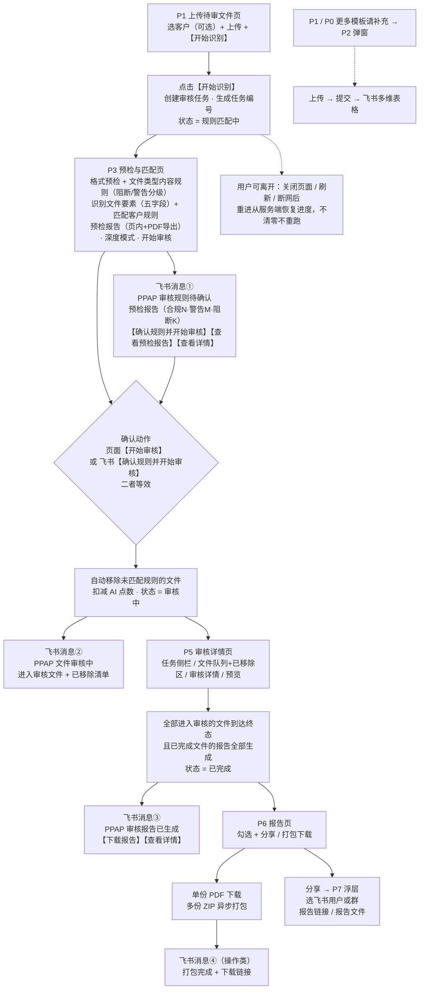

> 因单份文件审核耗时 20–30 分钟，**自创建任务起即为异步**：任务在服务端持续运行，用户可关闭页面；四个推进节点各发一条飞书消息召回。

### 2.3 审核任务状态机 `[确认]`

```
【前置：尚未创建任务】

用户上传文件（P1：选客户（可选）+ 本地拖拽 / 飞书云文档选择）
   ↓ 上传完成后点击【开始识别】
创建任务（生成 task_no，状态 = 规则匹配中）──> 进入 P3 预检与匹配页
   ↓ 自动执行（格式预检 + 识别文件要素 + 匹配客户规则，异步、可离开 / 重进）
预检结果（P3：合规 / 警告 / 阻断 分区 + 识别五字段 + 匹配规则 + 预检报告 + 深度模式开关）
   ↓ 勾选本次送审文件且确认无未移除阻断级，点击【开始审核】
──────────────── 以下为正式审核生命周期 ────────────────

[规则匹配中]  ── 三类检查完成 ──>  [规则待确认]  ── 无超时机制，等待创建人确认
                                                    │
            确认动作：页面【开始审核】 或 飞书【确认规则并开始审核】（二者等效，谁先点谁生效）
            · 自动移除所有未匹配规则的文件
            · 按剩余已匹配文件数扣减 AI 点数
                                                    ↓
            [审核中] ── 全部进入审核的文件到达终态（审核完成 / 审核异常）
            且 已完成文件的报告全部生成 ──> [已完成]
```

| 规则       | 说明                                                                                                                                  |
| -------- | ----------------------------------------------------------------------------------------------------------------------------------- |
| **前置步骤** | 用户在 P1 上传文件并点击【开始识别】创建任务 → 自动进入 P3 预检与匹配页（格式级 + 文件类型内容规则级预检 + 识别要素 + 匹配规则，结果分阻断 / 警告）→ 勾选本次送审文件并确定深度模式 → 点击【开始审核】。任务已于【开始识别】时创建，用户可增删文件、放弃或返回上一步                                                |
| 状态全集     | **仅四态**：`规则匹配中` / `规则待确认` / `审核中` / `已完成`；**不设「失败 / 部分失败」态** `[确认]`                                                                 |
| 创建时机     | 用户点击【开始识别】（不是上传时；上传只做预检） `[确认]`                                                                                                    |
| 完成条件     | 任务内**全部进入审核的文件到达终态**（`审核完成` 或 `审核异常`）**且**其中「审核完成」的每一份文件报告生成结束 → 转「已完成」。**存在异常文件不阻塞任务完成** `[确认]`                                    |
| 确认权限     | **仅任务创建人可确认** `[确认]`；非创建人点击按钮不可用（置灰）+ 提示「仅任务创建人可确认」                                                                                 |
| 超时       | **不设超时机制**，用户长期不确认则任务停留在「规则待确认」 `[确认]`                                                                                              |
| 单文件审核异常  | 该文件状态展示为「**异常**」（枚举 `review_failed`），**不生成报告**；其余文件照常审核出报告；全部文件到达终态且已完成文件报告齐 → **任务转「已完成」**；**不提供重试、不提供移除** `[确认]`；需重审则重新提交该文件发起新任务 |
| 零送审完成    | 确认时送审集合为空（全为未匹配自动移除 / 全取消勾选） | 任务**不进入 P5 审核、不生成审核报告**，直接转「已完成」，发送「本次任务无送审文件，未产生审核费用」飞书通知（见 §2.6 / FR-11 ④）；**不触发消息 ②/③** | 任务完成页 / 列表，无 P5 审核队列 |

### 2.4 待审文件状态机 `[确认]`

```
上传成功 ──预检（格式+内容规则）──> [可审核] ──开始识别（并行）──> 识别完成
    │                                                │
    │                                          [已匹配] / [未匹配] ──移除──> 结束
    └──预检阻断级──> [阻断级] ──一键移除──> 结束          │
                    确认动作（页面【开始审核】/ 飞书消息）→ 自动移除未匹配 + 开始审核
                                                      │
                        ┌─────────────────────────────┼─────────────────────────┐
                  [排队中 waiting]                [审核中 running]         （排队中的文件可移出队列）
                        └─────────────────────────────┼─────────────────────────┘
                                          项级进度 item_done/item_total 逐条回流
                                                      │
                                 ┌───────────────────┼───────────────────┐
                           [审核完成]           [审核异常]          （不提供重试、不提供移除）
                                │                    │
                                │              不生成报告；不阻塞任务完成；不计入已移除文件区
                                │
                        [报告生成中 generating]
                                │
                    ┌────────────┼────────────────┐
             [报告就绪 ready]  [生成失败 failed]  （仅重生成报告，不重跑审核）
                    │
        可查看 / 可下载 / 可分享（全部完成且报告齐后「查看报告」可点）
```

**状态枚举（任务级）**：任务顶层状态仅四态 —— `规则匹配中` / `规则待确认` / `审核中` / `已完成`（定义见 2.3）；文件级与报告级状态（已匹配 / 未匹配、排队中 / 审核中 / 审核完成 / 审核异常、报告生成中 / 就绪 / 失败等）见本文件状态机与 DM-02，不在任务级链中重复列出。
> 注：预检的「阻断 / 警告」分级与识别匹配的「已匹配 / 未匹配」均为 P3 预检与匹配页内的结果呈现与计费依据，不再作为独立任务状态；任务顶层状态仅 `规则匹配中` / `规则待确认` / `审核中` / `已完成` 四态。

**「审核异常」枚举值 `review_failed`，用户侧文案统一展示为「异常」**（禁止出现「失败」字样）`[确认]`。
**预检分级**`[确认]`：预检结果分两级（阻断 / 警告）——① **阻断级**：格式异常（加密 / 不支持格式 / 扫描件 / 损坏 / 超大小）或文件类型已识别但缺失核心结构 / 必填字段（如控制计划无工序行、尺寸报告无实测列），归入异常区，【开始审核】置灰，须移除或修正；② **警告级**：核心结构完整但疑似不完整（如严重度列大量为空）或疑似非最新版本，标黄警告但仍可勾选送审，用户自行承担。预检不影响计费（免费）。

### 2.5 规则匹配机制 `[确认]`

```
提取文件基本信息（客户名称 / 车型 / 零件号 / 零件名称 / 文件类型）
   ↓
按「每文件独立确定归属客户」——同一任务可含多客户文件，各按其自身归属匹配各自客户规则：
① 文件自身识别客户（高置信）→ 最高优先，即使与 P1 指定不一致也以文件为准
② 文件自身未识别客户 → 尝试模板库匹配：将文件结构 / 版式与各客户模板比对
      · 唯一高置信匹配 → 自动采用该客户，标注「模板推断」
      · 多候选高置信匹配 → 不自动判定，收窄「多项选择」候选集
③ 仍无唯一结果 → 取 P1 指定的「本批默认客户」作兜底，直接匹配其规则
④ 以上均无唯一结果（未设 P1 默认 或 兜底后仍无命中）→ 进入「多项选择」：
      列出候选客户的候选规则供点选，并可切到 IL-02.17 手动指定（客户, 文件类型）
   ↓
按（归属客户 × 文件类型）命中该客户「生效中」规则
   命中 → 状态 = 已匹配，展示 规则名称 + 归属客户（含「模板推断」标注）
   未命中 → 状态 = 未匹配，拆「无规则覆盖 / 识别失败」两态（见提示行 B 与 IL-02.17 / IL-02.18），展示对应提示行
           （含「多项选择」/「手动指定」入口）+ 支持提前手动移除（无二次弹窗、无锁定态）
   确认动作（页面【开始审核】或飞书【确认规则并开始审核】）→ 自动移除所有未匹配文件
   仅对剩余「已匹配」的文件开始审核并结算点数
```

| 口径     | 说明                                                                           |
| ------ | ---------------------------------------------------------------------------- |
| 客户下拉语义 | P1 客户 = **本批默认客户 / 批量归属偏好（兜底，非过滤条件）**；不强制单客户，支持同一任务含多客户文件、各按其自身归属客户独立匹配；文件自身识别出的客户优先级高于 P1 默认（见确定链 ①） `[确认]` |
| 客户识别信号 | 归属客户的确定分三级信号：① 文件自身识别（最高优先）② **模板库匹配（首选辅助信号）**——将文件结构 / 版式与模板库各客户模板比对，唯一高置信自动采用并标注「模板推断」、多候选则收窄多项选择候选集 ③ P1 本批默认客户兜底；以此缓解「文件本身无法提取客户信息」时的误判 `[确认]` |
| 多项选择状态 | 当文件无法唯一确定归属客户（①②③ 均无唯一结果）时，进入「多项选择」：列出候选客户的候选规则供用户点选，并可切换到 IL-02.17 手动指定（客户, 文件类型）；多项选择是「识别失败」的优先解决路径，手动指定为其并行可选路径 `[确认]` |
| 匹配结果表达 | 仅「**已匹配 / 未匹配**」二态，**不展示置信度徽章与分值** `[确认]`；未匹配内部再分「无规则覆盖 / 识别失败」两子类，分别给文案与出路（见提示行 B 与 IL-02.17）；「多项选择」为识别失败子类下的用户解决视图，非独立第三态 |
| 审核依据锚点 | 仅**客户专属模板 / 规则**；产品中不出现 IATF 16949 / AIAG 等通用标准条款兜底概念与条款编号 `[确认]`            |
| 未命中的含义 | 该客户的规则库中**没有覆盖该文件类型**（或规则未生效）；用户出路为「标准模板」→ 模板库 P0 / 「反馈对应模板」→ P2 补充模板 / 手动移除 |

**模板库匹配作为客户识别辅助信号（首选辅助信号）** `[确认]`：

- **匹配对象**：模板库中各客户的已生效模板（P0）。
- **作用时机**：文件自身未能识别出客户（`recognized_customer` 为 `—`）时触发；文件自身已识别客户的，以文件为准，不再用模板匹配覆盖（避免误改写已识别归属）。
- **行为**：
  - 将文件结构 / 版式与模板库各客户模板比对；
  - **唯一高置信匹配** → 自动采用该客户，文件行标注「模板推断 · 客户X」，并直接按该客户规则匹配（无需用户再选）；
  - **多候选高置信匹配** → 不自动判定，将候选客户收窄到「多项选择」列表，降低误选；
  - 置信度不足（无高置信匹配）→ 不采用，进入 P1 兜底 / 多项选择 / 手动指定。
- **产品表达**：模板匹配结果仅作为「客户识别辅助信号」，不替代文件自身识别；采用时明确标注来源，用户可覆盖（切换客户 / 手动指定）。
- **不写算法**：相似度计算、置信度阈值等属技术实现，本文档仅描述上述产品行为。

### 2.6 通知机制

任务推进的关键节点**共 4 个**（① 识别完成 ② 确认动作 ③ 全部完成 ④ 无送审文件），各发一条消息卡片；ZIP 打包完成为**操作触发类**通知（非推进节点）：

| # | 触发节点                        | 消息标题             | 内容要点                                                           | 按钮                |
| - | --------------------------- | ---------------- | -------------------------------------------------------------- | ----------------- |
| ① | 识别完成                        | **PPAP 审核规则待确认** | 任务编号、预检报告（合规 N · 警告 M · 阻断 K）、已匹配 N 份、待移除 M 份；预检报告可查看/下载 | 【确认规则并开始审核】【查看预检报告】【查看详情】 |
| ② | 确认动作（确认即审核开始）               | **PPAP 文件审核中**   | 进入审核的文件清单与详情 + **已移除文件清单（文件名 + 移除原因）** + 预计耗时                  | 【查看详情】            |
| ③ | 全部进入审核的文件到达终态且已完成文件的报告全部生成  | **PPAP 审核报告已生成** | PASS / NG 摘要 + 各报告名称列表；**若存在审核异常的文件，追加一行「另有 N 份文件审核异常，未生成报告」** | 【下载报告】【查看详情】      |
| ④ | 确认时送审集合为空（全为未匹配自动移除 / 全取消勾选） | **本次任务无送审文件**   | 任务编号 + 「本次任务无送审文件，未产生审核费用」；任务直接转「已完成」、不进入 P5 审核、不生成审核报告 | 【查看详情】            |
| — | ZIP 打包完成（**操作触发类**，非任务推进节点） | 报告打包完成           | 下载链接                                                           | 【下载】 `[确认]`       |

### 2.7 视觉与文案规范 `[确认]`

| 类别    | 规范                                                                                                 |
| ----- | -------------------------------------------------------------------------------------------------- |
| 色值    | PASS / 正常 = 绿色；NG / 异常 = 红色；警示 / 提示 = 黄色（琥珀）；不支持 / 禁用 = 灰色                                         |
| 文案    | 界面文案以设计图原文为准，逐字一致，不得改写或简化；本文档加粗引号内文案均为设计图原文                                                        |
| 进度真实性 | 进度只用真实完成计数（份 / 项）；**禁止按时间估算的百分比进度条、禁止进度回退**；任何 loading 必须伴随含真实对象名（文件名 / 审核项名）的文字，**禁止「请稍候」类无信息文案** |

---

### 2.8 页面跳转矩阵 `[确认]`

> 本表为**全产品页面跳转的唯一口径**。任何跳转不在表内的，需产品确认后补入，实现方不得自行新增。

| 编号    | 起点页面 / 位置      | 触发元素                         | 目标页面 / 位置           | 前置条件                | 返回路径             | 异常拦截                            |
| ----- | -------------- | ---------------------------- | ------------------- | ------------------- | ---------------- | ------------------------------- |
| JP-01 | 全局 · 左侧导航      | 「PPAP Audit」（默认菜单项 / 顶部应用标识） | P1 上传待审文件页          | 无                   | —                | 登录态失效 → 走 EA-02                 |
| JP-02 | 全局 · 左侧导航      | 「模板库」                        | P0 模板库页             | 无                   | —                | 同上                              |
| JP-03 | 全局 · 左侧导航      | 「用量记录」                       | P8 用量记录页            | 无                   | —                | 同上                              |
| JP-04 | 全局 · 页脚 / 帮助   | 「联系我们」                       | 联系我们浮层              | 无                   | 关闭浮层回原页面         | —                               |
| JP-05 | P1             | 【开始识别】（上传完成且 ≥1 文件）          | P3 预检与匹配页           | 至少 1 个文件进入上传队列      | 返回 P1（重新选客户/加文件） | 全部文件不可审 → 停留 P3 空态，见 FR-02      |
| JP-06 | P3 · 未匹配提示行    | 「标准模板」                       | P0 模板库页             | 无                   | 浏览器返回 / 导航回 P3   | 当前任务保持「规则匹配中」，返回后进度不丢           |
| JP-07 | P3 · 未匹配提示行    | 「反馈对应模板」                     | P2 补充模板弹窗           | 无                   | 关闭弹窗回 P3         | —                               |
| JP-08 | 飞书消息 ①         | 【查看预检报告】                   | 任务处于「规则待确认」→ P3 预检与匹配页（预检报告区可重下留存 PDF）；任务已离开规则待确认 → P10 文件审核详情对应历史版本（预检报告按版本可追溯） | 任务存在留存预检报告 | 浏览器返回 / 导航回来源 | 该任务无留存预检报告（极端缺失）→ 提示「暂无可追溯预检报告」 |
| JP-09 | P3 · 规则匹配中    | 三类检查完成（自动 / 刷新 / 重进恢复）       | P3 · 规则待确认          | 三类检查完成              | —                | 识别异常 → 见 FR-02 边界项              |
| JP-10 | P3 · 规则待确认    | 【开始审核】                       | P5 审核详情页            | 无未解决的硬阻断（B01/B02/B04/B05/B06） | —                | **存在未解决硬阻断才禁用**；已匹配 0 但其余可自动移除 / 全取消勾选 → 允许 0 点完成（不禁用）；非任务创建人 → 见 FR-02 **[V3.6·Q-03]** |
| JP-11 | P3 · 规则待确认    | 单文件「移除」                      | 停留 P3 预检与匹配页       | 无                   | 可撤销（本次会话内）       | —                               |
| JP-12 | P5 · 文件队列      | 点击某文件卡片                      | 停留 P5（审核详情列切换）      | 该文件已进入审核            | —                | 文件为「异常」→ 详情列展示异常说明，不进审核         |
| JP-13 | P5             | 【查看报告】                       | P6 报告页              | 至少 1 份报告已生成         | 浏览器返回 / 导航回 P5   | 报告 0 份 → 入口禁用                   |
| JP-14 | P5 · 预览列       | 点击文件 / 缩略图                   | 停留 P5（预览列切换）        | 文件可预览               | —                | 不支持预览 → 见 FR-15                 |
| JP-15 | P6             | 【分享】                         | P7 分享浮层             | 勾选 ≥ 1 份已就绪报告       | 关闭浮层回 P6         | 勾选 0 → 按钮禁用                     |
| JP-16 | P6             | 【下载】                         | 单份直接下载 / 多份异步打包     | 勾选 ≥ 1 份已就绪报告       | —                | 含未就绪报告 → 该份不可勾选                 |
| JP-17 | P0             | 「更多模板请补充」                    | P2 补充模板弹窗           | 无                   | 关闭弹窗回 P0         | —                               |
| JP-18 | P0 · 模板清单      | 点击模板名称                       | P0 · 单份模板预览态        | 无                   | 关闭预览回清单          | —                               |
| JP-19 | P0             | 「修改权限」                       | 修改文件夹权限浮层           | 操作人 = 模板所在文件夹创建人    | 关闭浮层回 P0         | 非创建人 → 入口不展示                    |
| JP-20 | 任务侧栏           | 点击某任务项                       | 该任务当前阶段对应页面         | 无                   | —                | 任务已被清理 → 列表不展示该项                |
| JP-21 | 计费提示条          | 「联系管理员」                      | 联系我们浮层              | 计费异常态               | 关闭浮层回原页面         | —                               |
| JP-22 | 飞书消息 ①         | 【确认规则并开始审核】                  | P3 · 规则待确认         | 任务处于「规则待确认」         | —                | 任务已被确认 → 提示「该任务已开始审核」           |
| JP-23 | 飞书消息 ① / ②     | 【查看详情】                       | P3 / P5（按任务当前状态）    | 无                   | —                | —                               |
| JP-24 | 飞书消息 ③         | 【下载报告】                       | P6 报告页              | 无                   | —                | —                               |
| JP-25 | 飞书消息 ④         | 下载链接                         | ZIP 下载              | 打包完成                | —                | —                               |
| JP-26 | 全局 · 左侧导航      | 「审核文件」                       | P9 审核文件列表页          | 无                   | 导航回原页面           | 登录态失效 → 走 EA-02                 |
| JP-27 | P9 · 列表行       | 「查看详情」                       | P10 文件审核详情页         | 该 doc ID 存在历史版本     | 浏览器返回 / 导航回 P9   | 文档不存在 → EA-06                   |
| JP-28 | P9 · 勾选 + 批量下载 | 单文件 / 多文件                    | 单份直接下载 / 多份异步打包 ZIP | 勾选 ≥ 1 份已就绪报告       | —                | 含未就绪报告 → 该份不可勾选                 |
| JP-29 | P10 · 历史版本     | 点击某版本                        | 停留 P10（切换版本）        | 该版本存在               | —                | 版本定位失败 → 提示并回退默认版本              |
| JP-30 | P10 · 顶部       | 「查看报告」                       | P11 报告预览页           | 该版本已生成报告（PASS / NG） | 浏览器返回 / 导航回 P10  | 审核中/异常未出报告 → 入口禁用               |
| JP-31 | P11 · 分享       | 「分享」                         | P7 分享浮层（限飞书组织内）     | 报告已就绪               | 关闭浮层回 P11        | 勾选 0 → 按钮禁用                     |
| JP-32 | P11 · 下载       | 「下载报告」                       | 单份 PDF 直接下载         | 报告已就绪               | —                | 未就绪 → 入口禁用                      |
| JP-33 | P8 · 用量流水      | 「查看详情」                       | P8 子页面（用量详情，定位对应版本） | 记录存在                | 浏览器返回 / 导航回 P8   | 记录不存在 → EA-06                   |
| JP-34 | 全局 · 左侧导航      | 「规则库」                         | P12 规则库页            | 无                   | —                | 登录态失效 → 走 EA-02                 |

### 2.9 通用交互规范 `[确认]`

> 本节为**全产品所有页面统一遵守**的交互基线。功能模块章节中未特别声明的，一律按本节执行；模块内有明确相反约定的，以模块为准。

#### 9.1 按钮五态

| 状态  | 视觉             | 可点击 | 说明                                        |
| --- | -------------- | --- | ----------------------------------------- |
| 默认  | 主色实心           | 是   | 条件满足                                      |
| 悬停  | 主色加深           | 是   | 桌面端生效                                     |
| 按下  | 主色再加深          | 是   | 触摸/点击瞬间                                   |
| 加载中 | 按钮内转圈 + 文案保持原义 | 否   | **文案不得变为「请稍候」**；加载时长 > 3s 需在按钮下方补一行真实对象说明 |
| 禁用  | 灰底灰字           | 否   | **必须可通过悬浮提示或相邻说明获知禁用原因**，禁止「灰着不给理由」       |

#### 9.2 空状态

- 任何列表 / 区域在**无数据**时必须展示空态，不得留白或只显示表头。
- 空态三要素：**插图（或留白区）+ 一句话说明「为什么是空的」+ 一个可执行出路**（按钮或链接）。
- 空态分为两类：**初始空态**（还没做过任何操作，给引导动作）与**结果空态**（搜索/筛选无结果，给「清空条件」出路），文案不同。

#### 9.3 加载状态

| 场景         | 规范                                             |
| ---------- | ---------------------------------------------- |
| 首屏 / 整页    | 骨架屏优先；超过 3s 补文字说明**正在加载的真实对象**（如「正在加载模板库」）     |
| 列表刷新       | 保留旧数据 + 顶部细进度条，**禁止整屏白屏**                      |
| 局部（卡片 / 列） | 就地 loading，不遮挡其他可操作区域                          |
| 长耗时异步      | 一律转为**可离开的异步任务**（见 FR-09），不得以 loading 阻塞用户等待   |
| 禁止         | **禁止按时间估算的百分比进度条、禁止进度回退、禁止「请稍候 / 加载中…」类无信息文案** |

#### 9.4 错误状态

| 层级   | 表现                        | 适用           |
| ---- | ------------------------- | ------------ |
| 行内错误 | 字段下方红色说明，输入区红框            | 表单校验         |
| 区域错误 | 区域内置换为错误态（图标 + 说明 + 【重试】） | 列表 / 卡片区加载失败 |
| 整页错误 | 整页错误态 + 【重试】 + 【返回】       | 页面级数据拉取失败    |
| 全局提示 | Toast                     | 操作失败但页面数据仍可用 |

- **错误文案三要素**：① 发生了什么 ② 为什么（可简述）③ 用户下一步能做什么。三者缺一不可。
- 错误文案**面向用户**，禁止输出错误码、堆栈、接口名；错误码写入日志与埋点。

#### 9.5 Toast 提示

| 类型   | 时长        | 位置     | 适用              |
| ---- | --------- | ------ | --------------- |
| 成功   | 2s 后自动消失  | 页面顶部居中 | 保存 / 提交 / 发送成功  |
| 普通信息 | 3s 后自动消失  | 页面顶部居中 | 状态变更提示          |
| 警告   | 4s 后自动消失  | 页面顶部居中 | 部分成功、可继续但需注意    |
| 错误   | **不自动消失** | 页面顶部居中 | 需用户处理后手动关闭或页面跳转 |

- 同一时刻**最多叠加 3 条**，超出时移除最早一条。
- 错误类 Toast 需带【重试】或【关闭】；同一动作的重复错误**不得刷屏**，1s 内相同文案只出一条。

#### 9.6 二次确认弹窗

**必须二次确认的动作**（破坏性 / 不可逆 / 跨系统影响）：移除已匹配文件、确认规则并开始审核（涉及扣费）、清空上传队列、放弃未提交编辑、取消进行中任务、删除类操作。

- 弹窗结构：标题（动宾短语）+ 影响说明（**明确点出数量与后果**，如「将移除 3 个文件，任务不再审核这些文件」）+ 取消 / 确认双按钮。
- 默认焦点在「取消」，**破坏性操作的确认按钮为警示色**。
- 确认后按钮立即置为加载中并禁用，防重复提交。

#### 9.7 浮层与弹窗

| 项     | 规范                                             |
| ----- | ---------------------------------------------- |
| 打开方式  | 遮罩层 + 居中弹窗（P2 / P7 / 联系我们）；右侧抽屉（预览、详情补充）       |
| 关闭方式  | 右上关闭、【取消】、点遮罩（**表单已填写内容时禁止点遮罩关闭，避免误触丢数据**）、ESC |
| 层级    | 后开的浮层在上；浮层内的 Toast 层级高于浮层                      |
| 滚动锁定  | 浮层打开时锁定背景滚动，关闭后恢复                              |
| 返回键   | 移动端 / 浏览器返回键关闭最上层浮层，不直接离开页面                    |
| 数据未保存 | 关闭时若有未保存内容，二次确认「放弃修改？」                         |

#### 9.8 列表与分页

| 项      | 规范                                   |
| ------ | ------------------------------------ |
| 默认排序   | 按业务主序（任务：创建时间倒序；模板：更新时间倒序；报告：对应文件顺序） |
| 分页     | 每页 10 条；页码 + 上一页 / 下一页；总数超过一页才展示分页器  |
| 翻页     | 保持筛选与搜索条件；回到列表顶部                     |
| 长列表    | 超过 100 条时采用滚动加载，加载中底部展示 loading      |
| 勾选状态保持 | 跨页勾选需保留并展示「已选 N 项」；切换筛选条件时清空勾选并提示    |
| 无数据    | 走 9.2 空状态                            |

#### 9.9 搜索

| 项    | 规范                           |
| ---- | ---------------------------- |
| 触发   | 输入即搜需 **300ms 防抖**；回车立即搜     |
| 清空   | 输入框内置清空按钮，清空后立即恢复全量          |
| 无结果  | 展示结果空态 + 【清空条件】              |
| 高亮   | 命中关键词在结果中高亮                  |
| 大小写  | 不区分大小写                       |
| 特殊字符 | 输入纯空格视为空；超长输入（> 100 字符）截断并提示 |
| 请求竞态 | 后发请求覆盖先发结果，**禁止旧结果后到覆盖新结果**  |

#### 9.10 勾选与批量操作

| 项      | 规范                                     |
| ------ | -------------------------------------- |
| 全选     | 表头复选框控制**当前页/当前筛选结果**全选，悬浮提示说明范围       |
| 半选     | 部分选中时表头为半选态                            |
| 不可选项   | 复选框禁用 + 悬浮说明原因（如「报告未生成」），**禁用项不参与全选**  |
| 批量操作   | 操作栏随勾选数出现，展示「已选 N 项」；未勾选时按钮禁用          |
| 批量结果   | 部分成功时展示「成功 N 项，失败 M 项」并可展开失败清单，见 EA-07 |
| 批量二次确认 | 涉及移除 / 删除 / 扣费的批量操作走 9.6               |

#### 9.11 表单与输入校验

| 项    | 规范                              |
| ---- | ------------------------------- |
| 校验时机 | 失焦即校验；提交时全量校验并定位到第一个错误字段        |
| 必填   | 标签前置红色 *；未填提交时行内红字说明            |
| 格式   | 邮箱 / 手机号 / 网址按标准格式校验，错误给出**示例** |
| 长度   | 输入达上限时截断并提示「最多 N 个字符」           |
| 空格   | 提交前自动去除首尾空格；纯空格视为未填             |
| 保存中  | 提交按钮置加载中并禁用，防重复提交               |
| 失败回填 | 保存失败后**保留已填内容**，不得清空            |

#### 9.12 文本截断与悬浮展示

| 项       | 规范                                     |
| ------- | -------------------------------------- |
| 单行截断    | 超出容器宽度省略号，悬浮展示完整内容（Tooltip），最大宽度 360px |
| 多行截断    | 超过 2 行省略号，悬浮或点击「展开」查看完整内容              |
| 文件名     | 优先截断中段保留扩展名；悬浮展示完整文件名                  |
| 数字 / 金额 | 一律右对齐、千分位；**禁止截断**                     |
| 状态文案    | 完整展示，不截断                               |

#### 9.13 轮询与实时刷新

| 项    | 规范                                                           |
| ---- | ------------------------------------------------------------ |
| 轮询场景 | 审核进度、识别结果、打包任务状态、报告生成状态                                      |
| 间隔   | 默认 10s；页面不可见（`visibilitychange` 为 hidden）时**暂停轮询**，恢复可见立即补一次 |
| 停止条件 | 到终态（已完成 / 异常 / 失败）或离开页面即停止                                   |
| 失败退避 | 连续失败 3 次后间隔退避为 30s，仍失败则展示「连接异常」并提供【重试】                       |
| 数据合并 | 轮询返回增量更新，**禁止整表重绘导致勾选丢失 / 滚动跳位**                             |
| 一致性  | 客户端进度只呈现服务端真实计数，本地不做推算                                       |

#### 9.14 权限与身份

| 项     | 规范                                                 |
| ----- | -------------------------------------------------- |
| 无权限   | 不隐藏不可见即可控：优先**隐藏入口**；若入口为通用组件无法隐藏，则禁用 + 悬浮说明       |
| 越权访问  | 直接访问无权限页面 / 数据时，展示无权限页 + 【返回首页】，不展示数据骨架            |
| 操作人限制 | 「确认规则并开始审核」等操作限定任务创建人，非创建人禁用并说明原因（见 FR-02 / FR-09） |
| 创建人标识 | 任务、模板、提报记录均展示创建人，口径取自飞书账号                          |

#### 9.15 返回与离开

| 项       | 规范                                    |
| ------- | ------------------------------------- |
| 浏览器返回   | 按进入路径逐级返回；从浮层进入的先关浮层                  |
| 有未保存内容  | 触发离开时二次确认「放弃修改？」                      |
| 离开异步任务  | 审核 / 打包类异步任务允许自由离开，重进从服务端恢复（见 FR-09）  |
| 刷新      | 刷新后恢复到当前所在步骤与勾选状态；任务进度从服务端拉取          |
| 关闭标签页   | 不做拦截（除未保存表单外）；异步任务继续在服务端运行            |
| 任务进行中离开 | 离开前若任务在「规则待确认」，顶部提示「任务将在你确认后开始审核」，不阻断 |

### 2.10 通用异常与兜底规范 `[确认]`

> 本节为**技术类通用异常**的统一处理口径（业务类异常见各功能模块「边界与异常」列与「异常与兜底总表」）。本节未覆盖的技术异常，一律按 EA-09 兜底。

#### 异常信息三要素（强制）

所有面向用户的异常提示必须同时包含：**① 发生了什么**（结果）→ **② 为什么**（原因，可简述）→ **③ 怎么办**（用户可执行的下一步）。缺任一项视为不合格。

#### 异常清单

| 编号    | 异常场景                         | 系统行为                                     | 界面反馈                                                    | 用户出路                         |
| ----- | ---------------------------- | ---------------------------------------- | ------------------------------------------------------- | ---------------------------- |
| EA-01 | **网络异常 / 请求超时**              | 请求超时阈值 15s；失败后自动重试 1 次（仅幂等读请求），仍失败则抛出    | 区域级或页级错误态 + Toast「网络连接异常，请检查网络后重试」                      | 【重试】；恢复后自动补齐数据               |
| EA-02 | **登录态失效 / 鉴权过期**             | 接口返回鉴权失败即全局拦截，清空本地态                      | 全屏提示「登录状态已失效，请重新进入应用」+【重新进入】                            | 点击后走飞书免登重新鉴权，回到原页面           |
| EA-03 | **并发冲突**（他人已修改 / 任务状态已变更）    | 服务端返回冲突态，**以服务端为准**覆盖本地展示                | Toast「该任务状态已更新，已为你刷新为最新状态」                              | 自动刷新，无需操作；用户此前操作作废并明确告知      |
| EA-04 | **重复提交 / 幂等**                | 创建任务、确认审核、扣费、提交模板等写操作需幂等键（客户端生成一次，随请求携带） | 重复请求返回上一次结果，不重复扣费、不重复建任务                                | 无感；按钮置加载中禁用本身即为第一道防线         |
| EA-05 | **无权限**                      | 服务端鉴权拦截                                  | 入口隐藏或禁用 + 悬浮说明；越权访问走 9.14                               | 联系管理员开通                      |
| EA-06 | **资源不存在 / 已被删除**             | 任务 / 文件 / 报告 / 模板被删除或已过期                 | 进入时展示「内容不存在或已被删除」+【返回列表】                                | 返回上级列表并刷新                    |
| EA-07 | **部分成功**（批量操作中部分失败）          | 返回逐项结果，成功的生效、失败的回滚                       | 汇总 Toast「成功 N 项，失败 M 项」+ 可展开失败清单（含每项原因）                 | 对失败项单独重试                     |
| EA-08 | **上传失败**（网络中断 / 单文件超限 / 超限数） | 单个文件失败不影响其他文件；失败的置为「上传失败」并保留在队列          | 该文件行内红色原因 +【重试】/【移除】；顶部汇总「N 个文件上传失败」                    | 重试该文件；或移除后继续                 |
| EA-09 | **未知错误 / 服务异常**              | 兜底捕获，记录 `trace_id` 与埋点                   | 「操作未成功，请稍后重试」+ 展示 `trace_id`（可复制）                       | 【重试】；多次失败联系管理员并提供 `trace_id` |
| EA-10 | **AI 点数额度不足**（操作前 / 操作中）     | 操作前校验拦截；操作中（审核进行中）余额不足时不中断已扣除点数的文件       | 操作前：提示条 + 入口禁用（见 FR-10）；操作中：常驻提示条「AI 点数不足，剩余文件可能无法完成审核」 | 联系管理员充值；已扣除点数不退还             |

#### 通用约束

1. **禁止静默失败**：任何失败必须有可见反馈，禁止只在控制台报错。
2. **禁止丢失用户输入**：异常发生后，用户已输入 / 已勾选 / 已上传的内容必须保留。
3. **禁止重复扣费**：所有涉及计费的写接口必须幂等，以服务端扣费记录为准。
4. **异常不阻断无关功能**：单文件、单项、单区域异常不得导致整页不可用。
5. **异常可追溯**：未知错误必须产出 `trace_id` 并写入日志。
6. **异常文案统一**：同一场景的文案全产品一致，由本文档统一给定，实现方不得各写各的。

---

## 3. 功能模块详述


### 3.0 全局框架与公共组件（FR-00）

#### ① 功能描述

全局框架提供**导航、步骤定位、任务切换与计费拦截**四类公共能力，在多个页面中以同一组件复用：

| 子组件    | 作用                  | 出现位置                            |
| ------ | ------------------- | ------------------------------- |
| 左侧导航   | 菜单切换（PPAP Audit 为默认菜单项；背景蓝色 = 当前所在菜单） | 全站（**PPAP Audit** / **审核文件** / **模板库** / **规则库** / **用量记录** / **联系我们**） |
| 两步步骤条  | 标示当前处于审核流程哪一步       | P1 / P3                    |
| 返回页头   | 面包屑返回 + 页面级操作按钮     | P5 / P6                         |
| 审核任务侧栏 | 任务搜索 / 筛选 / 切换 / 新建 | P1 / P5                         |
| 计费提示条  | 计费异常时全局拦截或常驻提示      | P1（拦截）/ P5（常驻）                  |

> **导航层级说明**：左侧导航承载的是**菜单**（PPAP Audit / 审核文件 / 模板库 / 用量记录 / 联系我们），而非页面。其中 **PPAP Audit 菜单**展开后内部包含 P1 / P3 / P5 / P6 等子页面流转（由两步步骤条串联），P2（补充模板弹窗）、P7（分享浮层）为流程中的弹窗 / 浮层；模板库菜单对应 P0；审核文件菜单对应 P9 / P10 / P11；用量记录菜单对应 P8。上表「出现位置」列中的 Px 是指该公共组件**具体渲染于哪些页面**，不代表它们是导航项。

**边界**：不新增独立的「审核任务」页面或导航项；任务列表只以侧栏形式存在（内嵌于 PPAP Audit 菜单的 P1 / P5）。

优先级：**P0**

#### ② 效果图（占位）

| 图号         | 说明                             |
| ---------- | ------------------------------ |
| `IMG-G-01` | 全局框架总览（左侧导航 + 步骤条 + 任务侧栏 + 主区） |
| `IMG-G-02` | 审核任务侧栏（含新建、搜索、状态筛选、任务项三态）      |
| `IMG-G-03-01` | 计费提示条 ①「飞书AI包开关已关闭」             |
| `IMG-G-03-02` | 计费提示条 ②「试用额度不足，且未采购飞书AI包」      |
| `IMG-G-03-03` | 计费提示条 ③「飞书AI包额度不足」（审核中常驻）       |


#### ③ 页面逻辑

**3.0.1 左侧导航（220px）**

| 元素  | 规则                                                         |
| --- | ---------------------------------------------------------- |
| 顶部  | **PPAP Audit**（左侧导航菜单项之一；**背景蓝色表示当前处于该菜单**；点击进入其默认页 P1，应用打开即默认进入该页） |
| 菜单项 | **PPAP Audit**（默认菜单项，应用打开即进入其默认页 P1）/ **审核文件** / **模板库** / **规则库** / **用量记录** |
| 底部  | 「联系我们」按钮 + 折叠按钮（现有收起展开组件） `[沿用现有]`                         |

> 「PPAP Audit」是左侧导航中的菜单项之一（背景蓝色表示当前选中）。点击 PPAP Audit 进入其默认页——P1 上传待审文件页，应用打开即默认进入该页；其下的 P3（预检与匹配）/ P5（审核详情）/ P6（报告中心）为该菜单内的页面流转，由两步步骤条串联，**并非独立的顶层导航项**；P2（补充模板弹窗）、P7（分享浮层）为流程中的弹窗 / 浮层。「审核文件」「模板库」「用量记录」为其余独立菜单入口（分别进入 P9 / P0 / P8）。

**3.0.2 两步步骤条（P1 / P3 顶部）**

| 元素   | 规则                                                       |
| ---- | -------------------------------------------------------- |
| 文案   | `① 上传与检查确认 › ② AI 审核`                             |
| 状态   | 当前步骤高亮，已完成步骤打勾                                           |
| 对应关系 | P1 / P3 = ①（P1 上传 + P3 预检与匹配同属步骤①）；P5 = ②；P6 / P0 为独立页，**不展示步骤条**（用返回页头） |

**3.0.3 返回页头（60px，P5 / P6）**

| 元素 | 规则                                                 |
| -- | -------------------------------------------------- |
| 左侧 | `← 面包屑`：P5 = `PPAP Audit`；P6 = `PPAP Audit / 查看报告` |
| 右侧 | 页面级操作按钮区（各页按钮见对应模块）                                |

**3.0.4 审核任务侧栏（240px，P1 / P5 共用同一组件与数据源）**

| 元素   | 规则                                                                                        |
| ---- | ----------------------------------------------------------------------------------------- |
| 列表首项 | 「+ 新建审核任务」，**首次进入默认选中**，此时主区展示 P1 上传页                                                     |
| 搜索框  | 按**任务内文件名称**模糊搜索，命中即返回所属任务                                                                |
| 状态筛选 | 默认「全部任务」；可筛 `规则匹配中` / `规则待确认` / `审核中` / `已完成`                                             |
| 任务项  | 任务编号 + 状态 tag + **文件数**（= 任务内排队审核、未被移除的文件数 `[确认]`），展示文案「共 N 份文件」；**该数值随移除动作递减，不含任何已移除文件** |
| 当前任务 | 高亮                                                                                        |
| 数据范围 | **仅当前用户自己创建的任务** `[确认]`                                                                   |

**3.0.5 计费提示条**

| 位置               | 触发场景                     | 行为                                                                                       |
| ---------------- | ------------------------ | ---------------------------------------------------------------------------------------- |
| PPAP Audit 页（进入） | 飞书 AI 包开关未打开             | 提示条①常驻（「飞书AI包开关已关闭，请联系管理员在飞书管理后台启用或联系我们获取免费额度」），**创建审核任务入口禁用**（限制写操作，浏览/查看报告/用量查询保留）     |
| 点击「创建审核任务」（硬闸）   | 开关关闭 或 免费额度 + 飞书AI点数 ≤ 0 | 创建失败，展示对应提示条（开关关闭→①；额度均不足→②「提示：试用额度不足，且未采购飞书AI包，请联系管理员在飞书管理后台进行充值或联系我们获取免费额度」）；**不进入审核** |
| P5 审核页顶部         | 审核中待扣费 > 当前可用额度          | 提示条③**常驻整套任务审核全程**（「提示：飞书AI包额度不足，本次消耗将于充值后自动扣费，请联系管理员或联系我们获取免费额度」），**审核流程不中断**           |

#### ④ 交互逻辑

| 编号       | 触发                                | 系统行为               | 界面反馈                                                                    | 边界与异常                                 |
| -------- | --------------------------------- | ------------------ | ----------------------------------------------------------------------- | ------------------------------------- |
| IL-00.01 | 点击左侧导航「审核文件」                      | 进入审核文件列表页          | 进入 P9（默认「全部文件」，展示已审核文件档案）                                               | —                                     |
| IL-00.02 | 点击左侧导航「模板库」                       | 加载模板库数据            | 进入 P0 模板库页                                                              | —                                     |
| IL-00.03 | 点击左侧导航「用量记录」                      | —                  | 沿用现有页面 `[沿用现有]`                                                         | —                                     |
| IL-00.04 | 点击底部「联系我们」                        | —                  | 沿用现有行为 `[沿用现有]`                                                         | —                                     |
| IL-00.05 | 点击折叠按钮                            | 收起 / 展开左侧导航        | 主区自适应宽度                                                                 | —                                     |
| IL-00.06 | 侧栏点击「+ 新建审核任务」                    | 清空当前任务选中态          | 主区切换到 P1 上传页（空态）                                                        | 已有任务不受影响                              |
| IL-00.07 | 侧栏搜索框输入关键词                        | 按任务内文件名模糊匹配，返回命中任务 | 列表实时过滤为命中任务                                                             | 无命中 → 展示空结果                           |
| IL-00.08 | 侧栏切换状态筛选                          | 按状态过滤任务列表          | 列表刷新                                                                    | 「已完成」任务同样可切换查看                        |
| IL-00.09 | 侧栏点击某任务项                          | 读取该任务状态            | 主区按状态落到对应页面：`规则匹配中` → P3 预检与匹配页（规则匹配中）；`规则待确认` → P3 预检与匹配页（规则待确认）；`审核中` / `已完成` → P5 `[确认]` | 任务不存在或已删除 → 回到新建态                     |
| IL-00.10 | P5 点击返回页头面包屑 `← PPAP Audit`       | —                  | 返回 P1（保留任务侧栏与选中态）                                                       | —                                     |
| IL-00.11 | P6 点击面包屑 `← PPAP Audit / 查看报告`    | —                  | 返回 P5（P6 只能从 P5 或飞书消息 ③ 进入）                                             | —                                     |
| IL-00.12 | PPAP Audit 页处于开关关闭 / 额度不足态时尝试创建任务 | 拦截创建动作             | 提示条常驻，创建入口禁用                                                            | 开通 / 充值后自动解锁                          |
| IL-00.13 | P5 审核中额度不足                        | **不中断审核**，记录欠费     | 顶部提示条③常驻至任务结束                                                           | 报告下载与分享**不受限**（限飞书组织内，见 FR-20） `[确认]` |
| IL-00.14 | 点击左侧导航「规则库」                      | 加载规则库数据            | 进入 **P12 规则库页**（按客户归集审核规则，FR-21）                                          | —                                     |

#### ⑤ 验收要点

左侧导航菜单齐全（PPAP Audit / 审核文件 / 模板库 / 规则库 / 用量记录 / 联系我们）且「联系我们 / 折叠」沿用现有；步骤条在 P1/P3 两态正确、P5/P6 不出现；任务侧栏在 P1/P5 为同一组件同一数据源，任务项文件数 = 排队未被移除数并随移除递减；计费提示条文案与线上完全一致。

---


### 3.1 PPAP Audit（默认菜单 · 文件提交与 AI 审核主流程）
#### FR-01 P1 上传待审文件页（步骤 ① 上传与检查）

##### ① 功能描述

审核流程的起点页：用户**可选地**指定**本批默认客户**（用于文件无法识别归属时按该客户兜底匹配其专属规则，不限制同批可含多客户文件），通过本地拖拽/点击上传或飞书云文档选择待审文件，系统提示可上传格式与预计耗时；上传完成后点击【开始识别】创建审核任务并进入 P3 预检与匹配页。

**边界**：

- 客户下拉 = **本批默认客户 / 批量归属偏好（兜底，非过滤条件）**，不选不阻断；支持同批上传多客户文件、各按其自身归属客户独立匹配（见 §2.5 确定链）；
- **图片不进入审核**，上传文案与枚举中均不含图片；
- 本页只做上传与提交；用户点击【开始识别】即创建审核任务（任务状态 = 规则匹配中），随后进入 P3 预检与匹配页；本页不单独做规则识别（识别与匹配在 P3 完成）。

优先级：**P0**

##### ② 效果图（占位）

| 图号          | 说明                                          |
| ----------- | ------------------------------------------- |
| `IMG-P1-01` | P1 上传待审文件页 · 初始态（含左侧导航、任务侧栏、客户下拉、上传区、时长预估行） |
| `IMG-P1-02` | P1 客户下拉展开态（客户列表）                            |
| `IMG-P1-03` | P1 从飞书云盘选择（文件选择器）                            |

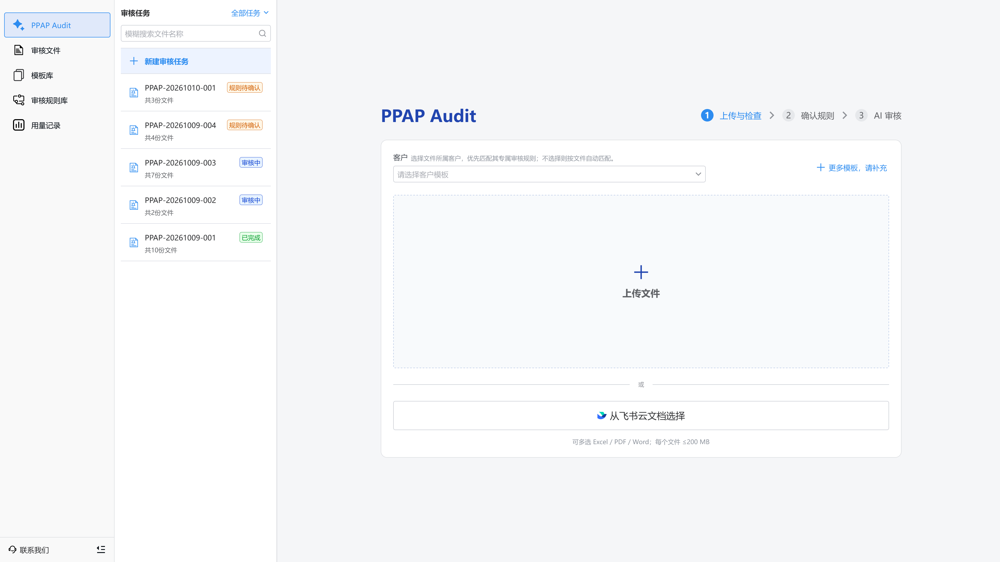


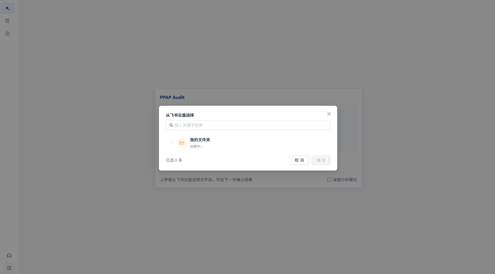

**界面结构（线框示意，最终以设计图为准）**

```
┌──────────┬────────────┬──────────────────────────────────────────────────────┐
│ 审核文件  │ 审核任务    │ PPAP Audit                                              │
│ 模板库    │ ┌────────┐ │ ① 上传与检查确认 › ② AI 审核                    │
│ 规则库    │ │🔍搜索文│ │                                                          │
│ 用量记录  │ │  件名称 │ │                                                          │
│          │ │  件名称 │ │ 客户                                                    │
│          │ └────────┘ │ 设置本批默认客户（文件无法识别归属时按此兜底匹配）；不设置则按文件  │
│          │ ┌────────┐ │ 自动匹配。                                               │
│          │ │全部任务▾│ │ ┌───────────────────────────┐      [+ 更多模板，请补充] │
│          │ └────────┘ │ │ 请选择客户模板         ▾ │                            │
│          │ ┌────────┐ │ └───────────────────────────┘                            │
│          │ │+ 新建审 │ │ ┌────────────────────────────────────────────────────┐ │
│          │ │ 核任务 ◄│ │ │                  ⬆ 上传文件                         │ │
│          │ ├────────┤ │ │             拖拽文件到此处，或点击上传                │ │
│          │ │PPAP-…04│ │ └──────────────────────────────────────────────────┘ │
│          │ │规则待确认│ │                          或                             │
│          │ │4 份文件 │ │ ┌──────────────────────────────────────────────────┐ │
│          │ ├────────┤ │ │             [飞书] 从飞书云文档选择                   │ │
│          │ │PPAP-…03│ │ └──────────────────────────────────────────────────┘ │
│          │ │审核中   │ │ 可多选 Excel / PDF / Word；每个文件 ≤200 MB              │
│          │ │3/8      │ │ ⓘ 已选 8 个文件，预计需要 X 小时 Y 分钟 ~ A 小时 B 分钟；│
│          │ ├────────┤ │   审核在后台进行，可关闭页面，完成后飞书通知你。          │
│          │ │PPAP-…02│ │                                                          │
│          │ │已完成   │ │                                                          │
│          │ └────────┘ │                                                          │
│          │            │                              【开始识别】                │
└──────────┴────────────┴────────────────────────────────────────────────────────┘
```

##### ③ 页面逻辑

| 元素               | 规则                                                                                                                                       |
| ---------------- | ---------------------------------------------------------------------------------------------------------------------------------------- |
| 步骤条              | 当前处于 **① 上传与检查**                                                                                                                         |
| **客户下拉**         | 标签「客户」+ 说明文案 **「设置本批默认客户：文件无法识别归属时按其规则匹配；不设置则按文件自动识别（支持同批多客户文件各自归属）。」** + 输入框 placeholder **「请选择客户模板（本批默认）」**；可选项 = 模板库「已生效」客户清单；**非必选、不阻断上传** `[确认]`；语义 = 本批默认客户（兜底，非过滤），不影响已识别文件归属 `[确认]`             |
| **「+ 更多模板，请补充」** | **位于客户行右侧**（带「新增」图标）→ 打开 P2 补充模板弹窗                                                                                                       |
| 上传区              | 拖拽 / 点击上传；主文案「上传文件」                                                                                                                      |
| 飞书入口             | 「或」分隔 + 「从飞书云文档选择」按钮 `[沿用现有]`                                                                                                            |
| **格式说明文案**       | **「可多选 Excel / PDF / Word；每个文件 ≤200 MB」** `[确认：不含图片]`                                                                                    |
| **时长预估行**        | 位于格式说明下方：`已选 N 个文件，预计需要 X 小时 Y 分钟 ~ A 小时 B 分钟；审核在后台进行，可关闭页面，完成后飞书通知你`。按「**勾选文件数 × 单份耗时区间（非深度模式基线，[开放] 值）**」估算，**宁高估**；**深度模式在 P3 才可选，P1 入口态不反映其勾选**，P3 勾选深度模式后实际耗时以 P3 / P5 真实进度为准 `[开放：非深度模式基线值]` |
| 审核任务侧栏           | 见 FR-00 3.0.4                                                                                                                            |
| 计费提示条            | 见 FR-00 3.0.5；拦截态下上传区不可用                                                                                                                 |
| **图片类**          | **不进入审核** `[确认]`：上传提示不含图片；若仍被上传（如从飞书云文档选择），在 P3 预检与匹配页归入阻断级区，原因文案「不支持格式；仅支持 Excel / PDF / Word 格式」                                           |
| **底部按钮【开始识别】** | 上传完成后出现在 P1 底部（右对齐）；点击 = 创建审核任务（生成 `task_no`、状态置 `规则匹配中`）并进入 P3 预检与匹配页；部分失败时成功文件仍进入 P3、失败文件提示后留上传区，按钮照常出现 `[确认]` |

##### ④ 交互逻辑

| 编号       | 触发              | 系统行为                      | 界面反馈                                    | 边界与异常                           |
| -------- | --------------- | ------------------------- | --------------------------------------- | ------------------------------- |
| IL-01.01 | 点击客户下拉          | 拉取模板库「已生效」客户清单            | 展开选项列表                                  | 无生效规则的客户**不出现在列表** `[确认]`       |
| IL-01.02 | 选中某客户           | 记录 `selected_customer_id`（**本批默认客户**，可空，作未识别文件归属兜底，**不强制单客户**） | 下拉回填客户名                                 | 可清空恢复「不选择」；同一任务后续仍可出现非该客户的识别归属文件                      |
| IL-01.03 | 拖拽文件到上传区 / 点击上传 | 逐个上传，实时返回进度               | 上传区展示已选文件与进度                            | 单文件 > 200MB → 上传失败并提示；该文件不进入 P3 |
| IL-01.04 | 点击「从飞书云文档选择」    | 唤起飞书文件选择器                 | 选中后回传文件与来源路径 `[沿用现有]`                   | 取消则无变化                          |
| IL-01.05 | 已选文件数变化         | 重算时长预估                    | 更新「已选 N 个文件，预计需要 X 小时 Y 分钟 ~ A 小时 B 分钟」 | 未选文件时不展示该行                      |
| IL-01.06 | 点击「+ 更多模板，请补充」  | —                         | 打开 P2 补充模板弹窗（初始态）                       | 与 P0 模板库入口等价，已选客户不清空            |
| IL-01.07 | **上传全部完成**      | 展示【开始识别】按钮（**不自动进入 P3**）              | P1 底部出现【开始识别】；点击创建审核任务（生成 `task_no`、状态置 `规则匹配中`）并进入 P3 预检与匹配页 `[确认]` | 部分失败时，成功文件进入 P3，失败文件提示后留在上传区    |
| IL-01.08 | 计费拦截态下尝试上传      | 拦截                        | 提示条常驻，上传区不可操作                           | 开通/充值后解锁                        |

##### ⑤ 验收要点

不选客户也能上传；「更多模板，请补充」位于客户行右侧且可打开 P2；格式文案不含图片；上传完成展示【开始识别】，点击创建任务并进入 P3；时长预估随文件数实时刷新。

---


#### FR-02 P3 预检与匹配页（格式预检 + 识别文件要素 + 匹配规则 + 预检报告）（步骤 ①）

##### ① 功能描述

用户在 **P1 上传页点击【开始识别】创建审核任务**（任务状态 = `规则匹配中`）后进入本页。系统在**同一页面内自动顺序执行三类免费检查**，并将结果统一呈现：

1. **格式级门禁 + 文件类型内容规则级预检**：沿用现有格式与可解析性检查（加密 / 不支持格式 / 扫描件 / 文件损坏 / 超大小），不通过即归**阻断区**；通过后再按「该客户 × 文件类型」对应的**预检分则**做**正确性 / 完整性 / 一致性**三维度检查（如控制计划须含严重度列与工序行、尺寸报告须含实测值列、材料清单须含供应商零件号列）。**预检分则先按文件实际归属客户（`effective_customer_id`）× 文件类型加载该客户专属分则，不再按文件类型通用生效、与 P1 是否选客户解耦**（P1 默认客户仅作未识别兜底；通用总纲如格式 / 可解析性仍与客户解耦）；内容级校验源为该客户审核规则的**必备结构 / 必填字段（required_structure）**，**模板无关**——不要求文件与固定模板一致，供应商按自身样式编制的文件亦可校验。用户侧不提供规则管理 UI（与审核规则同源、由规则运营维护）。预检框架详见附录 G · 预检规则体系；
2. **识别文件要素**：对每份文件提取 **五字段**（文件类型 / 客户名称 / 车型 / 零件号 / 零件名称），未识别显示 `—`；
3. **匹配客户规则**：按（客户 × 文件类型）命中「生效中」规则——已匹配展示《…评审逻辑》规则名称；未匹配拆「无规则覆盖 / 识别失败」两态（详见提示行 B 与 IL-02.17 / IL-02.18），分别提供「标准模板 / 反馈对应模板」（无规则覆盖）或「多项选择 / 手动指定」（识别失败）入口。

三类检查**全程免费**：不消耗任何 AI 点数、不产生计费订单；仅后续点击【开始审核】按「勾选且已匹配的文件数 × 500」计费（见 FR-10）。

**预检结果分两级（阻断 / 警告）**：

- **阻断级**：该问题导致至少一条审核规则**无法得出唯一结论**（含格式异常、缺失核心结构 / 必填字段、关键字段结构上不存在等），归入阻断区，**硬阻断送审**（【开始审核】置灰），须移除或修正后才能送审；
- **警告级**：判定仍可完成，但结果不完整或存在被误判风险（如严重度列大量为空、疑似非最新版本），标黄警告，**仍可勾选送审**（用户自行承担；警告项 100% 随预检报告移交正式审核，正式审核不得因预检通过而跳过）。

> 预检与正式审核的边界（与规则文件一致）：预检只回答「本批文件**能否被可靠审核**」，不回答「是否符合客户要求 / IATF 16949 / AIAG PPAP / 措施是否有效 / 数据是否真实」。判定证据仅限本批提交文件内可自证的事实（**证据封闭**），不引入外部历史；**只阻断、不拦截警告**；不评规则侧问题，不执行修复、补全与整改后复检。

**异步与召回**：三类检查在后台执行，本页展示「正在预检与识别要素、匹配审核规则」加载态（无需停留）；用户可关闭 / 刷新 / 断网后重进，按任务状态（`规则匹配中` → `规则待确认`）恢复进度、不清零不重跑；识别匹配完成后通过**飞书消息 ①**召回用户确认。任务状态含义：`规则匹配中` = 三类检查执行中；`规则待确认` = 检查完成、结果已呈现、等待用户点击【开始审核】。

**边界**：

- 本页**同时完成预检与识别 / 匹配**（原 P4 的客户规则匹配已并入本页，不再有独立的规则匹配页）；
- 预检、识别要素、匹配规则**全程免费**，不消耗点数、不产生订单；仅【开始审核】按「勾选且已匹配的文件数 × 500」计费；
- 取消勾选 = 该文件不进入本次审核；
- 警告级文件可勾选送审（override），阻断级文件须移除或修正后才能送审；
- 深度模式只是模型能力开关，不改变规则范围，也不改变点数；
- 预检规则覆盖以**文件类型字典（§1.5，核心 17 类 `T01`~`T17` + 扩展类 `E01`~`E12`）**为锚：**凡字典内且本期已提供审核规则的文件类型，预检复用其审核规则的 required_structure 做前置结构校验**（不重复编写独立预检分则）；仅「既无预检分则、也无审核规则 required_structure」者返回「未执行」（字典外且未提供规则的类型，按总纲 4.8 / 《PPAP-00-A》§5「范围外条目的行为（L3）」以「未匹配到规则」处理，记 `S02`）。**本期范围**见 《PPAP-00-A》§1 路由总表（已提供规则的 41 个客户 × 类型条目）。

优先级：**P0**（深度模式 **P1**）

##### ② 效果图（占位）

| 图号          | 说明                                   |
| ----------- | ------------------------------------ |
| `IMG-P3-01` | P3 预检与匹配页（预检分区（阻断 / 警告）+ 识别要素 + 匹配规则 + 预检报告区 + 深度模式 + 底栏按钮） |

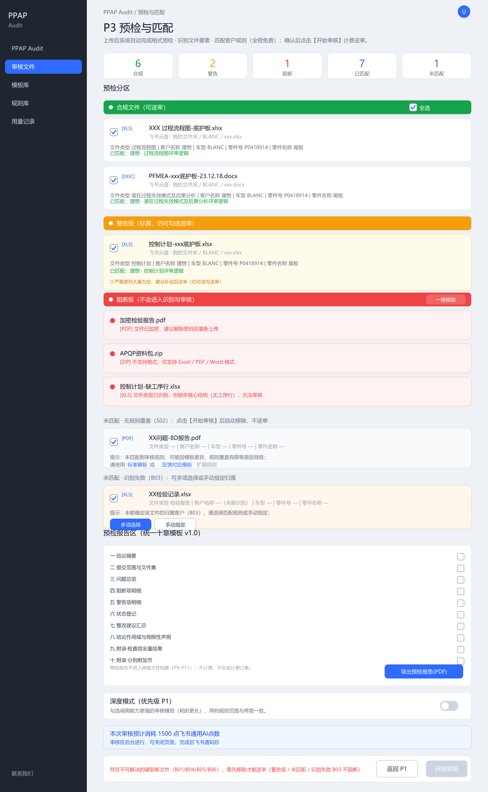

**界面结构（线框示意，最终以设计图为准）**

```
┌──────────────────────────────────────────────────────────────────────────┐
│ ① 上传与检查确认 › ② AI 审核                                               │
│ 预检与匹配       [N个合规 / M个警告 / K个阻断]  [J 份已匹配 / L 份未匹配]      │
│                                                                           │
│ ☑ ✅ 合规文件（可送审）                                                      │
│   ☑ [xls] XXX 过程流程图-底护板.xlsx                                        │
│       过程流程图 · 理想 · BLANC · P0418914 · 尾板  ✅ 理想 过程流程图评审逻辑    │
│   ☑ [doc] PFMEA-xxx底护板-23.12.18.docx                                    │
│       潜在过程失效模式及后果分析 · 理想 · ...  ✅ 理想 潜在过程失效模式及后果分析评审逻辑 │
│                                                                           │
│ ⚠️ 警告级（标黄，仍可勾选送审）                            [一键移除]    │
│   [!] 控制计划-xxx底护板.xlsx  ✅ 理想 控制计划评审逻辑                       │
│       严重度列大量为空，建议补全后送审（仍可选勾送审）                       │
│                                                                           │
│ ⛔ 阻断级（不会进入识别与审核）                             [一键移除]    │
│   [!] 加密检验报告.pdf  · 文件已加密，建议解除密码后重新上传                  │
│   [!] APQP资料包.zip     · 不支持格式；仅支持 Excel / PDF / Word 格式         │
│   [!] 控制计划-缺工序行.xlsx · 文件类型已识别，但缺失核心结构（无工序行），无法审核 │
│                                                                           │
│ [pdf] XX问题-8D报告.pdf  · — / — / — / — / —  ⚠ 未匹配到审核规则（无规则覆盖）    │
│       提示：未匹配到审核规则，可能因规则覆盖有限导致，请使用 标准模板 或 反馈对应模板 扩展规则 [移除]      │
│ [xls] 未知数据表.xlsx       · — / — / — / — / —  ⚠ 识别失败（未归属客户/类型）    │
│       提示：未能识别该文件的客户或文件类型，请 手动指定 后重试                 [移除]  │
│                                                                           │
│ 📄 预检报告（合规 N · 警告 M · 阻断 K）  [查看/下载预检报告(PDF)]              │
│ 本次审核预计消耗 J×500 点飞书通用AI点数   ⓘ 审核在后台进行，可关闭页面       │
│                                    ☑ 深度模式    [返回 P1] │              │
│                                                [开始审核] │              │
└──────────────────────────────────────────────────────────────────────────┘
```

> **等待态（任务状态 = `规则匹配中`）**：页面顶部展示「正在预检文件、识别要素、匹配审核规则」加载动画与「无需在当前界面停留，稍后将通过飞书消息通知您」，不展示上述结果区与底栏按钮；识别匹配完成后自动切换为上方结果态（任务状态 = `规则待确认`）。

##### ③ 页面逻辑

| 元素                         | 规则                                                                                                                                                                                                                                                                       |
| -------------------------- | ------------------------------------------------------------------------------------------------------------------------------------------------------------------------------------------------------------------------------------------------------------------------ |
| 标题                         | **「预检与匹配」** + tag **「N个合规 / M个警告 / K个阻断」**（N = 合规文件数，M = 警告级文件数，K = 阻断级文件数）+ 副 tag **「J 份已匹配 / L 份未匹配」**（J = 已匹配规则文件数，L = 未匹配文件数）                                                                                                                                                      |
| 合规区                       | 表头带**全选复选框** + 「✅ 合规文件（可送审）」；文件类型内容规则预检通过的文件；每行展示**识别出的五字段**（文件类型 / 客户名称 / 车型 / 零件号 / 零件名称）与**已匹配规则名称**（✅ 客户名称 + 《…评审逻辑》）                                                                                                                  |
| 警告级区                     | 表头「⚠️ 警告级（标黄，仍可勾选送审）」+ 副标题说明；文件行**默认仍勾选**，标黄高亮 + 警告原因；用户可取消勾选或仍勾选送审（override）；含已匹配规则名称                                                                                                                                                                                   |
| 阻断级区                     | 表头「⛔ 阻断级（不会进入识别与审核）」+ 副标题 **「以下文件不会进入识别与审核」** + 右侧「一键移除」；文件行展示阻断原因                                                                                                                                                                                   |
| 文件行                        | 复选框（**默认选中**）+ 格式图标（excel / word / pdf）+ 文件名 + 来源路径（如 `飞书云盘 · 我的文件夹 / XX车型 / xxx.xlsx`）；合规 / 警告级行附**识别五字段**与**已匹配规则**，未匹配行附**未匹配提示行**（见下）                                                                                                           |
| **阻断原因文案（逐文件显示具体原因，逐字一致）** | · **文件已加密** → 「**文件已加密，建议解除密码后重新上传**」<br />· **不支持格式（含 zip、图片等）** → 「**不支持格式；仅支持 Excel / PDF / Word 格式**」<br />· **扫描件 PDF** → 「**PDF 为纯扫描件且无法识别文字，建议提供可复制文本版本**」<br />· **文件损坏（无法解析）** → 「**文件已损坏，无法解析，请重新上传**」<br />· **超过大小限制** → 「**文件超过 200MB 上限，请拆分后上传**」<br />· **缺失核心结构 / 必填字段** → 「**文件类型已识别，但缺失核心结构（如：控制计划无工序行），无法审核**」（阻断，按文件类型预检规则给出具体缺失项） |
| **警告原因文案** | 核心结构完整但疑似不完整 / 非最新版本（如「**严重度列大量为空，建议补全后送审**」「**疑似非最新版本，请确认**」），标黄展示，不阻断送审                                                                                              |
| **识别字段**         | 合规 / 警告 / 未匹配文件行展示五列标签：**文件类型 / 客户名称 / 车型 / 零件号 / 零件名称**；**未识别出显示 `—`**                                                                                                                                                               |
| **匹配提示行（已匹配）**   | ✅ 图标 + **客户名称 + 规则名称**（规则命名形如《…评审逻辑》，如「过程流程图评审逻辑」「潜在过程失效模式及后果分析评审逻辑」「控制计划评审逻辑」）。**以规则实际名称为展示名，不显示版本号**；**归属来源标注**：当归属客户由模板匹配推断时，客户名称后附「**模板推断**」标识（`customer_determination_source = template_matched`），标识旁提供「**更改**」入口（见 IL-02.17），用户可覆盖其归属；文件自身识别（`file_extracted`）的归属同样允许经「更改」覆盖，但覆盖时若与新归属不一致弹「来源冲突」二次确认（仍允许覆盖，来源改 `manual`） **[V3.6·Q-05]**                                                                                                                |
| **提示行 A（缺比对文件）** | ⚠ **「提示：缺少比对文件《特殊特性清单》」** —— 预检阶段即按（**客户 × 零件号**）关联同批提交文件，提前识别缺比对文件并参与匹配；关联键（客户 / 零件号）缺失时提示用户补选、不直接判阻断 `[沿用现有关联口径，本次新增按客户×零件号前置关联]`                                                                                                                                                                  |
| **提示行 B（未匹配，拆两态）**   | 未匹配拆「**无规则覆盖**」与「**识别失败**」两态，分别给不同文案与出路 `[新增]`：<br />· **无规则覆盖 `S02`**（该客户 × 类型确实无审核规则）：⚠「提示：未匹配到审核规则，可能因规则覆盖有限导致，请使用 标准模板 或 反馈对应模板 扩展规则」；「**标准模板**」「**反馈对应模板**」为仅有的两个可点击入口（→ P0 / → P2），句末「扩展规则」为普通文案、不可点击。<br />· **识别失败 `B03`**（文件未能识别/归属客户或文件类型）：按确定链先尝试**模板库匹配**——唯一高置信 → 自动归属并标注「模板推断」；多候选或无可匹配 → 进入**「多项选择」**：⚠「提示：未能确定该文件的归属客户，请选择匹配规则或手动指定」；提供「**多项选择**」入口（展开候选客户及其候选规则列表，点选即按该客户规则重匹配；若经模板匹配，候选集已收窄到高置信客户）与「**手动指定**」入口（弹（客户, 文件类型）指定器，见 IL-02.17），二选一即可；若确为无法解析（B01）则归入阻断级。**确认时仍未解决的 `B03` 文件与 S02 同处理——自动移出审核队列、不计费，不卡死整批（整批门禁仅针对不可解决的硬阻断 B01/B02/B04/B05/B06）** `[V3.6·Q-01]` |
| **复选框语义** `[确认]`           | 合规区与警告级区每个文件带复选框，默认全选；**取消勾选 = 该文件不进入本次识别与审核**；点击【开始审核】时仅按勾选集合（合规 + 警告级中勾选的文件）开始审核。**取消勾选的已匹配文件 = 本任务「跳过」（不移除、不计费、不滞留于已移除区、不成为完成条件中的悬挂文件）；未匹配文件（S02 / 未解决 B03）在确认时统一「自动移除」（非跳过）——「自动移除」优先于「跳过」 `[V3.6·Q-03]`**                                                                                                                                    |
| **深度模式**                   | 底栏左侧复选框，标签 **「深度模式」**，**默认不勾选** `[确认]`；勾选 = 调用**能力更强的审核模型**（耗时更长，约 20–30 分钟/份），不勾 = 常规模型（更快）。**两档审核规则范围完全相同（均为全量审核项），界面呈现无差异，不提供升级入口**。**在场景 A（审核供应商提交文件）下，深度模式额外对弱匹配 / 低置信度文件尝试按通用结构做内容预检，并给出人工复核提示（不扩大审核规则范围）**                                                            |
| 单个移除                       | 每个文件行支持单独移除 `[沿用现有]`（合规 / 警告级 / 阻断级 / 未匹配均可）                                                                                                                                                                              |
| **预检报告区** `[新增]`           | 底栏上方常驻「📄 预检报告（合规 N · 警告 M · 阻断 K）」一行，点击「**查看/下载预检报告(PDF)**」重新拉取并下载该任务已**留存**的预检报告 PDF（预检完成时即生成并持久化于 `precheck_report_url`，不再临时生成）；报告内容 = 合规文件总览 + 警告级明细（原因 + 建议）+ 阻断级明细（原因），并给出整体送审就绪度。预检报告在预检完成时**持久化留存**，可在文件审核详情（P10）按历史版本追溯；**纠正归属/类型（IL-02.17/18 触发重匹配+重预检）后重新生成最新版 PDF，旧版按 doc ID 历史版本可追溯、不静默覆盖**；**不作为审核报告进入 P11 报告预览、不纳入 P9 列表统计**；不计费、不生成计费订单 `[V3.6·Q-04]`          |
| **点数预估**         | 底部文案 **「本次审核预计消耗 N 点飞书通用AI点数」**；**N = 当前勾选的已匹配文件数 × 500**，未匹配文件与取消勾选的已匹配文件均不计入 `[确认]`                                                                                                                                               |
| **后台运行提示行**      | 「ⓘ 审核在后台进行，可关闭页面，完成后飞书通知你」                                                                                                                                                                                            |
| 底栏               | 「返回 P1」/「开始审核」                                                                                                                                                                                                          |
| **「开始审核」可用性**    | **存在未移除的不可解决硬阻断级文件时置灰并提示** `[确认]`；硬阻断仅指 **B01（格式门禁/无法解析）+ B02（提交范围不可判）+ B04/B05/B06（内容/结构缺陷）** 中「未移除」者；**识别失败 `B03` 不卡死整批**（其有解决路径，确认时仍未解决则自动移除、不计费）。警告级文件不阻断。点击后：① 自动移除所有未匹配文件（记 `remove_stage = confirm`、`remove_reason = 未匹配到规则`）② 按剩余已匹配文件数扣减 AI 点数 ③ 全部已匹配文件进入审核队列 ④ 任务状态转「审核中」⑤ 立即转入 P5，发送**飞书消息 ②**；**存在未匹配文件（含未解决 B03）也可点击**（点击后自动移除未匹配）；若最终送审集合为空（全为未匹配自动移除 / 全取消勾选），则不进入 P5 审核、任务直接转「已完成」、发送「本次任务无送审文件，未产生审核费用」飞书通知（见 §2.6 / FR-11 ④）、不生成审核报告；**仅任务创建人可确认**，非创建人按钮置灰 + 提示「仅任务创建人可确认」 `[V3.6·Q-01·Q-03]` |

##### ④ 交互逻辑

| 编号       | 触发                | 系统行为                                                                                                                                            | 界面反馈                                            | 边界与异常                                     |
| -------- | ------------------- | ----------------------------------------------------------------------------------------------------------------------------------------------- | ----------------------------------------------- | ----------------------------------------- |
| IL-02.01 | 进入本页（P1【开始识别】后） | 对全部上传文件执行三类检查（格式级 + 文件类型内容规则级预检 + 识别要素 + 匹配规则），任务状态 `规则匹配中` | 展示「正在预检与识别要素、匹配审核规则」加载态（等待态） | 用户可离开；重进后按服务端状态恢复                  |
| IL-02.02 | 三类检查完成 | 落库预检结论（`precheck_level` / `precheck_findings` / `source_path`）+ 识别五字段 + 匹配结果；任务状态转 `规则待确认`；发送**飞书消息 ①**                                                                                                          | 加载态切换为结果态（合规区 / 警告级区 / 阻断级区 + 识别字段 + 匹配提示行 + 点数预估）                                  | 识别失败的文件按确定链（§2.5 / 提示行 B）处理，字段显示 `—`；先尝试**模板库匹配**（唯一高置信自动归属并标注「模板推断」），否则进入「多项选择」或经 IL-02.17 手动指定后重匹配            |
| IL-02.03 | 点击合规区 / 警告级区表头全选复选框     | 全选 / 全不选                                                                              | 同步所有行复选框                       | 取消全选后【开始审核】仍可用（仅阻断级才置灰）              |
| IL-02.04 | 取消勾选某可送审文件（合规或警告级）        | 标记 `selected = false`                                                                 | 该行复选框取消；该文件不进入审核               | 该文件不计费、不审核                 |
| IL-02.05 | 点击阻断级区「一键移除」       | 批量移除全部阻断级文件                                                                            | 阻断级区清空；标题 K 计数更新              | 移除后若无剩余阻断级，【开始审核】恢复可用              |
| IL-02.06 | 点击某文件行「移除」        | 移除单个文件（合规 / 警告级 / 阻断级 / 未匹配均可）                                                                    | 该行消失，标题计数更新               | 未匹配文件移除记 `remove_stage = manual`                         |
| IL-02.07 | 勾选「深度模式」          | 置 `depth_mode = true`（任务级，作用于全部文件）                                                    | 复选框选中；**界面其余部分无任何变化**          | **不支持单文件单独升级**；两档规则范围与界面一致 |
| IL-02.08 | 点击「查看/下载预检报告(PDF)」     | 预检完成时已生成并**留存**预检报告 PDF（持久化于 `precheck_report_url`）；点击即重新拉取该留存 PDF 下载，不再重新生成（未做纠正时）；若此前经 IL-02.17/18 纠正过归属/类型，则按最新重预检结论提供最新版 PDF，旧版在 P10 按历史版本可追溯 | 浏览器下载留存 PDF；报告含整体送审就绪度          | 预检报告免费、不计费、不生成订单；不进 P9 列表与 P11 报告预览，可在 P10 按历史版本追溯 `[V3.6·Q-04]` |
| IL-02.09 | 点击未匹配卡片右上角「移除」      | 移除该文件，记 `remove_stage = manual`、`remove_reason = 未匹配到规则`                                                                                        | 卡片消失，**点数预估实时重算**（该文件不计入）                       | 无任何二次确认弹窗                                 |
| IL-02.10 | 点击提示行 B 中「标准模板」     | —                                                                                                                                               | 跳转 **P0 模板库页**（可从模板库返回本页，任务与已移除状态保留）            | 当前任务保持「规则待确认」，返回后进度不丢           |
| IL-02.11 | 点击提示行 B 中「反馈对应模板」   | —                                                                                                                                               | 打开 **P2 补充模板弹窗**（初始态）；关闭后回到本页                   | 提交成功后回到本页，未匹配卡片仍在（由用户自行确认或移除）             |
| IL-02.12 | 点击底栏「返回 P1」           | —                                                                                                                                               | 返回 P1 上传页（已上传文件与任务保留，任务状态保持 `规则待确认`）                  | 已创建的任务不撤销                         |
| IL-02.13 | **点击【开始审核】**        | ① 仅按勾选集合（合规 + 警告级中勾选的文件）开始审核；② 自动移除全部未匹配文件（记 `remove_stage = confirm`、`remove_reason = 未匹配到规则`，含未解决的 `B03`）；③ 按剩余（勾选且已匹配）文件数扣减 AI 点数；④ 若送审集合非空：全部已匹配文件进入审核队列（部分排队、部分审核中）、任务状态转「审核中」、发送**飞书消息 ②**；⑤ 若送审集合为空（全为未匹配自动移除 / 全取消勾选）：不进入 P5 审核、任务直接转「已完成」、发送「本次任务无送审文件，未产生审核费用」飞书通知（见 §2.6 / FR-11 ④）、不生成审核报告 | 非空 → 立即转入 **P5 审核详情页**（不同步阻塞）；空 → 任务完成页/列表，无 P5 审核队列                        | 非创建人点击 → 置灰 + 提示「仅任务创建人可确认」；存在未移除**硬阻断（B01/B02/B04/B05/B06）**文件时按钮置灰 + 提示，需先移除；`B03` 未解决不置灰（确认时自动移除） `[V3.6·Q-01·Q-03]` |
| IL-02.14 | 飞书消息 ① 点【确认规则并开始审核】 | 与 IL-02.13 **完全等效**（同一接口）                                                                                                                       | 页面侧按钮置灰，不可重复执行                                  | 已确认后重复点击 → 拒绝并置灰                          |
| IL-02.15 | 点数预估刷新              | N = 当前勾选的**已匹配**文件数 × 500                                                                                                                  | 底部文案同步更新（示例：3 份已匹配 = 1500 点）                    | 未匹配文件始终计 0；取消勾选的已匹配文件实时从预估中剔除                                |
| IL-02.16 | 所有文件均未匹配            | —                                                                                                                                               | 点数预估显示 0 点；【开始审核】仍可点击，点击后任务内无可审核文件，**直接转「已完成」** | 不得因 0 点而禁用按钮                              |
| IL-02.17 | 识别失败 / 模板推断 / 用户质疑归属的文件（`B03` 或已匹配但用户点「更改」）点「手动指定 / 更改」 | 弹出（客户, 文件类型）指定器，用户指定后重新按该客户规则匹配与内容预检 | 文件行识别五字段回填、匹配结果刷新；指定后若（客户 × 类型）有生效规则 → 进入已匹配（来源 `manual`）；若已确定客户/类型但无生效规则 → 转「无规则覆盖 `S02`」（提示行仅标准模板/反馈对应模板两入口）；仍无法确定归属 → 保留 `B03` / 候选视图 | 适用范围含识别失败、模板推断、用户质疑（`file_extracted` 覆盖时若与文件自身识别冲突给「来源冲突」二次确认）；与「多项选择」（IL-02.18）并存，用户任选其一；不强制阻断；仅「无法解析 B01」仍硬阻断；指定后可再次修改、不锁定 **[V3.6·Q-02·Q-05]** |
| IL-02.18 | 识别失败 / 模板推断 / 用户质疑归属的文件（`B03` 或已匹配但用户点「更改」）点「多项选择 / 更改」 | 展开候选客户及其候选规则列表（若经模板库匹配，候选集已收窄到高置信客户）；用户点选某客户规则后重新按该客户规则匹配与内容预检 | 文件行归属客户回填（标注来源 `multi_choice`/`manual`）、匹配结果刷新；命中 → 进入已匹配；若已确定客户/类型但无生效规则 → 转 `S02`；否则回到「多项选择」/「手动指定」 | 与 IL-02.17 并存，用户任选其一；不强制阻断；仅「无法解析 B01」仍硬阻断 **[V3.6·Q-02·Q-05]** |

##### ⑤ 验收要点

三类格式异常文案与内容规则缺失文案逐字一致；文件类型内容规则级预检对缺失核心结构的文件判定为阻断并归阻断级区；警告级文件标黄但默认仍勾选、不阻断送审；一键移除与逐行移除均生效且计数同步；取消勾选的文件不进审核（= 跳过，不移除）；深度模式默认不勾、勾选后不影响规则范围与点数；**仅存在未解决硬阻断（B01/B02/B04/B05/B06）时【开始审核】置灰**，`B03` 未解决不置灰（确认时自动移除、不计费）；预检报告可正常导出 PDF 且内容含合规 / 警告 / 阻断总览；识别五字段未识别显示 `—`；未匹配提示行只有两项入口、无「扩展规则」入口；点数 = 已匹配 × 500（示例 1500）；存在未匹配文件时【开始审核】仍可点击并在点击后自动移除；**送审集合为空时允许 0 点完成、任务直接已完成、发送「无送审文件」通知、不生成审核报告**；页面与飞书双路径等效且不可重复执行；步骤条在 P1 / P3 两态正确、P5 不出现。 `[V3.6·Q-01·Q-03]`

---

#### FR-04 P5 审核详情页（步骤 ③ AI 审核）

##### ① 功能描述

任务进入审核后的主跟踪页，四列布局：**审核任务侧栏 / 文件队列（含已移除文件区）/ 审核详情（文件信息 + 审核详情表 + 总结）/ 文件预览**。提供三级真实进度（任务级、文件级、项级）、逐文件切换查看、文件信息修正、报告入口。

**边界**：

- 进度只能用真实完成计数，禁止时间估算百分比、禁止回退；
- **审核异常文件保留在队列中，不提供重试、不提供移除**；
- 「查看报告」仅在任务状态 = `已完成` 时可点击。

优先级：**P0**

##### ② 效果图（占位）

| 图号          | 说明                                              |
| ----------- | ----------------------------------------------- |
| `IMG-P5-00` | P5 审核详情页 · 四列布局（界面截图）                            |
| `IMG-P5-01` | P5 审核详情页 · 四列布局（任务侧栏、文件队列 + 已移除区、审核详情、预览） |
| `IMG-P5-02` | P5 文件队列卡片四种状态（已完成 PASS/NG、审核中 4/9、排队中、异常）       |
| `IMG-P5-03` | P5 已移除文件区展开态（文件名 + 移除原因）                        |
| `IMG-P5-04` | P5 文件信息编辑弹窗（界面截图）                                |

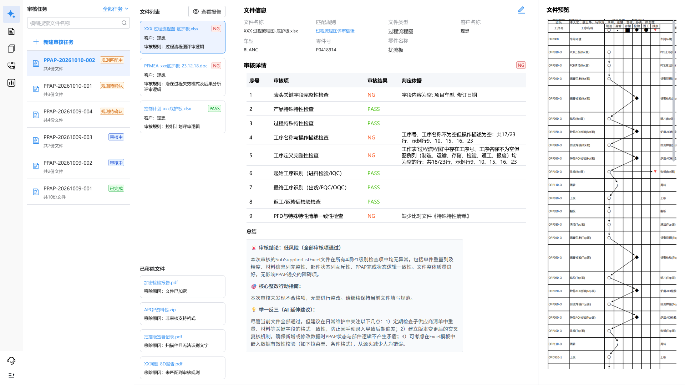

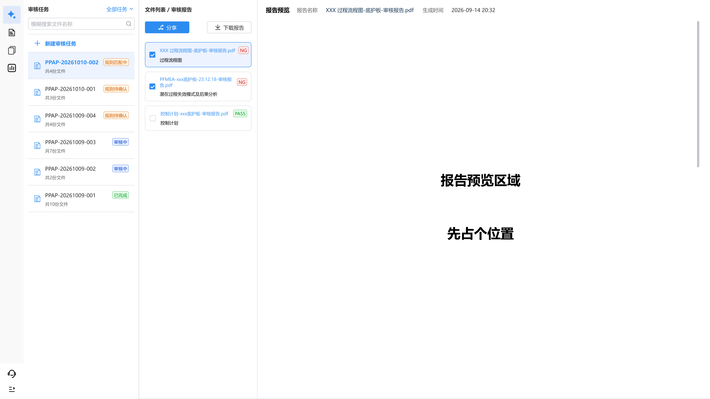

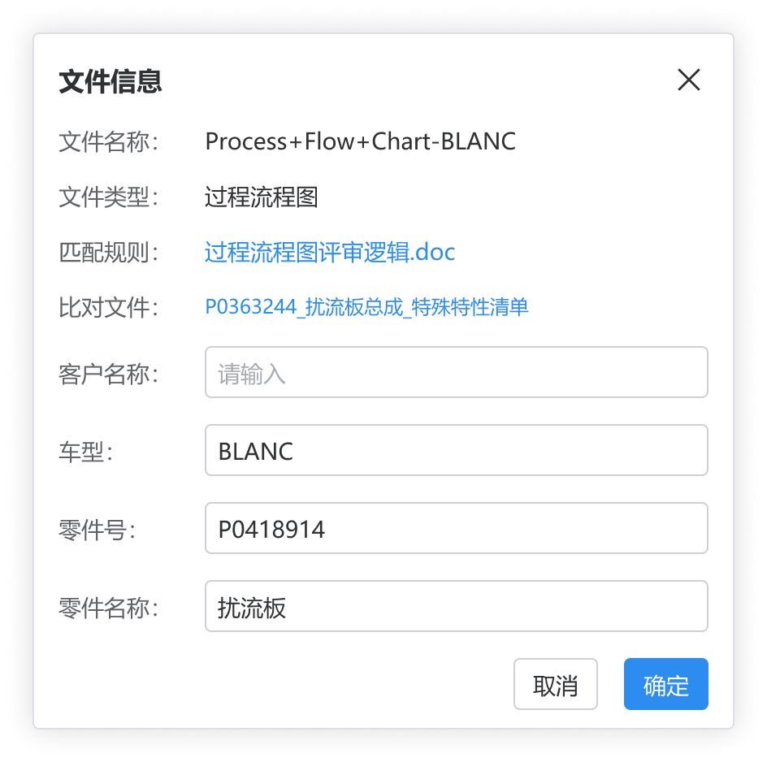

**界面结构（线框示意，最终以设计图为准）**

```
┌────────┬────────┬──────────────────────────────────────┬────────────────────┐
│ ← PPAP │ 任务    │ 审核中 · 已完成 3/8 份 · 预计还需 1  │ [完成后通知我 ✓]   │
│  Audit │ PPAP-03 │ 小时 12 分钟 ~ 1 小时 40 分钟        │ [查看报告]         │
│        │ 审核中  ├──────────────────────────────────────┼────────────────────┤
│        │ 8 份    │ 文件信息                        [✎]  │ 文件预览            │
│        │ ┌─────┐│ 文件名称  匹配规则  文件类型  客户名称│                    │
│        │ │XXX过 ││ XXX过程…  过程流程…  过程流程图 理想 │  [原文渲染]         │
│        │ │NG    ││ 车型      零件号    零件名称         │                    │
│        │ │客户：││ BLANC     P0418914  扰流板           │                    │
│        │ │理想  │├──────────────────────────────────────┤                    │
│        │ │规则：││ 审核详情                      [NG]   │                    │
│        │ │…     ││ 序号 审核项        审核结果 判定依据 │                    │
│        │ ├─────┤│ 1 表头关键字段完整性 NG   字段为空…  │                    │
│        │ │PFMEA ││ 2 产品特殊特性检查  PASS  …          │                    │
│        │ │NG    ││ …                                    │                    │
│        │ │⊘ 已移│├──────────────────────────────────────┤                    │
│        │ │除文件││ 总结                                 │                    │
│        │ │(2)   ││                                       │                    │
│        │ │ 8D报告│ │                                     │                    │
│        │ │ 未匹配│ │                                     │                    │
│        │ └─────┘│                                       │                    │
└────────┴────────┴──────────────────────────┴────────────────────┘
```

##### ③ 页面逻辑

| 区域                      | 元素与规则                                                                                                                                    |
| ----------------------- | ---------------------------------------------------------------------------------------------------------------------------------------- |
| **返回页头**                | `← PPAP Audit`；任务进度条 **「审核中 · 已完成 3/8 份 · 预计还需 X ~ Y」**；右上角 **「完成后通知我」开关（默认开）** + **「查看报告」按钮**                                           |
| **「查看报告」可用性**           | **任务状态 = 「已完成」时可点击** `[确认]`；**存在审核异常的文件时任务仍为「已完成」，按钮同样可点击**；未达成时置灰                                                                       |
| **列 1 · 审核任务侧栏**（240px） | 与 P1 同一组件：搜索 + 状态筛选 + 新建任务；当前任务高亮（见 FR-00 3.0.4）                                                                                         |
| **列 2 · 文件队列**（272px）   | 搜索框 placeholder **「快捷检索文件名称」**；文件卡片 = 文件名 + 结论 tag（`NG` / `PASS`）+「客户：XX」+「审核规则：XX评审逻辑」；点击切换；**默认选中第一个**                                 |
| **列 2 · 卡片状态**          | 保留文件名 + 结论 tag + 客户 + 审核规则四行，增加状态角标与文件级进度：`✓ 已完成(PASS/NG)` / `◐ 审核中 4/9` / `○ 排队中` / **`! 异常`**（**无重试按钮、无移除操作，保留在队列中**）                  |
| **列 2 · 已移除文件区**        | 队列底部折叠区，标题 **「已移除文件（N）」**；每行列 **文件名 + 移除原因**；可展开 / 收起；来源含三类（见 3.4.1 映射表）                                                                 |
| **中区 · 文件信息**           | 标题「文件信息」+ 右上角 **编辑图标**（可修改识别出的字段）；字段两行展示七项：**文件名称 / 匹配规则 / 文件类型 / 客户名称 / 车型 / 零件号 / 零件名称**；其中**仅客户名称 / 车型 / 零件号 / 零件名称四项可编辑**，文件名称、匹配规则、文件类型不可改 `[确认]`                                                 |
| **中区 · 审核详情**           | 标题「审核详情」+ **右侧项级进度 `审核中 4/9 项`** + 结论 tag；表格四列：**序号 ｜ 审核项 ｜ 审核结果 ｜ 判定依据**；沿用现有审核项与依据生成逻辑 `[沿用现有]`；**审核项逐条流式落地**，未完成项结果显示 `—`、依据显示 `核对中…` |
| **中区 · 总结**             | 「总结」区块：审核结论 + 核心整改执行指南 + AI 延伸建议 `[沿用现有]`；**审核完成前显示「（审核完成后生成）」占位，不显示空白**                                                                 |
| **中区 · 等待期提示**          | 审核项出现「缺少比对文件《XX》」时，该行追加「你可以先准备《XX》，下次提交时一并提供即可完成该项审核」                                                                                    |
| **右区（568px）**           | 「文件预览」+ 文件详情渲染 `[沿用现有]`                                                                                                                  |
| **计费提示条**               | 审核中额度不足时顶部常驻（见 FR-00 3.0.5），流程不中断                                                                                                        |

**3.4.1 移除原因文案映射（多对一）`[确认]`**

移除原因与该文件此前的异常提醒文案为**多对一映射**：多条异常提醒可共用同一条移除原因（如加密 / 损坏 / 超限共用「文件加密或异常，无法识别」；未匹配自动移除与手动移除共用「未匹配到规则」）。两处文案**成对维护、同步变更**，允许措辞不同（提醒文案偏完整说明，移除原因偏简短标注）。

| 异常提醒文案（前期展示）                    | 对应移除原因（已移除文件区展示） | 发生阶段 `remove_stage` |
| ------------------------------- | ---------------- | ------------------- |
| 不支持格式；仅支持 Excel / PDF / Word 格式 | **非审核支持格式**      | `precheck`          |
| PDF 为纯扫描件且无法识别文字，建议提供可复制文本版本    | **扫描版图片无法识别文字**  | `precheck`          |
| 文件已加密，建议解除密码后重新上传               | **文件加密或异常，无法识别** | `precheck`          |
| 文件损坏（无法解析）                      | **文件加密或异常，无法识别** | `precheck`          |
| 超过大小限制                          | **文件加密或异常，无法识别** | `precheck`          |
| 未匹配到审核规则（确认时自动移除）               | **未匹配到规则**       | `confirm`           |
| 用户手动移除                          | **未匹配到规则**       | `manual`            |
| 移出排队中的文件（用户取消审核）            | **用户取消审核（排队中）** | `queued_cancel`     |

> 维护规则：新增 / 修改某类异常提醒文案时，必须同步维护其对应的移除原因条目；两者文案不必一致；**多个异常原因可共用同一条移除原因**（加密 / 损坏 / 超限共用「文件加密或异常，无法识别」；未匹配自动移除与手动移除共用「未匹配到规则」；取消排队共用「用户取消审核（排队中）」）。
>
> **审核异常（`review_failed`）不属于移除范围** `[确认]`：该文件状态仍为「异常」，保留在队列中，**不提供「移除」操作、不计入「已移除文件（N）」区、`remove_stage` 不取 `review_error`**；如需重审，重新提交该文件发起新任务。

**3.4.2 审核项与判定依据示例**

审核项示例（过程流程图规则，共 9 项）：1 表头关键字段完整性检查 ｜ 2 产品特殊特性检查 ｜ 3 过程特殊特性检查 ｜ 4 工序名称与操作描述检查 ｜ 5 工序定义完整性检查 ｜ 6 起始工序识别（进料检验/IQC）｜ 7 最终工序识别（出货/FQC/OQC）｜ 8 返工/返修后检验检查 ｜ 9 PFD与特殊特性清单一致性检查。

判定依据示例：`字段内容为空: 项目车型, 修订日期` / `工序号、工序名称不为空但操作描述为空：共17/23行，示例行9、10、15、16、23` / `工作表'过程流程图'中存在工序号、工序名称不为空但图例列…均为空的行：共18/23行…` / `缺少比对文件《特殊特性清单》`。

##### ④ 交互逻辑

| 编号       | 触发                     | 系统行为                                 | 界面反馈                                                 | 边界与异常                                           |
| -------- | ---------------------- | ------------------------------------ | ---------------------------------------------------- | ----------------------------------------------- |
| IL-04.01 | 确认动作后进入本页              | 加载任务、文件队列、进度                         | 默认选中队列第一个文件；页头展示「审核中 · 已完成 0/8 份 · 预计还需 X ~ Y」       | 用户可关闭页面，服务端继续运行                                 |
| IL-04.02 | 定时拉取进度（任务级 + 文件级 + 项级） | 返回真实完成计数                             | 页头更新 `已完成 N/M 份` 与 ETA 区间；卡片更新 `◐ 审核中 x/y`；表格逐条落地审核项 | **禁止按时间估算的百分比进度条、禁止进度回退**；loading 必须含真实对象名      |
| IL-04.03 | 点击队列某文件卡片              | 加载该文件信息、审核详情、总结、预览                   | 中区与右区切换到该文件                                          | 排队中文件：审核详情区展示排队态；异常文件：展示异常态                     |
| IL-04.04 | 队列搜索框输入                | 按文件名过滤队列                             | 实时过滤                                                 | 无命中 → 空结果                                       |
| IL-04.05 | 点击「已移除文件（N）」折叠区        | 展开 / 收起                              | 列出已移除文件名 + 移除原因                                      | **审核异常文件不在此区**                                  |
| IL-04.06 | 点击文件信息右上角编辑图标          | 进入编辑态，可改**客户名称 / 车型 / 零件号 / 零件名称**四项（文件名称、匹配规则、文件类型均不可改） | 字段可编辑 + 保存                                           | 保存后仅更新展示、**不自动重新匹配规则、不重跑审核** `[确认]`；文件类型 / 客户的手动指定仅在 P3（IL-02.17）对识别失败 / 低置信度文件开放，P5 不提供该入口 |
| IL-04.07 | 切换「完成后通知我」开关           | 置 `notify_enabled`                   | 开关状态变更                                               | 默认**开**；**关闭后任务完成时不发飞书消息 ③**（其余两条节点消息不受影响）      |
| IL-04.08 | 单文件审核完成                | 生成审核结论与总结；触发报告生成（异步）                 | 卡片变为 `✓ 已完成(PASS/NG)`；中区展示完整审核详情与总结；报告状态转为「生成中…」     | 报告生成失败 → 标记「生成失败」，**仅可重生成报告，不重跑审核**             |
| IL-04.09 | 单文件审核异常                | 置 `review_failed`，**不生成报告**          | 卡片显示 **`! 异常`**；**无重试按钮、无移除入口**                      | 其余文件照常审核；全部文件到达终态且已完成文件报告齐 → 任务转「已完成」           |
| IL-04.10 | 移出排队中的文件               | 该文件从审核队列移除并登记（`remove_stage = queued_cancel`、`remove_reason = 用户取消审核（排队中）`），进入 P5 已移除文件区 | 该文件从队列移除并展示于已移除文件区（若有独立入口则按设计图） `[开放：入口形态]`                    | 已开始审核的文件不可取消                                    |
| IL-04.11 | 全部文件到达终态且已完成文件报告齐      | 任务状态转 `已完成`；发送**飞书消息 ③**             | 任务侧栏任务项状态 tag 转为「已完成」；「查看报告」由置灰变为可点击                             | **存在异常文件不阻塞**；消息 ③ 中追加「另有 N 份文件审核异常，未生成报告」      |
| IL-04.12 | 点击「查看报告」               | —                                    | 进入 **P6 报告页**                                        | 任务状态 ≠ 已完成时置灰不可点                                |
| IL-04.13 | 审核中额度不足                | 记录欠费，**不中断审核**                       | 顶部提示条常驻                                              | 充值后自动扣费；报告下载与分享不受限                              |

##### ⑤ 验收要点

四列布局与三级进度（任务 / 文件 / 项）一致；已移除文件区展示文件名 + 移除原因且不含异常文件；异常文件保留在队列、无重试与移除入口；「查看报告」仅在「已完成」可点；进度不回退、无百分比估算。

---


> **P5 审核详情页由以下子能力构成**：FR-12 审核详情表 / FR-13 审核总结区 / FR-15 文件预览。跨文件一致性核查不设独立界面：文件一起提交时，模型按提交的文件类型自动横向比对审核 `[确认]`。
#### FR-12 审核详情表（审核项明细）`[沿用现有 · 部分待补充]`

##### ① 功能描述

审核详情页（P5）的**审核详情列**以表格形式逐条呈现该文件的审核项，是审核结果的主承载区。每条审核项给出：审核项名称、所属来源（客户规则拆条后的条目）、**判定依据**、审核结果（PASS / NG）、说明。用户据此判断该文件是否符合该客户对应文件类型的审核要求，并可对照右侧预览定位到文件中对应位置。

审核项由**客户规则库**中该「客户 + 文件类型」的规则文档导入后拆条生成 `[确认]`。审核项集合在**文件进入审核前**确定，审核过程中不新增、不减少 `[待补充：是否支持审核过程中追加审核项]`。

##### ② 效果图（占位）

| 图号          | 说明                         |
| ----------- | -------------------------- |
| `IMG-P5-05` | 审核详情表（序号 + 审核项 + 审核结果 + 判定依据，界面截图） |
| `IMG-P5-11` | 审核详情表 · 未开始态 / 空态（界面截图）      |

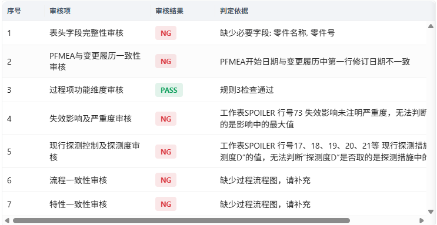

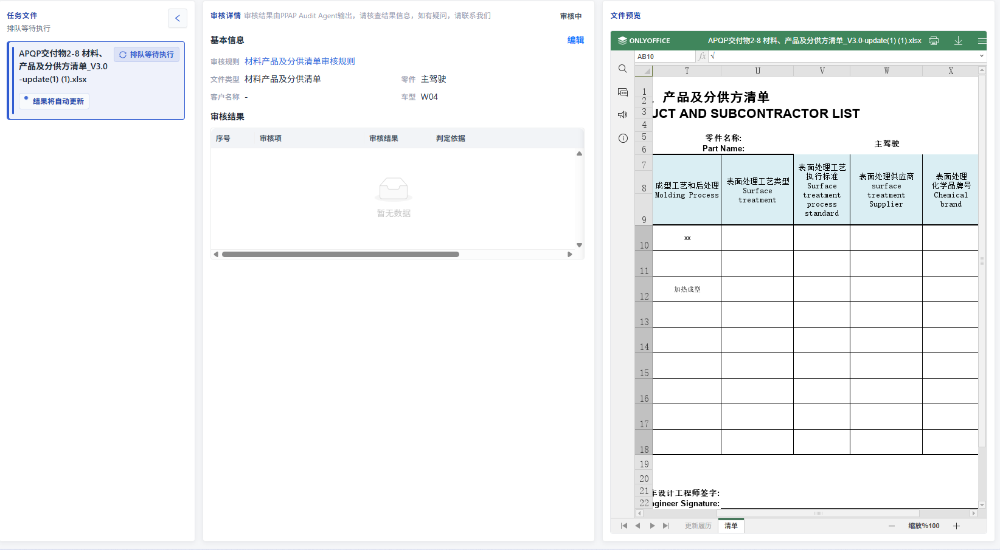

##### ③ 页面逻辑

| 元素    | 构成 / 数据来源                             | 文案                               | 状态显隐                       |
| ----- | ------------------------------------- | -------------------------------- | -------------------------- |
| 表格表头  | 序号 / 审核项 / 审核结果 / 判定依据（按图2 设计稿，直接列展示） | 以设计图原文为准                         | 常驻                         |
| 审核项名称 | 来自客户规则拆条结果                            | 原文展示，不改写                         | 常驻                         |
| 审核结果  | **PASS / NG** 二态 `[确认]`               | PASS = 绿色；NG = 红色                | 未审核到该项时展示「待审核」灰态           |
| 判定依据  | 审核项对应的规则要求条文                          | 直接列展示（与文件审核详情页 FR-19 一致，按图2 设计稿） | 常驻，超长内容区域内滚动               |
| 说明    | 审核模型给出的判定说明，**必须指向文件中真实存在的具体内容**      | 展开后展示                            | 默认收起                       |
| 定位入口  | 点击后右侧预览列跳转 / 高亮到对应位置                  | `[待补充：入口文案与定位方式（页码 / 单元格 / 段落）]` | `[待补充：是否本期提供]`             |
| 审核项计数 | 已审核项数 / 审核项总数                         | 「已审核 N / M 项」                    | 审核中实时更新；**只用真实计数，禁止按时间估算** |
| 未开始态  | 文件尚未进入审核                              | 「该文件尚未开始审核」                      | 文件状态为排队中时展示                |
| 异常态   | 文件审核异常                                | 「该文件审核异常，未生成审核结果」                | 文件状态为异常时展示，**不展示空表格**      |

##### ④ 交互逻辑

| 编号       | 触发               | 系统行为                | 界面反馈                          | 边界与异常                                |
| -------- | ---------------- | ------------------- | ----------------------------- | ------------------------------------ |
| IL-12.01 | 点击某审核项行          | 展开 / 收起该项的判定依据与说明   | 行高展开，出现判定依据与说明文本；右侧箭头翻转       | 展开内容超长时区域内滚动，不撑破布局                   |
| IL-12.02 | 点击「定位」类入口（若本期提供） | 右侧预览列跳转并高亮对应位置      | 预览列滚动到目标位置并短暂高亮               | 预览不可用时该入口禁用 + 悬浮说明「该文件不支持定位」`[待补充]`  |
| IL-12.03 | 审核进行中停留在详情页      | 按 9.13 轮询拉取增量审核项结果  | 新完成的审核项行追加到表格并计入「已审核 N / M 项」 | **禁止进度回退**；轮询失败走 EA-01，保留已展示项        |
| IL-12.04 | 切换到另一文件          | 拉取该文件审核项集合与结果       | 表格整体替换，滚动回顶部                  | 切换请求失败 → 区域错误态 +【重试】，保持原文件展示         |
| IL-12.05 | 点击审核结果为 NG 的项    | 与 IL-12.01 一致（展开说明） | 同 IL-12.01                    | NG 项在总结区汇总，见 FR-13                   |
| IL-12.06 | 审核项总数为 0         | 该文件规则下无审核项          | 展示空态「该文件未匹配到审核项」              | 若出现此情况，视为规则配置异常，**记录埋点与日志**，界面不给用户归因 |
| IL-12.07 | 表格内容超出容器         | 区域内滚动，表头吸顶          | 表头保持可见                        | 长表格（> 100 项）采用滚动加载                   |
| IL-12.08 | 审核模型对某项未给出结论     | 该项展示「待审核」灰态，不计入已审核数 | 与已审核项视觉区分                     | 全部项均为待审核且文件已到终态 → 按文件异常口径处理，文案统一「异常」 |

##### ⑤ 验收要点

- 审核项集合与「客户 + 文件类型」规则拆条结果一致，可逐项溯源到规则条目 `[待补充：溯源入口是否提供]`。
- 审核结果仅 PASS / NG 二态，无第三态（除「待审核」灰态外）。
- 审核项计数为真实计数，刷新页面后与服务端一致，不回退、不跳变。
- 文件异常时不展示空表格，展示异常说明。
- 展开内容超长、表格超长均不破坏四列布局。

---

#### FR-13 审核总结区 `[沿用现有 · 部分待补充]`

##### ① 功能描述

审核详情页（P5）审核详情列底部（或报告页 P6 单份报告内）的**总结区**，对该文件审核结果做汇总性结论，帮助用户在不必逐条翻阅审核项的情况下快速判断该文件是否通过并知道下一步做什么。

**沿用现有** `[沿用现有]`：总结区由四部分构成 —— ① **审核结论分级**；② **核心整改执行指南**；③ **AI 延伸建议**；④ **风险分级**（沿用现有能力，边界见附录 A）。产品**不提供 PPAP Level 1–5 判定**（附录 A10）。

本节只补齐**展示与交互口径**，分级逻辑本身不改动；分级文案的具体取值 `[待补充]`（见附录 F · M-04）。

总结区灰框内的所有内容（审核结论、核心整改行动指南、举一反三（AI 延伸建议）、风险分级等）**均由接口返回，前端仅做展示**，不在前端做结论计算或文案生成 `[确认]`。

##### ② 效果图（占位）

| 图号          | 说明             |
| ----------- | -------------- |
| `IMG-P5-07` | 审核总结区（结论 + 汇总） |

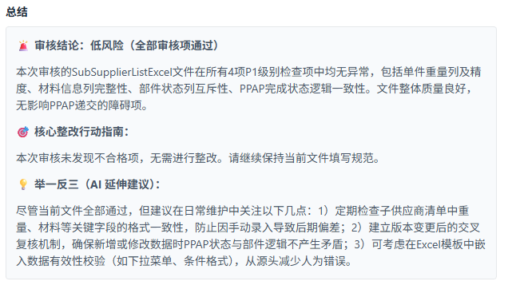

##### ③ 页面逻辑

| 元素       | 构成 / 数据来源                        | 文案                    | 状态显隐                         |
| -------- | -------------------------------- | --------------------- | ---------------------------- |
| 审核结论分级   | 由该文件全部审核项结果聚合（沿用现有分级逻辑）          | `[待补充：分级文案取值]`        | 文件审核完成后展示；审核中与未开始时隐藏         |
| 结论配色     | PASS 主导 = 绿色；存在 NG = 红色          | 同 2.7 视觉规范            | —                            |
| 风险分级     | 沿用现有风险分级逻辑                       | `[待补充：风险等级文案]`        | 常驻（结论区）                      |
| 核心整改执行指南 | 由 NG 项聚合生成的可执行建议（沿用现有）           | `[待补充：是否全部展示 / 折叠阈值]` | 存在 NG 项时展示；无 NG 项时展示「未发现问题项」 |
| AI 延伸建议  | 模型给出的补充建议（沿用现有）                  | `[待补充]`               | `[待补充：无 NG 时是否展示]`           |
| 汇总计数     | NG 项数 / 审核项总数                    | 「N / M 项未通过」          | 常驻（结论区）                      |
| 报告一致性    | P5 总结区与 P6 报告、导出 PDF 的结论**必须一致** | —                     | 同一数据源渲染                      |

##### ④ 交互逻辑

| 编号       | 触发            | 系统行为                                 | 界面反馈                   | 边界与异常                       |
| -------- | ------------- | ------------------------------------ | ---------------------- | --------------------------- |
| IL-13.01 | 文件审核完成，进入详情页  | 拉取并渲染总结区                             | 结论 + 问题项汇总展示           | 拉取失败 → 区域错误态 +【重试】，不影响审核项表格 |
| IL-13.02 | 点击汇总中的某个 NG 项 | 滚动并展开审核详情表中对应项（FR-12）                | 表格定位到该项并展开             | 该项因列表过滤不可见时，先清除过滤再定位        |
| IL-13.03 | 文件审核异常        | 不生成总结区                               | 展示异常说明，**不展示结论**       | 异常文件不产出 PDF 报告，见 FR-05      |
| IL-13.04 | 全部审核项为 PASS   | 结论为通过态，问题项区展示「未发现问题项」                | 绿色结论                   | —                           |
| IL-13.05 | 存在 NG 项       | 按**现有分级逻辑**给出结论，并输出核心整改执行指南与 AI 延伸建议 | 红色结论 + 指南 + 建议 + NG 清单 | NG 项过多（> 20）时折叠为「展开全部 N 项」  |
| IL-13.06 | 与报告 / PDF 比对  | 同一数据源渲染                              | 三处结论文案一致               | 出现不一致视为缺陷，**必须修复**，不得各端各算   |

##### ⑤ 验收要点

- 总结区结论与审核项结果严格一致：任一 NG 存在即不得呈现为通过。
- P5 总结区、P6 报告、导出 PDF 三处结论一致。
- 异常文件不展示结论区。
- **分级逻辑沿用现有实现，本期不改动**；分级文案取值 `[待补充]`（附录 F · M-04），未确认前以现有实现为准。

---

#### FR-15 文件预览 `[沿用现有 · 部分待补充]`

##### ① 功能描述

审核详情页（P5）**第四列**为文件预览区，展示当前选中文件的原文内容，供用户对照审核项与判定依据进行核对。预览与审核详情表联动：切换文件即切换预览内容；若提供定位能力，则支持从审核项定位到文件中对应位置（见 IL-12.02）。

##### ② 效果图（占位）

| 图号          | 说明                   |
| ----------- | -------------------- |
| `IMG-P5-09` | 文件预览 · 可预览态（界面截图）            |
| `IMG-P5-10` | 文件预览 · 文件已删除 / 暂无法预览态（示例图）  |

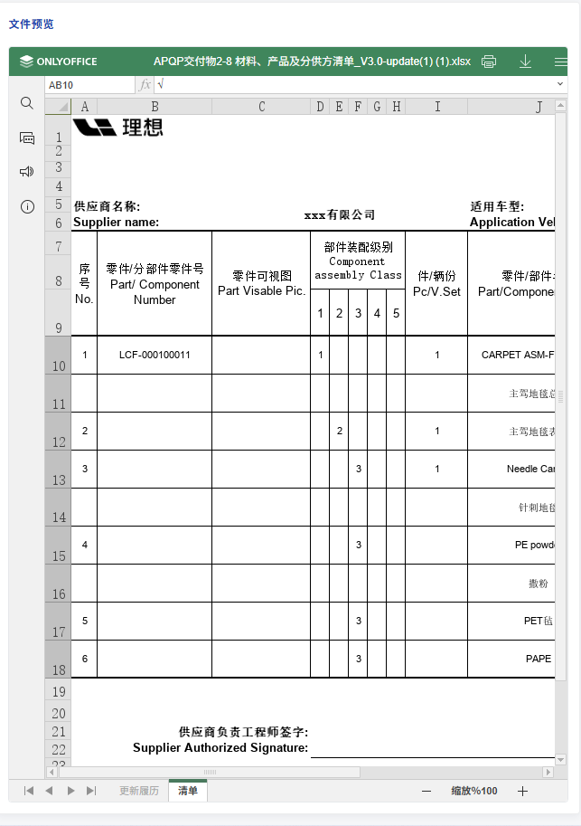


##### ③ 页面逻辑

| 元素     | 构成 / 数据来源                      | 文案                        | 状态显隐                  |
| ------ | ------------------------------ | ------------------------- | --------------------- |
| 预览容器   | 文件原文渲染（Excel / PDF / Word）     | —                         | 文件可预览时展示              |
| 文件名    | 当前展示文件名                        | 完整文件名，超长截断 + 悬浮展示         | 常驻                    |
| 工具栏    | 缩放 / 翻页 / 下载原文件 `[待补充：工具栏具体项]` | 以设计图原文为准                  | 可预览时展示                |
| 加载态    | 预览内容加载中                        | 「正在加载{文件名}」               | 加载中；**禁止「请稍候」类无信息文案** |
| 不支持预览态 | 格式不支持、转换失败                     | 「该文件暂不支持预览」+ 说明「可下载原文件查看」 | 不可预览时展示               |
| 加载失败态  | 预览服务异常                         | 「预览加载失败」+【重试】             | 失败时展示，保留左侧三列可用        |
| 空态     | 未选择文件                          | 「请选择左侧文件查看预览」             | 无选中文件时展示              |

##### ④ 交互逻辑

| 编号       | 触发            | 系统行为               | 界面反馈                        | 边界与异常                              |
| -------- | ------------- | ------------------ | --------------------------- | ---------------------------------- |
| IL-15.01 | 在文件队列点击某文件    | 预览列加载该文件内容         | 预览切换；加载中展示含文件名的加载文案         | 加载失败 → 失败态 +【重试】；**不影响审核详情表与文件队列** |
| IL-15.02 | 点击缩放 / 翻页     | 预览容器内变化            | 即时生效                        | 超大文件（页数 / 行数过多）分页加载，禁止一次性全量渲染      |
| IL-15.03 | 点击「下载原文件」     | 下载该文件原始文件          | 浏览器下载                       | 下载失败走 EA-01 +【重试】                  |
| IL-15.04 | 从审核项点击定位（若提供） | 预览列滚动并高亮目标位置       | 目标位置短暂高亮                    | 目标位置不存在 / 不支持定位 → 入口禁用 + 悬浮说明      |
| IL-15.05 | 预览内容为空（文件无内容） | 展示空态               | 「该文件无内容可预览」                 | —                                  |
| IL-15.06 | 文件为扫描件 PDF    | 按不可预览处理            | 「该文件为扫描件，无法预览文字内容」          | 与预检阻断级「扫描版图片无法识别文字」口径一致（见 FR-02）     |
| IL-15.07 | 快速连续切换文件      | 取消前一个预览请求，只渲染最后选中项 | 只展示最后一次选择的文件                | **禁止旧请求后到覆盖新预览**（请求竞态）             |
| IL-15.08 | 预览区宽度不足       | 内容按比例缩放适配          | 不出现横向滚动条破坏布局 `[待补充：是否允许横滚]` | —                                  |

##### ⑤ 验收要点

- 切换文件时预览正确联动，快速切换不出现「点了 A 显示 B」。
- 不可预览 / 加载失败均有明确文案与出路，不留白。
- 预览失败不影响其余三列可用性。
- 加载文案必须包含真实文件名。

---

#### FR-05 P6 报告页（查看报告）

##### ① 功能描述

任务完成后的报告中心：左侧为本次任务的**逐文件报告列表**（可勾选），右侧为**报告预览**；支持单份 PDF 下载、多份 ZIP 异步打包下载、分享给飞书用户/群。

**边界**：

- 本期**仅逐文件报告，无整套 PPAP 汇总报告** `[确认]`；
- 报告页**不展示报告编号**，原编号位置展示**报告名称**；
- 下载与分享一律**异步**，不得让用户同步等待。

优先级：**P0**

##### ② 效果图（占位）

| 图号          | 说明                                      |
| ----------- | --------------------------------------- |
| `IMG-P6-01` | P6 报告页（左区报告列表 + 右区报告预览 + 页头分享/下载报告）     |
| `IMG-P6-02` | P6 左区四种报告状态（已就绪 / 生成中… / 生成失败 / 审核异常灰显） |


**界面结构（线框示意，最终以设计图为准）**

```
┌─────────┬─────────────────────────────────────────────────────────────────┐
│ ← PPAP Audit / 查看报告                        [分享] [下载报告]           │
├─────────┼─────────────────────────────────────────────────────────────────┤
│🔍快捷检索│ 报告预览                                                         │
│ ┌──────┐│ 报告名称  XXX 过程流程图-底护板-审核报告   生成时间 2026-09-14 20:32 │
│ │☑ XXX ││ ┌───────────────────────────────────────────────────────────┐ │
│ │  NG  ││ │                    报告预览区域                              │ │
│ │ 过程 ││ │                                                             │ │
│ │ 流程图│ │ │                                                             │ │
│ ├──────┤│ └───────────────────────────────────────────────────────────┘ │
│ │☑ PFMEA│ │                                                                 │
│ │  NG  ││                                                                 │
│ │ 潜在…│ │                                                                 │
│ ├──────┤│                                                                 │
│ │☐ 控制 ││                                                                 │
│ │ PASS ││                                                                 │
│ │ 控制…│ │                                                                 │
└─────────┴─────────────────────────────────────────────────────────────────┘
```

##### ③ 页面逻辑

| 元素         | 规则                                                                                                                                                      |
| ---------- | ------------------------------------------------------------------------------------------------------------------------------------------------------- |
| 返回页头       | 面包屑 **`PPAP Audit / 查看报告`**；右上角 **「分享」「下载报告」**（本页操作按钮在页头，不在底部）                                                                                          |
| 左区（320px）  | 搜索框「快捷检索文件名称」；文件行 = **复选框** + 文件名 + 结论 tag + **文件类型名**（如 过程流程图 / 潜在过程失效模式及后果分析 / 控制计划）                                                                  |
| **左区报告状态** | `已就绪` / `生成中…` / `生成失败（重试，仅重生成报告）` / **「审核异常」（`review_failed` 文件，无报告，复选框禁用 + 灰显 + 标注「审核异常，未生成报告」，**&#x65E0;重试、无移除入&#x53E3;**）**；**生成中 / 审核异常的文件不可勾选下载** |
| 右区 报告头     | 「报告预览」+ **报告名称**（`{文件名}-审核报告`，如 `XXX 过程流程图-底护板-审核报告`）+ **生成时间**（`yyyy-MM-dd HH:mm`）。**原「报告编号」位置改展示报告名称，界面不再展示报告编号** `[确认]`                              |
| 右区 预览区     | 报告正文渲染区                                                                                                                                                 |
| **勾选与默认**  | 未勾选任何文件时，默认下载 / 分享**当前预览中的那一份** `[确认]`                                                                                                                  |
| **下载**     | 单份 → PDF（仅就绪的）；**多份 → ZIP 异步打包**：点击后提示「打包中，完成后飞书通知你」，**不得阻塞页面**；**PDF 与包内文件名 = `{文件名}-审核报告.pdf`** `[确认]`；打包完成后发飞书消息 ④ 给下载链接                             |
| 分享         | 点击「分享」→ 打开 P7 分享浮层                                                                                                                                      |
| 粒度         | 本期仅逐文件报告，无整套汇总 `[确认]`                                                                                                                                   |
| 深度模式标识     | **报告页、PDF、分享卡片均不标注档位** `[确认]`                                                                                                                           |

##### ④ 交互逻辑

| 编号       | 触发                   | 系统行为                   | 界面反馈                       | 边界与异常                       |
| -------- | -------------------- | ---------------------- | -------------------------- | --------------------------- |
| IL-05.01 | 从 P5 点「查看报告」进入       | 拉取该任务报告列表              | 默认选中并预览第一份**已就绪**报告        | 任务未完成时入口不可点                 |
| IL-05.02 | 从飞书消息 ③ 点【查看详情】      | —                      | 直接进入本页（图 6）                | —                           |
| IL-05.03 | 左区搜索框输入              | 按文件名过滤                 | 实时过滤列表                     | 无命中 → 空结果                   |
| IL-05.04 | 勾选 / 取消勾选文件行         | 更新勾选集合                 | 复选框状态变更                    | **生成中、审核异常的行不可勾选**（禁用 + 灰显） |
| IL-05.05 | 点击左区某文件行             | 加载该报告                  | 右区切换到该报告；报告头更新报告名称与生成时间    | 审核异常行点击无效                   |
| IL-05.06 | 勾选 1 份（或未勾选）后点「下载报告」 | 单份 PDF 下载（未勾选时取当前预览那份） | 触发下载                       | 未就绪的不可下载；额度不足时提示            |
| IL-05.07 | 勾选 ≥2 份后点「下载报告」      | 创建异步打包 job             | 提示「**打包中，完成后飞书通知你**」，页面不阻塞 | 打包失败 → 提示失败，可重试，**不丢已生成报告** |
| IL-05.08 | ZIP 打包完成             | 生成下载链接            | 发送**飞书消息 ④**（下载链接） | 下载链接长期可访问              |
| IL-05.09 | 报告生成失败行点「重试」         | **仅重生成报告**，不重跑审核       | 行状态回到「生成中…」                | 额度不足时拦截，充值后自动扣费并解锁          |
| IL-05.10 | 点击「分享」               | —                      | 打开 **P7 分享浮层**             | 见 FR-06                     |

##### ⑤ 验收要点

报告名称与生成时间展示正确、**不出现报告编号**；多份走异步打包且完成后通知下载链接；异常行灰显不可勾选、无重试与移除入口；未勾选时默认取当前预览那份；PDF 文件名 = `{文件名}-审核报告.pdf`。

#### FR-06 P7 分享浮层

##### ① 功能描述

在 P6 报告页（及 P0 模板库页）点击「分享」后打开的浮层：选择飞书用户或群组，选择发送内容（报告链接 / 报告文件），发送后通过飞书消息送达。

**边界**：

- 接收对象**至少 1 个**才能发送；
- 报告链接需飞书登录、同租户成员可访问，**长期有效**；
- 本期**不记录分享动作、不设水印/权限二次配置** `[确认]`。

优先级：**P1**

##### ② 效果图（占位）

| 图号          | 说明                          |
| ----------- | --------------------------- |
| `IMG-P7-01` | P7 分享浮层 · 初始态（搜索框 + 发送内容单选） |
| `IMG-P7-02` | P7 选人下拉列表（用户与群混排，多选）        |
| `IMG-P7-03` | P7 已选态（tag 展示 + 可删除）        |
| `IMG-P7-04` | 飞书消息卡片（报告链接形态）              |


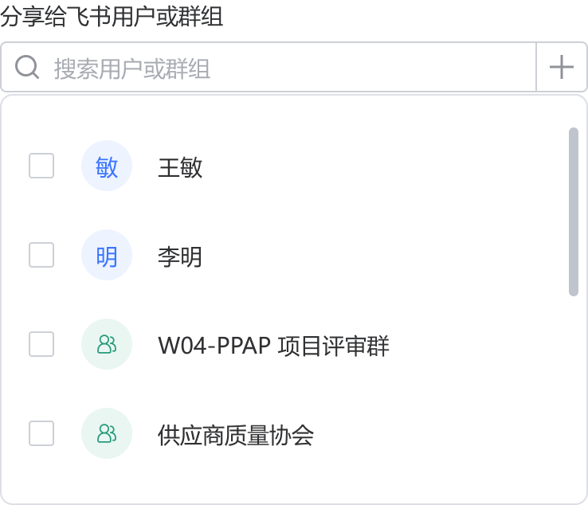
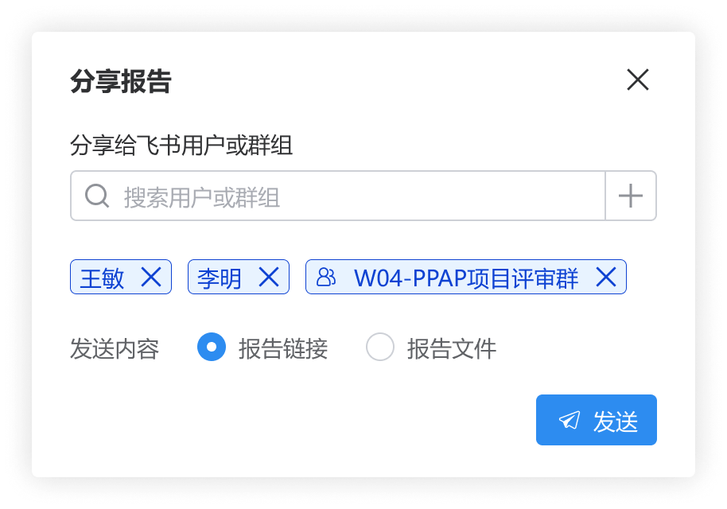

**界面结构（线框示意，最终以设计图为准）**

```
┌────────────────────────────────────┐
│  分享报告                       ✕  │
│                                    │
│  分享给飞书用户或群组               │
│  ┌──────────────────────────────┐ │
│  │ 🔍 搜索用户或群组        [+] │ │
│  └──────────────────────────────┘ │
│  [王敏 ×] [李明 ×] [👥 W04-PPAP项目评审群 ×]        ← 已选态 │
│                                    │
│  发送内容                          │
│  ◉ 报告链接   ○ 报告文件           │
│                        [发送]      │
└────────────────────────────────────┘
```

##### ③ 页面逻辑

| 状态 / 元素    | 规则                                                                                            |
| ---------- | --------------------------------------------------------------------------------------------- |
| 标题         | 「分享报告」+ 右上角关闭 `✕`                                                                             |
| 选人区        | 标签「分享给飞书用户或群组」；输入框 placeholder「搜索用户或群组」，右侧带 **「新增」图标按钮** `[开放：用途未定，本期保留图标不实现具体功能]`            |
| **选人下拉列表** | 列表项 = 多选复选框 + 头像 + 名称；**用户与群混排**（示例：王敏、李明、W04-PPAP 项目评审群、供应商质量协会），带滚动条 `[选用飞书选人组件]`           |
| **已选态**    | 已选项以 tag 展示（用户名 tag / 群 tag 带群图标），右侧 `×` 可删除                                                  |
| **发送内容**   | 单选：**报告链接（默认选中）** / 报告文件                                                                      |
| **发送按钮**   | 已选对象为空时置灰；不为空可点击 `[确认]`                                                                       |
| **发送行为**   | 报告链接 → 消息卡片（**文件名称 + PASS/NG 摘要 + 链接**）<br />报告文件 → 勾选报告 PDF 的 **ZIP 压缩包**（单份则发单份 PDF） `[确认]` |
| **链接访问**   | 需飞书登录、**同租户成员可访问**、长期有效；本期不写分享记录 `[确认]`                                                       |
| 发送后        | 提示「分享成功」，浮层关闭                                                                                 |

##### ④ 交互逻辑

| 编号       | 触发                      | 系统行为               | 界面反馈                 | 边界与异常                             |
| -------- | ----------------------- | ------------------ | -------------------- | --------------------------------- |
| IL-06.01 | 点击 P6「分享」（或 P0 模板库「分享」） | 拉取可分享对象            | 打开浮层（初始态），默认选中「报告链接」 | 未勾选任何报告时，默认取当前预览那一份               |
| IL-06.02 | 搜索框输入                   | 搜索用户 / 群           | 下拉列表实时过滤             | 无结果 → 空态                          |
| IL-06.03 | 勾选列表项                   | 加入已选集合             | 上方生成 tag（用户 / 群图标区分） | 可多选，可重复取消                         |
| IL-06.04 | 点击 tag 的 `×`            | 移出已选集合             | tag 消失               | 全部删除后「发送」置灰                       |
| IL-06.05 | 切换「报告文件」                | 记录内容类型             | 单选切换                 | 多份报告发送为 ZIP；单份发单份 PDF             |
| IL-06.06 | 点击「发送」                  | 按内容类型发送消息卡片 / 文件消息 | 提示「分享成功」+ 浮层关闭       | 已选对象为空 → 置灰不可点；发送失败 → 提示失败，已选对象保留 |
| IL-06.07 | 接收方点击链接                 | 校验飞书登录与租户          | 打开报告页                | 非同租户 / 未登录 → 拒绝访问并提示需使用飞书账号登录所属组织 |

##### ⑤ 验收要点

未选人时「发送」置灰；链接卡片含文件名 + 结论 + 链接；报告文件方式多份为 ZIP；发送成功后浮层关闭；模板库分享复用同一选人组件。

---

#### FR-08 P2 补充模板弹窗（三态）

##### ① 功能描述

用户反馈缺失模板的提报弹窗（三态）：**初始态「反馈新模板」→ 上传后态 → 成功态「模板提交成功」**。提交的材料与提交人联系信息写入**飞书多维表格**，由运营后续处理。

**边界**：

- 弹窗**不含任何联系信息表单**，所属公司 / 手机号 / 邮箱由**飞书开放 API 静默获取** `[确认]`；
- 此处是「模板提报」通道，**允许图片**；与审核流程「图片不进入审核」不冲突 `[确认]`。

优先级：**P1**

##### ② 效果图（占位）

| 图号          | 说明                             |
| ----------- | ------------------------------ |
| `IMG-P2-01` | P2 初始态「反馈新模板」（上传区 + 取消 / 提交材料） |
| `IMG-P2-02` | P2 上传后态（文件列表 + 下载 / 删除图标）      |
| `IMG-P2-03` | P2 成功态「模板提交成功」                 |


**界面结构（线框示意，最终以设计图为准）**

```
┌───────────────────────────────────────┐
│  补充模板                          ✕  │
│                                       │
│  ┌─────────────────────────────────┐ │
│  │            ⬆ 上传模板            │ │
│  │  支持压缩包（ZIP / RAR / 7Z）或多个文件│ │
│  │  支持 Excel / Word / 图片         │ │
│  └─────────────────────────────────┘ │
│                      [取消] [提交材料]│
└───────────────────────────────────────┘
```

##### ③ 页面逻辑

| 状态           | 元素与规则                                                                                                               |
| ------------ | ------------------------------------------------------------------------------------------------------------------- |
| **初始态**      | 标题「补充模板」+ 上传区 + 底部「取消」「提交材料」；**只含上传区，无联系信息表单**                                                                      |
| **上传区文案**    | 「上传模板」+「支持压缩包（ZIP / RAR / 7Z）或多个文件」+「支持 Excel / Word / 图片」                                                          |
| **上传后态**     | 文件列表行 = 文件名（如 `小鹏PPAP模板.zip`）+ 右侧 **下载** 图标 + **删除** 图标；**支持继续追加上传**                                                |
| **成功态**      | 成功图标 + 主文案 **「提交成功」** + 副文案 **「已经收到 N 份模板材料」**（N = 本次上传文件数）+ 说明 **「我们将在 1~2 个工作日内 / 通过短信或邮件同步您」**；关闭后回到来源页（P1 或 P0） |
| **按钮可用性**    | ≥1 个文件上传完成后「提交材料」可点击                                                                                                |
| **提交人与联系信息** | 提交人、提交时间**自动取当前飞书用户**；所属公司 / 手机号 / 邮箱由**飞书开放 API 静默获取**并写入多维表格，**不在弹窗展示** `[确认]`                                    |
| **客户名称字段**   | **留空**，由运营处理人后续与用户沟通后自行补录                                                                                           |
| **失败处理**     | 多维表格写入失败 → 弹窗内提示「提交失败，请稍后重试」，**已上传文件与列表保留**                                                                         |

> **API 降级 `[确认]`**：若飞书开放 API 未返回所属公司 / 手机号 / 邮箱（用户未授权或字段为空），**该字段留空由运营补录，不追加输入框、不阻断提交**。

##### ④ 交互逻辑

| 编号       | 触发                         | 系统行为                                                              | 界面反馈                             | 边界与异常                                       |
| -------- | -------------------------- | ----------------------------------------------------------------- | -------------------------------- | ------------------------------------------- |
| IL-08.01 | 点击 P1「+ 更多模板，请补充」或 P0 底部入口 | 无                                                                 | 打开弹窗（初始态）                        | —                                           |
| IL-08.02 | 上传压缩包 / 多个文件               | 逐个上传                                                              | 切换到上传后态，展示文件列表 + 下载 / 删除图标       | 格式不符 → 提示不支持                                |
| IL-08.03 | 点击文件行下载图标                  | —                                                                 | 下载该文件                            | —                                           |
| IL-08.04 | 点击文件行删除图标                  | 移出列表                                                              | 列表刷新；列表为空时回到初始态且「提交材料」置灰         | —                                           |
| IL-08.05 | 继续追加上传                     | 追加到列表                                                             | 列表新增行                            | 数量上限见 `[开放]`                                |
| IL-08.06 | 点击「提交材料」                   | ① 静获取当前飞书用户的所属公司 / 手机号 / 邮箱；② 写入飞书多维表格（含提交时间、提交人、文件附件、处理状态 = 待处理） | 切换到成功态（图 P2-03），展示「已经收到 N 份模板材料」 | 写入失败 → 弹窗内提示「提交失败，请稍后重试」，**已上传文件与列表保留**，可重试 |
| IL-08.07 | 成功态点击关闭 / `✕`              | —                                                                 | 关闭弹窗，回到来源页（P1 / P0）              | 来源页状态与已填内容不丢失                               |
| IL-08.08 | 点击「取消」                     | 放弃本次上传                                                            | 关闭弹窗                             | 不写入任何记录                                     |

##### ⑤ 验收要点

三态完整；弹窗无联系信息表单且联系信息静默获取；提交失败可重试且不丢已上传文件；成功态文案与份数正确；多维表格字段完整（客户名称留空、处理状态默认待处理）。

---

#### FR-09 审核任务与异步化

##### ① 功能描述

支撑长耗时审核的基础能力：**任务实体**（在【开始识别】时创建、四态流转）、**任务侧栏**（见 FR-00 3.0.4）、**三级真实进度**、**可离开与恢复**、**ETA 区间**、**PDF/ZIP 异步化**。

**边界**：不新增独立任务页面；任务无失败态、不设超时；任务数据范围仅限创建人自己。

优先级：**P0**

##### ② 效果图（占位）

| 图号         | 说明                                     |
| ---------- | -------------------------------------- |
| `IMG-G-02` | 审核任务侧栏（见 FR-00）                        |
| `IMG-T-01` | 三级进度展示（页头任务级 + 卡片文件级 + 表格项级）           |
| `IMG-T-02` | 任务项四种状态 tag（规则匹配中 / 规则待确认 / 审核中 / 已完成） |

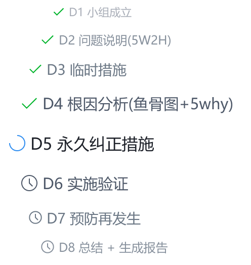

##### ③ 页面逻辑（规则口径）

| 项                | 规则                                                                                                            |
| ---------------- | ------------------------------------------------------------------------------------------------------------- |
| **任务实体**         | 点击【开始识别】时创建，生成 `task_no = PPAP-YYYYMMDD-NNN`（**当日自增**）                                                        |
| **四态流转**         | 见 2.3 状态机；**不设失败 / 部分失败态**                                                                                    |
| **任务项「文件数」**     | = 任务内**排队审核、未被移除**的文件数 `[确认]`，展示文案「共 N 份文件」；规则匹配中 / 规则待确认阶段 = 可审核且勾选的文件数，确认动作后 = 进入审核的文件数（= 计费基数）；**随移除动作递减** |
| **三级进度**         | 任务级 `已完成 N/M 份`；文件级 `审核中 x/y 项`；项级逐条回流。**禁止按时间估算的百分比进度条、禁止进度回退**                                              |
| **可离开**          | 关闭页面 / 刷新 / 断网后重进，进度从服务端恢复，**不清零、不重跑**                                                                        |
| **ETA**          | 以区间展示（如 `预计还需 15 ~ 20 分钟`），**宁高估**（区间上限 ≥ 实测 p90）；无历史数据时用档位基线                                                 |
| **侧栏切换任务**       | 主区按状态落页：`规则匹配中` → P3 预检与匹配页（规则匹配中）；`规则待确认` → P3 预检与匹配页（规则待确认）；`审核中` / `已完成` → P5 `[确认]`                                           |
| **数据范围**         | 仅当前用户自己创建的任务 `[确认]`                                                                                           |
| **PDF / ZIP 异步** | 用户点击后不得同步等待；完成后飞书通知下载链接                                                                                       |
| **深度模式**         | 任务级开关，默认不勾；两档规则范围相同、界面无差异、报告侧不标注、不改点数                                                                         |

##### ④ 交互逻辑

| 编号       | 触发                  | 系统行为                                  | 界面反馈               | 边界与异常            |
| -------- | ------------------- | ------------------------------------- | ------------------ | ---------------- |
| IL-09.01 | 点击【开始识别】（P1）       | 创建任务、生成 `task_no`、状态置 `规则匹配中`、侧栏新增任务项 | 进入 P3 预检与匹配页（规则匹配中） | 创建失败 → 留在 P1 并提示 |
| IL-09.02 | 识别完成                | 状态 → `规则待确认`；发消息 ①                    | 若用户停留则自动切到 P3 预检与匹配页（规则待确认）  | —                |
| IL-09.03 | 确认动作                | 自动移除未匹配文件 + 扣点 + 状态 → `审核中`；发消息 ②     | 转入 P5              | 非创建人被拦截          |
| IL-09.04 | 全部文件到达终态且已完成文件报告齐   | 状态 → `已完成`；发消息 ③                      | P5 页头转完成态，「查看报告」解禁 | **存在异常文件不阻塞**    |
| IL-09.05 | 用户关闭 / 刷新 / 断网后重进   | 从服务端读取任务与进度                           | 恢复到对应页面与真实进度       | 不得清零、不得重跑        |
| IL-09.06 | 侧栏搜索 / 筛选 / 切换任务    | 见 IL-00.07 ~ IL-00.09                 | —                  | —                |
| IL-09.07 | 任务停留在「规则待确认」        | **无超时自动处理**                           | 保持该状态              | 等待创建人确认          |
| IL-09.08 | 已确认后重复点击（页面或飞书任一入口） | 拒绝重复执行                                | 另一方按钮置灰            | —                |

##### ⑤ 验收要点

任务四态流转正确（创建于【开始识别】、完成于全部文件到达终态且报告齐）；任务项文件数 = 排队未被移除数并随移除递减；三级进度只用真实计数、不回退；关闭页面后重进进度可恢复；深度模式默认不勾且不改变规则范围与点数。

---

#### FR-11 飞书消息通知

##### ① 功能描述

任务推进的**四个关键节点**各发一条飞书消息卡片召回用户（① 识别完成 ② 确认动作 ③ 全部完成 ④ 无送审文件）；ZIP 打包完成另发一条**操作类**通知（非推进节点）。**不为异常文件单独发通知**。

优先级：**P0**

##### ② 效果图（占位）

| 图号          | 说明                             |                            |      |
| ----------- | ------------------------------ | -------------------------- | ---- |
| `IMG-N-01`  | 消息 ①「PPAP 审核规则待确认」卡片（含预检报告概览与【查看预检报告】入口）           |                            |      |
| `IMG-N-02`  | 消息 ②「PPAP 文件审核中」卡片（含已移除文件清单）   |                            |      |
| `IMG-N-03`  | 消息 ③「PPAP 审核报告已生成」卡片（含异常份数提示行） |                            |      |
| `IMG-N-04`  | 消息 ④「报告打包完成」卡片（下载链接）           |                            |      |

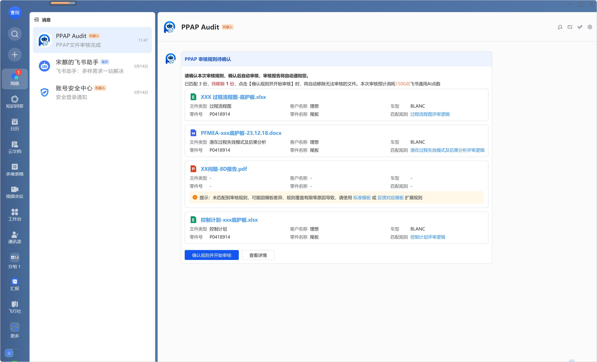
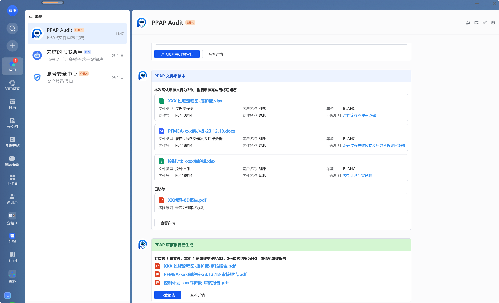
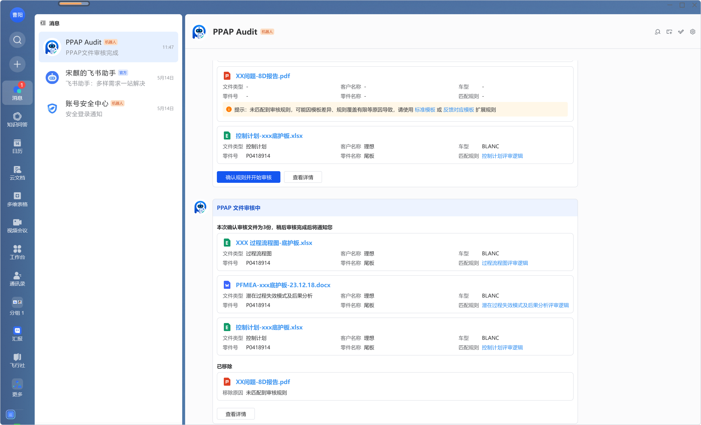

##### ③ 页面逻辑（规则口径）

| # | 触发节点                       | 消息标题             | 内容要点                                                           | 按钮                |
| - | -------------------------- | ---------------- | -------------------------------------------------------------- | ----------------- |
| ① | 识别完成                       | **PPAP 审核规则待确认** | 任务编号、预检报告（合规 N · 警告 M · 阻断 K）、已匹配 N 份、待移除 M 份；预检报告可查看/下载 | 【确认规则并开始审核】【查看预检报告】【查看详情】 |
| ② | 确认动作（确认即审核开始）              | **PPAP 文件审核中**   | 进入审核的文件清单与详情 + **已移除文件清单（文件名 + 移除原因）** + 预计耗时                  | 【查看详情】            |
| ③ | 全部进入审核的文件到达终态且已完成文件的报告全部生成 | **PPAP 审核报告已生成** | PASS / NG 摘要 + 各报告名称列表；**若存在审核异常的文件，追加一行「另有 N 份文件审核异常，未生成报告」** | 【下载报告】【查看详情】      |
| ④ | 确认时送审集合为空（全为未匹配自动移除 / 全取消勾选） | **本次任务无送审文件**   | 任务编号 + 「本次任务无送审文件，未产生审核费用」；任务直接转「已完成」、不进入 P5 审核、不生成审核报告 | 【查看详情】            |
| ⑤ | ZIP 打包完成（操作类，非推进节点）        | 报告打包完成           | 下载链接                                                   | 【下载】 `[确认]`       |

**按钮行为**

| 按钮            | 行为                                                                                     |
| ------------- | -------------------------------------------------------------------------------------- |
| 【确认规则并开始审核】   | 自动移除未匹配规则的文件 → 开始审核剩余已匹配文件 → 扣减点数；**点击后该按钮置灰不可重复点击**；随后发送消息 ② `[确认]`                   |
| 【查看详情】（消息 ①②） | 打开产品并**选中该任务**，按任务状态落到对应页面：`规则匹配中` → P3 预检与匹配页（规则匹配中）；`规则待确认` → P3 预检与匹配页（规则待确认）；`审核中` / `已完成` → P5 `[确认]` |
| 【查看详情】（消息 ③）  | 进入该任务的**报告页（P6）**                                                                      |
| 【下载报告】（消息 ③）  | 触发报告下载（单份 PDF / 多份 ZIP 异步打包）                                                           |
| 【下载】（消息 ⑤）    | 打开打包好的 ZIP 下载链接                                                                        |
| 【查看详情】（消息 ④）  | 打开产品并**选中该任务**，落到 P5 审核详情页（任务已完成、无送审文件、无审核队列；任务列表 / 详情空态）                                          |
| 【查看预检报告】（消息 ①） | 打开产品并**选中该任务**，落到 P3 预检与匹配页（规则待确认）；预检报告区常驻，可重新查看/下载该任务已留存的预检报告 PDF（命名 `{任务编号}-预检报告.pdf`）；**仅当任务处于「规则待确认」时直接落 P3**；若任务已确认/审核中/已完成，则跳转 P10 文件审核详情对应历史版本（预检报告按版本可追溯），并提示「该任务已进入审核，预检报告请在文件审核详情中查看」 `[确认]` |

**发送规则**：四个推进节点**各发一次**，不得多发（如"存在失败"类通知）、不得漏发；任务无失败态，不设失败通知。**0 送审时仅发 ④、不发送 ②/③**（无文件进入审核，故无「审核中」「报告已生成」消息）。**异常信息只通过三处表达**：① 消息 ③ 中的一行提示 ② P5 队列卡片 `! 异常` ③ P6 左区行状态。

##### ④ 交互逻辑

| 编号       | 触发                 | 系统行为              | 界面反馈                         | 边界与异常                  |
| -------- | ------------------ | ----------------- | ---------------------------- | ---------------------- |
| IL-11.01 | 识别完成               | 发送消息 ①            | 卡片含【确认规则并开始审核】【查看详情】         | 仅创建人可确认                |
| IL-11.02 | 点消息 ① 的【确认规则并开始审核】 | 与页面【开始审核】等效（同一接口） | 执行后该按钮置灰；随后发消息 ②             | 已确认后重复点击 → 拒绝          |
| IL-11.03 | 点消息 ①② 的【查看详情】     | 打开产品并选中该任务        | 落到 P3 预检与匹配页（规则匹配中 / 规则待确认）/ P5 | —                      |
| IL-11.04 | 全部文件到达终态且报告齐       | 发送消息 ③            | 卡片含报告名称列表；存在异常文件时追加异常份数提示行   | 若用户关闭了「完成后通知我」，则不发消息 ③ |
| IL-11.05 | 点消息 ③ 的【查看详情】      | —                 | 进入 P6 报告页                    | —                      |
| IL-11.06 | 点消息 ③ 的【下载报告】      | 触发下载（多份走异步打包）     | 打包中提示；完成后发消息 ⑤               | 额度不足时按计费规则处理           |
| IL-11.07 | ZIP 打包完成           | 发送消息 ⑤            | 卡片含下载链接              | 下载链接长期可访问     |
| IL-11.08 | 单文件审核异常            | **不单独发送通知**       | 异常信息合入消息 ③ 与页面状态             | 不得新增「审核失败」类独立消息        |
| IL-11.09 | 点消息 ① 的【查看预检报告】 | 打开产品并选中该任务；任务处于「规则待确认」→ 落 P3 预检与匹配页（预检报告区可重下留存 PDF）；任务已离开规则待确认 → 落 P10 对应历史版本（预检报告按版本可追溯） | 预检报告概览 + 可下载 PDF；非规则待确认时提示并转 P10 | 该任务无留存预检报告（极端缺失）→ 提示「暂无可追溯预检报告」 |

##### ⑤ 验收要点

四条推进通知在对应节点各发一次、不重不漏（0 送审时仅发 ④）；按钮行为与置灰正确；非创建人确认被拦截；异常份数在消息 ③ 中正确提示；ZIP 打包完成后发出下载链接；**消息 ① 含预检报告概览（合规 N · 警告 M · 阻断 K）与【查看预检报告】入口，预检报告持久化可重新查看/下载、跨任务在 P10 可追溯**。

---


### 3.2 审核文件（菜单 · P9 / P10 / P11 文件档案）
#### FR-18 审核文件列表页（P9 · 文件档案库）

##### ① 功能描述

按文件维度沉淀所有「审核完成」的文件，支持跨任务追溯与复看。列表每一行对应**一份云文档**（以飞书文档 ID 为唯一聚合键），行内信息以该文档**最新一次审核记录**为准。组织内全员可见所有项目的已审核文件。

> 关键前提：客户提交文件分本地上传与飞书文档两类。本地上传时系统先将该文件存入用户个人飞书云文档库，因此所有文件最终都对应一个飞书文档 ID；以飞书文档 ID 聚合该文档跨任务全部历史审核记录。

##### ② 效果图（占位）

| 图号          | 说明                                     |
| ----------- | -------------------------------------- |
| `IMG-P9-01` | 审核文件列表页（左树车型→零部件 + 11 列列表 + 筛选 + 批量下载）

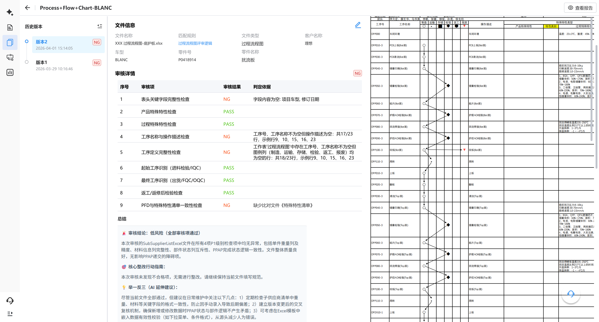 |

##### ③ 页面逻辑

**左树（车型 → 零部件两级）**

| 元素   | 规则                          |
| ---- | --------------------------- |
| 层级   | 固定【车型】→【零部件】两级；识别不出的归「其他」节点 |
| 默认选中 | 「全部文件」                      |
| 节点计数 | = 该节点下文件数（按 doc ID 计）       |
| 清空按钮 | 无（默认常驻「全部文件」）               |

**右列表（一行 = 一份云文档，展示最新审核记录）**

| 列               | 说明                        |
| --------------- | ------------------------- |
| 文档名称            | 飞书文档名称（模糊搜索仅匹配本列）         |
| 审核规则            | 最新一次审核匹配的规则名；**未匹配则显示为空** |
| 审核结果            | 最新一次审核结论（PASS / NG）       |
| 文件类型            | 识别出的字典类之一（核心 17 类或扩展类，见 §1.5）               |
| 发起人             | 最新一次审核发起人                 |
| 发起时间            | 最新一次审核发起时间                |
| 客户名称            | 最新一次审核客户                  |
| 车型 / 零件号 / 零件名称 | 来自文件识别字段                  |
| 操作              | 「查看详情」                    |

**筛选与搜索**

| 项         | 规则                                                                                         |
| --------- | ------------------------------------------------------------------------------------------ |
| 模糊搜索      | 仅检索**飞书文档名称**                                                                              |
| 筛选        | 文件类型 / 发起人 / 发起时间（范围） / 客户名称                                                               |
| 勾选 + 批量下载 | 单文件 → 直接下载该文档指定审核记录（默认最新）对应报告；多文件 → 打包 ZIP（复用现有异步打包 + 飞书消息通知）；每次下载均下载所选文档**指定审核记录**对应的审核报告 |
| 分页        | 每页 10 条（见 9.8）                                                                             |

##### ④ 交互逻辑

| 编号       | 触发              | 系统行为                   | 界面反馈              | 边界与异常              |
| -------- | --------------- | ---------------------- | ----------------- | ------------------ |
| IL-18.01 | 点击左侧导航「审核文件」    | 进入 P9，默认「全部文件」         | 左树 + 列表渲染（最新审核记录） | 拉取失败 → 整页错误态 +【重试】 |
| IL-18.02 | 点击左树节点          | 按车型 / 零部件过滤            | 列表刷新，计数随节点变化      | 节点无文件 → 空态         |
| IL-18.03 | 输入文档名搜索 / 选择筛选  | 300ms 防抖后拉取            | 列表刷新              | 无结果 → 空态 +【清空条件】   |
| IL-18.04 | 勾选文件 + 点击「批量下载」 | 单文件直接下报告 / 多文件异步打包 ZIP | 进度提示；完成经飞书消息通知    | 含未就绪报告 → 该份不可勾选    |
| IL-18.05 | 点击「查看详情」        | 进入 P10 文件审核详情页         | 载入该 doc ID 跨任务历史  | 文档不存在 → EA-06      |

##### ⑤ 验收要点

- 一行 = 一份云文档（doc ID 聚合），展示最新审核记录；
- 左树固定车型→零部件两级，默认「全部文件」，无清空按钮；
- 未匹配规则的记录「审核规则」列留空但仍可出报告（G10：仅 PASS/NG 出报告）；
- 审核中 / 异常文件不进入本列表；
- 批量下载按指定审核记录下载报告，单文件直下、多文件 ZIP。

---

#### FR-19 文件审核详情页（P10 · 跨任务历史版本）

##### ① 功能描述

展示某一云文档（doc ID）的**全部历史审核版本**，跨任务聚合。版本号按审核次数 **1 / 2 / 3 自增**，**不代表文件本身的版本号**。每版本含审核明细与总结区整改意见，并可查看对应报告。

##### ② 效果图（占位）

| 图号           | 说明                                    |
| ------------ | ------------------------------------- |
| `IMG-P10-01` | 文件审核详情页（左栏历史版本 + 中区审核明细 + 总结区 + 右栏预览） |

##### ③ 页面逻辑

**左栏 · 历史版本**

| 元素  | 规则                             |
| --- | ------------------------------ |
| 版本项 | 版本号 1 / 2 / 3…（按审核次数自增，非文件版本号） |
| 来源  | 展示**来源任务名 / 任务 ID**，便于追溯       |
| 默认  | 选中最新版本                         |
| 预检报告 | 该历史版本（= 一次任务）预检完成时生成的预检报告 PDF，提供「**查看预检报告**」入口，下载该版本留存预检报告（命名 `{任务编号}-预检报告.pdf`）；免费、不计费、不生成订单 |

**中区 · 审核明细（判定依据直接列展示，按图2 设计稿）**

| 列    | 说明                                  |
| ---- | ----------------------------------- |
| 序号   | 审核项序号                               |
| 审核项  | 来自客户规则拆条结果（原文展示）                    |
| 审核结果 | PASS / NG（未审到该项时「待审核」灰态）            |
| 判定依据 | 审核项对应规则要求条文，**直接列展示**（默认展开，超长区域内滚动） |

**总结区**

- 按**非 PASS 审核项 + 其判定依据**自动生成整改意见；
- 文件级结论（PASS / NG）与问题项汇总。

**右栏 · 文件预览**：文件原文对照预览 + 定位（见 FR-15）。

**顶部**：「查看报告」入口 → P11。

##### ④ 交互逻辑

| 编号       | 触发        | 系统行为                | 界面反馈      | 边界与异常                         |
| -------- | --------- | ------------------- | --------- | ----------------------------- |
| IL-19.01 | 进入 P10    | 载入该 doc ID 跨任务历史版本  | 默认选中最新版本  | 无历史版本 → 空态                    |
| IL-19.02 | 点击某历史版本   | 切换该版本审核明细 / 总结 / 预览 | 中区整体替换    | 版本定位失败 → 提示并回退默认版本            |
| IL-19.03 | 点击「查看报告」  | 进入 P11 报告预览页        | 载入该版本报告   | 该版本未生成报告（审核中/异常）→ 入口禁用（见 G10） |
| IL-19.04 | 审核项结果为 NG | 在总结区汇总并生成整改意见       | 与判定依据一并展示 | —                             |
| IL-19.05 | 点击某历史版本「查看预检报告」 | 下载该版本所属任务留存的预检报告 PDF（`precheck_report_url`） | 浏览器下载 `{任务编号}-预检报告.pdf` | 该版本无留存预检报告（极端缺失）→ 提示「暂无可追溯预检报告」 |

##### ⑤ 验收要点

- 历史版本 = 同 doc ID 跨任务全部审核记录，版本号 1/2/3 自增（非文件版本）；
- 版本项展示来源任务名 / ID；
- 审核明细判定依据直接列展示（与 FR-12 一致）；
- 仅 PASS / NG 版本可查看报告（审核中 / 异常不出报告，G10）；
- 每个历史版本可查看/下载其预检报告（跨任务追溯，命名 `{任务编号}-预检报告.pdf`，免费、不计费、不生成订单）；
- 总结区按非 PASS 项 + 判定依据生成整改意见。

---

#### FR-20 报告预览页（P11）

##### ① 功能描述

查看、下载、分享选定版本的审核报告。报告以 PDF 形式预览。

##### ② 效果图（占位）

| 图号           | 说明                                    |
| ------------ | ------------------------------------- |
| `IMG-P11-01` | 报告预览页（顶部报告名称 + 生成时间 + PDF 预览 + 分享/下载） |

##### ③ 页面逻辑

| 元素   | 说明                                              |
| ---- | ----------------------------------------------- |
| 顶部   | 报告名称（形如 `{文件名}-审核报告`）+ 生成时间（`yyyy-MM-dd HH:mm`） |
| 中部   | PDF 预览（在线报告与 PDF 解耦，见 DM-03）                    |
| 右上   | 「下载报告」「分享」                                      |
| 下载报告 | 单份 PDF 直接下载（命名 `{文件名}-审核报告.pdf`）                |
| 分享   | 复用 P7 分享浮层；**分享权限全部控制在飞书组织内**                   |

##### ④ 交互逻辑

| 编号       | 触发       | 系统行为               | 界面反馈                 | 边界与异常                                      |
| -------- | -------- | ------------------ | -------------------- | ------------------------------------------ |
| IL-20.01 | 进入 P11   | 载入该版本报告 PDF        | 预览渲染                 | 报告生成中 → 预览区占位「报告生成中」；生成失败 → 占位「报告生成失败，可重试」 |
| IL-20.02 | 点击「下载报告」 | 下载单份 PDF           | 浏览器下载                | 未就绪 → 入口禁用                                 |
| IL-20.03 | 点击「分享」   | 打开 P7 分享浮层（限飞书组织内） | 选飞书用户/群 + 选发送内容 + 发送 | 勾选 0 → 按钮禁用                                |

##### ⑤ 验收要点

- 报告名称与原生成时间展示，不展示报告编号（见附录 C）；
- PDF 预览支持生成中 / 失败占位；
- 下载单份 PDF；分享限飞书组织内（链接不超出组织）。

---


### 3.3 模板库（菜单 · P0）
#### FR-07 P0 模板库页

##### ① 功能描述

独立一级页（左侧导航「模板库」）：展示**已支持客户**与各客户的**模板清单**，支持 ① 预览单份模板 ② 分享模板给飞书用户/群 ③ 下载指定客户的模板压缩包（ZIP）④ 补充更多模板。

**边界**：

- **只展示已支持的客户**（存在 ≥1 条生效规则），未覆盖客户不进入列表、不灰显占位、不设「待支持 / 敬请期待」态 `[确认]`；
- 模板实际存放于飞书云盘文件夹，权限以云盘为准。
- 模板库除作为审核参照与补充入口外，同时作为**客户识别辅助信号源**：文件无法提取客户信息时，系统可将文件与模板库各客户模板比对以辅助推断归属客户（详见 §2.5「模板库匹配作为客户识别辅助信号」）；本页不展示匹配过程，仅作为信号数据源 `[确认]`。

优先级：**P0**

##### ② 效果图（占位）

| 图号          | 说明                                  |
| ----------- | ----------------------------------- |
| `IMG-P0-01` | P0 模板库页（左栏客户列表 + 右栏客户头 + 模板清单 + 分页） |
| `IMG-P0-02` | P0 单份模板预览态                          |
| `IMG-P0-03` | P0 修改文件夹权限浮层                        |

> **设计稿出处**：Figma 文件「PPAP Audit Agent 飞书集成」**模板库节点 `851-1988`**（链接见「文档信息 · 设计稿出处」）。本页三张图均取自该节点。

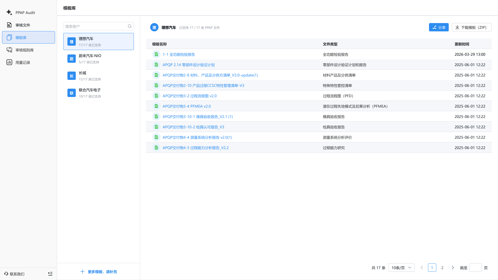

**界面结构（线框示意，最终以设计图为准）**

```
┌──────────────┬────────────────────────────────────────────────────────────────┐
│ 模板库       │  (理) 理想汽车   已支持 17 / 17 类 PPAP 文件                        │
├──────────────┤                                        [分享] [下载模板（ZIP）]     │
│ ┌──────────┐ │  文件夹创建人：章玲玲                        [修改文件夹权限]        │
│ │🔍搜索客户│ │  ┌──────────────────────────────────────────────────────────────┐  │
│ └──────────┘ │  │ 模板名称                      文件类型            更新时间   │  │
│ ┌──────────┐ │  ├──────────────────────────────────────────────────────────────┤  │
│ │(理) 理想 │ │  │ 1-1 全功能检验报告            全功能检验报告   2026-03-29 13:00│  │
│ │ 17/17 类 │ │  │ APQP 2.14 零部件设计验证计划  零部件设计验证…  2025-06-01 12:22│  │
│ │ 已支持   │ │  │ APQP交付物2-8 材料、产品及…    材料产品及分供清单 2025-06-01 …│  │
│ └──────────┘ │  │ APQP交付物2-10 产品过程CCSC…  特殊特性管控清单  2025-06-01 …│  │
│ ┌──────────┐ │  │ APQP交付物3-2 过程流程图 v2.0 过程流程图（PFD） 2025-06-01 …│  │
│ │(蔚) 蔚来 │ │  │ APQP交付物3-4 PFMEA v2.0      PFMEA            2025-06-01 …│  │
│ │ 5/17 类  │ │  │ APQP交付物3-10-1 模具验收报告  模具验收报告     2025-06-01 …│  │
│ └──────────┘ │  │ APQP交付物3-10-2 检具认可报告  检具验收报告     2025-06-01 …│  │
│ ┌──────────┐ │  │ APQP交付物4-4 测量系统分析报告 测量系统分析评价  2025-06-01 …│  │
│ │(长) 长城 │ │  │ APQP交付物4-5 过程能力分析报告 过程能力研究     2025-06-01 …│  │
│ │ 15/17 类 │ │  └──────────────────────────────────────────────────────────────┘  │
│ └──────────┘ │                    共 17 条  [10条/页 ▾] ‹1 2 3 4 5 … 9› 跳至10页  │
│ + 更多模板， │                                                                     │
│   请补充     │                                                                     │
└──────────────┴─────────────────────────────────────────────────────────────────────────┘
```

##### ③ 页面逻辑

**3.7.1 左栏（320px）：客户列表**

| 元素    | 规则                                                            |
| ----- | ------------------------------------------------------------- |
| 搜索框   | placeholder **「搜索客户」**，按客户名称实时过滤                              |
| 客户行   | 头像 + 客户名称 + **覆盖度文案 `N/17 类已支持`**（如 `17/17 类已支持`、`5/17 类已支持`） |
| 覆盖度取值 | N = 该客户「生效」规则适用文件类型中**核心 17 类（T01–T17）**的并集类数；扩展类（E01–E12）无模板，不计入覆盖度 N                                      |
| 选中态   | 点击切换右栏；**默认选中第一个客户**                                          |
| 底部入口  | 「+ 更多模板，请补充」→ 打开 P2 补充模板弹窗（与 P1 入口等价）                         |
| 数据来源  | 内部后台「已生效」规则聚合 `[确认]`                                          |

**3.7.2 右栏：客户模板清单**

| 元素     | 规则                                                                                                               |
| ------ | ---------------------------------------------------------------------------------------------------------------- |
| 客户头    | 头像 + 客户名称 + 徽章 **「已支持 17 / 17 类 PPAP 文件」**                                                                       |
| 右上角按钮  | **「分享」**（将模板分享给飞书用户/群，复用 P7 选人组件）+ **「下载模板（ZIP）」**（打包当前客户全部模板）                                                   |
| 文件夹信息行 | 「文件夹创建人：**章玲玲**」+「**修改文件夹权限**」按钮 —— 模板实际存放于飞书云盘文件夹，展示创建人并提供权限修改入口                                                |
| 表格列    | **模板名称**（左侧带文件类型图标，链接样式可点击预览）<br />**文件类型**（取自字典：核心 17 类 + 扩展类，见 §1.5，展示全名如「过程流程图（PFD）」）<br />**更新时间**（精确到分钟：`yyyy-MM-dd HH:mm`） |
| 排序     | **按更新时间倒序**（最新在前）                                                                                                |
| 分页     | 「共 N 条」+ 每页条数选择器（`10条/页`）+ 页码切换 + 「跳至 \__ 页」；**默认 10 条/页**                                                       |
| 空态     | 该客户无模板时展示空态 `[开放]`                                                                                               |

**参考数据（理想汽车示例，共 17 条）**：1-1 全功能检验报告（全功能检验报告）、APQP 2.14 零部件设计验证计划（零部件设计验证计划和报告）、APQP交付物2-8 材料产品及分供方清单（材料产品及分供清单）、APQP交付物2-10 产品过程CCSC特性管理清单（特殊特性管控清单）、APQP交付物3-2 过程流程图 v2.0（过程流程图 PFD）、APQP交付物3-4 PFMEA v2.0（PFMEA）、APQP交付物3-10-1 模具验收报告（模具验收报告）、APQP交付物3-10-2 检具认可报告（检具验收报告）、APQP交付物4-4 测量系统分析报告（测量系统分析评价）、APQP交付物4-5 过程能力分析报告（过程能力研究）。

##### ④ 交互逻辑

| 编号       | 触发               | 系统行为             | 界面反馈                           | 边界与异常                      |
| -------- | ---------------- | ---------------- | ------------------------------ | -------------------------- |
| IL-07.01 | 点击左侧导航「模板库」      | 拉取已生效客户聚合        | 进入本页，默认选中第一个客户并加载其模板           | 无已生效客户 → 左栏为空              |
| IL-07.02 | 左栏搜索框输入          | 按客户名过滤           | 实时过滤                           | 无命中 → 空结果                  |
| IL-07.03 | 点击某客户行           | 拉取该客户模板清单（第 1 页） | 右栏客户头、徽章、文件夹信息、清单、分页全部刷新；该行选中态 | 切换客户时保留搜索词                 |
| IL-07.04 | 点击模板名称           | 拉取模板内容           | 打开单份模板预览                       | 预览失败 → 提示                  |
| IL-07.05 | 点击「下载模板（ZIP）」    | 打包当前客户全部模板       | 触发下载                           | 该客户无模板 → 按钮不可用或下载空包 `[开放]` |
| IL-07.06 | 点击「分享」           | —                | 打开 P7 分享浮层（复用选人组件），发送该客户模板     | 见 FR-06                    |
| IL-07.07 | 点击「修改文件夹权限」      | 调云盘权限接口          | 打开权限修改入口（创建人可对他人授权）            | 无权限者按钮不可见/不可用 `[开放]`       |
| IL-07.08 | 切换分页 / 每页条数 / 跳页 | 按参数重新取数          | 清单刷新，保持按更新时间倒序                 | —                          |
| IL-07.09 | 点击「+ 更多模板，请补充」   | —                | 打开 P2 补充模板弹窗                   | 与 P1 入口等价                  |

##### ⑤ 验收要点

模板库数据与后台生效规则实时一致；覆盖度 `N/17 类已支持` 计算正确；清单按更新时间倒序、默认 10 条/页；分享 / 下载 ZIP / 修改文件夹权限 / 单份预览均可用；未覆盖客户不出现在左栏。

---


### 3.4 规则库（菜单 · P12）
#### FR-21 P12 规则库页

##### ① 功能描述

独立一级页（左侧导航「规则库」）：按客户归集审核规则，以「客户 → 文件类型」层级呈现每个客户的规则库（即按客户 × 文件类型组织的审核要求文档集合），可查看规则名称、生效状态与覆盖的文件类型（覆盖度 `N/17 类已支持`）。规则库是审核规则匹配（FR-02 / §2.5）检索范围的用户侧视图；规则内容的增删改与生效配置由内部后台维护，用户侧规则库为**按客户存储与查看**的视图。

##### ② 效果图（占位）

| 图号           | 说明                                          |
| ------------ | ------------------------------------------- |
| `IMG-P12-01` | 规则库页（左侧客户列表 + 右侧客户 × 文件类型规则条目） |

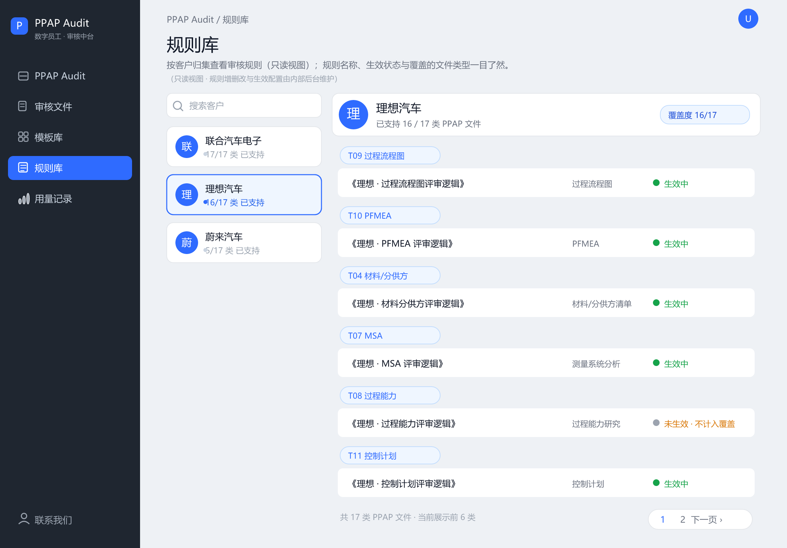

##### ③ 页面逻辑

| 元素            | 说明                                                                                  |
| ------------- | ----------------------------------------------------------------------------------- |
| 顶部            | 「规则库」标题                                                                            |
| 左侧            | 已支持客户列表（来源同模板库「已生效」客户清单 `[确认]`）                                            |
| 右侧（选中客户后）   | 该客户规则库：按文件类型分组的规则条目（规则名称 / 生效状态 / 覆盖的文件类型）；覆盖度标识 `N/17 类已支持`；与模板库（P0）对称布局 |

##### ④ 交互逻辑

| 编号       | 触发      | 系统行为                       | 界面反馈                    | 边界与异常                              |
| -------- | ------- | -------------------------- | ----------------------- | ---------------------------------- |
| IL-21.01 | 进入 P12  | 载入已支持客户列表                 | 左侧客户列表渲染                | —                                  |
| IL-21.02 | 选中客户   | 右侧展示该客户规则库（客户 × 文件类型）     | 规则条目按文件类型分组展示           | 客户无规则 → 空态提示「该客户暂无规则」                  |
| IL-21.03 | 点击规则条目 | 查看规则详情（只读）               | 展示规则名称 / 生效状态 / 覆盖范围     | 规则未生效 → 标注「未生效」，不计入覆盖度 `N/17`        |

##### ⑤ 验收要点

- 按客户归集展示，客户 → 文件类型 两级层级清晰；
- 规则名称、生效状态、覆盖的文件类型可见；覆盖度 `N/17 类已支持` 与模板库口径一致；
- 用户侧为**只读查看**视图，不提供规则编辑 / 上传入口（编辑能力见附录 A11 / A19）；
- 与模板库（P0）对称布局，左侧导航菜单项齐全。

---


### 3.5 用量记录（菜单 · P8）
#### FR-16 P8 用量记录页

##### ① 功能描述

展示当前企业的 **AI 点数用量记录**，供用户核对消耗与余额：统计卡（本月消费次数、消费点数、待扣费点数、免费额度）与用量流水（每条流水 = 单个文件的单次审核，对应一个独立的飞书订单号）。是计费能力（FR-10）的对账入口，也是用户遇到「额度不足」时的自查路径。

##### ② 效果图（占位）

| 图号          | 说明                        |
| ----------- | ------------------------- |
| `IMG-P8-01` | P8 用量记录页（4 张统计卡 + 用量流水列表） |


##### ③ 页面逻辑

**统计卡（固定「本月」自然月口径，不随列表时间筛选变动）**

| 卡      | 口径                                | 状态 |
| ------ | --------------------------------- | -- |
| 本月消费次数 | = 本月用量流水笔数                        | 常驻 |
| 消费点数   | 本月已扣费点数合计                         | 常驻 |
| 待扣费点数  | 本月待扣费点数合计；**无跳转能力**（不可点击）         | 常驻 |
| 免费额度   | 当前企业免费额度剩余 / 总额；默认 1000 / 企业（可配置） | 常驻 |

**用量流水列表（每条记录 = 单个文件的单次审核）**

| 列     | 说明                    | 来源                 |
| ----- | --------------------- | ------------------ |
| 时间    | 审核完成 / 扣费时间           | 记录生成时间             |
| 飞书订单号 | 每份文件每次审核单独生成          | 计费系统               |
| 文档名称  | 该次审核对应云文档名称（含版本）      | `feishu_doc_id` 聚合 |
| 扣费状态  | **已扣费** / **待扣费**（两态） | 计费系统               |
| 发起人   | 发起该次审核的用户             | 任务创建人              |
| 扣费点数  | 该次审核消耗点数              | 计费结算               |
| 操作    | 「查看详情」                | —                  |

**筛选与分页**

| 项      | 规则                                        |
| ------ | ----------------------------------------- |
| 时间筛选   | 最近 7 天 / 最近 30 天（**默认**） / 最近 90 天 / 全部记录 |
| 搜索     | 按文档名称或发起人模糊搜索                             |
| 分页     | 每页 10 条（见 9.8）；超一页展示分页器                   |
| 与计费一致性 | 扣费点数 = 勾选且已匹配的文件数 × 500（见 FR-10）           |

##### ④ 交互逻辑

| 编号       | 触发           | 系统行为             | 界面反馈                 | 边界与异常                   |
| -------- | ------------ | ---------------- | -------------------- | ----------------------- |
| IL-16.01 | 左侧导航点击「用量记录」 | 进入 P8 并拉取用量数据    | 4 卡 + 列表渲染           | 拉取失败 → 整页错误态 +【重试】（9.4） |
| IL-16.02 | 选择时间筛选       | 按条件重新拉取列表        | 列表刷新，分页重置第 1 页       | 无结果 → 结果空态 +【清空条件】（9.2） |
| IL-16.03 | 搜索文档名称 / 发起人 | 300ms 防抖后搜索（9.9） | 列表刷新                 | 请求竞态：后发覆盖先发             |
| IL-16.04 | 点击「查看详情」     | 进入用量详情页（P8 子页面）  | 定位到该记录对应版本的历史版本      | 记录不存在 → EA-06           |
| IL-16.05 | 翻页           | 拉取对应页            | 保持筛选条件，回到列表顶部        | 翻页失败 → Toast + 保持当前页    |
| IL-16.06 | 待扣费记录充值后     | 状态由「待扣费」翻「已扣费」   | 统计卡（消费次数 / 消费点数）同步累加 | 数据一致，三处口径对齐             |

**子页面 3.1 用量详情（P8 子页面）**

- **功能**：展示单条用量记录的明细，并将历史版本定位到该记录对应的版本。
- **页面逻辑**：顶部记录信息（时间 / 飞书订单号 / 文档名称 / 扣费状态 / 发起人 / 扣费点数）；中部文件审核详情（复用 FR-19，历史版本定位到该次审核对应版本）；右上「返回」回 P8。
- **异常**：记录不存在 → EA-06；对应版本已不可见 → 提示并回退默认版本。

##### ⑤ 验收要点

- 统计卡固定本月自然月口径，列表时间筛选独立作用；
- 每条流水 = 单文件单次审核，独立飞书订单号；扣费状态仅已扣费 / 待扣费两态；
- 待扣费点数卡无跳转；待扣费充值后翻已扣费且统计卡同步；
- 点查看详情进入用量详情，历史版本精确对应该记录版本；
- 列表支持分页、搜索、空态、错误重试等通用规范。

---

#### FR-10 AI 点数计费（免费额度 + 飞书AI点数 双池）

##### ① 功能描述

AI 点数（飞书 AI 点数）与免费额度共同构成计费双池，负责**预估、结算与计费异常处理**。计费口径与结算同口径（勾选且已匹配的文件数 × 500 点 / 文件）；异常提示文案按 Figma 节点 886-3068 逐字落地。采用**双步计费闸门（两步校验 + 确认时扣费）**：进入 PPAP Audit 页面先校验飞书 AI 包开关（① 进页校验）；点击「创建审核任务」时再实时校验「开关 = 开 且 双池之和 > 0」（② 创建硬闸）——**硬闸只拦截开关关闭或双池全空，不校验本次是否足额、不发生扣费**；**实际扣费发生在确认动作（P3【开始审核】）**，若本次待扣费 > 当前可用额度，不拦截审核，仅常驻提醒（软上限）。

优先级：**P0**

##### ② 效果图（占位）

| 图号         | 说明                                   |
| ---------- | ------------------------------------ |
| `IMG-G-03-01` ~ `IMG-G-03-03` | 计费提示条三态（开关关闭 / 试用额度不足且未采购 / 审核中额度不足），见 FR-00 |
| `IMG-B-01` | P3 预检与匹配页点数预估行「本次审核预计消耗 N 点飞书AI点数」         |
| `IMG-B-02` | P5 审核中额度不足常驻提示条                      |


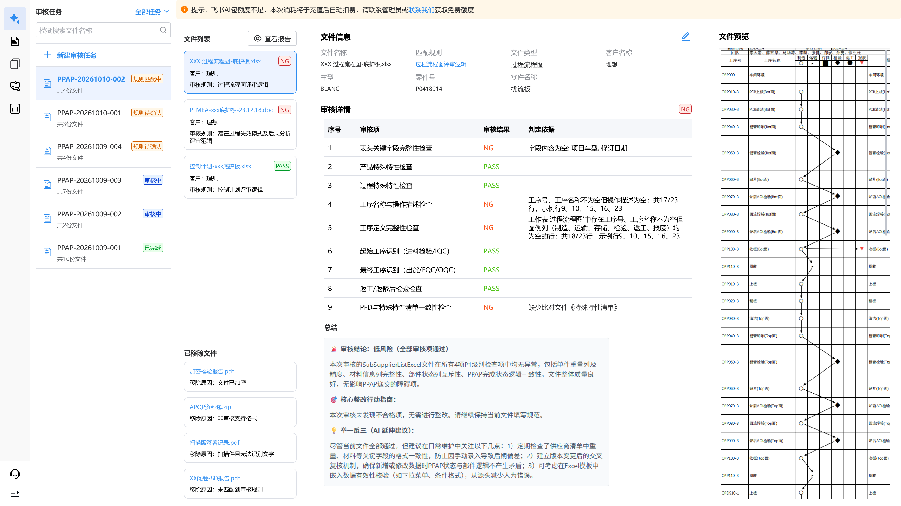

##### ③ 页面逻辑（规则口径）

| 项               | 规则                                                             |
| --------------- | -------------------------------------------------------------- |
| **双池构成**        | ① **免费额度**：每企业默认 1000 点（可配置，初始值 1000）；② **飞书 AI 点数**：企业采购的付费点数 |
| **扣减顺序** `[确认]` | 先扣**免费额度**，扣完后再扣**飞书 AI 点数**；任一池有余量即可满足本次消耗                    |
| **计费口径** `[确认]` | **[勾选且已匹配的待审文件数] × 500 点 / 文件**；未匹配、预检阻断级、取消勾选的文件不计入预估与结算       |
| **预估展示**        | P3 预检与匹配页（规则待确认）底部：「**本次审核预计消耗 N 点飞书AI点数**」                              |
| **预估计算**        | N = 当前任务内**被勾选的已匹配文件数** × 500（确认动作前显示为预估，随手动移除 / 取消勾选实时重算）             |
| **实际结算**        | 确认动作触发时，按最终进入审核的已匹配文件数结算，从双池按「先免费额度后飞书AI点数」扣减                  |
| **审核异常文件**      | **已扣点数不退还** —— 异常文件已进入审核并产生消耗，结算不因审核异常而回退 `[确认]`               |
| **深度模式**        | **不影响点数单价**，两档均为 500 点 / 文件                                    |
| **预检计费** `[确认]` | **预检、识别文件要素与匹配规则（格式级 + 文件类型内容规则级预检 + 识别要素 + 匹配规则 + 预检报告导出与留存）全程免费**，不消耗免费额度也不消耗飞书 AI 点数，不产生计费订单；计费仅发生于【开始审核】→ P5 正式审核（按「勾选且已匹配的文件数 × 500」） |
| 扣费主体            | 飞书 AI 点数 + 免费额度（双池）                                            |

**双步计费闸门（两步校验 + 确认时扣费）**

- **① 进入 PPAP Audit 页面（信息校验）**：实时校验**飞书 AI 包开关**状态。
  - 开关**未打开** → 顶部展示提示条①，**创建审核任务入口禁用**（限制写操作），浏览 / 查看报告 / 用量查询保持可用；
  - 开关已打开 → 本步不校验额度（额度校验下移到创建动作）。
- **② 点击「创建审核任务」那一刻（硬闸）**：实时校验 **(飞书 AI 包开关 = 开) 且 (免费额度 + 飞书 AI 点数 > 0)**。
  - 满足 → 放行并触发审核；
  - 不满足（开关关闭，或双池之和 ≤ 0）→ **创建失败**，顶部展示对应提示条，**不进入审核**。
  - **本步不校验本次是否足额、不发生扣费**；足额不足由确认后的软上限（审核中常驻提示条③）承接。

**软上限（审核中）**：已发起审核后，若本次待扣费点数 > 当前可用（免费额度 + 飞书 AI 点数），**不拦截审核**，仅在审核任务详情页（P5）顶部常驻提示条③，提示剩余费用将于充值后自动扣费。

**三类计费异常提示文案（Figma 节点 886-3068 逐字）**

| 场景                 | 触发位置          | 提示文案                                               |
| ------------------ | ------------- | -------------------------------------------------- |
| 飞书 AI 包开关已关闭       | ① 进页 / ② 创建失败 | 「飞书AI包开关已关闭，请联系管理员在飞书管理后台启用或联系我们获取免费额度」            |
| 免费额度与飞书 AI 点数均 ≤ 0 | ② 创建失败        | 「提示：试用额度不足，且未采购飞书AI包，请联系管理员在飞书管理后台进行充值或联系我们获取免费额度」 |
| 审核中待扣费 > 可用额度      | P5 顶部常驻       | 「提示：飞书AI包额度不足，本次消耗将于充值后自动扣费，请联系管理员或联系我们获取免费额度」     |

> 术语统一：全文以「**免费额度**」表述（替代「试用额度」等旧称）。**例外**：计费提示条②为线上实际文案，逐字采用「试用额度不足…」（验收口径：提示条文案与线上完全一致）。

**叠加规则**

1. 欠费运行期间，**报告下载与分享不受限**（限飞书组织内，见 FR-20）；
2. 报告生成失败的「重生成」与 ZIP 打包重试仍受额度校验（不足则拦截，充值后自动扣费并解锁）；
3. **审核异常文件不提供重试**。

##### ④ 交互逻辑

| 编号       | 触发                      | 系统行为                          | 界面反馈                          | 边界与异常                      |
| -------- | ----------------------- | ----------------------------- | ----------------------------- | -------------------------- |
| IL-10.01 | 进入 PPAP Audit 页面        | 实时校验飞书 AI 包开关                 | 开关关闭→提示条①常驻 + 创建入口禁用；开关打开→无提示 | 浏览 / 查看报告 / 用量查询保持可用       |
| IL-10.02 | P3 预检与匹配页（规则待确认）渲染                | 计算 N = 已匹配文件数 × 500           | 底部展示「本次审核预计消耗 N 点飞书AI点数」      | 未匹配文件计 0；全部未匹配 → 0 点       |
| IL-10.03 | 点击「创建审核任务」              | 实时校验 (开关=开) 且 (免费额度+飞书AI点数>0) | 满足→放行；不满足→创建失败 + 提示条②/①       | 并发耗尽导致点击时 ≤0 → 拦截（硬闸在创建动作） |
| IL-10.04 | 确认动作                    | 按最终进入审核的已匹配文件数，先免费额度后飞书AI点数结算 | —                             | 已扣点数异常不退                   |
| IL-10.05 | 审核中待扣费 > 可用             | 记录欠费，**继续审核**                 | P5 顶部提示条③常驻至任务结束              | 报告下载与分享不受限（限组织内）           |
| IL-10.06 | 欠费下点击「重生成报告」/ 重试 ZIP 打包 | 重新校验额度                        | 不足则拦截并提示；充值后自动扣费并解锁           | 已生成报告不受影响                  |
| IL-10.07 | 勾选深度模式                  | 点数单价不变（500 / 文件）              | 预估不变                          | —                          |
| IL-10.08 | 充值到账                    | 免费额度 / 飞书AI点数回补；待扣费记录翻「已扣费」   | 用量记录统计卡同步累加（见 FR-16）          | —                          |

##### ⑤ 验收要点

- 进入页面即校验开关，关闭时创建入口禁用且提示条①常驻；
- 点击创建审核任务实时校验双池，≤0 创建失败并展示提示条②，>0 放行；
- 扣减顺序为「先免费额度后飞书AI点数」，可用 = 免费额度 + 飞书AI点数；
- 审核中欠费不中断、常驻提示条③，报告导出 / 分享不受限（限飞书组织内）；
- 三类提示文案与 Figma 886-3068 逐字一致；异常文件点数不退还。

---


### 3.6 联系我们（菜单）
#### FR-17 联系我们 `[沿用现有 · 待补充]`

##### ① 功能描述

提供统一的问题反馈与人工支持入口。出现以下情形时用户可由此联系到对接人：**AI 点数未开通 / 额度不足**（FR-10）、**未知错误需提供 `trace_id`**（EA-09）、**需要补充客户模板**（FR-08）、**模板库权限申请**（FR-07）、其他使用问题。

入口位置：左侧导航底部「联系我们」按钮（全局常驻）`[确认]`；展示形式：**全局浮层**（遮罩 + 居中弹窗）`[确认]`；展示内容：以线上浮层为准——快速响应 / 专业支持 / 专属对接三通道，直接联系（联系电话、邮箱、服务时间）与飞书咨询二维码（扫码添加，一对一服务）`[确认]`。

##### ② 效果图（占位）

| 图号         | 说明     |
| ---------- | ------ |
| `IMG-G-04` | 联系我们浮层 |


##### ③ 页面逻辑

| 元素         | 构成 / 数据来源             | 文案      | 状态显隐              |
| ---------- | --------------------- | ------- | ----------------- |
| 入口         | 全局可见（见 JP-04 / JP-21） | 「联系我们」  | 常驻                |
| 容器         | 全局浮层（遮罩 + 居中弹窗）`[确认]` | 「联系我们」  | 点击入口即展示           |
| 对接信息       | 联系电话 / 邮箱 / 服务时间（接口或配置返回，前端仅展示） | 以线上浮层为准 | 常驻                |
| 二维码        | 飞书咨询二维码（扫码添加，一对一服务）   | 「飞书咨询」  | 常驻（浮层右侧卡片区）       |
| 场景化引导      | 不同进入来源展示不同引导语         | `[待补充]` | 从计费异常进入时优先展示开充值引导 |
| `trace_id` | 从 EA-09 进入时携带，便于排查    | 可复制     | 仅从未知错误进入时展示       |

##### ④ 交互逻辑

| 编号       | 触发              | 系统行为                    | 界面反馈        | 边界与异常                              |
| -------- | --------------- | ----------------------- | ----------- | ---------------------------------- |
| IL-17.01 | 点击「联系我们」        | 打开浮层                    | 展示对接信息      | 打开失败 → Toast 错误 +【重试】，不阻断原页面       |
| IL-17.02 | 从计费提示条「联系管理员」进入 | 打开浮层并定位到「开通 / 充值」引导     | 优先展示充值相关引导  | —                                  |
| IL-17.03 | 从未知错误 Toast 进入  | 携带 `trace_id` 一并展示，支持复制 | 「复制成功」Toast | 复制失败 → 提示手动选择文本                    |
| IL-17.04 | 点击二维码           | 放大展示                    | 二维码放大层      | `[待补充：是否支持保存到本地]`                  |
| IL-17.05 | 点击邮箱 / 群链接      | 唤起邮件客户端 / 跳转飞书群         | 系统级跳转       | 未安装对应客户端 → 提示「未检测到邮件客户端，可手动复制邮箱地址」 |
| IL-17.06 | 关闭浮层            | 关闭并回到来源页面               | 来源页面状态不变    | 来源页面为异步任务页时，任务继续运行                 |
| IL-17.07 | 对接信息未配置         | 兜底展示通用支持说明              | 不展示空白浮层     | **禁止空浮层**：未配置时走兜底文案 `[待补充：兜底文案]`   |

##### ⑤ 验收要点

- 全局可达：所有主要页面均可进入「联系我们」。
- 从计费异常、未知错误进入时携带场景信息（引导语 / `trace_id`）。
- 任何情况下不展示空白浮层。
- 关闭后回到来源页面且不影响进行中的异步任务。

---


## 4. 数据需求

> 工程实现可按现有库规范调整字段类型，但**实体、关键字段与枚举值**须与本节一致。

### DM-01 审核任务 `review_task`

| 字段                                   | 类型                | 说明                                                                                                                                                   |
| ------------------------------------ | ----------------- | ---------------------------------------------------------------------------------------------------------------------------------------------------- |
| `task_id`                            | string            | 任务唯一 ID                                                                                                                                              |
| `task_no`                            | string            | **任务编号**，格式 `PPAP-YYYYMMDD-NNN`（NNN 当日自增，如 `PPAP-20261012-003`） `[确认]`                                                                               |
| `selected_customer_id`               | string / null     | **本批默认客户**（P1 下拉选择），未选为 null；作未识别文件归属的**兜底**，非过滤条件、不强制单客户；不影响已识别文件的归属（确定链见 §2.5） `[确认]`                                                                  |
| `status`                             | enum              | **仅四态**：`matching` 规则匹配中 / `pending_confirm` 规则待确认 / `reviewing` 审核中 / `completed` 已完成。**不设失败 / 部分失败态** `[确认]`                                       |
| `depth_mode`                         | bool              | 深度模式：true = 调用**能力更强的审核模型**；**两档规则范围相同，仅模型能力与耗时不同**，默认 false                                                                                         |
| `file_count_total`                   | int               | 本次提交的文件总数                                                                                                                                            |
| `file_count_reviewable`              | int               | 预检通过（非阻断级）且在 P3 被勾选的可送审文件数                                                                                                                                |
| `file_count_reviewing`               | int               | 最终进入审核的文件数 **= 勾选且已匹配的文件数**（计费基数）                                                                                                                     |
| `file_count_queued`                  | int               | **任务项展示的「N 份文件」= 任务内当前排队审核的文件数（未被移除的文件数）** `[确认]`：规则匹配中 / 规则待确认阶段 = `file_count_reviewable`；确认动作后 = `file_count_reviewing`。**随移除动作动态递减**，不含任何已被移除的文件 |
| `points_estimated` / `points_actual` | int               | 预计 / 实际消耗点数；**基数均为「勾选且已匹配的文件数 × 500」** `[确认]`                                                                                                         |
| `created_by` / `created_at`          | string / datetime | 创建人与创建时间                                                                                                                                             |
| `confirmed_by` / `confirmed_at`      | string / datetime | 确认人与确认时间；**仅任务创建人可确认** `[确认]`                                                                                                                        |
| `progress_done` / `progress_total`   | int               | 已完成份数 / 总份数（进度计数）                                                                                                                                    |
| `eta_low_min` / `eta_high_min`       | int               | 剩余时间区间（分钟），宁高估                                                                                                                                       |
| `notify_enabled`                     | bool              | 是否发送任务完成通知，默认 true                                                                                                                                   |
| `finished_at`                        | datetime / null   | 任务完成时间（全部文件审核完成 **且** 报告全部生成）                                                                                                                        |
| `precheck_report_url`             | string / null     | **预检报告持久化 PDF 地址**：预检完成时生成并留存（免费、不计费、不生成计费订单）；供 P3 预检报告区重新下载、消息 ①【查看预检报告】跳转查看、P10 按历史版本追溯 `[新增]` |
| `precheck_report_pdf_name`        | string / null     | 预检报告 PDF 文件名，命名 `{任务编号}-预检报告.pdf` `[新增]`                                                                              |
| `precheck_report_generated_at`    | datetime / null   | 预检报告生成时间（预检完成、任务转「规则待确认」时刻） `[新增]`                                                                              |


### DM-02 待审文件 `review_file`

| 字段                                            | 类型                    | 说明                                                                                                                                     |
| --------------------------------------------- | --------------------- | -------------------------------------------------------------------------------------------------------------------------------------- |
| `file_id`                                     | string                | 文件唯一 ID                                                                                                                                |
| `task_id`                                     | string                | 所属任务                                                                                                                                   |
| `file_name` / `file_ext` / `file_size`        | string / string / int | 原始信息                                                                                                                                   |
| `source`                                      | enum                  | `local_upload` 本地上传 / `feishu_drive` 飞书云文档 `[沿用现有]`                                                                                    |
| `source_path`                                 | string / null         | 来源路径展示文案，如 `飞书云盘 · 我的文件夹 / XX车型 / 文件名.xlsx`                                                                                            |
| `reviewable`                                  | bool                  | 是否可审核（预检结果；阻断级 = false）                                                                                                                           |
| `not_reviewable_reason`                       | enum                  | `format_unsupported` 不支持格式（**含图片类**）/ `file_encrypted` 文件已加密 / `scanned_pdf` 扫描件 PDF 无文本层 / `file_corrupted` 文件损坏 / `too_large` 超过大小限制 |
| `precheck_level`                              | enum                  | 预检结果分级：`pass` 合规 / `warning` 警告级 / `fatal` 阻断级；上传后预检得出（格式级门禁 + 文件类型内容规则级三维度检查） `[新增]` |
| `precheck_findings`                           | string / null         | 预检发现明细（阻断 / 警告原因 + 原因码 + 责任侧），逐文件展示，与页面文案一致 `[新增]` |
| `precheck_rule_set`                           | string / null         | 命中的文件类型预检规则集标识（按文件类型），由内部后台维护 `[新增]` |
| `precheck_report_available`                   | bool                  | 是否已有留存预检报告可查看/下载（预检完成后为 true；任务级 `precheck_report_url` 可用后该文件可追溯到） `[新增]` |
| `precheck_reason_code`                        | string / null         | 预检原因码（`B01`~`B06` / `W01`~`W06`），逐文件、逐检查项记录 `[新增]` |
| `precheck_status`                             | string / null         | 预检状态词（`S01` 范围外 / `S02` 规则不适配 / `S03` 移交 / `S04` 对端未到（`S04-S`/`S04-C`）/ `S05` 受控模板缺结构（已核对 / 待核）/ 未执行），非级别，完整定义见附录 G G.5 `[更新]` |
| `precheck_responsibility`                     | string / null         | 预检问题责任侧（材料侧 / 提交方 / 解析侧） `[新增]` |
| `recognized_type`                             | string / null         | 识别出的文件类型（取自字典：核心 17 类 + 扩展类，见 §1.5）                                                                                                                    |
| `recognized_customer`                         | string / null         | 识别出的客户名称                                                                                                                               |
| `recognized_vehicle_model`                    | string / null         | 车型                                                                                                                                     |
| `recognized_part_no`                          | string / null         | 零件号                                                                                                                                    |
| `recognized_part_name`                        | string / null         | 零件名称                                                                                                                                   |
| `match_status`                                | enum                  | `matched` 已匹配 / `unmatched` 未匹配                                                                                                        |
| `customer_id` / `rule_id` / `rule_version`    | string                | 命中的**客户、规则与版本**（对应「客户规则库」中 `客户 × 文件类型` 命中的那条规则）；用户侧展示**规则名称**（形如《…评审逻辑》）                                                               |
| `effective_customer_id`                     | string / null         | **文件实际归属客户**（每文件独立确定）：优先取 `recognized_customer`，模板匹配推断时取模板匹配客户，P1 兜底时取 `selected_customer_id`，多项选择 / 手动指定时取用户选定客户；是规则匹配的实际依据（确定链见 §2.5） `[新增]`；匹配成功后与 `customer_id`（命中客户）恒等——前者为确定来源、后者为匹配结果，二者不并存歧义 `[新增]` |
| `customer_determination_source`             | enum / null           | 归属客户的确定来源：`file_extracted` 文件自身识别 / `template_matched` 模板库匹配推断 / `task_default` P1 本批默认兜底 / `multi_choice` 多项选择 / `manual` 手动指定；用于追溯与界面标注（如「模板推断」） `[新增]` |
| `match_basis`                                 | string                | 命中依据文案，如「客户名称命中 · 模板表头匹配」                                                                                                              |
| `selected`                                    | bool                  | P3 复选框状态，默认 true；**取消勾选 = 不进入本次识别与审核** `[确认]`；确认后该文件不进入审核队列、不计费、不移除，亦不计入 P5 文件队列与已移除区，作为本任务跳过项处理                                                                                          |
| `review_status`                               | enum                  | `pending` / `queued` / `running` / `passed` / `failed`（**NG** 判定结论；`failed` 仅作内部状态值，用户侧一律展示「NG」，禁止出现「失败」字样）/ `review_failed`（**审核异常**，用户侧文案统一为「**异常**」）/ `removed`                 |
| `points_cost`                                 | int                   | 该文件消耗点数；**仅勾选且已匹配的文件计费，未匹配 / 取消勾选文件为 0**                                                                                                       |
| `depth_mode`                                  | bool                  | 继承任务深度模式；**不支持单文件升级**                                                                                                                  |
| `remove_stage`                                | enum                  | `precheck` 预检 / `confirm` 确认时自动移除 / `manual` 用户手动移除 / `queued_cancel` 取消排队                                                                                   |
| `remove_reason`                               | string                | 移除原因文案，与异常提醒文案多对一映射（见 FR-04 · 3.4.1）                                                                                               |
| `queue_status`                                | enum                  | `waiting` / `running`；仅供排队展示                                                                                                           |
| `item_total` / `item_done`                    | int                   | 审核项总数 / 已完成数                                                                                                                           |
| `current_item_name`                           | string                | 正在核对的审核项名称                                                                                                                             |
| `report_status`                               | enum                  | `none` / `generating` / `ready` / `failed`                                                                                             |
| `started_at` / `finished_at` / `duration_sec` | datetime / int        | 用于实测均值与 ETA 计算                                                                                                                         |

> **跨任务聚合约定**：所有客户提交文件（本地上传或飞书文档）最终均落到飞书云文档，以 `feishu_doc_id` 为唯一聚合键；「审核文件」列表（FR-18）一行 = 一个 `feishu_doc_id`，展示其最新一次审核记录；文件审核详情（FR-19）按 `history_version` 展示跨任务全部历史版本。

**DM-02 跨任务聚合补充字段**

| 字段                | 类型     | 说明                                                                   |
| ----------------- | ------ | -------------------------------------------------------------------- |
| `feishu_doc_id`   | string | **飞书云文档 ID**；跨任务唯一聚合键，同一 doc ID 的多次审核 = 同一文件的多条历史版本（见 FR-18 / FR-19） |
| `source_task_id`  | string | 来源审核任务 ID，用于历史版本追溯（见 FR-19）                                          |
| `history_version` | int    | 该文件在跨任务聚合中的版本号，按审核次数 1/2/3 自增，**不代表文件本身版本号**                         |

### DM-03 审核报告 `review_report`

| 字段                     | 类型       | 说明                                                     |
| ---------------------- | -------- | ------------------------------------------------------ |
| `report_id`            | string   | 报告内部 ID                                                |
| `report_no`            | string   | 报告内部编号，格式沿用 `PPAP-YYYYMMDD-NNN`；**仅供内部追溯与日志，不在界面展示**   |
| `report_name`          | string   | **报告名称**，命名规则 `{文件名}-审核报告`；界面**原「报告编号」位置改展示此项** `[确认]` |
| `file_id` / `task_id`  | string   | 关联文件与任务                                                |
| `conclusion`           | enum     | 沿用现有总结区结论分级 `[沿用现有]`                                   |
| `review_items`         | array    | 审核项清单，字段沿用现有结构 `[沿用现有]`                                |
| `pdf_url` / `pdf_name` | string   | PDF 下载地址与文件名；**PDF 命名 `{文件名}-审核报告.pdf`** `[确认]`        |
| `generated_at`         | datetime | 生成时间，页面展示 `yyyy-MM-dd HH:mm`                           |
| `pdf_status`           | enum     | `generating` / `ready` / `failed`；**在线报告与 PDF 解耦**     |
| `pdf_generated_at`     | datetime | PDF 就绪时间，ZIP 打包依赖                                      |

**DM-03 补充字段**

| 字段                  | 类型   | 说明                                                             |
| ------------------- | ---- | -------------------------------------------------------------- |
| `version_no`        | int  | 对应历史版本号（1/2/3 自增），用量详情与文件详情据此定位                                |
| `share_scope`       | enum | `org_internal` 仅飞书组织内；分享权限全部控制在飞书组织内（见 FR-20）                  |
| `report_for_result` | enum | `pass` / `ng`；**仅 PASS / NG 审核结果生成报告，审核中 / 异常 / 失败不生成（见 G10）** |

> 深度模式不体现在报告正文、PDF 与分享卡片上，报告中无需落档位字段。

### DM-04 模板提报记录（写入飞书多维表格）`[确认 字段清单]`

| 字段   | 来源                                 | 必填 |
| ---- | ---------------------------------- | -- |
| 提交时间 | 系统自动生成                             | 是  |
| 提交人  | 系统自动取当前登录飞书用户                      | 是  |
| 所属公司 | **飞书开放 API 自动获取**（提交人的企业信息） `[确认]` | 是  |
| 手机号  | **飞书开放 API 自动获取**（提交人联系方式） `[确认]`  | 是  |
| 邮箱   | **飞书开放 API 自动获取**（提交人联系方式） `[确认]`  | 是  |
| 客户名称 | **留空**，由运营处理人后续与用户沟通后自行补录          | 否  |
| 文件附件 | 用户上传的压缩包 / 模板文件                    | 是  |
| 处理状态 | 默认 `待处理`；枚举：`待处理` / `已入库` / `已拒绝`  | 是  |
| 处理人  | 运营填写                               | 否  |
| 处理备注 | 运营填写                               | 否  |

> **API 降级 `[确认]`**：若飞书开放 API 未能返回所属公司 / 手机号 / 邮箱，该字段**留空由运营补录，不追加输入框、不阻断提交**。

---

### DM-05 用量流水 `usage_record`

| 字段              | 类型       | 说明                                  |
| --------------- | -------- | ----------------------------------- |
| `order_no`      | string   | 飞书订单号；**每份文件每次审核单独生成**              |
| `occurred_at`   | datetime | 审核完成 / 扣费时间                         |
| `feishu_doc_id` | string   | 对应云文档 ID（文档名称展示用）                   |
| `doc_name`      | string   | 文档名称（含版本）                           |
| `charge_status` | enum     | `charged` 已扣费 / `uncharged` 待扣费（两态） |
| `initiator`     | string   | 发起人（任务创建人）                          |
| `points`        | int      | 该次审核消耗点数（= 匹配文件数 × 500）             |
| `task_id`       | string   | 来源审核任务                              |
| `version_no`    | int      | 对应历史版本号（用量详情定位用）                    |

> 每条记录 = 单个文件的单次审核；待扣费记录充值后 `charge_status` 翻 `charged`，用量页统计卡（消费次数 / 消费点数）同步累加（见 FR-16）。

---

## 5. 异常与兜底总表

| 分类    | 场景                           | 系统行为                                                                        | 用户出路                                                    |
| ----- | ---------------------------- | --------------------------------------------------------------------------- | ------------------------------------------------------- |
| 计费/权限 | 未采购飞书 AI 包 / AI 包开关关闭 / 额度不足 | P1 提示条，上传与识别不可用                                                             | 联系管理员开通 / 充值                                            |
| 计费/权限 | 审核中额度不足                      | P5 常驻提示条，流程不中断，充值后自动扣费                                                      | 联系管理员充值                                                 |
| 计费/权限 | 欠费下重生成报告 / 重试打包              | 重新校验额度，不足则拦截                                                                | 充值后自动解锁                                                 |
| 计费/权限 | 审核异常文件的点数                    | **不退还**，界面不做退点说明                                                            | —                                                       |
| 文件    | 不可审核：不支持格式（含 .zip、图片）        | 异常区原因「不支持格式；仅支持 Excel / PDF / Word 格式」                                      | 一键移除 / 逐个移除                                             |
| 文件    | 不可审核：文件已加密                   | 异常区原因「文件已加密，建议解除密码后重新上传」                                                    | 解除密码后重新上传 / 移除                                          |
| 文件    | 不可审核：扫描件 PDF                 | 异常区原因「PDF 为纯扫描件且无法识别文字，建议提供可复制文本版本」                                         | 提供文本版 / 移除                                              |
| 文件    | 不可审核：损坏 / 超限                 | 异常区显示对应原因                                                                   | 一键移除 / 逐个移除                                             |
| 文件    | 仍有不可审核文件（阻断级）未移除                  | P3【开始审核】置灰 + 提示                                                               | 先移除不可审核文件                                               |
| 识别    | 五项信息任一项未识别                   | 该字段显示「—」                                                                    | 在 P5 编辑修正（仅四项可改）                                        |
| 识别    | 未匹配到规则（无规则覆盖）          | 提示行「未匹配到审核规则，可能因规则覆盖有限导致，请使用 标准模板 或 反馈对应模板 扩展规则」                    | 点「标准模板」去模板库 / 点「反馈对应模板」提报 / 移除该文件                       |
| 识别    | 识别失败（未能归属客户/类型）        | 按确定链先尝试**模板库匹配**（唯一高置信自动归属并标注「模板推断」）；否则进入「多项选择」+「手动指定」双入口（见 IL-02.17 / IL-02.18）；提示行「未能确定该文件的归属客户，请选择匹配规则或手动指定」 | 多项选择（点选候选规则）或手动指定（弹（客户,文件类型）指定器）后重新匹配；确为无法解析（B01）则归阻断级；**确认时仍未解决则自动移出审核队列、不计费（与 S02 同处理）** `[V3.6·Q-01]`                       |
| 识别    | 未匹配文件在确认动作时                  | **自动移出审核队列**，记 `remove_stage=confirm`、`remove_reason=未匹配到规则`                | 确认前可手动移除或走对应入口（标准模板 / 反馈对应模板 / 手动指定）                                          |
| 任务    | 非任务创建人点击确认                   | 按钮不可用（置灰）+ 提示「仅任务创建人可确认」                                                    | 由创建人在产品页或飞书消息中确认                                        |
| 任务    | 用户长期不确认                      | 任务停留在「规则待确认」，**无超时自动处理**                                                    | 等待创建人确认                                                 |
| 任务    | 已确认后重复点击（页面 / 飞书任一入口）        | 另一方按钮置灰，拒绝重复执行                                                              | —                                                       |
| 任务    | 用户关闭页面 / 刷新 / 断网             | 服务端继续运行；重进后从服务端恢复进度                                                         | 从任务侧栏或通知卡片返回                                            |
| 审核    | 单文件审核异常                      | 该文件状态展示为「**异常**」，不生成报告；其余文件照常审核出报告；全部文件到达终态且已完成文件报告齐 → 任务转「已完成」；**已扣点数不退还** | **无重试、无移除**：异常文件保留在队列中，不计入「已移除文件（N）」区；如需重审请重新提交该文件发起新任务 |
| 报告    | 报告生成失败                       | 文件标记「报告生成失败」，审核结果保留                                                         | 仅重生成报告，不重跑审核                                            |
| 报告    | ZIP 打包失败                     | 提示打包失败                                                                      | 重试打包，不丢已生成报告                                            |
| 报告    | 未勾选且未选中任何文件                  | —                                                                           | 默认取当前预览中的报告                                             |
| 分享    | 未选择任何用户/群                    | 「发送」置灰                                                                      | 至少选择 1 个接收对象                                            |
| 分享    | 多维表格写入失败（补充模板）               | 弹窗内提示失败                                                                     | 重试，已填内容与文件不丢失                                           |
| 分享    | 非同租户 / 未登录访问报告链接             | 拒绝访问                                                                        | 提示需使用飞书账号登录所属组织                                         |

---

## 6. 非功能需求

| 编号    | 类别    | 需求                                                                     | 状态       |
| ----- | ----- | ---------------------------------------------------------------------- | -------- |
| NF-01 | 时效    | 单份文件审核，非深度模式为更短区间（[开放] 回填基线），**深度模式约 20–30 分钟/份**；多份串行排队，页面给出「已完成 N/M 份 + 预计还需 X ~ Y」            | `[确认]`   |
| NF-02 | 异步可靠性 | 任务提交后服务端持续运行；用户关闭页面 / 刷新 / 断网重进，从服务端恢复进度，不清零、不重跑                       | `[确认]`   |
| NF-03 | 进度真实性 | 进度只用真实完成计数（份 / 项），禁止时间估算百分比、禁止回退；loading 必须含真实对象名                      | `[确认]`   |
| NF-04 | 可解释性  | 每条审核结论旁可见判定依据；展示范围 = 规则组来源（客户 + 规则名称）+ 实际使用规则明细 + 文件定位；**不展示标准条款编号**   | `[确认]`   |
| NF-05 | 文件规格  | 单文件 ≤ 200 MB；支持 Excel / PDF / Word（电子文本版）；扫描件 PDF 无文本层归为异常；**图片不进入审核** | `[确认]`   |
| NF-06 | 权限    | 任务仅创建人可见、可确认；报告链接需飞书登录且同租户成员可访问                                        | `[确认]`   |
| NF-07 | 安全合规  | 原始文件与报告沿用现有对象存储 / 云空间方案与权限体系；模板的实际权限以飞书云盘文件夹为准                         | `[沿用现有]` |
| NF-08 | 计费一致性 | 预估与结算同口径（勾选且已匹配的文件数 × 500）；深度模式不改单价；异常不退点                                  | `[确认]`   |
| NF-09 | 通知及时性 | 四个推进节点各发一次，不得多发漏发；ZIP 打包完成发下载链接                                        | `[确认]`   |
| NF-10 | 视觉规范  | PASS / 正常 = 绿色；NG / 异常 = 红色；警示 / 提示 = 黄色（琥珀）；不支持 / 禁用 = 灰色             | `[确认]`   |
| NF-11 | 文案一致性 | 界面文案以设计图原文为准，逐字一致，不得改写或简化                                              | `[确认]`   |
| NF-12 | 兼容性   | 沿用现有飞书内产品的运行环境与版本支持范围，不新增平台要求                                          | `[沿用现有]` |

> 以下项尚未定稿，建议研发预留能力并给出默认值：并发审核数、识别超时阈值、总文件数上限、进度轮询间隔与心跳阈值。

---

## 7. 里程碑与验收标准

| 阶段            | 范围                                        | 验收要点                                                                                                                                                                                                                                                                                                 |
| ------------- | ----------------------------------------- | ---------------------------------------------------------------------------------------------------------------------------------------------------------------------------------------------------------------------------------------------------------------------------------------------------- |
| **M1 基础链路**   | FR-01 P1 + FR-02 P3（预检 + 识别 + 匹配）+ FR-04 P5 | 步骤条两态正确；异常原因文案与设计图一致（**不含图片**）；图片文件归入异常区且文案为「不支持格式；仅支持 Excel / PDF / Word 格式」；五字段识别正确（未识别显示 `—`）；未匹配提示含「标准模板 / 反馈对应模板」**两项**入口（无「扩展规则」入口）；点数预估 = 已匹配文件数 × 500                                                                                                                                        |
| **M2 报告与分享**  | FR-05 P6 + FR-06 P7                       | **报告名称 `{文件名}-审核报告`**（界面不展示报告编号）与生成时间展示正确；页头「分享 / 下载报告」可用；单份 PDF 与 ZIP 打包均正常；报告链接卡片含文件名 + 结论 + 链接；报告文件发送为 ZIP；未选人时发送置灰                                                                                                                                                                               |
| **M3 模板运营闭环** | FR-07 P0 + FR-08 P2                       | 模板库数据与后台生效规则实时一致；客户卡片显示 `N/17 类已支持`；模板清单按更新时间倒序、分页 10 条/页；「下载模板（ZIP）」「分享」「修改文件夹权限」可用；提交后多维表格记录完整（联系信息由飞书 API 静默填充）；失败可重试不丢数据                                                                                                                                                                         |
| **M4 计费与异常**  | FR-10 计费                                  | 四种计费提示文案与线上完全一致；欠费下**重生成报告 / 重试打包**拦截；报告导出分享不受限；异常文件点数不退还                                                                                                                                                                                                                                            |
| **M5 任务与异步化** | FR-09 + FR-11 + FR-00 侧栏                  | 任务四态流转正确（创建于【开始识别】、完成于全部文件到达终态且已完成文件报告齐）；任务项文件数 = 排队审核未被移除的文件数；单文件异常时其余文件照常完成且任务转「已完成」；异常文件**无重试按钮、无移除操作**、已扣点数不退还、**不计入已移除文件区**；移除原因映射定稿（加密/损坏/超限 →「文件加密或异常，无法识别」；未匹配/手动 →「未匹配到规则」；不支持格式 →「非审核支持格式」；扫描件 PDF →「扫描版图片无法识别文字」）；三条通知在对应节点各发一次、按钮行为与置灰正确；非创建人确认被拦截；确认时自动移除未匹配文件且只按已匹配文件扣点；ZIP 异步打包后发下载链接 |

---

## 8. 给工程实现的约束（必须遵守）

1. **页面数量**：主流程共 **7** 个 —— P0 模板库页、P1 上传待审文件页（含审核任务侧栏）、P2 补充模板弹窗（三态）、P3 预检与匹配页（格式预检 + 识别文件要素 + 匹配规则 + 预检报告）、P5 审核详情页（四列）、P6 报告页、P7 分享浮层；另有 **P8 用量记录页**（沿用现有页面，`[待补充]` 见 FR-16）、**P12 规则库页**（FR-21，按客户归集审核规则，用户侧只读查看）与**「联系我们」全局浮层**（FR-17）。**不得新增独立的「审核任务」页面或导航项**（任务列表内嵌为 PPAP Audit 页左侧栏）。
2. **全局框架必须实现**：左侧导航（PPAP Audit（默认页）/ 审核文件 / 模板库 / **规则库** / 用量记录 + 联系我们 + 折叠）；P1/P5 左侧**审核任务侧栏**（同一组件）；P1/P3 顶部**两步步骤条**（上传与检查确认 › AI 审核）；P5/P6 **返回页头**（面包屑 + 右上操作按钮）。
3. **文案以设计图为准**：加粗引号内的文案为设计图原文，工程实现必须逐字一致，不得改写或简化。
4. **图片不进入审核** `[确认]`：上传页格式文案、预检阻断级文案、数据枚举中均不含图片；上传提示统一为「可多选 Excel / PDF / Word；每个文件 ≤200 MB」。
5. **模板库只展示已支持的客户** `[确认]`：数据源 = 内部后台生效规则聚合，无生效规则的客户不进入列表，不设「待支持 / 敬请期待」灰显态。
6. **不做 / 不画**：见附录 A。
7. **沿用不动**：审核详情表（序号/审核项/审核结果/判定依据）与其生成逻辑、总结区与风险分级、跨文件一致性现有口径、飞书云文档入口、内部后台模板库 / 规则库管理交互、部署与技术栈。
8. **色值约定**：PASS / 正常 = 绿色；NG / 异常 = 红色；警示 / 提示 = 黄色（琥珀）；不支持 / 禁用 = 灰色。
9. **审核依据必须前置可见**：每条审核结论旁都要能看到判定依据（中区「判定依据」列）。**展示范围 `[确认]`**：规则组来源（客户 + 规则名称）+ AI 实际使用的规则明细 + 文件定位；**不对标准条款或客户规范条文做逐条溯源展示**，产品中不出现条款编号字段。
10. **计费提示条属全局拦截元素**：P1 与 P5 两处必须体现，文案与触发逻辑不得改动。
11. **未匹配的处理是「提示 + 移除 + 反馈入口」，不是弹窗拦截**：不得实现任何二次确认弹窗。
12. **多选/单选默认行为**：报告下载与分享在未勾选时默认取**当前预览中的那一份**。
13. **编号与命名必须严格**：**任务编号** `PPAP-YYYYMMDD-NNN`（当日自增）；**报告不对外展示编号**，其位置展示**报告名称** `{文件名}-审核报告`；**PDF 文件名** `{文件名}-审核报告.pdf`；生成时间 `yyyy-MM-dd HH:mm`。报告内部 `report_no` 仅用于日志追溯。
14. **文件信息可编辑范围**：仅客户名称 / 车型 / 零件号 / 零件名称四项；保存后不自动重新匹配规则、不重跑审核。
15. **开放项不要臆造**：标 `[开放]` 的项（见附录 B）先按现有产品能力或合理降级实现，并在代码中留出配置项。若实现中发现未覆盖情形，按同类已确认规则就近处理并回问产品，不得自行设计新交互。
16. **先做异步，再做提速**：任务可离开 + 三级进度可见是本期地基，提速可分期；不得只做提速而保留同步阻塞形态。
17. **进度只能用真实完成计数**：禁止按时间估算的百分比进度条；禁止进度回退；任何 loading 必须伴随含真实对象名（文件名 / 审核项名）的文字，**禁止「请稍候」类无信息文案**。
18. **ETA 宁高估**：以区间展示（如 `预计还需 15 ~ 20 分钟`），区间上限 ≥ 实测 p90；无历史数据时用档位基线。
19. **PDF / ZIP 一律异步**：不得出现用户点击后同步等待生成或打包的行为；完成后通过飞书通知给下载链接。
20. **深度模式不在报告侧体现**：深度模式 = 模型能力开关，**审核规则范围两档相同、界面无差异**，报告页、PDF、分享卡片均**不标注档位**；也不提供「快速转深度」的升级入口。
21. **审核任务的四个通知节点必须各发一次** `[确认]`：① 识别完成 →「PPAP 审核规则待确认」② 确认动作 →「PPAP 文件审核中」③ 全部完成且报告齐 →「PPAP 审核报告已生成」④ 确认时送审集合为空 →「本次任务无送审文件」。不得多发、不得漏发；**0 送审时仅发 ④、不发送 ②/③**；任务无失败态，不设失败通知。
22. **确认动作 = 自动移除 + 开始审核 + 扣点，且双路径等效** `[确认]`：页面【开始审核】与飞书【确认规则并开始审核】调用同一能力，任一方生效后另一方置灰；**仅任务创建人可确认**；不设超时。
23. **计费基数 = 勾选且已匹配的文件数** `[确认]`：预估与实际结算均以「勾选且已匹配的待审文件数 × 500」计算；未匹配、预检阻断级、取消勾选的文件均计 0；深度模式不改变单价。取消勾选的已匹配文件在确认后不进入审核队列、不计费、不移除，亦不计入 P5 文件队列与已移除区，作为本任务跳过项处理。
24. **已移除文件必须在 P5 可见** `[确认]`：任务过程中被移除的文件（预检阻断级 / 确认自动 / 手动 / 取消排队）保留记录，在审核详情页「已移除文件（N）」区展示文件名与移除原因，并在飞书消息 ② 中同步列出。
25. **任务项「文件数」= 排队审核且未被移除的文件数** `[确认]`：界面文案为「共 N 份文件」；该数值随移除动作递减，确认动作后等于进入审核的文件数（= 计费基数）；不得把已移除文件计入。
26. **单文件审核异常不阻塞任务完成** `[确认]`：异常文件用户侧文案统一为「**异常**」（禁止出现「失败」字样），不生成报告；其余文件到达终态且报告齐时任务即转「已完成」；飞书消息 ③ 需提示异常份数，报告页中异常文件灰显不可勾选。**不得因存在异常文件而把任务卡在「审核中」**。
27. **不为异常文件单独发送通知** `[确认]`：异常信息只通过 ① 消息 ③ 中的一行提示 ② P5 队列角标 ③ P6 左区行状态 三处表达；不得新增「审核失败」类独立消息。
28. **审核异常文件：不退还点数、不提供重试、不提供移除** `[确认]`：① 已扣点数不退还，界面不做退点说明；② P5 队列卡片与 P6 左区**均不出现「重试」按钮**，报告重生成能力仅服务于报告生成失败的重生成；③ **异常文件不纳入移除范围**——不提供「移除」操作、不计入「已移除文件（N）」区，`remove_stage` 不取 `review_error`；④ 若用户需要重审该文件，路径是**重新提交并发起新的审核任务**，不得在本任务内实现重审。
29. **移除原因文案按 FR-04 · 3.4.1 映射表定稿** `[确认]`：加密 / 损坏 / 超限 →「**文件加密或异常，无法识别**」；未匹配规则（自动）与手动移除 →「**未匹配到规则**」；不支持格式 →「**非审核支持格式**」；扫描件 PDF →「**扫描版图片无法识别文字**」。多对一合并允许（原文案此处为「扫描版图片无法识别文字」），新增异常类型须同步维护映射。
30. **未匹配·无规则覆盖提示行仅两项入口** `[确认]`：P3 预检与匹配页（规则待确认）**无规则覆盖**提示行只允许「**标准模板**」（→ 模板库 P0）与「**反馈对应模板**」（→ P2 补充模板弹窗）两个可点击入口；句末「扩展规则」为普通文案，**不得实现为链接/按钮/下拉项或任何第三种处理路径**。**识别失败（`B03`）属未匹配另一子类**，其提示行提供「**多项选择**」「**手动指定**」两个入口（见提示行 B / IL-02.17 / IL-02.18），不在此两项入口限制内 `[确认]`。
31. **通用交互规范为强制基线** `[确认]`：2.9 全部条目（按钮五态、空状态、加载状态、错误状态、Toast、二次确认、浮层、列表与分页、搜索、勾选与批量、表单校验、文本截断、轮询、权限、返回与离开）全产品统一执行；模块内未声明的一律按 2.9，模块内明确相反约定的以模块为准。
32. **页面跳转以 2.8 矩阵为唯一口径** `[确认]`：表内 **34 条跳转（`JP-01` ~ `JP-34`，编号连续无缺号）**为实现范围，**不得新增表外跳转**；确需新增的须先回问产品并入表（新增后同步更新本计数）。
33. **通用异常按 2.10 统一处理** `[确认]`：`EA-01` ~ `EA-10` 的表现、文案、出路全产品一致，实现方不得各写各的；未覆盖的技术异常一律按 `EA-09` 兜底并产出 `trace_id`。**异常提示必须同时包含「发生了什么 / 为什么 / 怎么办」三要素**。
34. **`[待补充]` 项在确认前不下实现** `[确认]`：附录 F 登记的待补充项，研发不得自行假设口径；实现方式有二——① 等待产品回填；② 该模块整体延后。**禁止以「合理推测」填补 `[待补充]`**。
35. **每个可点击元素必须定义异常路径** `[确认]`：任何按钮 / 链接 / 复选框 / 下拉 / 列表项，除正常路径外必须定义「请求失败 / 无权限 / 无数据 / 重复操作 / 越权」至少一类异常表现与出路，**不得只实现 happy path**。
36. **禁用态必须可解释** `[确认]`：任何置灰禁用的操作，必须能通过悬浮提示、相邻说明或提示条获知禁用原因，禁止「灰着不给理由」；破坏性与扣费类操作必须走二次确认（2.9 · 9.6）。
37. **受控模板补登导致的判定更正仅后台留痕、不通知用户** `[V3.6·Q-06]`：受控模板补登（M §4.4「有（待补登记）」在登记日 2027-01-01 前完成登记）后，若模板确有该栏须撤回原 `S05 待核`、改判 `B05` 并重新预检，该复核由**内部规则运营在后台发起**（沿用 A11/A19 后台能力），**不自动触发、不用户侧触发**；更正动作须留痕（记录「原 S05 待核 → 补登后 B05」变更日志），原预检报告 PDF 保留可查，新判定生成新版本 PDF（按 doc ID 历史版本机制可追溯），**不静默覆盖、不主动推送用户重跑**；已 `completed` 的任务不因补登自动重跑预检或推送用户，仅内部留痕；当前判定中的登记状态（27 有 / 13 待补 / 1 无）、截止日与逾期回落仍按 M 执行，**不新增通用整改闭环**。
38. **幂等与防重复提交为强制项** `[确认]`：创建任务、确认审核、扣减点数、提交模板等写操作必须幂等（客户端生成幂等键随请求携带），**重复请求不重复建任务、不重复扣费**；按钮点击后立即置加载中并禁用。
39. **禁止静默失败与丢失用户输入** `[确认]`：任何操作失败必须有可见反馈；失败后用户已输入 / 已勾选 / 已上传的内容必须保留，不得清空重来。

---

## 9. 附录

### 附录 A · 本期不做清单 `[本期不做]`

| #   | 不做项                        | 说明                   |
| --- | -------------------------- | -------------------- |
| A1  | 图片类文件审核                    | 图片不进入审核；仅模板提报通道允许图片  |
| A2  | 整套 PPAP 汇总报告               | 本期仅逐文件报告             |
| A3  | 模板状态条 / 客户墙                | 首页元素，取消              |
| A4  | 客户锁定态                      | 取消锁定概念               |
| A5  | 非锁定客户文件二次确认弹窗              | 未匹配改为提示行 + 入口，不做弹窗拦截 |
| A6  | 置信度徽章与分值                   | 改用「已匹配 / 未匹配」二态      |
| A7  | P3 手动切换客户 / 规则下拉           | 不提供人工切换规则的入口         |
| A8  | P2 联系信息表单                  | 联系信息由飞书 API 静默获取     |
| A9  | 人工复核流转 / 整改闭环              | 本期不做状态流转与闭环          |
| A10 | PPAP Level 1–5 判定          | 不做提交等级判定             |
| A11 | 用户自定义模板与规则编辑界面             | 仅内部后台维护              |
| A12 | 分享动作记录、水印 / 访问权限二次配置 | 链接长期有效，不做记录          |
| A13 | 独立审核任务导航页                  | 任务列表内嵌为左侧栏           |
| A14 | 任务的失败 / 部分失败状态             | 任务仅四态                |
| A15 | 规则待确认超时机制                  | 不设超时                 |
| A16 | 深度模式的升级路径与档位标识             | 两档规则范围相同、界面无差异       |
| A17 | 审核异常文件的重试流程                | 无重试按钮                |

|  |  |  |
| --- | --- | --- |
| A18 | 审核异常文件的移除流程与任务内重审入口 | 重审需发起新任务 |  
| A19 | 审核规则库编辑 / 管理界面（规则增删改、生效配置） | 仅内部后台维护；用户侧 **P12 规则库页** 为按客户归集的**只读查看**视图（审核规则匹配仍消费既有规则，见 FR-02 / §2.5） |

### 附录 B · 开放项清单 `[开放]`

| #   | 开放项                   | 建议处理            |
| --- | --------------------- | --------------- |
| B1  | 模板分享内容形态（卡片内容粒度）      | 复用 P7 分享卡片口径    |
| B2  | 分享浮层「新增」图标按钮用途        | 本期保留图标，不实现具体功能  |
| B3  | 模板清单空态文案与样式           | 由设计补稿，研发留通用空态组件 |
| B4  | 总文件数上限                | 留配置项            |
| B5  | 识别超时阈值                | 留配置项            |
| B6  | 审核并发数                 | 留配置项            |
| B7  | 单份耗时基线值（常规 / 深度）      | 上线后按实测回填，UI 用区间 |
| B8  | P5 文件信息编辑入口形态（图标 / 弹层 / 行内） | 按设计图补充，确认前不实现 |
| B9  | 进度心跳阈值 / 轮询间隔         | 留配置项            |
| B10 | P5「移出排队文件」的入口形态       | 按设计图补充，未确认前不实现  |
| B11 | P0「下载模板（ZIP）」在无模板时的行为 | 留配置项，建议置灰       |

### 附录 C · 术语与命名口径速查

| 项       | 口径                                                                                 |
| ------- | ---------------------------------------------------------------------------------- |
| 任务编号    | `PPAP-YYYYMMDD-NNN`，当日自增                                                           |
| 报告展示    | **只展示报告名称** `{文件名}-审核报告`，界面不出现报告编号                                                 |
| PDF 文件名 | `{文件名}-审核报告.pdf`                                                                   |
| 生成时间    | `yyyy-MM-dd HH:mm`                                                                 |
| 计费      | 勾选且已匹配的文件数 × 500 点；未匹配 / 预检阻断级 / 取消勾选计 0；深度模式不改单价；异常不退点；**双池扣减顺序：先免费额度后飞书AI点数**；可用 = 免费额度 + 飞书AI点数 |
| 任务文件数展示 | 排队审核、未被移除的文件数（「共 N 份文件」）                                                           |
| 异常文案    | 用户侧统一「异常」，禁止「失败」                                                                   |
| 匹配结果    | 仅「已匹配 / 未匹配」二态，不展示置信度                                                              |
| 本批默认客户 | P1 客户下拉设定的**兜底客户**（`selected_customer_id`）；文件无法识别归属时回落匹配其规则；非过滤条件、不强制单客户（见 §1.4 / §2.5） |
| 文件归属客户 | 每文件实际用于规则匹配的客户（`effective_customer_id`）；由文件识别 / 模板推断 / 本批默认 / 多项选择 / 手动指定 五级来源之一确定（见 §1.4 / §2.5） |
| 模板匹配推断客户 | 文件无法识别时与模板库各客户模板比对、唯一高置信所得客户；客户识别首选辅助信号，采用时标注「模板推断」、可经 P3 匹配提示行「更改」入口覆盖其归属（见 §1.4 / §2.5） |

### 附录 D · 效果图占位清单（待补图）

> 占位写法统一为 ``，图片文件放入文档同级 `images/` 目录即可自动渲染。**下表为全部需补图位置**，请按图号逐一补充。
>
> **图片来源**：Figma 文件「PPAP Audit Agent 飞书集成」（链接见「文档信息 · 设计稿出处」）：  
> · **主流程 / 审核过程**（P1 / P3 / P5 / P6 / P7 / P2 / 全局 / 任务 / 计费 / 通知）→ 起始节点 `851-284`  
> · **模板库**（`IMG-P0-01` ~ `IMG-P0-03`）→ 节点 `851-1988`  
> 补图时按图号对应节点截图，命名与图号一致。

| 图号          | 所属模块          | 图片内容                            | 状态   |
| ----------- | ------------- | ------------------------------- | ---- |
| `IMG-G-01`  | FR-00         | 全局框架总览（左侧导航 + 步骤条 + 任务侧栏 + 主区）  | ☑ 已补 |
| `IMG-G-02`  | FR-00 / FR-09 | 审核任务侧栏（新建、搜索、状态筛选、任务项状态）        | ☑ 已补 |
| `IMG-G-03-01` ~ `IMG-G-03-03` | FR-00 / FR-10 | 计费提示条三态（开关关闭 / 试用额度不足且未采购 / 审核中额度不足） | ☑ 已补 |
| `IMG-G-04`  | FR-17         | 联系我们浮层                          | ☑ 已补 |
| `IMG-P1-01` | FR-01         | P1 上传待审文件页 · 初始态                | ☑ 已补 |
| `IMG-P1-02` | FR-01         | P1 客户下拉展开态                      | ☑ 已补 |
| `IMG-P1-03` | FR-01         | P1 从飞书云盘选择                      | ☑ 已补 |
| `IMG-P3-01` | FR-02         | P3 预检与匹配页（预检分区（阻断 / 警告）+ 识别要素 + 匹配规则 + 预检报告区 + 深度模式） | ☑ 已补 |
| `IMG-P4-01` | FR-02（已合并） | P4 等待态（已并入 P3 预检与匹配页，不再独立）              | — 已合并 |
| `IMG-P4-02` | FR-02（已合并） | P4 确认态（已并入 P3 预检与匹配页，不再独立）              | — 已合并 |
| `IMG-P5-00` | FR-04         | P5 审核详情页 · 四列布局（界面截图）        | ☑ 已补 |
| `IMG-P5-01` | FR-04         | P5 审核详情页 · 四列布局                 | ☑ 已补 |
| `IMG-P5-02` | FR-04         | P5 文件队列卡片四种状态                   | ☐ 待补 |
| `IMG-P5-03` | FR-04         | P5 已移除文件区展开态                    | ☐ 待补 |
| `IMG-P5-04` | FR-04         | P5 文件信息编辑弹窗（界面截图）               | ☑ 已补 |
| `IMG-P5-05` | FR-12         | 审核详情表（界面截图）                     | ☑ 已补 |
| `IMG-P5-07` | FR-13         | 审核总结区（界面截图）                     | ☑ 已补 |
| `IMG-P5-09` | FR-15         | 文件预览 · 可预览态（界面截图）               | ☑ 已补 |
| `IMG-P5-10` | FR-15         | 文件预览 · 文件已删除 / 暂无法预览（示例图）       | ☑ 已补 |
| `IMG-P5-11` | FR-12         | 审核详情表 · 未开始态 / 空态（界面截图）         | ☑ 已补 |
| `IMG-P6-01` | FR-05         | P6 报告页                          | ☐ 待补 |
| `IMG-P6-02` | FR-05         | P6 左区四种报告状态                     | ☐ 待补 |
| `IMG-P7-01` | FR-06         | P7 分享浮层 · 初始态                   | ☑ 已补 |
| `IMG-P7-02` | FR-06         | P7 选人下拉列表                       | ☑ 已补 |
| `IMG-P7-03` | FR-06         | P7 已选态                          | ☑ 已补 |
| `IMG-P7-04` | FR-06         | 飞书消息卡片（报告链接形态）                  | ☐ 待补 |
| `IMG-P0-01` | FR-07         | P0 模板库页                         | ☑ 已补 |
| `IMG-P0-02` | FR-07         | P0 单份模板预览态                      | ☐ 待补 |
| `IMG-P0-03` | FR-07         | P0 修改文件夹权限浮层                    | ☐ 待补 |
| `IMG-P2-01` | FR-08         | P2 初始态「反馈新模板」                   | ☑ 已补 |
| `IMG-P2-02` | FR-08         | P2 上传后态（文件列表）                   | ☑ 已补 |
| `IMG-P2-03` | FR-08         | P2 成功态「模板提交成功」                  | ☑ 已补 |
| `IMG-T-01`  | FR-09         | 三级进度展示（任务级 / 文件级 / 项级）          | ☑ 已补 |
| `IMG-T-02`  | FR-09         | 任务项四种状态 tag                     | ☐ 待补 |
| `IMG-B-01`  | FR-10         | P3 预检与匹配页点数预估行                        | ☐ 待补 |
| `IMG-B-02`  | FR-10         | P5 审核中额度不足常驻提示条                 | ☑ 已补 |
| `IMG-P8-01` | FR-16         | P8 用量记录页                        | ☐ 待补 |
| `IMG-P9-01` | FR-18         | 审核文件列表页（左树车型→零部件 + 11 列列表 + 筛选 + 批量下载） | ☑ 已补 |
| `IMG-N-01`  | FR-11         | 飞书消息 ①「PPAP 审核规则待确认」（含预检报告概览与【查看预检报告】入口）            | ☑ 已补 |
| `IMG-N-02`  | FR-11         | 飞书消息 ②「PPAP 文件审核中」              | ☑ 已补 |
| `IMG-N-03`  | FR-11         | 飞书消息 ③「PPAP 审核报告已生成」            | ☑ 已补 |
| `IMG-N-04`  | FR-11         | 飞书消息 ④「报告打包完成」                  | ☐ 待补 |
| `IMG-P12-01`| FR-21         | P12 规则库页（左栏客户列表 + 右栏客户 × 文件类型规则条目 + 覆盖度 N/17 类已支持） | ☑ 已补 |

### 附录 E · 埋点建议（未拍板）

| 事件                   | 触发时机           | 关键参数                                                                  |
| -------------------- | -------------- | --------------------------------------------------------------------- |
| `task_created`       | 点击【开始识别】       | `task_no`、`file_count_reviewable`、`depth_mode`、`selected_customer_id` |
| `task_confirmed`     | 确认规则并开始审核      | `task_no`、`file_count_reviewing`、`points_actual`、来源（页面 / 飞书）          |
| `file_removed`       | 移除文件           | `remove_stage`、`remove_reason`                                        |
| `file_review_failed` | 单文件审核异常        | `file_id`、`error_type`                                                |
| `template_submitted` | 补充模板提交成功       | 文件数、是否 API 降级                                                         |
| `report_downloaded`  | 下载单份 PDF / ZIP | `report_name`、份数                                                      |
| `report_shared`      | 分享成功           | 内容类型（link / file）、接收对象数                                               |
| `notify_sent`        | 飞书通知发送（四推进节点：①规则待确认 ②文件审核中 ③报告已生成 ④无送审文件） | `node`（①~④）、`task_no`、渠道（页面内 / 飞书）、发送结果（成功 / 失败） |

---

### 附录 F · 待补充资料与待补充项清单

> 本节用于管理 V3.0「0→1 完整版」编制过程中识别出的**缺口**：一类是需要外部提供的资料，一类是文档内部尚未拍板的口径（正文以 `[待补充]` 标记）。资料到位后由产品回填正文，回填后从本节移除对应条目。

#### F.1 待补充资料（需提供）

| 编号   | 资料                                                 | 用途                                                | 关联模块 / 章节                     | 状态      |
| ---- | -------------------------------------------------- | ------------------------------------------------- | ----------------------------- | ------- |
| M-01 | **线上产品页面截图**（审核详情表、总结区、文件预览、用量记录页、联系我们）            | 补齐 FR-12 / FR-13 / FR-15 / FR-16 / FR-17 的页面结构与文案 | FR-12、FR-13、FR-15、FR-16、FR-17 | ☐ 待提供   |
| M-02 | **有效 Figma token**（需 `File content: Read-only` 权限） | 抓取设计节点内容，核对页面逻辑与文案                                | 附录 D 全部占位图                    | ☐ 待提供   |
| M-03 | **审核规则 / 审核项样本**（至少 1 个「客户 + 文件类型」的完整规则文档与拆条结果）    | 确认审核项字段、判定依据形态、PASS/NG 判定口径                       | FR-12、2.5 规则匹配机制              | ☐ 待提供   |
| M-04 | 审核结论分级、风险分级的**文案取值**（分级逻辑沿用现有，只需文案）                | 确定 FR-13 总结区展示口径                                  | FR-13                         | ☐ 待确认   |
| M-06 | 用量记录页字段口径与数据来源                                     | 补齐 FR-16 页面逻辑                                     | FR-16                         | ☐ 待确认   |
| M-07 | 联系我们入口位置、形式与对接信息                                   | 已确认：左侧导航底部入口 + 全局浮层，展示内容以线上浮层为准（见 FR-17）          | FR-17                         | ☑ 已确认   |
| M-08 | 审核项是否支持「定位到文件位置」及定位方式                              | 补齐 IL-12.02 / IL-15.04                            | FR-12、FR-15                   | ☐ 待确认   |
| M-09 | 模板库 P0 分享、权限修改的既有实现细节                              | 核对 FR-07 交互与现有实现是否一致                              | FR-07                         | ☐ 待确认   |
| M-10 | 单份耗时基线值（常规 / 深度模式实测）                               | 回填附录 B7，UI 展示区间                                   | 附录 B、FR-09                    | ☐ 待实测回填 |

#### F.2 正文 `[待补充]` 索引

> 下表汇总正文仍处于 `[待补充]` 状态的口径。**未确认前不下实现**；确认后由产品回填正文，并从本表移除对应条目。

| 模块                 | 待补充要点                                                                                                | 数量 |
| ------------------ | ---------------------------------------------------------------------------------------------------- | -- |
| **FR-12 审核详情表**    | ① 审核过程中是否允许追加审核项；② 「定位到文件位置」入口的文案与定位方式（页码 / 单元格 / 段落）；③ 是否提供审核项到规则的溯源入口                              | 3  |
| **FR-13 审核总结区**    | ① 审核结论分级文案取值；② 风险分级文案；③ 核心整改执行指南是否全部展示及折叠阈值；④ AI 延伸建议文案与无 NG 时是否展示                                   | 4  |
| **FR-15 文件预览**     | ① 预览工具栏具体项（缩放 / 翻页 / 下载原文件）；② 预览区宽度不足时是否允许横向滚动                                                       | 2  |
| **FR-16 P8 用量记录页** | **整页待补**：① 页面结构与字段口径；② 数据来源；③ 余额展示口径；④ 是否提供时间范围筛选；⑤ 是否实时刷新；⑥ 未匹配规则的文件是否产生 0 点记录                      | 6  |
| **FR-17 联系我们**     | ① 二维码是否支持保存到本地；② 未配置对接信息时的兜底文案（入口位置 / 展示形式 / 对接内容均已确认） | 2  |

> **说明**：FR-00 ~ FR-21 的口径均已确认或已列入附录 A / B；其中 FR-12 / FR-13 / FR-15 / FR-16 / FR-17 的剩余 `[待补充]` 项见上表，FR-00~FR-11 与 FR-18~FR-21 正文无 `[待补充]` 项。

> **文档尾部说明**：本文档为当前唯一现行需求文档。所有 `[确认]` 条目为硬约束，实现不得偏离；`[开放]` 条目需产品补充后实现；`[待补充]` 条目**在确认前不下实现**（清单见附录 F）；`[本期不做]` 条目禁止出现在实现与界面中。


### 附录 G · 预检规则体系（参考规范）`[参考：PPAP 数据标准化预检总纲 v0.14 + 00-A 覆盖矩阵·路由表 v1.7 + 27 份分则]`

> 本附录为 PPAP Audit 预检环节的**权威规则参考架构**。预检规则由内部后台（规则运营）维护，用户侧不提供规则管理 UI；本文档仅描述用户可感知的预检行为与结论口径，逐条判定细则以《PPAP-00 数据标准化预检总纲 v0.14》《PPAP-00-A 客户与文件类型覆盖矩阵·路由表 v1.7》及 27 份分则文件为准（详见 G.7）。**本期内容级校验覆盖 41 个（客户 × 类型）条目（UAES 19 / 理想 17 / 蔚来 5）**，逐条落位见 00-A §1 路由总表；规则文件以 `PRD工作区/预检规则/` 内自包含副本为权威源。

#### G.1 定位与边界

- 预检与识别匹配在 P3 预检与匹配页**同页执行、先于收费审核（【开始审核】）**；预检只回答三个问题：**读得出来吗、有没有、说得一致吗**；不回答是否符合客户要求、措施是否有效、数据是否真实（总纲 1）。
- **先识别（客户 × 文件类型），再加载判定源，后逐项校验**（总纲核心原则）。归属先于一切校验：同一文件类型在不同客户下必备结构与必填字段不同，归属未定则无从选择判定基准。
- **分则按文件实际归属客户加载、校验模板无关**：预检分则先按文件**实际归属客户**（`effective_customer_id`，确定链见 §2.5：文件自身识别 → 模板匹配推断 → P1 本批默认兜底 → 多项选择 / 手动指定）加载该客户专属分则；**与 P1 是否设置默认客户解耦**——P1 默认仅作为未识别文件的兜底，不强迫改写已识别文件的归属（通用总纲如格式 / 可解析性仍与客户解耦）；内容级校验源为该客户审核规则的**必备结构 / 必填字段（required_structure）**，不要求文件与固定模板一致（供应商按自身样式编制的文件亦可校验）。
- **证据封闭性 = 可及证据集（AES）封闭**（总纲 4.4）：判据证据须落在「提交件（SRC-1）∪ 受控提供源（SRC-2：客户图纸 / 规范 / 表单模板 / 客户台账 / 已批准偏差记录）」之并集内；不得因「应该有但没交」判缺件阻断（缺项一律 `W01` 警告），但对端在受控提供源内即须正常比对、不得记 `S04`。
- 明确排除规则侧一切问题（总纲 2.3）：规则是否已录入 / 启用 / 版本是否锁定、数据标准字典是否发布等，一律不在预检范围内，不得作为问题登记。由此产生四项架构后果：判定维度只留三维、责任归属不设「规则侧」、规则集不可用时返回「未执行」而非「不通过」、`required_structure` 只消费不评价。
- 解析责任（OCR、表格抽取、图文理解）由外部系统或模型层负责，预检不规定实现方式。

#### G.2 三维度判定口径（总纲 7.1–7.3）

| 维度 | 检查内容 | 不判（移交正式审核 `S03`） |
| --- | --- | --- |
| 数据正确性 | 字段类型 / 格式 / 值域、代数自洽、基本科学逻辑 | 实测值与公差比较、业务合理性、工程有效性 |
| 数据完整性 | 判定所需数据是否存在 / 可定位 / 可归一；缺项按是否承载关键字段分流（`B05` / `W01`） | — |
| 数据一致性 | 不同数据关联是否自洽；跨文件比对仅限本批已提交文件之间 + 文件 vs 项目主数据 | 假定跨文件应一致的零件号 |

#### G.3 结论与级别

| 结论 | 判定条件 | 后续处理 |
| --- | --- | --- |
| 通过 | 无阻断项 | 可进入正式审核；警告项全部随报告移交 |
| 不通过 | 存在任一阻断项 | 按责任分派：材料侧打回整改 / 提交方补正 / 解析侧转技术支持 |

**唯一非结论返回值 —「未执行」**（总纲 5.1）：规则集不可用 / 本批无文件 / **本批有文件但无本类目文件** / **该（客户 × 类型）条目既无分则也无 `required_structure`**。不产出通过 / 不通过；说明原因。**「未执行」是结论级返回值、不进入通过率统计；与判定项级「未审」（因 `S04` / `S05` / 解析能力不足而没判成）不得混用**。

**两级**：阻断（导致至少一条规则无法得出唯一结论，硬阻断）、警告（判定可完成但存误判风险，仅记录、不拦截、可 override）。

**内容级校验模板无关**：校验源为该客户审核规则的必备结构 / 必填字段（required_structure），不对照固定模板；供应商按自身样式编制的文件亦可校验（详见 G.1）。

#### G.4 原因码（总纲 5.2）

- 阻断原因码（B 系列）：`B01` 无法解析且无同源替代 / `B02` 提交范围不可判（已声明但与实到不符，或多版本并存无唯一有效件）/ `B03` 身份不可归属（**仅由路由置信度「低」触发**）/ `B04` 结构不可判 / `B05` 本文件关键字段结构上不存在（仅指本文件自身，跨文件对端未提交不属此码，记 `W01`）/ `B06` 两处取值冲突（含派生值 / 复算值与其来源不自洽）。**硬阻断（置灰、须移除才能送审）仅 `B01`/`B02`/`B04`/`B05`/`B06`；`B03` 身份不可归属虽列于 B 系列，但产品上归为识别失败（未匹配子类、非硬阻断，见 §2.5 确定链 / 提示行 B / §8 #30），不置灰、确认时自动移除、不计费** `[V3.7·HD-3·MD-6]`。
- 警告原因码（W 系列）：`W01` 缺项（三种形态）/ `W02` 空值占位 / `W03` 写法不规范 / `W04` 非主键不一致 / `W05` 局部不可解析 / `W06` 内部不自洽。
- 一个阻断项一个码，不得合并。

**`B05` 边界（统一口径，按「缺的成因」分流，详见 G.8）**：无受控模板且结构上无此列 → `B05`；有受控模板且模板本体也无此列 → `S05`；有受控模板且模板有此列但文件无 → `B05`；有列整列空 → `B05`；个别单元格空 → `W02`；有列有值但需语义判 → `S03`。

#### G.5 状态词（非级别，不参与通过判定；总纲 3.1）

**「不适用」一词禁用**，必须按下表拆分为五种之一。五者为**状态**，不是级别，不产生级别、不改变结论。

| 状态 | 代码 | 含义 | 是否产生级别 |
| --- | --- | --- | --- |
| 范围外 | `S01` | 该对象本就不属本次提交范围——本批不含该类目、该文件不属本项类目、或规则项在本范围档下不适用；**与「交没交」无关** | 否 |
| 规则不适配 | `S02` | 规则侧成因导致该项无判定依据（识别成功但规则集无该条目，或该字段本就不该有）；预检不评 | 否 |
| 移交 | `S03` | 该判断属正式审核（超差 / 合规 / 有效性 / 造假），预检只登记不判 | 否 |
| 对端未到 | `S04` | 该判定项须与本批另一份文件比对，而对端在可及证据集（AES）内不存在；本侧已提交、结构可判，仅因无对象而比对未完成。**按来源类别分两子型**：`S04-S`（提交方应交件，配 `W01`、进整改单、计缺件数）/ `S04-C`（甲方受控提供件，**不配 `W01`**、不进缺件数、走七章 7.2b 索取） | 否 |
| 受控模板缺结构 | `S05` | 该判定所需关键字段在**客户受控模板本体**上不存在，提交方无权增列；且（客户 × 类型）在 00-A §4.4 登记了受控模板（「有」或「**有（待补登记）**」均算登记，后者标「待核」）。成因在模板侧（七章 7.2c），非材料侧 | 否 |

**关键区分（防误判）**：
- `S04` 不用于「本文件自己的字段没有」（那是 `B05` / `W01`），也不用于「对端在受控提供源里有、只是不在提交目录里」（那须正常比对）。
- `S05` 只用于「模板本体就没有」；该（客户 × 类型）**未登记受控模板**时，提交方对表结构负全责，缺栏落 `B05`，**不得记 `S05`**；模板有该栏而文件没有，同样落 `B05`（供应商删列）。
- `S04` / `S05` 均不进入任何计数、不改变结论；二者均计入报告「未审条数」（见 G.10 第六章）。

#### G.6 责任归属（三侧，无规则侧；总纲 10.1）

| 责任侧 | 涵盖问题 | 处理去向 |
| --- | --- | --- |
| 材料侧 | 文件内容本身的正确性 / 完整性 / 一致性 | 打回整改 |
| 提交方 | 范围声明 / 版本唯一性 / 文件组织 / 清单一致性 / 人工指定动作本身 | 补充声明 / 指定唯一版本 |
| 解析侧 | 文件可读性不足（损坏 / 加密 / 纯图像无文本层） | 转技术支持核查 |

> 责任归属不设「规则侧」：规则集本身的问题不在预检范围（总纲 2.3）。

#### G.7 预检规则库（权威源；总纲附录 A）

> **覆盖模型（三级判定源，总纲 4.7）**：路由 = 由（客户 × 文件类型）唯一确定用哪一套判定源。
> - **L1 分则直判**：该条目有具备完整判定深度的分则（公共判定项 + 客户差异层），校验深度 = 结构 + 字段 + 正确性 / 完整性 / 一致性。
> - **L2 规则驱动**：无完整深度分则（含仅有结构判定分则的情形），但 `required_structure` 已抽取，校验限于**结构存在性与必填性**，不做数值复算 / 不做跨文件一致性。
> - **L3 无规则覆盖**：规则集无该条目或标「规则待补充」，仅格式级 + 识别，内容级不判，记 `S02`。
>
> **加载纪律要点**：先定归属再加载；客户差异层只写差异、不改公共项级别 / 原因码；**模板不是判定源**；为 L2 编写的「结构判定分则」**不构成 L1**（防 41 条全升 L1）；路由结果须逐文件写入报告第二章；**分则按文件实际归属客户（`effective_customer_id`）加载，P1 默认客户仅作未识别文件归属兜底、不强迫改写已识别文件的归属**。

**本期规则文件清单（29 份，权威源以 `PRD工作区/预检规则/` 自包含副本为准）**：

| 类别号 | 分则文件 | 版本 | 判定深度 / 覆盖 |
| --- | --- | --- | --- |
| 00 | `PPAP-00_数据标准化预检总纲_v0.14.md` | v0.14 | 全部类目公共契约（识别 / 路由 / 级别 / 原因码 / 报告模板） |
| 00-A | `PPAP-00-A_客户与文件类型覆盖矩阵_路由表_v1.7.md` | v1.7 | 覆盖矩阵 / 字典映射 / 路由表（配套文件，非分则，承载全部 41 条目落位 + §4.4 受控模板登记） |
| 01-1 | `PPAP-01-1_检验报告_预检规则_v2.9.md` | v2.9 | L1：UAES×初始样品检验报告（E01）/ 理想×全功能检验报告（T01） |
| 01-2 | `PPAP-01-2_测量报告_预检规则_v3.8.md` | v3.8 | L1：UAES×测量比较报告（E02）/ 蔚来×测量报告（T01），含三族 |
| 02-1 | `PPAP-02-1_零部件设计验证计划和报告_预检规则_v2.9.md` | v2.9 | L1：理想×DVP&R（T02） |
| 02-2 | `PPAP-02-2_零部件设计验证报告_预检规则_v3.8.md` | v3.8 | L1：理想×DV/PV/试验报告（T03） |
| 02-3 | `PPAP-02-3_实验室资质证书_预检规则_v2.7.md` | v2.7 | L1：UAES×实验室资质证书（E04） |
| 03 | `PPAP-03_材料产品及分供方清单_预检规则_v3.8.md` | v3.8 | L1：UAES/理想×材料产品及分供方清单（T04） |
| 06 | `PPAP-06_测量系统分析_预检规则_v2.8.md` | v2.8 | L1：UAES/理想×MSA（T07） |
| 07 | `PPAP-07_过程能力研究_预检规则_v3.0.md` | v3.0 | L1：UAES/理想×过程能力研究（T08），四载体族 |
| 09 | `PPAP-09_PFMEA_预检规则_v3.1.md` | v3.1 | L1：UAES/理想/蔚来×PFMEA（T10） |
| 10 | `PPAP-10_控制计划_预检规则_v2.0.md` | v2.0 | L1：UAES/理想/蔚来×控制计划（T11） |
| E03 | `PPAP-E03_包装方案_预检规则_v1.2.md` | v1.2 | L2：UAES×包装方案（E03，U09）7 项结构判定 |
| E05 | `PPAP-E05_材料规范_预检规则_v1.2.md` | v1.2 | L2：UAES×材料规范（E05，U10）1 项 |
| E06 | `PPAP-E06_样品阶段履历_预检规则_v1.2.md` | v1.2 | L2：UAES×样品阶段履历（E06，U11）6 项 |
| E07 | `PPAP-E07_生产件样品照片_预检规则_v1.2.md` | v1.2 | L2：UAES×生产件样品照片（E07，U13）2 项 |
| E08 | `PPAP-E08_订货规范_预检规则_v1.2.md` | v1.2 | L2：UAES×订货规范（E08，U14）1 项 |
| E09 | `PPAP-E09_试装单_预检规则_v1.2.md` | v1.2 | L2：UAES×试装单（E09，U15）6 项 |
| E10 | `PPAP-E10_零件追溯说明_预检规则_v1.2.md` | v1.2 | L2：UAES×零件追溯说明（E10，U18）6 项 |
| E11 | `PPAP-E11_顾客工程批准_预检规则_v1.2.md` | v1.2 | L2：UAES×顾客工程批准（E11，U19）8 项 |
| T05 | `PPAP-T05_检具验收报告_预检规则_v1.2.md` | v1.2 | L2：理想×检具验收报告（T05，L09）6 项 |
| T06 | `PPAP-T06_模具验收报告_预检规则_v1.2.md` | v1.2 | L2：理想×模具验收报告（T06，L10）15 项 |
| T09 | `PPAP-T09_过程流程图_预检规则_v1.2.md` | v1.2 | L2：UAES/理想/蔚来×过程流程图（T09，U16/L11/N05）27 项，三客户各一套判据 |
| T12 | `PPAP-T12_特殊特性清单_预检规则_v1.3.md` | v1.3 | L2：UAES/理想/蔚来×特殊特性清单（T12，U12/L12/N04）18 项 |
| T13 | `PPAP-T13_设备清单_预检规则_v1.3.md` | v1.3 | L2：理想×设备清单（T13，L13）7 项 |
| T14 | `PPAP-T14_生产系统产能评估报告_预检规则_v1.2.md` | v1.2 | L2：理想×产能评估（T14，L14）8 项 |
| T15 | `PPAP-T15_APQP项目问题清单_预检规则_v1.3.md` | v1.3 | L2：理想×APQP问题清单（T15，L15）5 项 |
| T16 | `PPAP-T16_零部件年度试验要求_预检规则_v1.2.md` | v1.2 | L2：理想×年度试验要求（T16，L16）7 项 |
| T17 | `PPAP-T17_零件提交保证书PSW_预检规则_v1.2.md` | v1.2 | L2：UAES/理想×PSW（T17，U17/L17）22 项 |

> **L1 / L2 分界**：01-1、01-2、02-1、02-2、02-3、03、06、07、09、10 共 10 类为 L1（具备完整判定深度，含客户差异层）；其余 17 类（E03–E11、T05–T17）为 L2 结构判定分则（只判结构存在性与必填性，判定本体以 `required_structure` 为准）。凡未提供规则的类型（含字典外）按总纲 4.8 以「未匹配到规则」处理，记 `S02`，不进入内容级校验；规则文档到位后只需在 00-A §1 登记该条目即升 L2/L1，**无需改本文件**。

#### G.8 客户受控模板三分界（按「缺的成因」而非「缺的现象」；总纲 3.1 三分界 / 5.2 B05 边界 / 3.3）

同样一句「结构上没这一栏」，成因不同归口完全不同——这是预检最易错的分流，禁止按现象一刀切：

| 现象 | 成因（判定两问：先问文件列结构，再问模板本体） | 归口 | 后续动作 |
| --- | --- | --- | --- |
| 结构上无此列/无此栏，且该（客户×类型）**无受控模板**（不限定表单格式） | 提交方自选/自建表，结构责任在自身 | `B05`（阻断） | 材料侧打回增列 |
| 结构上无此列/无此栏，但**受控模板本体也没有该列** | 模板侧缺位，提交方无权增列 | `S05`（状态，非级别） | 七章 7.2c 模板结构性缺陷清单，责任侧=甲方；进「未审条数」 |
| 结构上无此列/无此栏，但**受控模板本体有该列** | 供应商删列或改用自建表 | `B05`（阻断） | 材料侧打回整改 |
| 该字段在取值层面**本就不该有**（如规则假设错，四版表无 AP 列） | 规则假设错，非模板/材料问题 | `S02`（规则不适配） | 反馈规则运营，不进文件缺陷 |

**`S05` 两种形态**：登记为「有」→ `已核对`；登记为「**有（待补登记）**」→ `待核`（标「结论以客户模板补登后复核为准」，受 00-A §4.4.8 的 60 天补登时限约束，逾期回落 `B05`）。两种形态**都计入未审条数**。`S05` 不得作为降级开关（见 G.9）。

#### G.9 口径校准（四类不构成阻断 / 四类不得放宽；总纲 4.5 / 8.4 / 8.5 / 8.6）

预检的「通过」只表示「能审」，不表示「审过没问题」。以下校准纪律防止两类系统性偏差——**把该拦的放掉**与**把识别的不确定性嫁祸到事实判定**。

**四类不构成阻断（放宽识别门槛，不降低判定强度）**：
1. **识别「中」档**（路由置信度为「中」：可指认主要候选但证据间接，或路由键仅一项显式）→ 可正常路由与判定，仅标「建议人工确认文件类型 / 识别依据：间接（中）」，**不得记 `B03`**。
2. **对象键（车型/零件号/零件名称）缺失或低置信** → 只影响同批归组与键反证，**不触发 `B03`**（对象置信度与路由置信度分离，4.5）。
3. **`S05` 待核**（客户受控模板待补登记）→ **不阻断**、允许进入下一阶段，但须满足 7.2c 单列 + 一章「重点关注 N 项」+ 10.3 声明三条，否则视为用状态码放水；通过结论须连载「含待核 N 项」。
4. **「未审」标注**（因 `S04`/`S05`/解析能力不足没判成的判定项）→ 不产生级别、不改变结论，只计入「未审条数」并逐条列报。

**四类不得放宽（禁止降级原则，总纲 8.4）**：
1. **普遍性不降级**：某类问题在全批次普遍存在，不得因其普遍性降低级别（行业性缺口恰是最应拦的）。
2. **已确证事实不因识别/路由置信度低而降级**：已读到的原文事实保持级别并标注置信度（与 8.6 分工：8.6 管「推断本身置信度低不得单独构成阻断」）。
3. **推断本身置信度低不得单独构成阻断**：判不了就记 `S02`，不得硬判；须另有已确证证据支撑。
4. **整改成本不降级**：不得因整改成本高而将阻断降为警告。

> **`S04`/`S05` 不在任何级别调整路径内**（总纲 8.5 禁令）：二者由客观事实决定（对端确实未提交 / 模板本体确实没有该栏），不是「先判阻断、再调成状态」的结果——凡出现「先判阻断再调成 `S04`/`S05`」属违反禁止降级原则。

#### G.10 预检报告（统一十章模板 v1.0；总纲 11.2）

全部规则输出同一套报告结构（章序、章名、十条问题字段、固定话术不得改动；分则差异仅下沉第十章附录）：

| 章 | 名称 | 主要内容 |
| --- | --- | --- |
| 一 | 结论摘要 | 结论 / 原因码分布 / 三档计数（阻断·警告·未审）/ 可否进入正式审核 / 一句话判断 |
| 二 | 提交范围与文件集 | 文件清单、载体族/模板代际、可解析性、范围判定、**逐文件路由结果（客户/类型 T/E 号/判定源 L1–L3/命中差异层）**、证据来源 |
| 三 | 问题总览 | 级别 × 责任侧矩阵、原因码分布、首查清单 |
| 四 | 阻断项明细 | 逐条卡片，十条必填字段（位置/证据/判定依据/原因码/影响/整改建议/责任侧/置信度/关联/出处），含单元格级整改建议 |
| 五 | 警告项明细 | 逐条卡片，100% 列报，不得合并 |
| 六 | 状态登记 | `S01` / `S02` / `S03` / `S04-S` / `S04-C` / **`S05`（注明「已核对」/「待核」）** / 未执行；逐条列报 |
| 七 | 整改建议汇总 | 按文件分组 + 跨文件合并整改（7.4）+ 复检要点；含 7.2b 受控件索取清单、7.2c 模板结构性缺陷清单（责任侧=甲方，不进缺件统计） |
| 八 | 结论作用域与局限性声明 | 固定话术（只判能否可靠审核，不判合规 / 不修复不复检等） |
| 九 | 附录·检查项全量结果 | 规则项 × 结果 × 原因码 × 问题号 |
| 十 | 附录·分则附加节 | 客户差异层、路由结果、载体族判定、模板代际、要素矩阵、版本路由、待确认清单（含 S05 待核逐条声明） |

每条问题须「三固定」：固定位置（到单元格）、固定证据（照录原文）、固定整改动作（改成什么值）；整改建议禁用「请核实 / 请确认 / 建议完善」等空话，允许动作仅四类：改值 / 增补 / 删除 / 重做映射。**篇幅纪律**：一/二/三章合计 ≤ 全文 20%，四/五/七章合计 ≥ 70%。

#### G.11 核心原则（强制）

1. 只有阻断拦截，警告仅记录并 100% 移交正式审核；
2. 证据封闭（可及证据集 AES 封闭）：判定证据须落在本批提交文件 + 受控提供源之并集内，不得因「应该有但没交」判缺件阻断（缺项一律 `W01` 警告）；
3. 不评规则侧：规则集本身的问题不在预检范围；
4. 不修复、不补全、不转换、不复检；
5. 「通过」只表示「能审」，不表示「审过没问题」；报告禁止出现「数据无问题 / 数值全部合格 / 无造假风险」；
6. 模板不是判定源，报告禁止出现「与模板不一致」作为不通过理由；
7. 先识别（客户 × 文件类型）后校验，归属先于一切；分则按文件**实际归属客户（`effective_customer_id`）**加载，**P1 默认客户仅作未识别兜底、不强迫改写已识别文件归属**；
8. 未匹配两态不得合并（无规则覆盖 `S02` ≠ 识别失败 `B03`）；
9. 禁止降级：普遍性、已确证事实、推断置信度低、整改成本均不降低级别。

#### G.12 可配置项（产品侧约定）

| 可配置项 | 默认值 | 是否可配置 |
| --- | --- | --- |
| 客户画像（符号集 / 模板形态容忍度） | 通用默认（不假设特定客户） | 由分则（客户差异层）声明 |
| 严格程度（影响是否记警告，不影响是否判阻断） | 相对严格 | 可配置 |
| 跨文件对端缺项定级 | `src=SUB`→`W01`+`S04-S`；`src=CUS`→仅 `S04-C` | **不可配置为阻断**（按 `src` 分流） |
| 本文件区块/子表缺项定级 | 承载关键字段→`B05`；不承载→`W01` | **不可配置为「一律警告」**（按是否承载关键字段分流） |
| 级别体系 / 结论档位 / 原因码表 / 三维度口径 / 规则侧排除 /（客户×文件类型）判定主键 / 模板不作判定源 | — | **不可配置** |

