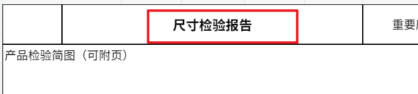
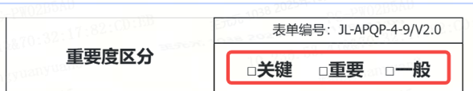
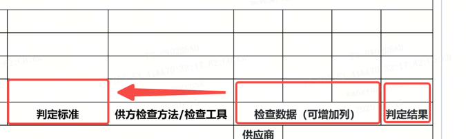
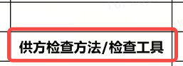
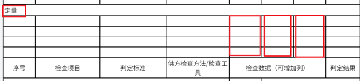
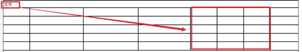
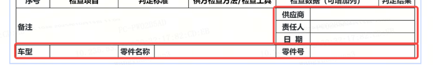
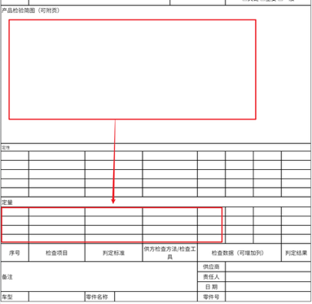

<table style="width:95%;">
    <colgroup>
        <col style="width: 5%" />
        <col style="width: 32%" />
        <col style="width: 56%" />
    </colgroup>
    <thead>
        <tr>
            <th><strong>审核条款</strong></th>
            <th><strong>规则说明</strong></th>
            <th style="text-align: center;"><strong>样例/具体位置</strong></th>
        </tr>
    </thead>
    <tbody>
        <tr>
            <td>1</td>
            <td>识别报告标题为“尺寸检验报告”则通过，否则不通过</td>
            <td style="text-align: center;"></td>
        </tr>
        <tr>
            <td>2</td>
            <td>识别“重要度区分”字段，并识别“重要度区分”字段对应内容区域是否有勾选且仅有一个被勾选，如果是则通过，否则不通过</td>
            <td style="text-align: center;"></td>
        </tr>
        <tr>
            <td>3</td>
            <td>检查“定量”区域的数据，当“检查数据”中的数值不超过对应行的“判定标准”内容，且对应行的“判定结果”为OK或合格则通过；否则不通过。注意：结果判定PASS或正确不能等同于OK或合格，需严格按照文字要求，另外不关注大小写。
            </td>
            <td style="text-align: center;"></td>
        </tr>
        <tr>
            <td>4</td>
            <td>当“供方检查方法/检查工具”列的内容中不包含“/”、“或”则通过，否则不通过</td>
            <td style="text-align: center;"></td>
        </tr>
        <tr>
            <td>5</td>
            <td>检查“定量”区域数据，当“检查数据”中同行的数据中出现两个或两个以上数值一致则不通过，否则通过</td>
            <td style="text-align: center;"></td>
        </tr>
        <tr>
            <td>6</td>
            <td>检查“定性”区域数据，当“检查数据”中的数据均为“OK”或“合格”则通过，否则不通过。注意：内容为“PASS”或“正确”不能等同于OK或合格，需严格按照文字要求，另外不关注大小写。</td>
            <td style="text-align: center;"></td>
        </tr>
        <tr>
            <td>7</td>
            <td>识别表尾是否包含“车型”、“零件名称”、“零件号”、“供应商”、“责任人”、“日期”字段，包含则继续识别。当“车型”、“零件名称”、“零件号”、“供应商”、“责任人”、“日期”内容都不为空则通过，否则不通过
            </td>
            <td style="text-align: center;"></td>
        </tr>
        <tr>
            <td>8</td>
            <td>当“产品检验简图”区域的图纸中，标注尺寸数与“定量”区域的检验项的行数一致则通过，否则不通过</td>
            <td rowspan="2" style="text-align: center;"></td>
        </tr>
        <tr>
            <td>9</td>
            <td>识别“定量”区域的序号是否在“产品检验简图”中存在同样的序号标注，如果不存在则不通过，否则继续识别，当“定量”区域的每一行的“判定标准”与“产品检验简图”中同序号对应的标准值相同则通过，否则不通过。</td>
        </tr>
    </tbody>
</table>