<table>
    <colgroup>
        <col style="width: 5%" />
        <col style="width: 37%" />
        <col style="width: 57%" />
    </colgroup>
    <thead>
        <tr>
            <th><strong>审核条款</strong></th>
            <th><strong>规则说明</strong></th>
            <th style="text-align: center;"><strong>样例/具体位置</strong></th>
        </tr>
    </thead>
    <tbody>
        <tr>
            <td>1</td>
            <td>识别“CoverSheet”页是否存在，如果不存在则不通过，否则继续识别“CoverSheet”页中是否包含“零件号”、“零件名”、“项目”、“项目阶段”、“日期”是否存在，如果不存在则不通过，否则继续识别；当“零件号”、“零件名”、“项目”、“项目阶段”、“日期”内容均不为空则通过，否则不通过；
            </td>
            <td style="text-align: center;">
                
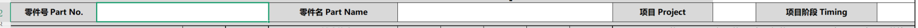

                
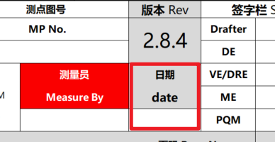

            </td>
        </tr>
        <tr>
            <td>2</td>
            <td>识别“测量报告”页中是否存在“测点号”、“坐标X”、“坐标Y”、“坐标Z”、“上公差”、“下公差”、“主要控制方向”列，如果有一列不存在则不通过，否则继续识别；当“测点号”列下存在内容，且同行的“坐标X”、“坐标Y”、“坐标Z”、“上公差”、“下公差”、“主要控制方向”列内容均不为空则通过，否则不通过
            </td>
            <td style="text-align: center;">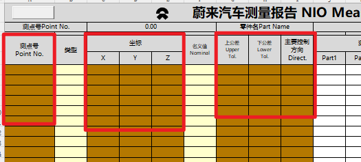</td>
        </tr>
        <tr>
            <td>3</td>
            <td>识别“测量报告”页中是否存在“上公差”、“下公差”、“主要控制方向”列，如果有一列不存在则不通过，否则继续识别；当“主要控制方向”列下内容为“ND”或“Gap”或“Flush”或“ND-”或“Gap-”或“Flush-”，且对应行的“上公差”和“下公差”均为“NA”则通过，否则不通过；
            </td>
            <td style="text-align: center;">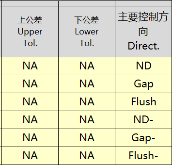</td>
        </tr>
        <tr>
            <td>4</td>
            <td>识别“测量报告”页中是否存在“名义值”、“主要控制方向”、“测量偏差值”列，如果有一列不存在则不通过，否则继续识别；当“主要控制方向”列下内容为“X”或“Y”或“Z”或“ND”或“Gap”或“Flush”或“ND-”或“Gap-”或“Flush-”，且对应行的“名义值”为空、“测量偏差值”存在内容则通过，否则不通过；
            </td>
            <td style="text-align: center;">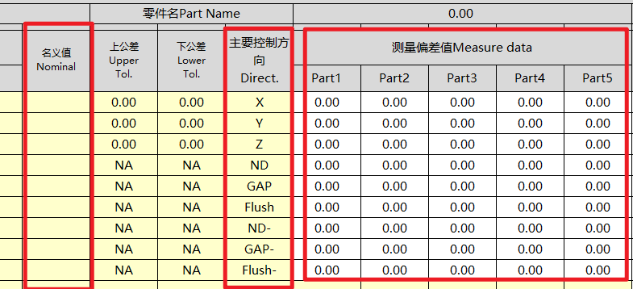</td>
        </tr>
        <tr>
            <td>5</td>
            <td>识别“测量报告”页中是否存在“类型”列，如果不存在则不通过，否则继续识别；当“类型”列下内容为“CC”或“SC”或“AC”则通过，否则不通过；</td>
            <td style="text-align: center;">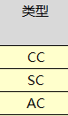</td>
        </tr>
        <tr>
            <td>6</td>
            <td>当“测量报告”中“测点号”存在，并且“测点图/截面”下的标记点均能在“测点号”下找到对应的行则通过，否则不通过</td>
            <td style="text-align: center;">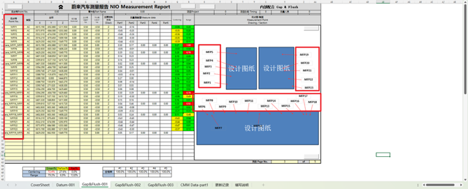</td>
        </tr>
        <tr>
            <td>7</td>
            <td>
                
当“测量报告”表为“Hole&amp;Slot”、“Surface”、“Trim”、“SubDatum”、“Gap&amp;Flush”时，识别“名义值”、“上公差”、“下公差”、“测量偏差值”的内容；当“测量偏差值”内容不为空，且“测量偏差值”在公差范围内则通过，否则不通过；
                

                
注意：

                <ol type="1">
                    <li>
                        
公差范围由“名义值”叠加“上公差”、“下公差”确定，即：[名义值+下公差，名义值+上公差]。

                    </li>
                    <li>
                        
“名义值”内容为空时，默认为0.00；

                    </li>
                </ol>
            </td>
            <td style="text-align: center;">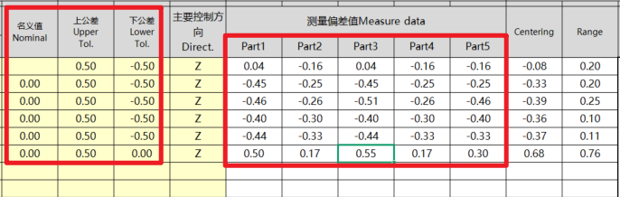</td>
        </tr>
        <tr>
            <td>8</td>
            <td>
                
当“测量报告”表中“主要控制方向”为“X”或“Y”或“Z”或“ND”、且“测量偏差值”下的“Part1”列下内容不为空，且“上公差”、“下公差”内容不为“NA”时，进行计算统计；

                <ol type="1">
                    <li>
                        
对中性值 = (-“名义值”+(“测量偏差值”下全部实测值的平均值))/(“上公差”-“下公差”)；

                        <ol type="1">
                            <li>
                                
注意：当“测量偏差值”下同一行中有实测值为空格，则不纳入平均值的统计范围内；当“名义值”为空时，默认取0.00；

                            </li>
                        </ol>
                    </li>
                    <li>
                        
判断同行的“Centering”的值是否等于同行计算出来的中性值，如果等于则通过，否则不通过；

                    </li>
                </ol>
            </td>
            <td style="text-align: center;">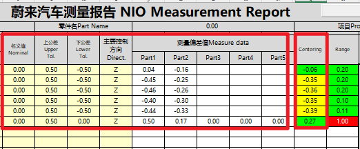</td>
        </tr>
        <tr>
            <td>9</td>
            <td>
                <ol type="1">
                    <li>
                        
当“Centering”下内容的绝对值存在＞0.66的行，则不通过，并提醒用户哪些行＞0.66，否则判定为通过；

                    </li>
                </ol>
                
注意：当“Centering”下内容的绝对值≤0.66且＞0.33时，判定为通过，但需要提醒用户哪些行的值≤0.66且＞0.33；

            </td>
            <td style="text-align: center;">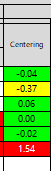</td>
        </tr>
        <tr>
            <td>10</td>
            <td>
                
当“测量报告”表中“主要控制方向”为“X”或“Y”或“Z”或“ND”、且“测量偏差值”下的“Part1”列下内容不为空，且“上公差”、“下公差”内容不为空值或“NA”时，进行计算统计；

                <ol type="1">
                    <li>
                        
极差值 = (“测量偏差值”下全部实测值的最大值-“测量偏差值”下全部实测值的最小值)/(“上公差”-“下公差”)；

                        <ol type="1">
                            <li>
                                
注意：当“测量偏差值”下同一行中有实测值为空格，则不纳入最大值和最小值的统计范围内；

                            </li>
                        </ol>
                    </li>
                    <li>
                        
判断同行的“Range”的值是否等于同行计算出来的极差值，如果等于则通过，否则不通过；

                    </li>
                </ol>
            </td>
            <td style="text-align: center;">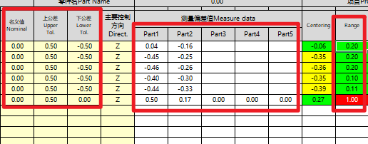</td>
        </tr>
        <tr>
            <td>11</td>
            <td>
                <ol type="1">
                    <li>
                        
当“Range”下内容的绝对值存在＞0.66的行，则不通过，并提醒用户哪些行＞0.66，否则判定为通过；

                    </li>
                </ol>
                
注意：当“Range”下内容的绝对值≤0.66且＞0.33时，判定为通过，但需要提醒用户哪些行的值≤0.66且＞0.33；

            </td>
            <td style="text-align: center;">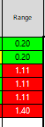</td>
        </tr>
    </tbody>
</table>