<table>
<colgroup>
<col style="width: 5%" />
<col style="width: 35%" />
<col style="width: 59%" />
</colgroup>
<tbody>
<tr>
<td><strong>审核条款</strong></td>
<td><strong>规则说明</strong></td>
<td><strong>样例/具体位置</strong></td>
</tr>
<tr>
<td>1</td>
<td>文件中勾选“SOP”或“生产”则通过，否则不通过</td>
<td>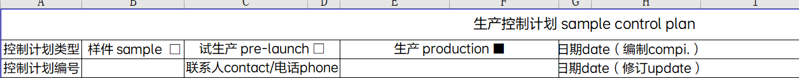</td>
</tr>
<tr>
<td>2</td>
<td>
过程流程图：列“工序号”、“工序名称”；

控制计划：列“零件/工序号”、“工序名称/操作描述”；

规则描述：

1、识别是否有“过程流程图”文件和“控制计划”文件，如果有则识别“过程流程图”中是否包含“工序号”、“工序名称”，没有则NG，提示未找到有效行信息。

2、“控制计划”中是否包含“零件/工序号”、“工序名称/操作描述”，如果包含则继续识别，没有则NG，提示未找到有效行信息。

3、当“过程流程图”下的每一个“工序号”内容都能在“控制计划”的“零件/工序号”下找到相同内容的行，且过程流程图中对应行的“工序名称”与“控制计划”中对应行的“工序名称/操作描述”相同则通过，否则不通过（简单来说，一一对应）
</td>
<td style="text-align: center;">
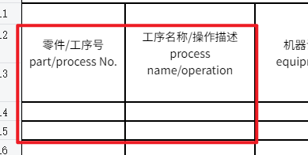

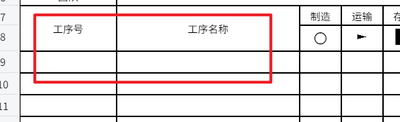
</td>
</tr>
<tr>
<td>3</td>
<td>
规则描述：

<ol type="1">
<li>
识别是否有“PFMEA”文件和“控制计划”文件，如果有则继续识别
</li>
<li>
“PFMEA”文件中是否包含“过程步骤”、“特殊特性”两列，“控制计划”文件是否包含“零件/工序号”、“工序名称/操作描述”、“特殊特性分类”三列，如果存在则继续识别，
</li>
<li>
当“PFMEA”文件中“特殊特性”有内容，且同行的“过程步骤”与“控制计划”中“零件/工序号”加“工序名称/操作描述”同名时，则识别“控制计划”中对应行的“特殊特性分类”列是否存在内容，且内容与“PFMEA”中的“特殊特性”列内容相同，如果是则通过，否则不通过
</li>
</ol></td>
<td style="text-align: center;">
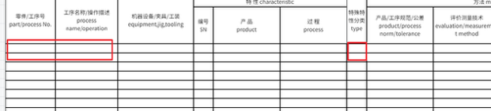

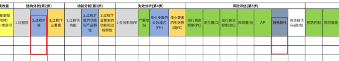
</td>
</tr>
<tr>
<td>4</td>
<td>识别是否有“特殊特性分类”、“特性”列，且“特性”列下存在“产品”、“过程”两列，如果没有，该项结果判定为NG；如果有，则继续识别，当“特殊特性分类”下的内容不为空，且对应行的“产品”、“过程”两列有一列内容不为空则通过，否则不通过</td>
<td>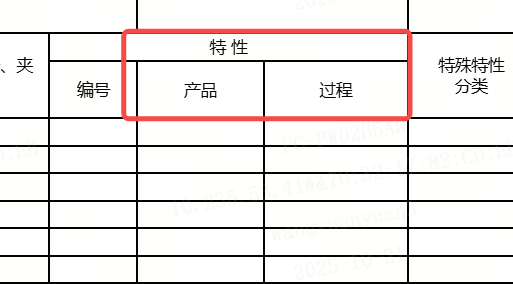</td>
</tr>
<tr>
<td>5</td>
<td>识别是否有“特殊特性分类”、“控制方法”列，如果没有，该项结果判定为NG；如果有，则继续识别，当“特殊特性分类”下的内容为“关键特殊特性”或“重要特殊特性”或[SC]或[CC]，且对应行的“控制方法”列内容不为空则通过，否则不通过</td>
<td>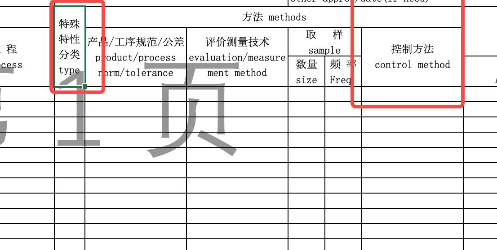</td>
</tr>
<tr>
<td>6</td>
<td>识别是否有“频率”或“频次”列，如果没有则不通过，否则继续识别；当“频率”或“频次”列下所有内容均不为空则通过，否则不通过</td>
<td>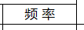</td>
</tr>
<tr>
<td>7</td>
<td>识别表头区域是否有“控制计划类型”、“控制计划编号”、“联系人contact/电话phone”、“日期date（编制compi.）”、“日期date（修订update）”、“版本Rev.”、“页数”、“页码”、“零件号”、“零件名称”、“多功能小组”、“公司”、“公司代码”、“公司批准/日期”、“其它批准/日期（如需要）”、“顾客工程批准/日期(如需要）”、“顾客质量批准/日期(如需要)”、“其它批准/日期(如需要)”字段，如果没有则不通过，如果有则继续识别；当“控制计划编号”、“联系人contact/电话phone”、“日期date（编制compi.）”、“日期date（修订update）”、“版本Rev.”、“页数”、“页码”、“零件号”、“零件名称”、“多功能小组”、“公司”、“公司代码”、“公司批准/日期”、“其它批准/日期（如需要）”、“顾客工程批准/日期(如需要）”、“顾客质量批准/日期(如需要)”、“其它批准/日期(如需要)”字段对应的内容不为空，且“控制计划类型”的选项有且仅有一个被勾选则通过，否则不通过；</td>
<td style="text-align: center;">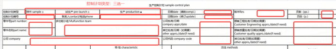</td>
</tr>
<tr>
<td>8</td>
<td>
流程一致性审核：

过程流程图（PFD）：“工序号”、“工序名称”

控制计划（CP）：“零件/工序号”、“工序名称/操作描述”

<ol type="1">
<li>
未找到“过程流程图”表则直接判定NG，判定依据为“缺少过程流程图，请补充”；否则继续执行下一步；
</li>
<li>
未找到“控制计划”表则直接判定NG，判定依据为“缺少控制计划，请补充”；否则继续执行下一步；
</li>
<li>
提取“过程流程图”表的“工序号”、“工序名称”两列下的全部内容，并将每一行的“工序号”、“工序名称”拼接起来，拼接格式为“工序号”+“ ”+“工序名称”；注意：当工序号和工序名称全部为空时，忽略该行；另外拼接好的内容需要去重处理；
</li>
<li>
提取“控制计划”表的“零件/工序号”、“工序名称/操作描述”两列下的全部内容，并将每一行的“零件/工序号”、“工序名称/操作描述”拼接起来，拼接格式为“零件/工序号”+“ ”+“工序名称/操作描述”；注意：当工序号和工序名称全部为空时，忽略该行；另外拼接好的内容需要去重处理；
</li>
<li>
将“过程流程图”文件中提取拼接的内容与“控制计划”文件中提取拼接的内容进行逐项比对，当“过程流程图”中的每一项内容均在“控制计划”中找到对应内容则判定为PASS，否则判定为NG，NG判定依据需要说明“过程流程图”中的哪一项内容在“控制计划”中未体现
</li>
</ol></td>
<td style="text-align: center;">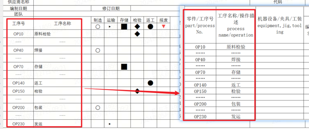</td>
</tr>
<tr>
<td>9</td>
<td>
特性一致性审核：

CP（控制计划）：“产品”、“过程”、“特殊特性分类”、“产品/工序规范/公差”

特殊特性清单：“特性分类”、“特性描述”、“特性值”、“特殊特性类别”

<ol type="1">
<li>
未找到“控制计划”表则直接判定NG，判定依据为“缺少控制计划，请补充”；否则继续执行下一步；
</li>
<li>
当特殊特性清单文件不存在，或特殊特性清单文件存在但特殊特性清单文件中未找到“特殊特性清单”表则直接判定NG，判定依据为“缺少特殊特性清单，请补充”；否则继续执行下一步；
</li>
<li>
提取特殊特性清单文件中“特殊特性清单”表的“特性分类”、“特性描述”、“特性值”、“特殊特性种类”四列下的全部内容，并将每一行的“特性分类”、“特性描述”、“特性值”、“特殊特性种类”拼接起来，拼接格式为“【特性分类】”+“【特殊特性种类】”+“特性描述”+“：”+“特性值”；注意：当特性描述和特性值全部为空时，忽略该行；另外拼接好的内容需要去重处理
</li>
<li>
当“控制计划”中“特殊特性分类”内容不为空时，提取对应行的“产品”，当“产品”内容不为空时则拼接为“【产品】【特殊特性分类】”+“产品”+“：”+“产品/工序规范/公差”；当“过程”内容不为空则拼接为“【过程】【特殊特性分类】”+“过程”+“：”+“产品/工序规范/公差”；注意：拼接好的内容需要去重处理
</li>
<li>
将特殊特性清单文件中提取拼接的内容与“控制计划”文件中提取拼接的内容进行逐项比对，当特殊特性清单中的每一项内容均在“控制计划”中找到对应内容则判定为PASS，否则判定为NG，NG判定依据需要说明特殊特性清单中的哪一项内容在“控制计划”中未体现
</li>
</ol></td>
<td style="text-align: center;">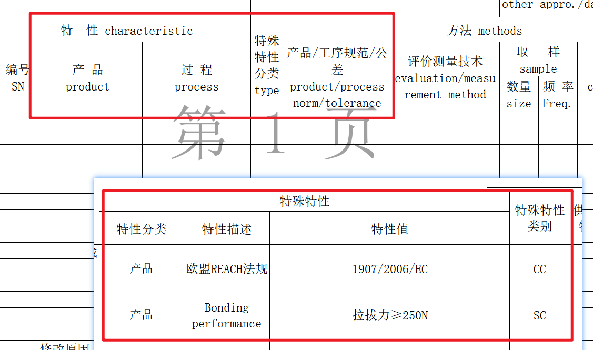</td>
</tr>
<tr>
<td>10</td>
<td>
措施一致性审核：

PFMEA：“过程步骤”、“现行预防控制”、“现行探测控制”、“预防控制”、“探测措施”；

CP（控制计划）：“零件/工序号”、“工序名称/操作描述”、“评价测量技术”

<ol type="1">
<li>
当PFMEA文件不存在，或PFMEA文件存在但PFMEA文件中未找到“PFMEA”表则直接判定NG，判定依据为“缺少PFMEA，请补充”；否则继续执行下一步；
</li>
<li>
当“控制计划”文件不存在，或“控制计划”文件存在但“控制计划”文件中未找到“控制计划”表则直接判定NG，判定依据为“缺少控制计划，请补充”；否则继续执行下一步；
</li>
<li>
当PFMEA中的“过程步骤”下内容在“控制计划”中“工序名称/操作描述”列下找到对应行；则比对PFMEA文件中对应行的“现行预防控制”、“现行探测控制”、“预防控制”、“探测措施”下内容是否能在“控制计划”对应行中的“评价测量技术”中找到对应内容，如果能则通过，否则不通过
</li>
</ol></td>
<td style="text-align: center;">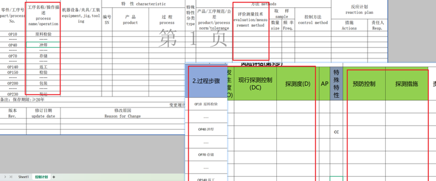</td>
</tr>
<tr>
<td>11</td>
<td>
CP（控制计划）：“产品”、“过程”、“特殊特性分类”、“产品/工序规范/公差”、“评价测量技术”、“频率”、“数量”

特殊特性清单：“特性分类”、“特性描述”、“特性值”、“特殊特性类别”、“控制方法（制造过程）”、“频次”、“样本数”

<ol type="1">
<li>
当“控制计划”文件不存在，或“控制计划”文件存在但“控制计划”文件中未找到“控制计划”表则直接判定NG，判定依据为“缺少控制计划，请补充”；否则继续执行下一步；
</li>
<li>
当特殊特性清单文件不存在，或特殊特性清单文件存在但特殊特性清单文件中未找到“特殊特性清单”表则直接判定NG，判定依据为“缺少特殊特性清单，请补充”；否则继续执行下一步；
</li>
<li>
当“控制计划”中的“特殊特性分类”下内容不为空，识别同行的“产品”或“过程”内容是否不为空。
</li>
<li>
如果“产品”内容不为空，则提取“产品”下的内容与特殊特性清单文件中的“特性分类”内容为“产品”且“特性描述”内容与“控制计划”中“产品”内容一致的行，比对“控制计划”中的“评价测量技术”、“数量”、“频率”与特殊特性清单中的“控制方法（制造过程）”、“样本数”、“频次”是否一致；如果一致则继续识别，如果不一致则不通过；
</li>
<li>
如果“过程”内容不为空，则提取“过程”下的内容与特殊特性清单文件中的“特性分类”内容为“过程”且“特性描述”内容与“控制计划”中“过程”内容一致的行，比对“控制计划”中的“评价测量技术”、“数量”、“频率”与特殊特性清单中的“控制方法（制造过程）”、“样本数”、“频次”是否一致；如果一致则继续识别，如果不一致则不通过；
</li>
</ol></td>
<td style="text-align: center;">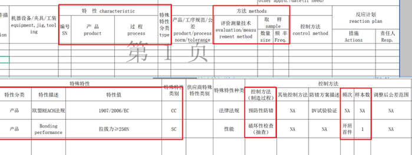</td>
</tr>
<tr>
<td></td>
<td></td>
<td style="text-align: center;"></td>
</tr>
</tbody>
</table>
