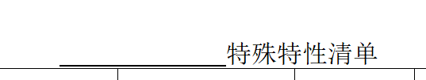
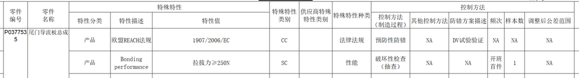

<table>
    <colgroup>
        <col style="width: 5%" />
        <col style="width: 34%" />
        <col style="width: 59%" />
    </colgroup>
    <thead>
        <tr>
            <th><strong>审核条款</strong></th>
            <th><strong>规则说明</strong></th>
            <th style="text-align: center;"><strong>样例/具体位置</strong></th>
        </tr>
    </thead>
    <tbody>
        <tr>
            <td>1</td>
            <td>识别“特殊特性清单”表标题前是否有产品编号，如果有则通过，否则不通过</td>
            <td style="text-align: center;"></td>
        </tr>
        <tr>
            <td>2</td>
            <td>识别“特殊特性清单”表中是否包含“零件编号”、“零件名称”、“特性分类”、“特性描述”、“特性值”、“特性类别”、“特殊特性种类”、“控制方法（制造过程）”、“防错方案描述”、“频次”、“样本数”列，如果不存在则不通过，否则继续识别；当“零件编号”、“零件名称”下内容不为空，且同行的“特性分类”、“特性描述”、“特性值”、“特性类别”、“特殊特性种类”、“控制方法（制造过程）”、“防错方案描述”、“频次”、“样本数”列下内容均不为空则通过，否则不通过
            </td>
            <td style="text-align: center;">
                

                
零件号、零件名称列有可能会合并单元格

                
这两列需要同时有内容，再去检查同行的其他内容

            </td>
        </tr>
    </tbody>
</table>