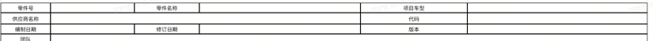
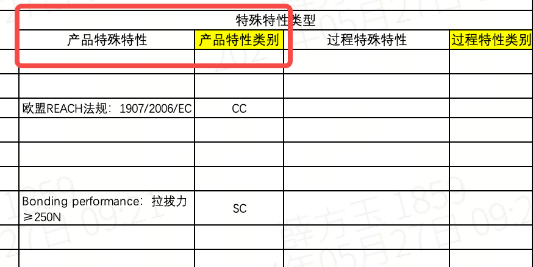
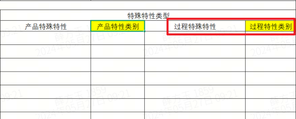
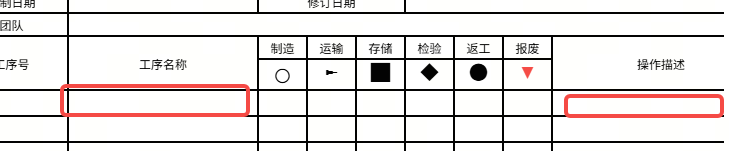
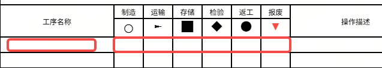
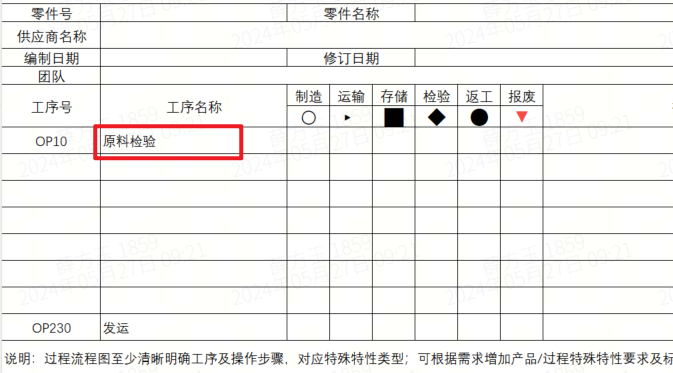
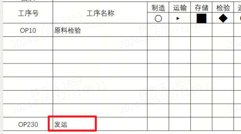
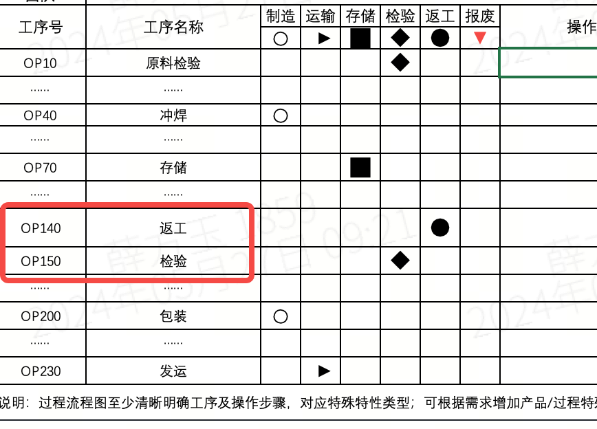
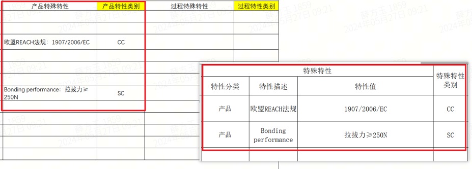

<table style="width:100%;">
    <colgroup>
        <col style="width: 3%" />
        <col style="width: 10%" />
        <col style="width: 41%" />
        <col style="width: 45%" />
    </colgroup>
    <thead>
        <tr>
            <th><strong>审核条款</strong></th>
            <th><strong>规则简述</strong></th>
            <th><strong>规则说明</strong></th>
            <th><strong>样例/具体位置</strong></th>
        </tr>
    </thead>
    <tbody>
        <tr>
            <td>1</td>
            <td>检查过程流程图表头字段是否均填写完整</td>
            <td>识别是否存在“过程流程图”表，如果存在则继续识别“过程流程图”表中是否包含“零件号”、“零件名称”、“项目车型”、“供应商名称”、“代码”、“编制日期”、“修订日期”、“版本”、“团队”字段，如果包含则继续识别；当“零件号”、“零件名称”、“项目车型”、“供应商名称”、“代码”、“编制日期”、“修订日期”、“版本”、“团队”字段对应的内容均不为空则通过，否则不通过
            </td>
            <td></td>
        </tr>
        <tr>
            <td>2</td>
            <td>产品特殊特性及特性类别填写逻辑校验</td>
            <td>识别是否存在“过程流程图”表，如果存在则继续识别；“过程流程图”表中是否包含“产品特殊特性”、“产品特性类别”两列，如果包含则继续识别；当“产品特性类别”列下内容不为空，且对应行的“产品特殊特性”列内容不为空则通过，否则不通过
            </td>
            <td style="text-align: center;"></td>
        </tr>
        <tr>
            <td>3</td>
            <td>过程特殊特性及特性类别填写逻辑校验</td>
            <td>识别是否存在“过程流程图”表，如果存在则继续识别；“过程流程图”表中是否包含“过程特殊特性”、“过程特性类别”两列，如果包含则继续识别；当“产品特性类别”列下内容不为空，且对应行的“产品特殊特性”列内容不为空则通过，否则不通过
            </td>
            <td style="text-align: center;"></td>
        </tr>
        <tr>
            <td>4</td>
            <td>工序名称、操作描述填写逻辑校验</td>
            <td>识别“工序名称”、“操作描述”两列是否存在，有一列不存在则不通过，否则继续识别；当“工序名称”列下内容不为空且对应行的“操作描述”列内容也不为空则通过，否则不通过</td>
            <td></td>
        </tr>
        <tr>
            <td>5</td>
            <td>工序名称、图例填写逻辑校验</td>
            <td>识别“工序名称”、“制造”、“运输”、“存储”、“检验”、“返工”、“报废”七列是否存在，有一列不存在则不通过，否则继续识别；当“工序名称”不为空且对应行的“制造”、“运输”、“存储”、“检验”、“返工”、“报废”有一列内容不为空则通过，否则不通过
            </td>
            <td></td>
        </tr>
        <tr>
            <td>6</td>
            <td>识别工序拆解完整性-起始工序</td>
            <td>识别“工序名称”列是否存在，如果存在则继续识别；当“工序名称”列下包含“进料检验”或“IQC”或<strong>相近词义</strong>的内容则通过，否则不通过</td>
            <td style="text-align: center;"></td>
        </tr>
        <tr>
            <td>7</td>
            <td>识别工序拆解完整性-最终工序</td>
            <td>识别“工序名称”列是否存在，如果存在则继续识别；当“工序名称”列下包含“出货”或“FQC”或“OQC”或<strong>相近词义</strong>的内容则通过，否则不通过</td>
            <td style="text-align: center;"></td>
        </tr>
        <tr>
            <td>8</td>
            <td>识别返工/返修工序是否有检验环节</td>
            <td>识别“工序名称”列是否存在，如果存在则继续识别；当“工序名称”列下出现表达“返工”或“返修”<strong>意思的行</strong>，则检查该行的下一行是否为表达“检验”或“重检”意思的内容，如果是则通过，否则不通过
            </td>
            <td style="text-align: center;"></td>
        </tr>
        <tr>
            <td>9</td>
            <td>跨文件：PFD（过程流程图）和特殊特性清单</td>
            <td>
                
比对列： 
                    PFD：“产品特殊特性”、“产品特性类别”、“过程特殊特性”、“过程特性类别”

                
特殊特性清单：“特性分类”、“特性描述”、“特性值”、“特殊特性类别”

                
<strong>审核判定逻辑：</strong>

                <ol type="1">
                    <li>
                        
<del>当PFD文件不存在，或PFD文件存在但PFD文件中</del>未找到“过程流程图”表则直接判定NG，判定依据为“缺少过程流程图，请补充”；否则继续执行下一步；

                    </li>
                    <li>
                        
当特殊特性清单文件不存在，或特殊特性清单文件存在但特殊特性清单文件中未找到“特殊特性清单”表则直接判定NG，判定依据为“缺少特殊特性清单，请补充”；否则继续执行下一步；

                    </li>
                    <li>
                        
提取特殊特性清单文件中“特殊特性清单”表的“特性分类”、“特性描述”、“特性值”、“特殊特性种类”四列下的全部内容，并将每一行的“特性分类”、“特性描述”、“特性值”、“特殊特性种类”拼接起来，拼接格式为“【特性分类】”+“【特殊特性种类】”+“特性描述”+“：”+“特性值”；注意：当特性描述和特性值全部为空时，忽略该行；另外拼接好的内容需要去重处理
                        

                    </li>
                    <li>
                        
当PFD中“产品特性类别”内容不为空时，提取对应行的“产品特殊特性”，并拼接位“【产品】【产品特性类别】”+“产品特殊特性”；当PFD中“过程特性类别”内容不为空时，提取对应行的“过程特殊特性”，并拼接位“【过程】【过程特性类别】”+“过程特殊特性”；注意：当产品特殊特性或过程特殊特性内容为空时，忽略该行；另外拼接好的内容需要去重处理
                        

                    </li>
                    <li>
                        
将特殊特性清单文件中提取拼接的内容与PFD文件中提取拼接的内容进行逐项比对，当特殊特性清单中的每一项内容均在PFD中找到对应内容则判定为PASS，否则判定为NG，NG判定依据需要说明特殊特性清单中的哪一项内容在PFD中未体现
                        

                    </li>
                </ol>
            </td>
            <td style="text-align: center;"></td>
        </tr>
    </tbody>
</table>