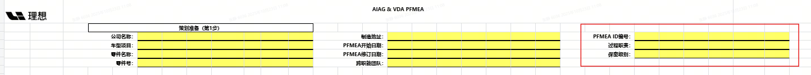
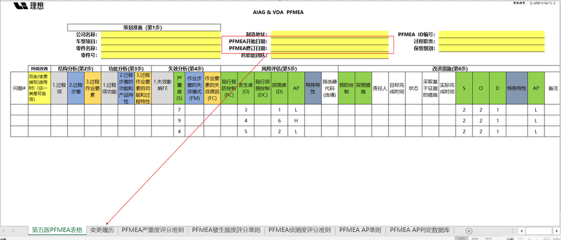
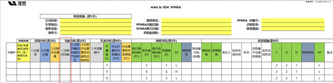
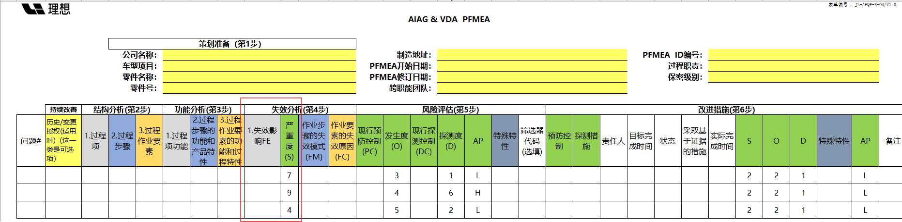
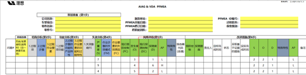
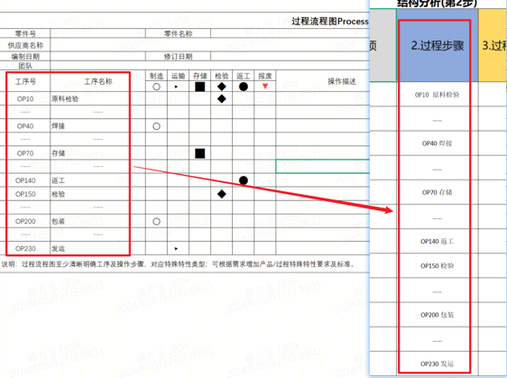
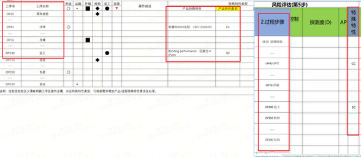

<table>
    <colgroup>
        <col style="width: 5%" />
        <col style="width: 38%" />
        <col style="width: 56%" />
    </colgroup>
    <thead>
        <tr>
            <th><strong>审核条款</strong></th>
            <th><strong>规则说明</strong></th>
            <th><strong>样例/具体位置</strong></th>
        </tr>
    </thead>
    <tbody>
        <tr>
            <td>1</td>
            <td>识别表头区域是否包含“公司名称”、“车型项目”、“零件名称”、“零件号”、“制造地址”、“PFMEA开始日期”、“PFMEA修订日期”、“跨职能团队”字段，如果包含则继续识别，当“公司名称”、“车型项目”、“零件名称”、“零件号”、“制造地址”、“PFMEA开始日期”、“PFMEA修订日期”、“跨职能团队”字段对应内容均不为空则通过，否则不通过
            </td>
            <td>
            </td>
        </tr>
        <tr>
            <td>2</td>
            <td>识别是否有PFMEA表格（包含“PFMEA表格”有效字符）、“变更履历”表格，如果不包含则不通过，如果包含则继续识别PFMEA表头区域是否包含“PFMEA开始日期”、“PFMEA修订日期”字段，如果包含则继续识别，当PFMEA表格中的“PFMEA开始日期”字段内容与变更履历表中“修订日期”第一行有效数据的内容一致，且PFMEA表格中的“PFMEA修订日期”字段内容与变更履历表中“修订日期”最后一行有效数据的内容一致则通过，否则不通过
            </td>
            <td>
            </td>
        </tr>
        <tr>
            <td>3</td>
            <td>
                
识别PFMEA表中是否包含“过程项功能”列，如果包含，则继续识别“过程项功能”列下内容是否均包含三个维度，如果是则通过，否则不通过；

                
过程项功能的三个维度示例如下：

                
内部：使用扭矩枪把坐垫安装在座椅轨道上

                
客户工厂：将座椅安装至车身上

                
最终用户：坐乘

            </td>
            <td>
            </td>
        </tr>
        <tr>
            <td>4</td>
            <td>
                
识别PFMEA表中是否包含“失效影响”列（包含有效字符），如果没有，则该审核项判定为NG；如果有，则继续识别“失效影响”列下的内容是否包含三个维度，且每个维度存在对应独立的严重度分值，如果不包含三个维度或每个维度没有独立对应严重度分值则不通过，否则继续识别PFMEA表中的“严重度”的分值是否为“失效影响”三个维度分值的最大值，如果是则通过，否则不通过。
                

                
失效影响的三个维度示例如下：

                
内部：100%产品在线返工（４）

                
客户工厂：100%产品离线返工（６）

                
最终用户：次级功能降低，坐垫松动异响（５）

                
基于失效影响的示例，对应的严重度应为6

            </td>
            <td></td>
        </tr>
        <tr>
            <td>5</td>
            <td>
                
识别PFMEA表中是否包含“现行探测控制”列（包含有效字符），如果没有，则该审核项判定为NG；如果有，则继续识别“现行探测控制”列下的内容是否为一个或多个探测措施，且每个探测措施存在对应独立的探测度分值，如果内容为空或每个探测措施没有独立对应探测度分值则不通过，否则继续识别PFMEA表中的“探测度”的分值是否为“现行探测控制”中分值的最小值，如果是则通过，否则不通过。
                

                
“现行探测控制”的内容示例如下：

                
本工位的双感官100%检查（6）

                
终检工位的100%目视检查（8）

                
基于“现行探测控制”的示例，对应的探测度应为6

            </td>
            <td>
            </td>
        </tr>
        <tr>
            <td>6</td>
            <td>
                
流程一致性审核：

                
过程流程图和PFMEA比对： 
                    比对列： 
                    过程流程图：“工序号”、“工序名称”

                
PFMEA：“过程步骤”

                
审核逻辑：

                <ol type="1">
                    <li>
                        
<del>当PFD文件不存在，或PFD文件存在但PFD文件中</del>未找到“过程流程图”表则直接判定NG，判定依据为“缺少过程流程图，请补充”；否则继续执行下一步；

                    </li>
                    <li>
                        
当PFMEA文件不存在，或PFMEA文件存在但PFMEA文件中未找到“PFMEA”表则直接判定NG，判定依据为“缺少PFMEA，请补充”；否则继续执行下一步；

                    </li>
                    <li>
                        
提取<del>PFD文件中</del>“过程流程图”表的“工序号”、“工序名称”两列下的全部内容，并将每一行的“工序号”、“工序名称”拼接起来，拼接格式为“工序号”+“
                            ”+“工序名称”；注意：当工序号和工序名称全部为空时，忽略该行；另外拼接好的内容需要去重处理；

                    </li>
                    <li>
                        
提取PFMEA文件中“PFMEA”表的“过程步骤”列下的全部内容，并去重处理。

                    </li>
                    <li>
                        
将PFD文件中提取拼接的内容与PFMEA文件中提出的内容进行逐项比对，当PFD中的每一项内容均在PFMEA中找到对应内容则判定为PASS，否则判定为NG，NG判定依据需要说明PFD中的哪一项内容在PFMEA中未体现
                        

                    </li>
                </ol>
            </td>
            <td></td>
        </tr>
        <tr>
            <td>7</td>
            <td>
                
特性一致性审核：

                
PFD：“产品特殊特性”、“产品特性类别”、“过程特殊特性”、“过程特性类别”

                
PFMEA：“过程步骤”、“特殊特性”

                <ol type="1">
                    <li>
                        
<del>当PFD文件不存在，或PFD文件存在但PFD文件中</del>未找到“过程流程图”表则直接判定NG，判定依据为“缺少过程流程图，请补充”；否则继续执行下一步；

                    </li>
                    <li>
                        
当PFMEA文件不存在，或PFMEA文件存在但PFMEA文件中未找到“PFMEA”表则直接判定NG，判定依据为“缺少PFMEA，请补充”；否则继续执行下一步；

                    </li>
                    <li>
                        
当过程流程图中的“产品特性类别”列或“过程特性类别”列下内容不为空时，则以对应行的“工序名称”的内容在PFMEA文件中“过程步骤”列下识别是否有内容相同的行，如果存在则继续在PFMEA文件中识别对应行的“特殊特性”列下内容是否与PFD中的特殊特性内容一致，如果一致则通过，否则不通过
                        

                    </li>
                </ol>
            </td>
            <td>
            </td>
        </tr>
    </tbody>
</table>
