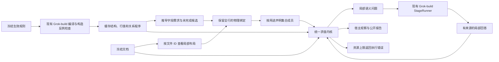

# 目标架构

产品语义见 [Northstar](NORTHSTAR.md)；当前实现事实以源码和测试为准。

```text
Web / PWA / 飞书入口
        |
   services/api
      /      \\
PostgreSQL  object storage
      \\      /
   services/worker
        |
     packages
```

PC Web 入口在 `apps/web`，只调用 Product API。飞书 docs-addon 进入同一套 round / findings / review。

兼容入口 `/mcp` 与 Product API 在同一进程运行，由独立 `fastmcp` 包提供工具装饰器、Schema、Resources、Prompts 和 Streamable HTTP。依赖版本由 `uv.lock` 固定；当前 FastMCP 的上游依赖要求 MCP Python SDK `<2`，不能只升级 SDK 主版本而保留未验证的组合。兼容入口的 Tasks 扩展关闭；Deep 的 `/mcp/deep` 适配提供原生 Tasks，仍引用现有 Round、engine job 与 MCP 操作回执。Deep 的未来原生 MCP 交互与共享应用边界见下文产品设计；当前调用方式与协议配置不是目标产品原则。

`mcp_gateway` 通过进程内 ASGI 调用同一 Product API 入口，保留路由中的对象授权、来源校验及分享编排。只有该适配器可在 ASGI scope 写入实际 `Delegation` 对象；网络请求头不构成身份。字节传输直接转发 ASGI 流，继续使用文件 owner 的 200 MiB 限制，不额外把整份文件缓存到 MCP JSON 或 HTTP 客户端响应中。

网关检查确认内容后，将原操作的 `ApprovedCall` 放入内部 scope。飞书报告导出、写回和分享在业务入口冻结实际内容时，再核对同一来源快照；分享恢复同样核对当前发送回执。证明绑定委托、操作、HTTP 方法和路径，不能借给另一调用。冻结前的修改使操作失败；冻结后的网页修改仍可正常保存，但不会替换已批准的发送内容。分享继续使用原有 engine 记录冻结报告引用和产物。

`ppap-mcp-client` 是单独发布的本地 stdio 适配器，只依赖 FastMCP、OAuth 和本地凭据/文件组件；不依赖产品 API 或审核引擎。它代理同一授权下的远程工具、Resources 和 Prompts，并在用户指定目录内完成字节上传和下载。客户端只保存加密 OAuth 状态、刷新恢复标记及临时文件；上传、预校验、审核和报告状态仍以服务端业务回执为准。同一 profile 跨进程串行刷新，未知刷新不得重用旧令牌。

MCP 表只保存客户端授权、确认、传输凭证和调用回执。写入先持久 claim，再执行原业务入口；响应丢失不自动恢复执行权。人工复核的回执与复核内容在同一事务提交，并通过授权记录关联实际确认人及客户端。其它业务操作仍以各自的原生回执和恢复合同为准，不能从一个通用 `unknown` 状态推导可重试。配置、传输与客户端边界见 [MCP](MCP.md)，交付状态由 [#206](https://github.com/ppap-agent/ppap/issues/206) 维护。

生产部署可以把 API/Worker 放到 self-hosted InsForge Custom Compute 上，由 InsForge 提供 PostgreSQL 集群与容器生命周期；PPAP 仍是唯一 Product API 与领域 authority。Web 不直连 InsForge Database/PostgREST。细节见 [deploy/insforge/README.md](../deploy/insforge/README.md)。

## 所有权

`services/api` 是唯一公开 HTTP/process adapter，拥有身份/session、授权入口以及文件、草稿、轮次、复核和用量的 HTTP contract；跨 core / engine / store 的产品编排由 `ppap_application` 拥有，共享 PostgreSQL persistence implementation 由 `ppap_product_store` 拥有。API 与 Worker 都组合这些 installable owners，而不是互相作为 library。重解析、转换、模型调用和规则检查由 Worker 执行。

原件预览优先使用可选的 OnlyOffice Document Server，Python API 签发只读配置，不提供编辑回写。`PPAP_ONLYOFFICE_URL` 是浏览器可达地址，`PPAP_ONLYOFFICE_API_URL` 是 Document Server 可达的 Product API 地址，`PPAP_ONLYOFFICE_SECRET` 与其 JWT secret 一致。授权通过后签发单文件版本、单租户、十分钟有效的读取凭证；该凭证在到期前仍可读取，因此 Document Server 及其缓存必须属于可信部署边界。API 和反向代理不得记录凭证查询串。缺少服务时回退到有大小上限的 Word / Excel / 文本摘录；摘录不执行宏、公式或模型，也不转换旧 DOC。审核历史支持服务端搜索和分页。飞书目录选择使用当前用户令牌，逐文件导入独立版本，不递归导入或修改来源。

PostgreSQL 中 `product` 保存产品事实，`engine` 保存执行任务/尝试。两者不是两套产品台账。对象存储保存文件版本引用的字节；数据库保存文件版本、对象位置和授权关系。

`product.provider_authorizations` 是飞书凭据的唯一续期入口，由 `ppap_product_store.provider_auth` 保存并发 claim 和结果。浏览器 Session 与 MCP Grant 各自拥有有效期、撤销和授权范围，引用精确的 provider/app/tenant/subject 凭据记录。新登录取得不同凭据时创建新记录；不按用户查找“最新令牌”替换旧委托。此表只保存身份凭据生命周期，不保存审核或报告执行状态，Worker 不可读取。

一个历史审核只需要稳定引用它当时使用的 `file_version_id` 和规则版本。新上传创建新文件版本，不重定向旧版本。内容 hash 可以作为辅助字段保留，但不是产品版本 identity 的前提。

有请求 ID 的 URL 与飞书导入共用 `_receive_import_upload`，使用既有 `file_versions.upload_request` 保存请求拥有者、来源和首次捕获的内容摘要；不建立另一份导入状态表。来源绑定先于外部读取，内容摘要先于对象写入。恢复先核对已有对象，丢失数据库锁会使旧处理者失去提交权。URL 的显式恢复只使用已保存来源；MCP 调用回执与持久文件/Task 回执含义分开。

派生工作簿、页面图像或 OCR 结果只有当前消费者需要时才缓存，并明确指向来源文件版本。浏览器不获得对象存储管理凭据。

## 执行

Worker 用短数据库事务 claim 工作（含过期 `leased` 重试，同一 round 只增加 attempt），事务外执行，并用当前 attempt/claim 提交结果。技术重试不创建新产品轮次；用户主动重审才创建新轮次。

Worker 在一个边界按冻结的 `analysis_mode` 路由：`standard` 走本仓 in-repo engine；`deep` 只通过 bounded UDS 调用独立 Controller。Deep 整次执行失败时写回结构化 failure 并将 job/round 标为 failed，不伪造业务判定，**不得静默回退 Standard**。某套规则计划经有界修复仍校验失败时，只将绑定该规则的全部条款记为 ERR，其他可用计划继续使用原冻结资料；不删除 target、不重新受理、不重置总预算。结果包以有效计划与绑定冻结身份的失败记录共同覆盖原规则集合，失败计划不进入共享缓存；取消、预算或整体协议故障不因此转为局部成功。Controller 协议 `extra=forbid`，不接受 host path、command、mount、image 或 env；Worker 不持有 Docker socket。`PPAP_DEEP_CONTROLLER_SOCKET` 只表示 Deep capability 是否配置；Core `/ready` 仍只探 PostgreSQL 与对象存储。

Controller 进程是 `python -m ppap_deep`。生产工厂要求显式设置 `PPAP_DEEP_RUNTIME=container-only`，并将 `PPAP_DEEP_SANDBOX_PROFILE` 设为 `off` 或 `ppap`，没有默认 process/checker 后端。`SemanticRuntime` 消费冻结的有效规则和文件版本，通过 `ContainerRuntime` 与可信模型 gateway 执行；guest 命令、模型 endpoint 和 provider key 不来自 Worker RPC。`off` 是降权容器执行，不保证独立文件系统或 egress 隔离，不能称为 gVisor/VM。具体运行与限制见 [Deep 部署说明](../deploy/deep/README.md)；启动或 UDS 可用不证明审核质量或强隔离。

产品先复用既有编译入口，每次仅提交一份规则及其计划缓存；该运行清理后，才准备供应商文档。审核运行只接受已验证计划或明确的编译失败记录，不能回退到现场编译或改写基础计划。各阶段沿用同一截止时间，并从整次请求与 token 额度扣除前序已确认用量；缓存命中可以是零模型调用。技术编译身份包含本轮身份，业务计划缓存仍按规则与引擎修订复用。运行镜像排除研究 prototype、测试预期和实验输出。

规则检查、模型推断和文档抽取可以替换实现，但不能改变产品输入版本、授权和结果语义。只有真实当前需求证明价值时才新增服务、框架或隔离层。

Deep 的核心目标设计见 [规则约束下的文档理解与反馈](../packages/ppap_deep/DESIGN.md)，未来产品架构、UI 与 MCP 见 [Deep 产品设计](../packages/ppap_deep/PRODUCT.md)：业务输入只有 `rules + documents`，已确认附录包含在 rules 中；RulePlan 中的 ontology 引导生成逻辑文档，用户确认通过更新明确输入进入后续计算。目标是持续的审核工作区，Web 与原生 MCP 平等调用同一个 Audit Application；界面、确认方式、协议和部署均可重构，业务事实与审核语义保持单一拥有者。当前已实现基于明确对象粒度、身份属性、逻辑对象及类型化 Hole 的首个反馈闭环。原生 snapshot 保持无损，逻辑物化按规则所需字段读取；跨行或一行多对象必须有明确来源和覆盖。尚不因此宣称任意布局和规则均能被模型正确解释。

反馈应用复用现有审核轮次、队列和结果存储。`product.deep_rule_changes` 只拥有同一工作区内的规则变更操作回执；工作区身份复用根轮次。一个操作按已读修订保存附录，并可在同一事务受理新输入计算；技术 attempt 与新业务计算分开。Web 与 `/mcp/deep` 共用 `read_deep_feedback/apply_rule_change/read_rule_change`，迟到结果仍只属于其原轮次。问题指纹约束实际内容与来源；附录分别记录被解释原件和精确的目标文件／条款配对，同名条款不会隐式扩大范围。客户端会话不构成业务依据。确认记录可导出，默认无人工 gold 和训练资格。

Deep 当前使用一个纯求值入口：模型提交物理 `Binding`、每条缓存程序的集合用途，以及宿主提出的局部语义问题的答案；宿主读取完整声明范围，执行条件、量词、关系和比较，生成观察、计数与公开报告。宿主从已验证程序派生 obligations 的潜在集合／字段需求和 initial-execution 未完成候选；模型逐步补全，求值仍只使用原程序和实际执行证书。初始候选不表示完成或支持故障后恢复。规则程序只读取冻结规则，按租户、规则来源及引擎修订缓存；文档位置、行成员资格和答案不进入规则缓存。编译 schema 区分文件结构前提、当前行适用条件及行值／关系要求；列存在不能作为行值非空的证明。Binding 保留所有物理行，排除和未知行角色随用途确定。同一工序标题可以参与覆盖，同时不属于特性明细。

Ontology 关系由规则程序明确引用，区分同一实例与一般关联。显式逻辑分组保存成员来源及公开依据，字段投影保留未分配给其他对象的原始观察。文档限定解释修订记录在原 `AuditTrace`，统一求值时校验并派生有效计划，只允许粒度澄清和身份增强；原审核义务保持不变，待比较属性及同源别名不能作为新增身份筛掉违规，来源独立性复用实际观察和原件合并锚点校验。基础 `bundle.plans` 继续作为规则缓存，执行修订不进入该缓存，也不增加产品状态表或新的求值入口。


关系计算按匹配要求取证：any 在目标资格不依赖模型答案且已有原生充分匹配时跳过其余语义配对，all/one_to_one 保留完整候选及重复、共享目标检查。目标范围未知进入对应叶子的三值结果，再参与布尔组合；源总体覆盖仍独立必需。数值 10/10.0 采用同一数值域，文本编号和布尔值保留类型。模型只处理绑定和必要语义缺口，不再抄写 QueryProof/SemanticProof 逐行结果。缺答案或范围产生 UNABLE；已知独立违规仍可 NG。合并布局按行边界建立索引，物理范围仍保留全部声明行列。宿主工作或局部问题超过资源上限时返回 RESOURCE_LIMIT，不触发结构修复；不能通过删列或删行绕过上限。可选引用与计算采用独立预算，缺引用不改业务结果，也不单独触发修复。StageRunner 只保留 `run`：真实执行器写入结果文件，经严格完成回执、JSON 和 schema 校验后返回类型化产物。执行语义由注入的单一指南拥有，不另维护第二份 Python 长提示或备用直接结构化输出协议。接口见 [执行证书](../packages/ppap_deep/src/ppap_deep/semantic/skill/references/execution-trace.md)。宿主只能证明声明程序和范围的重放，不能独立证明规则理解、关联身份或表头映射正确。



Deep 的受理端和执行端以 `ppap_core.deep_policy.DeepExecutionPolicy` 共用实际配置身份，不只比较同名版本标签。它是纯配置值，不启动 Controller、不存密钥、不增加策略 registry；实际 `RuntimeConfig` 继承相同字段及摘要计算。新受理在现有 Round/job 事务固定摘要，执行时由真实 runtime 再核对；旧策略不可用时明确失败，显式新轮次才采用新策略。Standard 不计算 Deep 策略，历史读取也不依赖当前配置。

## 外部能力

飞书只负责身份、文件来源和必要的显式写回；Partner AI 负责外部权益/计费确认；LLM/OCR provider 是执行依赖；Deep Controller 是可选执行依赖。它们都是可选 capability，不成为整个 Core 的启动或普通 CI 前置。

#169 通知接入须区分可恢复的发送前准备与不可盲重试的外部发送。发送前必须以当前 claim/attempt 做数据库条件更新，持久记录已经进入发送边界；过期 Worker 不得继续发送。进入该边界后，超时或进程退出不能证明未送达，不能沿用普通审核任务的过期租约重跑规则。未知结果保留原意图，只有可靠回执或确认未发送的外部证据才能改变恢复资格。

任务通知复用 `engine.jobs/attempts`，数据库按租户、任务及节点唯一；待确认、开始审核和首次报告终结的通知意图与对应业务事务一起提交。普通审核 Worker 不领取通知，也不持有飞书发送凭据；API 进程领取后，在发送前重新检查创建人、租户、源文件权限和完成通知设置，再以当前 claim/attempt 持久化发送边界。发送前准备可接管；发送后未知不可接管。有效消息 ID 才能记录发送成功，不表示用户已阅读。尚无可靠外部证据时，未知状态保留，不能声称具备自动恢复或外部绝对去重保证。

ZIP 就绪与其通知意图同事务提交，按规范化打包工作去重，不受完成通知开关影响；失败打包不通知就绪，恢复成功后才产生意图。不同报告集合的通知互不覆盖。发送前重读该包及来源授权；消息链接固定 `packageRequest`，报告中心只读取该请求，不以最新打包结果替代。链接不可读不封锁已有 PDF，下载仍实时鉴权。

待确认卡片只有在完整列出文件、规则、移除原因与预计点数时才提供直接确认；截断内容或缺少回调校验配置时仅打开页面。发送边界同时固定该卡片的输入修订与确认请求。回调校验 Verification Token、应用及真实操作者，关联已确认发送的原消息，再通过同一个 `_accept_locked` 事务核对当前创建人、权限、规则版本并受理；不从按钮字段创建身份，不按新输入重绑旧卡片。网页先受理时只读回已有轮次，回执丢失重放仍使用原请求。发送未知、旧输入或过期规则均不授权新的审核；不声称支持加密回调、外部永久去重或飞书端响应时限保证。

[NotificationDispatch](models/NotificationDispatch.tla) 是这一并发边界的有限要求模型：一个通知意图、两个 Worker、两个接管版本，包含迟到发送与回执丢失。正向配置及 `-fence`、`-recovery` 反例分别检查所有者约束与重复送达。它不证明现有 Worker 已实现通知，也不保证最终送达；持久意图唯一性、消息内容/接收人授权和飞书读回能力仍须单独验证。模型不依赖飞书幂等保证，不改变现有 Worker 的凭据边界。

继续支持 `.doc` 时保留必要的受限转换边界。其它兼容层只有在存在当前消费者时保留。

交付镜像安装 LibreOffice Writer 与中文字体，并编译现有网络限制 helper。旧 DOC 审核和规则解析在 Worker 中复用受限转换；没有运行时则明确失败，不绕过沙箱。
