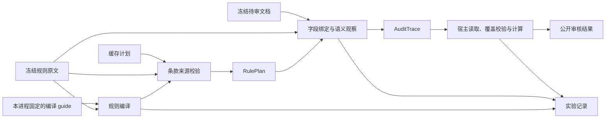

# Typed Evidence Hole：共享绑定与本地完整文档实验

研究问题：怎样提高现有测试的准确率，减少重试与 token，同时保持 Deep 的结构简单？

下文的 `output/` 链接指向本地实验记录；这些记录不随源码提交。提交内容包含实验工具、合成测试和结果说明。

本次 ontology 关系、对象粒度和解释修订的反例、真实模型结果及离线重放边界，见 [ontology 实验报告](ontology_experiment_report.md)。

当前设计方向：**复用一个 grok-build core，让模型解决共享证据绑定，让代码读取原件并计算结果。** Typed Evidence Hole 是尚未解决的有类型字段，不需要独立调度器、依赖图或另一套 agent 平台。



两阶段复用 grok-build、`grok-4.7 / medium`。编译请求直接包含固定 guide、完整有效规则快照和冻结条款；修复同时收到被拒计划及反馈，复核使用完整来源，不能把候选定位中的序号或片段当成规则正文。审核及其修复直接收到同一冻结条款原文，供应商文档按需读取。输入送达不证明模型理解正确；自然语言条件仍需用原文和能区分不同解释的反例复核。记录保留编译、绑定与最终结果各自的错误，避免汇总状态掩盖中间错误。

编译语义由 `rule-plan.md` 单独拥有，阶段提示只提供输入输出、冻结身份和安全约束。RulePlan 只保留条款身份与来源、程序、审核粒度和空范围政策；不生成重复原文的 description、scope、semantic question、ambiguities 或计划 priority。统一程序保留可重放的谓词、量词、关系和局部语义判断。产品优先级和规则正文仍来自冻结规则，实际字段、范围及未知在 AuditTrace 中解释。

本进程固定实际加载的 guide；实验副本和版本指纹使用同一内容，运行中修改磁盘文案不会改变本进程的编译、修复或复核。旧字段的缓存按现有严格 schema 拒绝后重编译；历史实验不改写，用各自冻结代码重放。当前模型提交 bindings、uses 和 answers，由宿主统一求值；旧版 QueryProof 不再属于当前执行接口。

删除重复解释的验证分别保留在 [原始规则编译](output/plan-authority-01/review.json)、[合成范围反例](output/plan-authority-probe-01/review.json) 和 [完整原件复核](output/semantic-v2-doc12-10/review.json)。编译成功不代表语义正确；覆盖全部网格行也不证明这些行都是实际记录。完整原件的公式与填写指南已经送入模型，尾部预留格的适用性仍被过度断言。当前证据支持删除重复权威，不支持通用准确率或整轮 token 收益结论。

## 通用产品路径实验

`corpus_experiment.py` 直接调用产品的 `semantic.guest.execute`，复用原件快照、任意规则编译、trace 派生、来源与覆盖校验及一次有限修复。`LocalGrokRunner` 只替换模型运行边界，固定 `grok-4.7 / medium`，共用累计 Gateway 预算；本地 Seatbelt 允许读取冻结输入、在本阶段临时目录构造结果。模型看不到人工期望与评分报告。

本地与生产共用 `guest_model.GROK_TOOL_ALIASES` 的 CLI 名称，保留读取、终端、直接写文件和后台任务收尾。core 仍自动提供工具查找和调用入口；此配置只减少默认工具上下文，不充当授权边界。真实 CLI 的脚本 provider 已验证文件、图片和后台操作，见 [能力探针](output/grok-tool-context-01/capability-report.json)；schema 字节减少不证明整轮 token 或准确率收益。本地临时文件统一使用阶段 cwd／`TMPDIR`，编译和审核的 `working-state.json` 均为可写副本，其余输入与 helpers 仍只读，见 [路径验证](output/path-interface-probe-01/summary.json)。局部字段检查使用 Python 模块入口；生产运行器保留上层运行环境已设置的 Python 包路径。[干净安装验证](output/python-tool-env-01/summary.json)证明该入口不依赖仓库 cwd 或 editable 安装，但不替代 Linux 部署验收。

按产品负责人的最新要求，本阶段先做开放探索，容量边界留到后续集中分析。通用研究入口的默认预算为每个执行单元 2 小时、256 次请求、1000 万输入和 200 万输出 tokens；单次请求允许最多 262,144 输出 tokens，完整产物允许 64 MiB。这些是研究配置，不是模型服务端能力声明，也不改变生产默认预算。每次执行继续保存真实请求、消费和终止原因。

入口使用 canonical loader：完整 V2 为 **164 文件／840 条**；V3 为 **8 组／27 文件／220 条**。即使只选择一个文件，报告仍保留未执行项与完整分母。V2 按现有测试逐文件执行；V3 保留同组完整文件，不自动加入兄弟目录。当前研究入口在同一运行内复用 source-only 规则程序。正式产品还按租户和引擎版本隔离，程序键不再包含供应商文档组；文档快照、绑定及局部答案仍随执行版本变化。旧实验的受限计划复核结果只属于其冻结版本，不能直接迁入当前缓存。

规则通常来自原始 DOCX。编号条款正文与编译快照共用 Deep 的 `active_text` 读取方式，排除直接删除及删除线内容；原件字节不变，并在来源中记录 `text_view=deep_active_text`。这避免 V3 三处直接删除线在规则列表和编译快照中产生两种正文。5 份 DPVR 试验报告的六条规则没有对应 DOCX，明确采用 canonical CSV 的 `rule_desc` 正文生成有效规则源，并核对五例正文一致；人工状态和意见不进入输入。不能把它们误套到七条 DVP&R 计划规则，也不能宣称这五例的规则来自 DOCX。

当前运行结构由 [规则编译 guide](../../src/agent/semantic/skill/references/rule-plan.md) 和 [执行产物合同](../../src/agent/semantic/skill/references/execution-trace.md) 定义。模型提交物理 bindings、规则用途 uses 和局部问题 answers；同一个宿主 evaluator 展开完整声明范围，计算条件、关系、计数和报告。`unresolved_scopes` 保存尚未绑定的范围及原因，未定位与确认缺失分开。模型不抄录逐行判定；语义判断所需的原文片段仍须实际检查。跨文件范围必须来自本次授权冻结文档。宿主能证明重放一致，不能独立证明编译和绑定符合业务原意。

完整结果写入 `execution.json`，core 只返回小型完成回执。本地终端使用系统 `/bin/bash`，通过临时 `BASH_ENV` 恢复 uv Python 路径。DOCX 嵌套表保留独立物理位置及父单元格关系；数组公式保留原文和属性，缺少缓存值仍为未知。这些行为由读取器和运行器测试拥有，不以单个实验成功替代产品验收。

**通用 V2/V3 验证尚未完成，最终状态匹配也不证明审核完整。** 上海亚大设备清单曾出现最终状态匹配、但漏掉 47 行且引用错误列的结果；逐行覆盖与独立来源复核才暴露该错误。后续完整流程得到 116 条正确正文观察，但尾部记录归属仍未知，R1 因而保留 UNABLE。来源、候选、反例和评审分别保存在 [第二轮复核](output/semantic-v2-doc12-02/review.json)、[第五轮复核](output/semantic-v2-doc12-05/review.json) 和 [编译反例复核](output/compile-guide-doc12-01/review.json)。这些均不是人工 gold，不可直接作为训练标签。

早期确定性重放证明部分逐行条件可由共享绑定和当时的 QueryProgram 表达；当前由统一程序 evaluator 接管。旧重放数据保存在 `output/query-holes-doc12-replay-02` 与 `output/query-holes-cetus-replay-04`，只使用其冻结代码解释。它不证明模型绑定正确，也不直接证明 token 收益。实际成本比较必须使用相同原件、相同规则，并检查正文覆盖、未知项和失败请求成本。

按需读取仍可能因分块、重复展开和更多工具轮次增加总用量，不能从初始 prompt 的缩减推导成本收益。文件规则的每条冻结输入现包含 `source_locators`，使用现有 Locator 类型。DOCX 研究入口从原件正文提取这些位置，与读取器共享合并格及嵌套表的坐标含义，不把物理 XML 列号直接当成网格列号。计划定位必须属于本条允许的位置，并能解析出已知非空内容；正式产品的已发布 JSON 要求匹配本条 `published_clause`。编译、缓存、修复、受限复核及宿主结果重放共用这项检查。它防止引用序号或别条正文，但不证明计划保留了原文的完整判定含义。

流式响应失败的根因仍未定位。此前两次未知用量通过 [服务端对账一](output/provider-reconciliation-01.json) 和 [服务端对账二](output/provider-reconciliation-02.json) 补齐；对账不恢复丢失的模型结果。[第三次对账](output/provider-reconciliation-03.json) 仅确认末次请求的服务端读取失败，用量仍为空，不能作为零用量或完整总量。[第十一轮](output/semantic-v2-doc12-11/review.json)使用缩减后的工具配置，但审核因本地 `IncompleteRead` 未完成；[第四次对账](output/provider-reconciliation-04.json)补齐全部 13 次用量，且末次服务端记录为成功。两种故障不能混为同一原因，失败任务的完整消费也不能当作完成任务的成本收益。当前权限不能读取 Cloudflare 遥测日志，见 [查询结果](output/provider-telemetry-01.json)。Gateway 失败记录包含单调时钟耗时、接收分块间隔及写入失败标记；这些是本地读取观察，不等于供应商生成时间。失败请求不自动重放，原始本地报告保持不变。

每次实验的阶段、用量、源码副本、完整输入与结果以对应 `output` 目录为准；本地 helper 同时冻结 Deep 与 `documents`，源码副本保留 lock 和实际 Python/已安装库版本。README 只描述当前入口和证据边界，不重复维护逐轮状态。

```bash
# 默认只检查范围；加 --live 才会调用模型。输出目录必须不存在。
uv run --no-sync python packages/agent/prototypes/typed_evidence_holes/corpus_experiment.py \
  --corpus v2 --doc-key 12 --case '12-设备清单-上海亚大.xlsx' --output /private/new-run
```

## 统一求值试验及编译诊断

[Sirius 首轮程序试验](output/semantic-v3-program-pilot-01/report.json)从原始三份文件和三套规则执行全部 27 项，使用 Grok 1.0.70、grok-4.7／medium，本机运行 1,860.754 秒。80 次请求均有已知用量：输入 4,856,693、输出 137,917 tokens。其中新编译及一次编译修复占 8 次请求、74,690 输入、15,984 输出；审核占 72 次请求、4,782,003 输入、121,933 输出，无宿主审核修复。结果为 12 NG、5 PASS、10 UNABLE，与旧标签一致 15/27；不作为准确率。执行证书包含 6 个物理绑定、27 个用途和 773 个局部回答；宿主生成 4,250 项观察。观察数会按规则重复，不是独立样本数。

本轮失败揭示了编译接口的层级问题：程序含 215 个 column-presence 节点，却没有一个行值谓词。CP R4/R5/R6 等把“内容非空”编成“列存在”；PFMEA R6 又把 `{工序号} {工序名称}` 放在字面 join 分隔符中。另有字段绑定与行成员资格未完成。不能因重放正确、最终 NG 或没有审核修复，就认定规则已正确执行。

当前 schema 因而分开文件结构、当前行条件和行值／关系要求，运算分别命名为 collection_exists、column_exists、value_test。行条件不接受列存在性。键 separator 只接受字面分隔符，template 才可代入字段。文件级 Judge 的 fields 是搜索提示，不伪装成当前行值。编译修复只接收有限的 schema 路径和错误代码，不回传拒绝值。这些是通用接口修正，原试验代码与产物保持冻结；更改后的准确率和成本须由新运行证明。

[仅重编译三套原始规则](output/semantic-v3-program-compile-02/summary.json)进一步说明了类型边界的限制：13 次请求、254,024 输入、50,783 输出，含一次 PFD 编译修复；没有提供供应商文件。27 条程序仍有 54 个 Judge、零个 value_test，模型用局部问句代替了已支持的基本值运算。[CP R4 构造反例](output/semantic-v3-program-compile-02/source-counterexample-cp4.json)保留原条款、程序、构造输入、局部回答和结果：按原文的 AND／否则分支预期 NG，程序却把左项 false 作为不适用，得到 UNABLE。这是 agent 的来源复核，不是人工 gold。

规则编译与审核现共用 StageRunner 的文件产物路径。编译先写程序，再调用同一 schema／evaluator 检查小型构造记录；模型生成的检查与假设保存在阶段 working-state.json，并标为 model_notes_unverified、training_eligible=false。宿主仍验证实际产物及完成回执；构造检查本身不作为语义正确的证明。该流程复用现有运行器与求值器，不新增模型客户端、编译服务或测试语言。

[文件流程重编译](output/semantic-v3-program-compile-03/summary.json)已从相同三套原始规则完成全部 27 项：88 个 value_test、13 个 Judge、12 个 Related。三阶段分别保存 70、55、64 个模型生成的构造检查；这些检查的预期未获独立确认。[相同 CP R4 反例](output/semantic-v3-program-compile-03/source-counterexample-cp4.json)已由独立 agent 重放，从旧程序的 UNABLE 变为 NG，且不需局部答案；[CP R6 五例](output/semantic-v3-program-compile-03/source-counterexamples-cp6.json)又分别验证两种表头别名、已知空、不可读和确认缺列。这六例也保留 human_gold=false。编译用时 2,286.451 秒，88 次请求、4,999,257 输入、160,546 输出 tokens，0 次宿主编译修复；工具记录另有 6 次 Bash 非零退出，不能称整个流程零重试。编译增加了明显成本，后续审核复用的是本次实际产出的完整缓存计划，未重写程序内容或版本身份。

复用这三套缓存计划的两次 Sirius 完整审核均未生成最终报告。首轮第 33 次请求在响应读取阶段中断；[服务端读回](output/provider-reconciliation-05.json)补齐该笔计量，整次为 1,828,147 输入、33,103 输出 tokens。确认服务端终止后只重启一次；[第二次记录](output/semantic-v3-program-pilot-03-continuation-01/review.json)有 68 次已发请求、67 次已知计量，共 5,235,945 输入、84,569 输出 tokens，最后一笔为发送阶段 BrokenPipeError。CLI 的 403 由本地 gateway 错误路径返回，不能直接推断供应商认证失败。[有界只读核对](output/provider-reconciliation-06.json)未找到与最后一笔匹配的服务端记录；它不能证明零消耗，仍保留一笔未知。没有启动第三次付费尝试。两次都有 27 项执行失败覆盖，评分器中的 0 不能解释成 0/27 业务准确率。本次重编译与这两次审核的已知投入下限为 12,063,349 输入、278,218 输出 tokens；88 次编译及 101 次审核请求共 189 次，其中 188 次有计量。

当前读取接口已支持从 documents.json 按准确文档 ID、表、行列查看局部布局。另修正了每个单元格重复遍历全部合并区域的问题：[相同冻结原件离线回放](output/semantic-v3-merge-index-01/review.json)保留 CP 的 477×16、PFMEA 的 273×32 个单元格，值、状态和定位均与原读取语义一致；实际内部访问由 4,712,509／3,634,673 降为 42,981／71,071。上限不变，未删字段；宿主资源上限另明确为不可用模型结构修复的 RESOURCE_LIMIT。上述两次模型审核使用冻结旧读取器，因此这些本地改动尚无真实整轮准确率或 token 收益。相关 Deep、研究、打包和策略测试为 575 passed、1 xfailed；预期失败仍为已知 PDF 背景网格案例，不属于本轮 XLSX 样本。

与旧 Sirius 的直接比较存在条件差异：旧运行复用三套缓存计划，共 63 次请求、4,809,929 输入、104,686 输出，含一次审核修复；本轮重新编译三套计划。旧运行标签一致 20/27，21 NG、3 PASS、3 UNABLE；本轮一致数下降至 15/27，UNABLE 增到 10，当前指标没有改善。标签本身仍待核对，不能把一致率当作准确率，也不能用更严格的执行边界解释并合理化全部退步。编译解释、字段绑定和实际原文需要分别诊断。所有记录均未获人工 gold 确认，training_eligible=false。

`audit.engine/checkers` 继续提供规则知识、字段别名、布局实例、纯计算和回归反例。复用前核对有效条款及原始类型；不把删标点、子串相等、只选最佳单表、全局删除组标题或旧最终状态带入新判定内核。已有 measurement policy 纯函数复用可作参考，整套旧 agent 不作为 Deep 的后备判定路径。

## V3 跨文件完整流程实验（旧版本基线）

使用本机 Grok CLI **1.0.70**、`grok-build`、`grok-4.7 / medium`，从原始文件执行真实 guest，未使用 Docker。代码与运行环境指纹固定为 `17fc2281e7866ca1faf230a5394ec64a89be53fb80256affdb41577aa61d8493`；实验期间未修改执行器。每组预算为 2 小时、512 次请求、3200 万输入和 400 万输出 tokens。

范围为全部 8 个 V3 组的 23 个 PFD/PFMEA/CP 目标、203 条完整规则，保留原组上下文。重点检查 PFD R9、PFMEA R6/R7、CP R2/R3/R8/R9/R10/R11，共 67 项。其余 17 条 canonical 检查仍在原报告中保留为未执行。结果来自 [首次运行](output/semantic-v3-cross-full-01/report.json) 与 [未完成组续跑](output/semantic-v3-cross-full-continuation-01/report.json)，合并计算见 [完整复核](output/semantic-v3-cross-full-01/review.json)。成功组没有重复执行。

| 范围 | 标签一致 | 实际 PASS | 实际 NG | 实际 UNABLE |
| --- | ---: | ---: | ---: | ---: |
| 全部目标规则 | 136/203（67.00%） | 21 | 148 | 34 |
| 其中跨文件规则 | 43/67（64.18%） | 0 | 43 | 24 |

**这些数字是既有标签一致率，不是已确认的业务准确率。** 跨文件标签有 66 NG、1 PASS，全部输出 NG 也能达到 98.51%。唯一 PASS 是 Aries CP R3 的空特殊特性触发集合，模型按冻结空范围政策返回 UNABLE。跨文件的 24 项 UNABLE 分为 13 项 `rule_ambiguity`、7 项 `unresolved_relation`、4 项 `visual_only_evidence`。全部 203 条中，相对标签有 33 项 PASS→NG、0 项 NG→PASS；详细来源复核集中在 67 项跨文件检查，其他条款未作同等深度的业务裁定。

| 用量范围 | 已发请求 | 有计量请求 | 输入 tokens，含缓存 | 输出 tokens |
| --- | ---: | ---: | ---: | ---: |
| 八组完成结果，含编译与修复 | 327 | 327 | 22,327,443 | 666,448 |
| 外部进程中断的未完成尝试 | 22 | 21 | 992,997 | 27,161 |
| 基线已知投入下限 | 349 | 348 | 23,320,440 | 693,609 |

中断请求已由服务端读回确认终止，仍有一笔用量为 NULL；上述合计保留未知，不能当作完整费用或零额外消费。原记账与 [再次读回](output/semantic-v3-cross-full-01/interruption-usage-recheck.json) 分别保存。完成组之外只对中断组做了 1 次执行重启。

基线有 **3 次宿主审核修复、0 次编译修复、0 次计划复核**；CLI 自动重试配置为 0。三次审核修复共 32 次请求、878,430 输入及 18,220 输出 tokens，已包含在完成结果用量中。它们都由“未绑定范围中不允许 PASS 前置记录”触发。对 [Aries](output/semantic-v3-cross-full-01/unbound-guard-counterfactual.json)、[Cetus](output/semantic-v3-cross-full-01/unbound-guard-cetus-counterfactual.json)、[Sirius](output/semantic-v3-cross-full-01/unbound-guard-sirius-counterfactual.json) 的隔离回放，只放宽这项守卫后，原候选均通过来源、范围和记录校验，各 27 条状态与修复后相同；未知范围仍不能得到 PASS。这是离线反例，尚未应用到执行器，也不是新版本的实测节省。另记录了 388 次工具调用、8 次 Bash 非零退出；普通工具轮次不算宿主修复。

八组均通过冻结版本的 bundle 校验、报告重放和原件快照重读比对，共保留 75 项可选引用缺口。宿主校验确认声明来源、范围、记录与聚合，不独立证明字段含义、文件关联或自然语言规则正确；重读也使用同一文档读取器，不是读取器本身无误的证明。

本轮支持以下设计判断：

- 三份规则计划在各组版本相同，计划缓存得到实际复用；203 项最终 proof 全部为 semantic。全部可观察命令与模型写入脚本没有引用关系模块，共享绑定 CLI 调用也为 0。新增工具尚未进入 agent 的实际比较路径。
- [保存绑定的离线回放](output/semantic-v3-cross-full-01/saved-binding-relation-replay.json) 暴露行角色问题：Blanc CP 的工序标题被全局排除，原生流程覆盖有 30 个命中，使用保存的 Binding 只有 18 个命中及 2 项未知。工序身份与特性明细的适用性应局部判断。
- [数值表示反例](output/semantic-v3-cross-full-01/numeric-representation-counterfactual.json) 中，原始 XLS 的数值 `10.0` 使用 General 格式，XLSX 对应值为数值 `10`。Cetus 原组把 103 项全部判为未匹配；只统一数值表示后有 14 项命中。最终 NG 仍可能成立，逐行比较错误会被状态一致掩盖。
- [规则方向复核](output/semantic-v3-cross-full-01/rule-direction-review.json) 发现五组 PFMEA R7 标签理由使用了正文未明示的反向覆盖要求。[Gemini 来源复核](output/semantic-v3-cross-full-01/candidate-review-gemini.json) 确认原件 S9/AD9 都有“特殊特性”表头，既有理由却写未找到该列。标签保留原样，不能直接用于训练结论。
- 存在可复核的真实反例。例如 [Sirius](output/semantic-v3-cross-full-01/candidate-review-sirius.json) 的 PFMEA S52=SC，10 条原始拼接完全相同的 CP 候选行分类均已知为空；[原生比较回放](output/semantic-v3-cross-full-01/sirius-native-replay.json) 还按模型声明的政策重现了两项流程比较的 164 行及 CP R3 的 273 行观察。政策本身是否符合原文仍单独保留边界。
- Blanc 的扫描 CP 有 4 页、无原生文本或网格。实际请求包含 11 张不同图片，不能归因为没有视觉输入；已保存的查看证据不覆盖全部四页正文。一次 [格式探测抽查](output/semantic-v3-cross-full-01/format-probe-spotcheck.json) 实际只向模型返回 25 行、11,324 字节。程序读入完整快照、原始事件字节和累计输入 tokens，均不等于把全部数据打印给模型。

本轮没有同源、同范围的重构前完整模型对照，不能宣称已减少整轮 token。输入、动作、代码、原件摘要、执行记录、校验反馈和来源复核均保存在对应运行目录，保留 `human_gold=false`、`training_eligible=false`；尚未导出或用于训练。

### 补齐目录引用的配对输入对照

Blanc、Cetus 两组“特殊特性清单见原文件夹”的样本，按原目录引用分别补入现有的 1 份、2 份清单。代码和两份所需缓存计划逐字段不变，只审核这两组的 CP/PFD，合计 4 个目标、40 条完整规则、14 项跨文件检查，其中 6 项直接受补充资料影响。详见 [配对复核](output/semantic-v3-reference-context-01/review.json) 与 [原件值检查](output/semantic-v3-reference-context-01/source-review.json)。

6 项直接相关检查中，4 项 NG→NG，依据由缺文件改为清单项未体现在目标内容中；两项 CP R11 为 NG→UNABLE，因为清单齐全后，CP 特殊特性分类的实际触发集合为空。其余 8 项状态不变。新增文件能改变执行认识，无需重编译计划。Cetus 第二份清单的 `P0400905` 与 CP 的 `PO400905` 关联仍未独立裁定，不能将全部对应行当作已验证标签。

| 用量范围 | 已发请求 | 有计量请求 | 输入 tokens，含缓存 | 输出 tokens |
| --- | ---: | ---: | ---: | ---: |
| 补充输入对照，0 次宿主修复 | 53 | 53 | 3,574,578 | 138,322 |
| 本轮全部已知投入下限，含中断 | 402 | 401 | 26,895,018 | 831,931 |

两组均通过冻结版本重放与原件快照比对，无可选引用缺口，仍未调用关系模块或共享绑定 CLI。这 14 项是原样本的配对输入，不能加进原来 67 项的独立分母。新模型采样、目标数及资料量也有差异，不能把用量差异单独归因为架构收益。

[归档记录检查](output/semantic-v3-cross-full-01/recording-checks.json) 核对了全部 402 次请求均为 `grok-4.7 / medium`，并对当时 1742 个存档文件检查配置 provider key 的实际字节及已知私有推理块，均未命中。检查范围只包括这些记录项，训练资格仍为 false。

## Doc01 固定规则实验

```text
冻结规则及原件 → 宿主读取完整原件 → grok-build 返回共享 Binding
                                            ↓
                                  宿主取值、计算、保存结果
```

`full_document_experiment.py` 本地启动 `grok --agent grok-build`，固定请求模型 `grok-4.7`、reasoning=`medium`。本次 core 为 `grok 1.0.70 (f50904eaee6c)`。研究流程直接运行，不需要 Docker。

`bound_document.py` 的 Binding 只包含字段位置、记录集合、列映射和未解决项。模型不输出最终状态、计数或计算脚本。宿主从冻结原件重新取值，复用现有 Standard 的纯测量策略判断 R3/R5/R7。多条规则共享同一记录范围，不能因某行非数值而将它从源记录中删除。

这是冻结 Doc01 八条规则的显式实验；原始规则 SHA 必须匹配。它还不能执行任意用户规则，也没有迁入产品 Binding。产品执行链另已删除重复模型报告：模型生成 `AuditTrace`，代码派生原 `AuditReport`，外部结果格式保持不变。

`inspect_original.py` 读取 XLSX 的全部工作表、合并范围和图片关系；`inspect_pdf.py` 直接读取原始 PDF，保留逐页网格、原件 SHA、单元格 bbox 和页面 PNG，不读取 XLSX 同名文件。5 份 PDF 共 25 页已实际读取。页旋转、非零裁剪原点明确拒绝；图片和未重建网格仍可保持未知。

部分说明页的推断网格 bbox 超出页面边界；独立检查确认相关非空文字实际在可见页内。当前保存的是原始网格坐标，不能把它当作已裁剪的显示引用。

原生值的使用按每个有效源单元格判断：已知非空值可用于原生单元格检查，logo 或印章重叠不将该值自动变成未知。图片中的值、未知公式和未解决绑定仍是未知；同组其他已知样本不能掩盖图片样本。此策略不证明视觉无遮挡。单行数值组保留分隔边界，换行单元格保留现有测量策略的内部规整语义。

PDF 续页允许 `header_rows=[]`，表头行号只属于当前页。表头与数据重叠、地址越界、不同记录重复使用同一测量来源仍被拒绝。物理行完整不等于逻辑分组正确；共享绑定也会共享错误。

## 已执行结果：2026-10-28

人工期望来自现有 canonical CSV：`assets/全量测试 - 4.8文件测试反馈（云端） - 4.8（云端）.csv`。`score_corpus.py` 复用 canonical loader、严格比较器和现有报告格式，不使用 baseline exception。

| 范围 | 严格匹配 | 假 PASS | 假 NG | UNABLE |
| --- | ---: | ---: | ---: | ---: |
| 全部 Doc01 XLSX：5 文件 | **40/40** | 0 | 0 | 0 |
| 全部 Doc01 PDF：5 文件 | **38/40** | 0 | 0 | 2 |
| 全部 Doc01：10 文件 | **78/80，97.5%** | 0 | 0 | 2 |

最终派生结果在 `output/native-replay-03/`，严格评分在 `output/doc01-native-final-03.json`。因为仍有两项不匹配，评分命令正确返回非零；不能称为全部通过。

两项未解决：

- 亚大 PDF R8：推断网格将供应商值与责任人期望区合并；模型的责任人 absent 声明与合并源值冲突。宿主保留 UNABLE，没有将供应商名称当成责任人。
- 继峰遮挡 PDF R3：模型保留了源记录范围未解决，涉及未覆盖网格及附带模板的区分。其他明确违规仍可独立 NG。

本次全量执行覆盖 Doc01 的全部 80 条，但不是全 V2/V3。完整 V2 有 164 文件、840 条；V3 有 8 组、27 文件、220 条。其他文档规则、关联文件和扫描件尚未在本入口完成。所有已观察样本都是开发数据，不能当作独立泛化测试集。

### 同三份 XLSX 的成本对照

继峰、亚大、继峰错误原件字节不变，模型配置均为 `grok-4.7` / `medium`。

| 项目 | 旧流程：模型绑定、写脚本及结果 | 当前共享绑定及宿主重放 |
| --- | ---: | ---: |
| 人工期望匹配 | 21/24 | **24/24** |
| 模型请求，含辅助请求 | 54 | **7** |
| 输入 tokens，含缓存 | 2,373,442 | **63,013** |
| 输出 tokens | 112,504 | **28,786** |

旧结果的错误为亚大 R3 假 PASS、R7 假 NG，以及继峰 R3 UNABLE。当前按既有业务策略计算，原候选没有被覆盖。输入包含缓存命中，因此 token 降幅不能直接视为费用降幅；这也不是随机化或重复运行的性能实验。

### 本次全部尝试

| 执行组 | 模型请求 | 输入 tokens | 输出 tokens |
| --- | ---: | ---: | ---: |
| 5 份 XLSX 首次运行 | 11 | 118,999 | 49,941 |
| 5 份 PDF 首次运行，含 2 次结构失败 | 11 | 164,387 | 42,198 |
| 2 份 PDF 各一次修复 | 5 | 181,694 | 21,782 |
| **合计** | **27** | **465,080** | **113,921** |

两次结构失败来自强制非空的续页表头字段。修正合同后，使用原候选和明确校验反馈各修复一次。没有无限修复、未知消费重放或失败后换模型。所有请求用量已结算。

首轮 XLSX 为 35/40；原生值与图片策略修正后，以同一模型绑定离线重放得到 40/40。PDF 单元格内的数值组与换行处理也通过宿主重放验证。`native-replay-01/02/03` 保留各次派生结果；这些重放共新增 **0 次模型请求**。

## 证据与训练记录

每例保存原件副本、完整读取快照、提示、schema、运行器与判定器源码、脱敏请求、可观察动作、图片字节、模型绑定、计算结果、用量和失败。运行原件和规则均核对 SHA。`replay_bindings.py` 重新读取原件并比较冻结的源观察；只有已完成且用量已结算的运行可重放。每份新结果记录原结果、快照及判定器指纹，不覆盖原结果。

Gateway 将真实凭据留在父进程，CLI 只用短期令牌。macOS Seatbelt 先验证原件可读、范围外探针不可读。未保留原始 core 会话、私有推理块或 provider key。此前原件批次 731 个已保存文件的 key 扫描无命中；V3 批次检查见上方记录。该本地研究不证明产品部署隔离或完整客户路径。

已有人工业务标签；独立人工字段绑定 gold 仍为 **0**。继峰、亚大、巨一有独立 agent 的原件复核，均明确 `human_gold=false`。继峰若干记录只有序号合并，而检查项目独立；即使八条状态正确，也不能将这些分组当成金标。所有产物保持 `semantic_binding=unverified`、`record_coverage=model_declared|unresolved`、`training_eligible=false`。

现有策略和人工期望也不是物理真值证明。巨一 XLSX 的正下偏差解析、几何公差跳过及可疑测量字符串已在独立复核中记录。例如 `D214=平面度0.05`、`J214=0.0987` 与当前 R3 PASS 存在张力。不能把状态匹配直接训练成正确公差推理；本轮未改人工 CSV 或既有 Standard 策略。

未来标注应分别确认字段含义、完整记录范围、分组、缺失原因及业务结论。按原始来源和模板族分割数据；同一文档的 PDF/XLSX、错误版本、遮挡版本和坐标平移不能跨训练与测试集合。本轮数据只保存在本地，尚未导出或用于训练。

## 运行与验证

先安装 workspace 依赖。每次输出目录必须不存在；以下 `--live` 会真实调用模型。

```bash
uv run --no-sync python packages/agent/prototypes/typed_evidence_holes/full_document_experiment.py \
  --live --settings-root /path/to/configured-repo --assets-root . \
  --output /private/new-full-run
```

默认运行 5 XLSX + 5 PDF。每例最多 8 次请求、20 分钟、30 万输入和 4 万输出 tokens，无 SDK 自动重试。只有用量已结算的首次结构拒绝可显式使用 `--repair-from PREVIOUS_RUN --case CASE`，且只允许修复一次。

```bash
uv run --no-sync python packages/agent/prototypes/typed_evidence_holes/replay_bindings.py \
  /path/to/completed-case --output /private/new-replay

uv run --no-sync python packages/agent/prototypes/typed_evidence_holes/score_corpus.py \
  --corpus v2 --doc-key 1 --output /private/new-score.json \
  /path/to/replay/*/execution.json

uv run --no-sync pytest packages/agent/prototypes/typed_evidence_holes/test_*.py -q
```

Deep 与本目录研究测试覆盖未知值、原生/图片混合、合并引用、数值组、续页、条款来源归属、显式修复、评分分母、跨文件 semantic scope 和实际 Gateway 的断流分类。Deep 还在独立 wheel 环境验证，防止依赖只在开发环境可用。这些检查验证运行合同，不替代全 V2/V3 的真实模型准确率或部署验证。

## 历史实验

旧原件完整执行及启动失败记录仍在 `output/full-grok47-medium-*`；包括历史失败，共 91 次已确认请求、3,429,143 输入及 176,760 输出 tokens，与本次 27 次分开记账。旧三份完成产物用于上表的同源对照。

最初局部对比使用 `grok-4.6` / `low`，共 24 次请求；`hole_experiment.py`、`probe_column_type.py`、`evaluate_rows.py` 和 `demo.html` 保留可运行入口。历史局部参考来自 agent 检查，不是独立人工准确率。原有详细分析及旧合同由 Git history 保留；当前入口已删除无消费者的 `full_document_contract.py`，旧运行中保存的合同副本不受影响。
