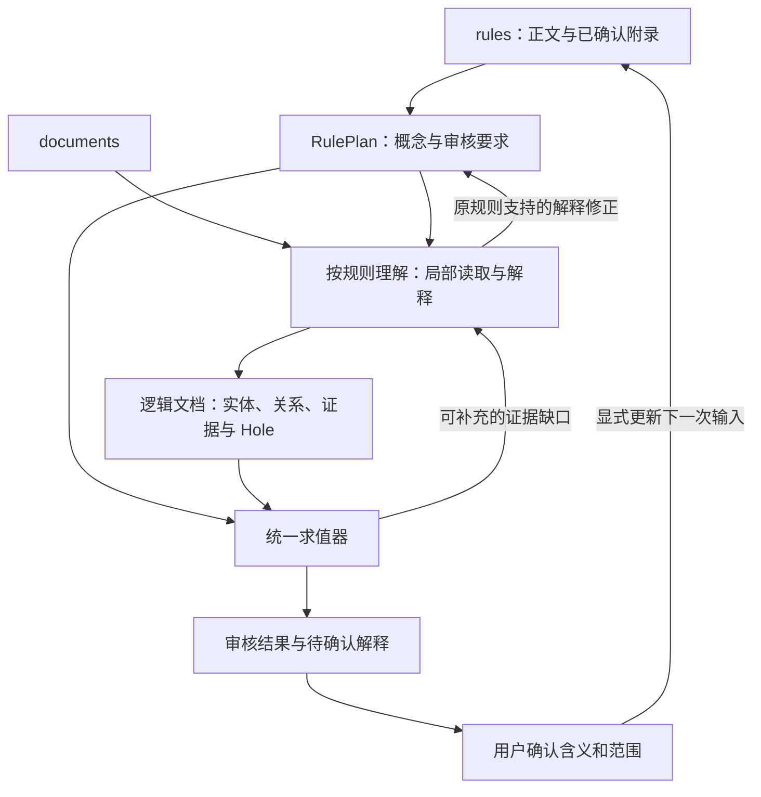

# Deep：规则约束下的文档理解与反馈

这是目标设计与现有实现的调整说明，不表示这些能力已经实现。当前行为以源码和测试为准，实施验收由 [#223](https://github.com/ppap-agent/ppap/issues/223) 拥有。本文只设计审核核心；产品架构、交互与部署边界可以重构，输入明确、对象授权和结果真实等原则仍须成立。

产品架构、用户旅程、界面与 MCP Elicitation 适配由 [PRODUCT.md](PRODUCT.md) 定义。二者使用同一个 Hole 和附录合同：本文拥有其审核含义，产品层拥有呈现、确认和输入更新。

## 1. 唯一业务输入：rules + documents

```text
audit(rules, documents) -> 审核结果 + 待确认解释

rules = 规则正文 + 已确认附录 + 明确的规则适用对象信息
documents = 本次提供的文件内容及输入内的文件引用
```

规则附录属于 rules，不是第三个隐式输入。核心不读取用户历史、人工复核表、全局别名字典或上一次结论来补充业务依据。复用的确认必须显式包含在本次 rules 中；附录引用的对象必须能在当前输入中明确定位。

逻辑文档是执行中的中间产物，不是用户需要预先提供的输入。文件在核心中用本次输入引用标识；产品文件版本和审核轮次不进入领域概念模型。技术层继续承担来源校验与运行记录。这里的“纯输入”指业务依据闭合，不承诺外部模型输出逐位确定。

一次执行期间，用户的新确认可以提前收集，但不能悄悄改变正在求值的输入。确认进入 rules 后进行新的计算；应用可以沿用仍适用的中间计算结果，不需要让旧 agent 会话长时间等待用户。

MCP 是产品入口适配器。核心不接收协议 capability、会话或 requestState 作为业务依据，也不直接调用 Elicitation；它将 Hole 与候选交给产品层。用户确认由 Web 或 MCP 的同一业务入口处理，已确认附录再作为 rules 进入核心。

## 2. 四个概念，各有一个位置

| 概念 | 含义 | 所在位置 |
|---|---|---|
| 规则附录 | 用户已确认的术语解释、关系解释、限定范围的文档映射或明确的标准修改 | rules 的一部分 |
| Ontology | 本次规则需要的实体类型、属性、关系、对象粒度和身份依据；含有语境的别名 | RulePlan 中的概念定义 |
| RulePlan | 在这些概念上表达的适用条件、方向、量词和审核要求，关联完整规则及附录依据 | 编译中间产物 |
| 逻辑文档 | documents 在上述概念下表达的实体实例、属性、关系、原文依据和未解缺口 | 本次执行的解释结果 |

Ontology 不需要独立服务或数据库。规则附录是确认内容的输入载体；ontology 是其与正文共同编译出的概念表示，两者不能成为互相竞争的知识来源。报告和待确认列表由本次执行产生，不另建状态台账。

## 3. 一个理解与求值循环



先从 rules 提出必要概念和审核义务，再与 documents 中的观察建立对应。详细读取、PDF 分格、逻辑记录分组和图文关系都受这些需求指导。物理读取器提供位置、值、图像等观察；它的文字分组或表格重建只是可修正的结构解释。

理解过程可以往返。文档证据可以澄清对象如何表达、揭示编译误解或反驳某个候选映射。若原规则足以支持修正，则回到原文修正解释并重算受影响要求；若仍有多个合理含义，或需要改变业务标准，则产生待确认问题。不能根据期望结论选择最容易通过的解释。

执行层当前选择 Grok-build 和 StageRunner 完成编译、阅读及局部解释，一个宿主求值器拥有计算、覆盖统计和结果。执行器可以替换，业务含义仍由同一规则与证据合同确定；上述概念不要求各自成为 agent 或服务。

## 4. Ontology：由问题提出，由证据检验

通用机制只提供表达实体、属性、关系及证据的能力。具体需要工序、审批区域、箭头还是附件，由本次规则提出；只建立审核所需的概念。

- 实体类型说明对象是什么、按什么粒度计数、依据什么确定身份。文件本身也可以是实体；它既可被审核，也可提供其他对象的证据。
- 属性说明值的含义与必要的类型、单位或上下文。默认保留源值，不能自动删标点、换单位或把编号当数值。
- 关系说明端点类型、方向及含义。域内“属于”“指向”“描述”与审核中的“必须存在”“必须一一对应”分开：后者是待检验义务，不能作为实例进入模型的门槛。
- 实体类型和关系可有别名，但别名带适用语境与依据。“操作步骤”可在确认语境下表示“工序”；“特性所属工序”和“工序包含特性”的表达方向不同。类型同义不证明两个实例是同一个对象，反向关系表达也不自动新增反向审核义务。
- 相同名称可以有不同含义。多个规则只有在定义相容时才共用概念，不能按字符串名称强制合并。

当前最小执行合同把“关系含义”和“匹配方式”分开。规则表达式通过 `relationship_id` 引用具体关系；`same_instance` 表示同一业务实例，`association` 表示一般关联。前者使用实体声明的有序身份分量，不允许额外比较字段或字符串拼接替代实例身份；后者可以使用外键或规则明确要求的字面投影。身份分量不完整时保留未知。具体编码跨不同身份表示的对应若无法验证，也保留能力缺口，不凭拼接后的字符串相等建立同一实例。

对象在某个文件中的出现位置与业务身份分开：两份文件的两行可以描述同一工序；两行不同并不证明是一般关联。若规则只要求按编号匹配，而未说明是否是同一业务对象，不能仅凭关系类型不同判定业务审核错误；这时需要解释依据，必要时询问用户。

原件为解释提供支持或反证。“文件接受 ontology”表示能够建立可核查的概念对应，不表示文件符合规则。如果已识别工序缺少必需控制措施，这个工序仍须保留，供求值器发现违规。

从旧 checkers 参考的是这些认知步骤：识别对象、确定粒度、建立对应、寻找证据、判断要求。其固定字段、别名、字符串匹配和通过条件都不自动成为新规则的依据。新规则不能依赖先增加一个对应的专用 checker 才能进入解释过程；现有能力不能完成的部分须明确保留缺口。

## 5. 逻辑文档：有出处的实体与关系

逻辑文档是一份按需形成的执行表示，可以覆盖多份输入文件；不要求与物理文件一一对应，也不完整复制所有原始数据。

最小内容包括：实体实例及其概念、属性值与状态、关系端点与依据、来源位置、已检查范围和尚未确定的 Hole。事实是否已知、证据是否已覆盖、业务是否合格分别表达，不用单个置信度代替这些区别。

一个业务对象可以跨行、跨区域；一个物理行也可以承载工序、特性等多个对象。输入文件成为可引用的文件实体；文件内部的区域或图形仅在规则需要时进入模型。

显式对象分组携带公开的 `basis` 和原件位置 `evidence`。来源须可读并覆盖每个成员行；只有表头、缺少依据或来源尚未读清时，对象成员资格保持未知。显式字段位置可以将一行划分成多个对象，但不能丢掉未分配给其他对象的成员原始观察。相同值的不同来源仍保留；多个身份值冲突时，不能把组合冒充一个已识别对象。位置有效只证明依据可以核查，不证明分组含义正确。

表格列映射表示同一字段沿数据行重复；表头表单可以直接用对象属性的位置绑定，不需要占位空列。例如名称在 B2、编号在 B3，二者属于同一表单。纯位置绑定仍须为每个成员行提供实际属性来源，分组标签本身不能代替属性来源。未确定的映射可以由明确位置补足；已读取的冲突值不能因此被删除。字段存在、字段值已知、字段值非空分别求值，避免把空值误判为字段不存在。

跨文件认定“同一工序”后，仍保留各文件中的对象表达、属性取值和来源。不能合并成一个值而抹掉冲突，也不能去重后隐藏重复对象。关系实例可以来自原生结构或有依据的语义推断；推断要保留理由和不确定性。

原生值由读取工具提取；模型负责位置、角色与语义解释。图像或其他无法直接读取的事实需要显式的证据解释，不能伪装成原生单元格值。来源校验只能证明位置有效，不能证明语义解释正确。

布局探测使用少量有代表性的区域；确定布局后，程序读取规则需要的完整对象范围。尚未读取不等于不存在；完整覆盖后的缺失与尚未定位分开。PASS、NG、UNABLE/NA 继续由规则及证据决定，技术失败另行表达。局部独立违规可以支持 NG；其他未解缺口仍保留，不因已有结论而消失。

文档证据驱动的局部修订使用 `AuditTrace.plan_refinements`。每个修订引用基础计划摘要、受影响的原规则出处和当前文档证据，并给出公开的解释理由。宿主只允许澄清粒度说明、增强身份分量和相应的同实例关系键；原条款、量词、比较、方向、适用条件、匹配政策和附录均保持不变。正在比较的属性及与其共享原件来源的别名不能追加为身份，以免把违规对象从候选中筛掉。实际来源校验复用已读取观察，并将合并单元格与 DOCX 引用规范到原锚点；来源未知时不能宣称身份依据独立。需要改变这些业务义务或仍有合理歧义时，使用既有澄清与规则附录流程。

有效计划由同一个求值器从基础计划和当前执行修订派生。基础计划仍是纯规则编译产物；文档限定修订、绑定与旧答案不会进入通用规则计划缓存。修订后的完整概念和程序参与当前问题身份，旧回答须重新验证适用性。

## 6. Typed Evidence Hole 与人工反馈

Hole 统一表达规则解释、对象范围、属性、关系或局部判断的缺口。每个 Hole 关联受影响的要求、预期回答类型、已有证据、候选解释和未解决原因。根据原因，系统选择局部补读、重新解释或询问用户；它是执行数据，不是另一套任务调度系统。

例如规则要求“红色箭头指向的部件，必须在附件中声明材料”。所需概念包括箭头、部件、附件、材料声明，以及指向和描述关系。箭头无法辨认、部件身份不明、附件关联不明分别形成缺口；确认关联后发现材料声明缺失，才是相应业务违规。读取器不支持颜色，是能力缺口，不能自动解释成规则需要放宽。

默认完成能执行的部分，在结果中附上待确认解释。影响大量后续判断的关键歧义可提前呈现；无关部分继续执行。共享同一语义问题的 Hole 合并提问，用户不逐格回答，也不编辑 ontology。

一条用户可见问题应提供：原文与相关区域、少量候选及其依据、受影响的规则或对象、可选择的确认范围，并允许用户纠正所有候选。提交给用户澄清的候选，在确认前不作为已确定解释；系统仍可自行完成有充分依据的普通语义解释。假设采用某候选得到的结果只能作为明确标注的影响说明。

附录保留自然语言确认，同时有最小结构：适用条款、确认内容、适用范围、确认依据和反馈性质。原文出处与用户补充来源分开，不把用户说明伪装成原文件文字。

| 反馈性质 | 例子 | 生效边界 |
|---|---|---|
| 含义澄清 | 在规定语境下，“操作步骤”表示“工序” | 仅在说明的语义范围复用 |
| 文档解释确认 | 本次控制计划中的几个区域共同描述一个工序 | 仅作用于明确指向的输入与区域，不自动推广到所有同名字段 |
| 标准修改 | 明确改变某条规则的适用条件或通过要求 | 明确指出修改哪条要求；不能包装成别名确认 |

系统将用户表达整理成可读的附录变更，并展示范围和含义供确认。草稿或候选留在输出，只有确认内容进入下次 rules。附录与正文有冲突时，必须明确哪条要求被修订，否则保持规则歧义；不采用“最后一句优先”。多个确认之间同样检查适用范围内的冲突。

人工复核某条结果与补充规则含义是两种不同动作。直接确认 PASS 不会自动产生别名或标准。附录进入输入后重新求值，不把上次结论或用户期望作为结果。用户可以一次明确选择“确认并继续分析”，同时保存与发起新计算；只选择保存时不启动新的付费执行。产品不需要把一个完整意图拆成多次重复批准。

## 7. 对现有实现的调整

以下是同一条执行路径的接口调整，不增加平行引擎。表格保留重构前基线，便于说明替换方向。

以下对照以重构前的 `3b4c66c9` 为基线。当前源码已采用最小逻辑对象和有来源的类型化请求，业务输入仍为明确的规则、附录和文档；可执行验证见整体架构与开发说明。

| 当前实现 | 调整方向 | 保留的能力 |
|---|---|---|
| `ppap_core.rules.normalize_rule_body` 重建白名单；`RuleItem` 无附录；`rule_sources.py` 只登记条款来源 | 在现有规则 body 中显式承载已确认附录，校验范围、冲突与来源。用户确认来源与原条款来源分别表达 | 原条款、适用对象及规则登记/发布入口 |
| `auditor.semantic_inputs` 将 body 打包；不读取 `case_context` 或 review | 把附录贯穿规则归一化、packet、编译上下文和来源校验。隐藏历史字段不能替代附录输入 | 现有输入组装与来源校验 |
| `models.RulePlan` 只有集合、字段和表达式 | 加入必要概念定义；表达式引用概念、属性和关系，保留正文/附录语境。编译错误与可表达的语义歧义分别处理 | 条件、量词、三值逻辑、显式空范围政策 |
| `guest.execute` 先生成全部文档快照，之后编译规则；`prepare_audit` 只派生字段需求 | 先编译初步概念和要求；保留轻量文档索引，让证据需求驱动详细读取、解释与补读。需求清单继续是派生视图 | Grok-build、StageRunner、现有执行预算和运行记录 |
| `document_tools` / `pdf_tables` 先固定表格；`Binding` 将每个物理行当记录 | 将 Binding 保留为读取工具；本次执行产出逻辑对象、关系和来源，允许跨行对象及区域重新解释。求值不再直接以行号定义业务对象 | 原生读取、位置引用、原始类型与未知状态 |
| `trace.JudgmentNeed/Judgment` 只支持三类语义问题与布尔回答 | 将结构、属性、关系、规则解释和布尔缺口纳入同一个有类型的请求/回答接口；验证回答再更新逻辑文档。候选与已确认解释分开 | 问题与规则关联、理由、引用、已有布尔分支 |
| `trace.evaluate_audit` / `relation_tools` 直接消费物理记录并计算关系 | 改为消费逻辑实体及关系；计数与基数按业务对象。匹配算法在身份依据明确后使用；本次解释改变后重新验证旧回答的适用性 | 一个宿主求值器、覆盖检查、确定性算子、结果汇总 |
| `protocol.ResultBundle` 没有用户候选解释合同；`auditor` 只向产品投影 findings/coverage；现有 `save_review` 只保存人工复核 | 将可展示的未解 Hole、候选与来源贯穿执行输出和产品保存/读取边界，使用户稍后回来仍能确认同一问题。完整逻辑文档留在执行产物，产品按需读取其解释依据。共享应用操作将明确确认写入附录，并按用户意图仅保存或保存后重新分析；当前 DTO、页面和批准流程可以替换 | 单一业务事实、对象授权、人工记录与机器结果分开、明确输入与执行效果 |

关键替换是“物理记录是唯一求值对象”这一假设。只给 RulePlan 加一个 ontology 字段，或只把 compile 移到 snapshot 前面，都不能完成这个设计。需要让概念、逻辑对象、缺口和求值贯穿同一路径；迁移完成后移除被替代的语义路径，避免两套事实模型长期并行。

新增实体或关系名称本身不会自动增加推理能力。已有运算不能表达的要求，可在证据范围明确时交给局部语义判断；仍无法解释或验证时保留未知/能力缺口。不能通过动态标签声称已支持任意新规则。

## 8. 缓存、记录与验证

缓存是可选优化，不是业务输入来源。规则计划仅在正文、已确认附录及解释约定相容时复用；纯原生观测按实际读取参数复用。逻辑文档同时依赖规则含义与文档，不能只按文件复用；文档特定确认不能混入跨文档通用概念缓存。当前完整规则 packet 已参与摘要，附录进入 body 后应复用这一身份机制。

失败恢复也沿用现有执行产物存储：经验证的计划与未完成候选分别保存，候选只有在显式恢复最近的已确认尝试、完整输入与来源重新校验后才参与计算。恢复保留原截止时间与累计已知用量，未知消费不会触发新模型请求。分批语义回答区分当前需要、同上下文有效但已不再需要、真正失效；前两者可重放，后者拒绝。

沿用现有实验与运行记录，保存规则及附录输入、必要概念、逻辑对象与来源、Hole、候选、工具操作、用户确认、解释修正、重算结果和实际 token/重试用量。训练导出不包含隐藏推理过程或密钥。一个别名确认只提供该范围的语义监督，不自动标注全部审核结果；未经独立整理的实验记录仍保持 `training_eligible=false`、`human_gold=false`。

验证应覆盖下列行为，不能只复现旧 checker：

- 给出旧 checker 没有实现的规则，形成必要概念与可核查解释；超出能力时如实暴露缺口。
- 相同业务内容改用合并行、拆列或图文表达，仍可识别对象；有业务含义的差异不能被归一化抹掉。
- 文件作为实体参与关系；同一业务对象在两份文件中的冲突值、重复实例和关系方向被保留。
- “对象能解释但缺少必需关系”产生规则规定的违反；“对象尚未定位、读取不足或规则歧义”不能冒充已确认缺失。
- 未确认候选不改变结果。确认进入附录后可以改变对应解释和结果，且不影响范围外的文件；删除附录后不能偷偷继承历史确认。
- 实体类型别名不自动证明实例相同，关系别名不丢方向；正文或附录冲突保持待澄清。
- 确认与业务标准修改分别展示；规则修正、解释修正后旧问题答案不会被错误沿用。
- 模型自测与旧 checker 一致率不作为独立业务准确率。对规则含义、概念映射和最终结论分别复核，并报告样本分母、未知比例、交互次数、重试及 token 用量。

当前实现的局部依据见 `semantic/models.py`、`bindings.py`、`trace.py`、`guest.py`、`audit_tools.py`、`protocol.py` 及其直接测试。当前产品与执行实现见 [整体架构](../../docs/ARCHITECTURE.md)，目标交互与应用边界由 [PRODUCT.md](PRODUCT.md) 定义；现有实现不构成目标设计的上限。
